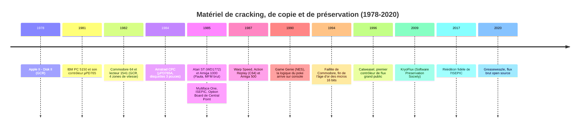
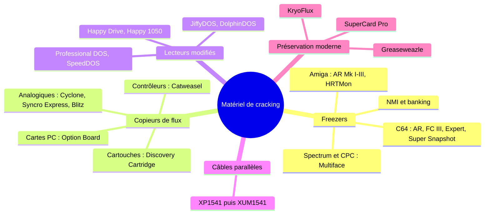
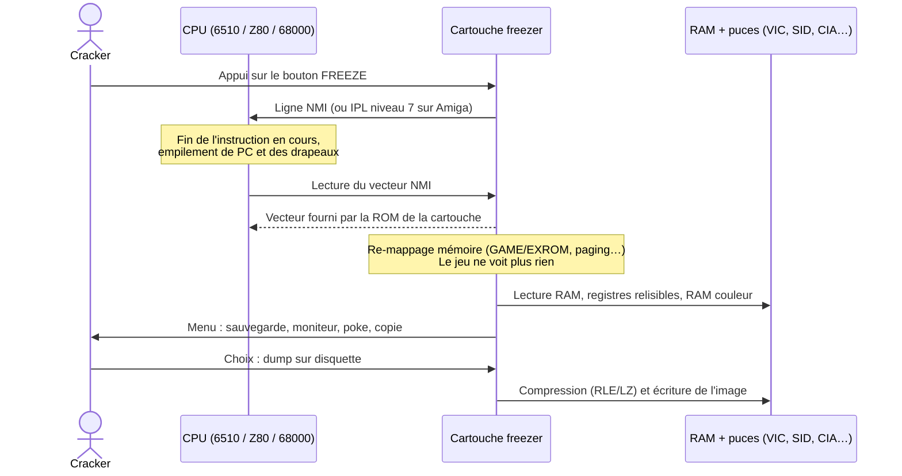
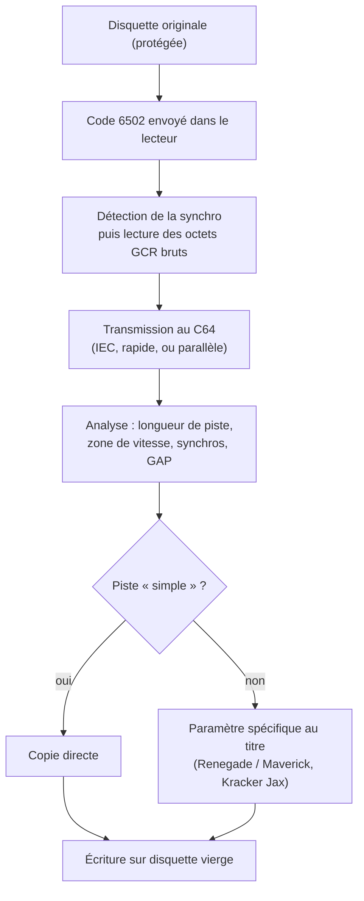
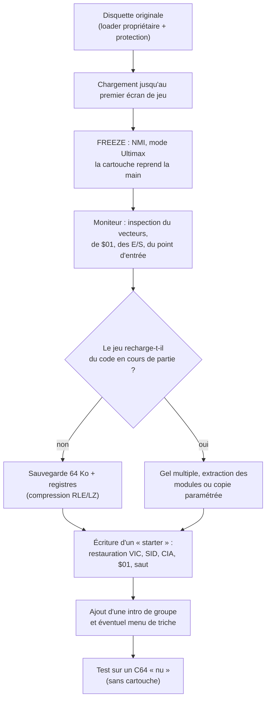
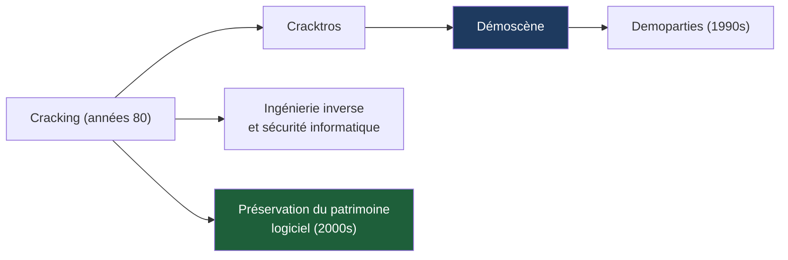

# 💾 Le Matériel de Cracking et de Copie sur Ordinateurs 8/16 bits (1980-1999)

### Rapport technique approfondi — Édition enrichie et illustrée

| | |
|---|---|
| **Périmètre** | Commodore 64/128, Amiga, Atari ST / 8 bits, ZX Spectrum, Amstrad CPC, Apple II, IBM PC (ISA), consoles (en périphérie) |
| **Axe** | Matériel : freezers, copieurs de flux, modifications de lecteurs, câbles parallèles, cartes de copie |
| **Ajouts de cette édition** | Fondamentaux physiques (MFM, GCR, FDC), mécanique détaillée des freezers (NMI, banking, registres non relisibles), anatomie des pistes, formats de préservation, études de cas, culture de la scène, errata |
| **Illustrations** | Diagrammes [Mermaid](https://mermaid.js.org) (GitHub, GitLab, Obsidian, Typora, VS Code…) et schémas ASCII (lisibles partout) |

**Légende des niveaux de confiance utilisés dans le texte**

| Marque | Signification |
|---|---|
| ✅ | Fait solidement établi (documentation officielle, datasheets, communauté de préservation) |
| ⚠️ | Information de seconde main ou contradictoire selon les sources : à vérifier avant citation |
| 🔧 | Correction apportée au document d'origine (détail en [Annexe C](#annexe-c--errata-et-points-à-vérifier)) |

---

## Sommaire

- [0. Vue d'ensemble : frise chronologique et cartographie](#0-vue-densemble--frise-chronologique-et-cartographie)
- [1. Introduction et Contexte Technique](#1-introduction-et-contexte-technique)
- [2. Fondamentaux techniques : supports, encodages et contrôleurs](#2-fondamentaux-techniques--supports-encodages-et-contrôleurs)
- [3. Les Cartouches et Cartes d'Extension « Freeze » (Gel de Mémoire)](#3-les-cartouches-et-cartes-dextension--freeze--gel-de-mémoire)
- [4. Les Copieurs de Disquettes Matériels (Hardware Disk Copiers)](#4-les-copieurs-de-disquettes-matériels-hardware-disk-copiers)
- [5. Techniques d'Ingénierie Inverse Matérielles Employées](#5-techniques-dingénierie-inverse-matérielles-employées)
- [6. Études de cas techniques](#6-études-de-cas-techniques)
- [7. Culture de la scène : du cracking à la démoscène](#7-culture-de-la-scène--du-cracking-à-la-démoscène)
- [8. Conclusion et Héritage](#8-conclusion-et-héritage)
- [9. Annexes](#9-annexes)
  - [Annexe A — Tableau comparatif des principaux dispositifs](#annexe-a--tableau-comparatif-des-principaux-dispositifs)
  - [Annexe B — Glossaire étendu](#annexe-b--glossaire-étendu)
  - [Annexe C — Errata et points à vérifier](#annexe-c--errata-et-points-à-vérifier)
  - [Annexe D — Pour aller plus loin](#annexe-d--pour-aller-plus-loin)

---

## 0. Vue d'ensemble : frise chronologique et cartographie

### 0.1 Frise chronologique



### 0.2 Cartographie des familles d'outils



### 0.3 La boucle de la course aux armements

```mermaid
flowchart LR
    A["Éditeur : protection logicielle seule"] -->|"copieurs logiciels, DOS standard"| B["Copie triviale"]
    B --> C["Éditeur : anomalies physiques<br/>(secteurs, pistes, weak bits)"]
    C -->|"le FDC et l'OS ne savent plus lire"| D["Copieurs logiciels échouent"]
    D --> E["Scène : freezers et copieurs de flux"]
    E -->|"gel après déchiffrement<br/>ou copie au niveau flux"| F["Protection contournée"]
    F --> G["Éditeur : anti-debug, timings,<br/>chiffrement, dongles"]
    G --> E
    style E fill:#1e3a5f,color:#fff
    style C fill:#5f1e1e,color:#fff
```



---

## 1. Introduction et Contexte Technique
Durant l'âge d'or des ordinateurs 8 et 16 bits (Commodore 64, Amiga, Atari ST, ZX Spectrum, Amstrad CPC, Apple II, Atari 8-bit, IBM PC), les éditeurs de logiciels ont déployé des protections anti-copie sophistiquées. Celles-ci ne reposaient pas sur le chiffrement logiciel seul, mais exploitaient les limitations physiques des lecteurs de disquettes : formats de pistes non standards, secteurs décalés, « weak bits » (bits faibles ou aléatoires), trous d'index multiples, densités variables, pistes longues, double indexage et signatures magnétiques volontairement irrégulières.

Le système d'exploitation (comme le Kernal du C64, le DOS du 1541, le Workbench de l'Amiga, le GEM de l'Atari ST ou le BIOS/BDOS du PC IBM) ne pouvant pas lire ces formats, les copieurs logiciels standards échouaient. La réponse de la scène du cracking a été le développement d'outils **matériels (hardware)** spécialisés, capables d'interagir au niveau le plus bas avec le bus système et les contrôleurs de disquette (FDC : Floppy Disk Controller). Ces dispositifs se divisaient principalement en deux familles : les cartouches « freezer » (gel de mémoire) et les copieurs de disquettes matériels (analogiques ou à accès direct au flux).

Une troisième famille, souvent négligée, complète le tableau : les **modifications de firmware** des lecteurs (ajout de RAM tampon, remplacement de ROM), les **câbles parallèles** accélérateurs et, à l'extrême fin de la période, les **cartes de copie pour IBM PC** (option boards) capables de lire le flux brut au niveau de la tête de lecture.

Ces outils ont non seulement permis de contourner les protections, mais ont aussi accéléré le développement, le débogage et la préservation. Leur héritage se retrouve aujourd'hui dans les save states des émulateurs et les formats de préservation magnétique (IPF, KryoFlux streams, SCP, HFE, etc.).

**Note sur les noms et dates** : la documentation de l'époque (publicités, revues spécialisées comme *Zzap!64*, *Commodore User*, *Amiga Format*, *ST Format*, *Tilt*, *Joystick*) est parfois contradictoire. Les fiches ci-dessous s'en tiennent aux faits matériels généralement admis par la communauté de préservation.

### 1.1 Pourquoi ces protections fonctionnaient : l'écart d'abstraction

Un système d'exploitation présente la disquette comme une suite de **secteurs logiques** numérotés. Or, physiquement, une disquette est une suite de **transitions de flux magnétique** disposées sur des pistes concentriques. Entre les deux, plusieurs couches interprètent et filtrent l'information :

```text
 ┌─────────────────────────────────────────────┐
 │ Application / Jeu                           │  ← voit des fichiers ou des secteurs
 ├─────────────────────────────────────────────┤
 │ Système de fichiers (DOS, AmigaDOS, GEMDOS) │  ← voit des blocs logiques
 ├─────────────────────────────────────────────┤
 │ Pilote disque (trackdisk.device, INT 13h…)  │  ← voit des secteurs (piste/tête/n°)
 ├─────────────────────────────────────────────┤
 │ Contrôleur FDC (WD1772, µPD765, Paula…)     │  ← voit des octets + marques de synchro
 ├─────────────────────────────────────────────┤
 │ Électronique de lecture du lecteur          │  ← voit des impulsions de flux
 ├─────────────────────────────────────────────┤
 │ Tête magnétique + oxyde de la disquette     │  ← réalité physique
 └─────────────────────────────────────────────┘
        ▲ plus on descend, moins il y a de « filtres »
```

Une protection **vit dans les couches basses** (format de piste, temporisation, bits instables) et **teste sa présence depuis les couches hautes**. Un copieur logiciel standard, lui, ne voit que les couches hautes : il reproduit ce que le FDC consent à lui montrer, et perd tout le reste. Les outils matériels de ce rapport ont une seule ambition commune : **descendre d'un étage** (ou de plusieurs), soit pour *geler* le programme après qu'il a terminé son déchiffrement (freezers), soit pour *capturer* la piste telle que la tête la voit (copieurs de flux).

### 1.2 Deux stratégies fondamentalement différentes

| | **Stratégie « freezer »** (attaquer l'exécution) | **Stratégie « copieur de flux »** (attaquer le support) |
|---|---|---|
| Principe | Laisser la protection s'exécuter, puis figer l'état de la machine | Reproduire fidèlement la piste physique sur une autre disquette |
| Résultat | Un **programme modifié**, souvent à chargement unique, détaché de la disquette d'origine | Une **disquette clone** qui trompe la protection (qui ne voit pas la différence) |
| Qualité du résultat | Peut être plus rapide et plus compact que l'original | Au mieux identique à l'original, au pire dégradée (copies de copies) |
| Limite structurelle | Échoue si le jeu recharge du code protégé en cours de partie (multi-chargement) | Échoue si la protection dépend de propriétés non reproductibles à l'écriture (weak bits, trou laser) |
| Outils types | Multiface, Action Replay, Final Cartridge III, ISEPIC | Syncro Express, Blitz, Discovery Cartridge, Option Board, nibblers C64 |
| Aboutissement moderne | Save states d'émulateurs, WHDLoad | Images de flux (KryoFlux, SCP, HFE) et format IPF |

---


## 2. Fondamentaux techniques : supports, encodages et contrôleurs

> Cette section est le socle du rapport. Sans elle, les mots « weak bit », « piste longue » ou « NMI » restent des étiquettes ; avec elle, on comprend **pourquoi** chaque outil a existé.

### 2.1 Du flux magnétique au bit : FM, MFM et GCR

Une tête de lecture ne détecte pas des « 0 » et des « 1 », mais des **inversions de polarité magnétique** (transitions de flux). Les données sont encodées dans l'**intervalle de temps** entre deux transitions. Trois familles de codages dominent la période :

| Codage | Principe | Utilisé par |
|---|---|---|
| **FM** (Frequency Modulation) | Un bit d'horloge est inséré avant *chaque* bit de données (densité simple) | Anciens formats 8", Atari 8 bits (densité simple), zones « FM » des disquettes mixtes |
| **MFM** (Modified FM) | Le bit d'horloge n'est écrit **que si le bit précédent et le bit courant sont tous deux à 0** : densité double | IBM PC, Atari ST, Amstrad CPC, Spectrum +3, **Amiga** (variante à secteurs maison) |
| **GCR** (Group Coded Recording) | Les données sont découpées en groupes recodés par table (ex. 4 bits → 5 bits) afin de garantir un nombre maximal de zéros consécutifs | **Commodore 1541** (4→5), **Apple II** (5→3 puis 6→2) |

#### Exemple MFM : la marque de synchronisation « 4489 »

Un octet `$A1` encodé en MFM donne `$44A9`. La marque de synchro utilisée par l'Amiga, les PC et l'Atari ST est ce même octet **avec un bit d'horloge volontairement omis**, ce qu'une donnée normale ne peut jamais produire. Le contrôleur peut donc s'y verrouiller sans ambiguïté :

```text
Octet de données       :   1   0   1   0   0   0   0   1      ($A1)
Cellules MFM normales  :  01  00  01  00  10  10  10  01      = $44A9
Même octet, 1 horloge  :  01  00  01  00  10  00  10  01      = $4489  ← marque de synchro
manquante (cellule 5)                      ▲
                                  horloge supprimée
```

Ce détail est essentiel : **la synchro est un motif « interdit » que seul un format d'écriture spécial peut produire**. Les protections détournent exactement ce mécanisme (marques de synchro personnalisées, absentes ou multiples).

#### Le GCR 4→5 du Commodore 1541 ✅

Chaque groupe de 4 bits est remplacé par 5 bits, de façon qu'il n'y ait **jamais plus de deux zéros consécutifs** sur la piste (au-delà, le lecteur perdrait sa synchronisation interne). Une suite de 10 bits à 1 ou plus (≥ 40 bits à 1 en pratique) est donc, comme en MFM, **réservée à la synchro** :

| Nibble | GCR | | Nibble | GCR |
|:-:|:-:|---|:-:|:-:|
| `0` | `01010` | | `8` | `01001` |
| `1` | `01011` | | `9` | `11001` |
| `2` | `10010` | | `A` | `11010` |
| `3` | `10011` | | `B` | `11011` |
| `4` | `01110` | | `C` | `01101` |
| `5` | `01111` | | `D` | `11101` |
| `6` | `10110` | | `E` | `11110` |
| `7` | `10111` | | `F` | `10101` |

Quatre octets de données donnent donc cinq octets GCR. C'est pourquoi un en-tête de secteur de 8 octets occupe 10 octets sur la piste, et un bloc de données de 260 octets en occupe 325.

#### Le GCR de l'Apple II ✅

La Disk II utilise des « octets disque » dont le bit de poids fort vaut toujours 1, sans plus de deux zéros consécutifs. Il n'existe que **32 valeurs valides** pour le DOS 3.2 (13 secteurs/piste, codage 5-et-3) et **64 valeurs valides** pour le DOS 3.3 (16 secteurs/piste, codage 6-et-2, de `$96` à `$FF`). Les **octets d'auto-synchronisation** (self-sync bytes) sont des octets à 10 bits dont les deux zéros finaux resserrent l'alignement de la machine à états de la carte : un autre « motif réservé » détourné par les protections.

### 2.2 Géométrie et capacités comparées

Une disquette 3,5" ou 5,25" tourne à **300 tr/min** (une révolution = **200 ms**) ; seul le 5,25" haute densité du PC AT atteint 360 tr/min. En MFM double densité, le débit est de 250 kbit/s de données, soit 500 kbit/s de cellules : **une piste contient donc au plus ≈ 100 000 cellules = ≈ 12 500 octets MFM bruts**.

| Plateforme | Support | Codage | Pistes | Secteurs/piste | Taille secteur | Capacité formatée |
|---|---|---|:-:|:-:|:-:|---|
| Apple II (DOS 3.3) | 5,25" | GCR 6-et-2 | 35 | 16 | 256 | 143 360 o |
| Commodore 1541 | 5,25" | GCR 4→5, 4 zones | 35 (jusqu'à ≈ 40-42 hors-spécification) | 17 à 21 | 256 | 174 848 o (683 blocs) |
| Amstrad CPC (Data) | 3" | MFM | 40 | 9 | 512 | ≈ 180 Ko par face |
| Atari ST | 3,5" | MFM | 80 | 9 (10-11 en format « long ») | 512 | 737 280 o |
| **Amiga** | 3,5" | MFM (format maison) | 80 | **11** | 512 | **901 120 o** (880 Ko) |
| IBM PC | 5,25" DD | MFM | 40 | 9 | 512 | 368 640 o |

Observation : l'Amiga occupe 11 × 512 = 5 632 octets utiles par piste sur les ≈ 6 250 octets utiles théoriques (12 500 / 2). Il n'y a presque plus de marge, d'où un format maison quasi sans GAP inter-secteurs, dont l'extrême densité explique à la fois la capacité et la fragilité face aux copies analogiques.

#### Les quatre zones de vitesse du Commodore 1541 ✅

Les pistes extérieures étant plus longues, le 1541 y écrit **plus vite** (plus de bits sous la tête pour la même vitesse de rotation) afin de conserver une densité linéaire à peu près constante :

| Zone | Pistes | Secteurs/piste | Débit de cellules (≈) |
|:-:|:-:|:-:|---|
| 3 | 1–17 | 21 | 307 692 bit/s |
| 2 | 18–24 | 19 | 285 714 bit/s |
| 1 | 25–30 | 18 | 266 667 bit/s |
| 0 | 31–35 | 17 | 250 000 bit/s |

Le débit est choisi par **deux bits du port B du VIA#2** du lecteur (`$1C00`, bits 5-6). Or ce choix est contrôlé… par le logiciel qui tourne dans le lecteur lui-même. Une piste formatée avec une zone de vitesse « fausse » est un **outil de protection** classique, et un **piège pour les nibblers** qui supposent le mauvais débit.

### 2.3 Anatomie d'une piste

#### Piste C64 (1541)

```text
 ← sens de rotation ──────────────────────────────────────────────────────────→
 ┌────────┬────────────────────┬─────────┬────────┬────────────────────────┬────────────┐
 │ SYNC   │ EN-TÊTE            │ GAP 1   │ SYNC   │ BLOC DE DONNÉES        │ GAP inter- │
 │ ≥ 5×FF │ 10 oct. GCR        │ ≈ 9 oct │ ≥ 5×FF │ 325 oct. GCR           │ secteur    │
 │        │ (8 décodés)        │ ($55)   │        │ (260 décodés)          │ (variable) │
 └────────┴────────────────────┴─────────┴────────┴────────────────────────┴────────────┘
 En-tête décodé : $08 | somme de contrôle | secteur | piste | ID2 | ID1 | $0F | $0F
 Données décodées: $07 | 256 octets de données | somme de contrôle | $00 | $00
```

La **somme de contrôle** du 1541 est un simple XOR de tous les octets : contrairement au CRC des FDC MFM, elle est facile à recalculer, ce qui rend la **reconstitution** d'un secteur sur C64 bien plus aisée.

#### Piste MFM standard IBM / Atari ST / CPC

```text
 INDEX ─┐
        ▼
 ┌──────┬──────┬────────────────────────┬──────┬──────────────────────────────┬──────┐
 │ GAP4a│ GAP1 │ SECTEUR 1              │ GAP3 │ SECTEUR 2 … SECTEUR n        │GAP4b │
 │ 80×4E│ 50×4E│ ┌─────────┬──────────┐ │ 80×4E│                              │ ≈ 4E │
 │      │      │ │ ID FIELD│DATA FIELD│ │      │                              │      │
 └──────┴──────┴─┴─────────┴──────────┴─┴──────┴──────────────────────────────┴──────┘
 ID FIELD   : 12×00 | 3×A1* | FE | C | H | R | N | CRC16        (C=cylindre, H=tête, R=secteur, N=taille)
 DATA FIELD : 12×00 | 3×A1* | FB | 128·2^N octets | CRC16        (FB = données, F8 = « deleted data »)
             * A1 avec horloge manquante = marque de synchro $4489
 CRC16      : polynôme CCITT x^16 + x^12 + x^5 + 1
```

Chaque champ **déclare lui-même** ses propres coordonnées (C, H, R, N). Rien n'oblige donc un secteur à être numéroté « logiquement » : un secteur peut porter un numéro de piste mensonger, deux secteurs peuvent partager le même numéro, N peut valoir 6 (8 192 octets) ou 7 (16 384 octets), et le CRC peut être volontairement faux. Ce sont les briques de base des protections par format. 🔧

#### Piste Amiga (secteur « maison », 1 088 octets bruts)

```text
 ┌──────────┬───────────────┬──────────────────────┬────────────┬────────────┬──────────────┐
 │ 2×$AAAA  │ 2×$4489 sync  │ INFO (4 o. impairs/  │ ÉTIQUETTE  │ CHECKSUMS  │ DONNÉES      │
 │ (pré-    │               │ 4 o. pairs) :        │ 16 octets  │ en-tête +  │ 512 o. en    │
 │ ambule)  │               │ $FF, piste, secteur, │ (inutilisée│ données    │ 2×512 (impair│
 │          │               │ secteurs avant GAP   │ en pratique│            │ puis pair)   │
 └──────────┴───────────────┴──────────────────────┴────────────┴────────────┴──────────────┘
 Particularité : chaque longmot est « scindé » : tous les bits impairs puis tous les bits pairs,
 ce qui rend le décodage logiciel possible par simples masques `AND $55555555`
 (le Blitter peut le faire sans CPU).
```

Cette conception (DMA brut, synchro programmable, décodage par le CPU ou le Blitter) donne à l'Amiga **une liberté inouïe côté logiciel**, au point que beaucoup de protections n'ont **besoin d'aucun matériel spécial** pour exister : elles écrivent leur propre format avec le DMA Paula.

### 2.4 Les contrôleurs de disquette : qui encode, qui décode ?

| Plateforme | Contrôleur | Niveau d'accès « natif » | Conséquence pour les protections |
|---|---|---|---|
| **Apple II** | Carte Disk II : machine à états sur PROM, registre à décalage | Le CPU 6502 reçoit des *octets disque* et fait lui-même le décodage ; il pilote le stepper en phases | Contrôle quasi total : demi-pistes et quarts de piste, bits « fantômes », comptage de nibbles |
| **C64 / 1541** | CPU 6502 dédié (2 Ko RAM, 16 Ko ROM) + 2 × VIA 6522 ; **le décodage GCR est fait par le logiciel du lecteur** | **Du code 6502 peut être envoyé dans la RAM du lecteur** (commandes `M-W` « memory-write » puis `M-E` « memory-execute ») | Le lecteur est un **ordinateur à part entière** : protections côté lecteur, fast loaders, nibblers |
| **Amiga** | **Paula** (DMA disque) + CIA pour le moteur/stepper | Flux **MFM brut** en Chip RAM, synchro programmable (`DSKSYNC`), longueur de piste choisie (`DSKLEN`) | Format libre : pistes longues, synchro personnalisée, lecture de la piste « en vrac » |
| **Atari ST** | **WD1772** (Western Digital) + puce DMA | Commandes de type secteur, plus `Read Address`, `Read Track`, `Write Track` | Possibilités fines sur le format à l'écriture (formatage par `Write Track`), mais lecture brute limitée et peu fiable |
| **PC / CPC / Spectrum +3** | **NEC µPD765** / Intel 8272A (+ DMA sur PC) | Commandes `Read Data`, `Write Data`, `Format Track`, `Read ID`, `Read Track`… | `Format Track` permet de choisir (C,H,R,N) de chaque secteur : base de nombreuses protections « logicielles » |
| **Atari 8 bits** | Lecteurs intelligents (810, 1050) avec leur propre CPU et FDC (de la famille WD279x) ⚠️ | Protocole série SIO vers un lecteur autonome | « Secteurs défectueux » volontaires : la raison d'être des **Happy 1050** |

#### Registres du Paula utiles à retenir (Amiga) ✅

| Registre | Adresse | Rôle |
|---|---|---|
| `DSKPT` | `$DFF020` | Pointeur DMA vers le tampon Chip RAM |
| `DSKLEN` | `$DFF024` | Longueur (14 bits, en mots) + bits DMAEN/WRITE ; **doit être écrit deux fois** pour lancer le DMA (sécurité) |
| `DSKSYNC` | `$DFF07E` | Mot de synchronisation (par défaut `$4489`) |
| `ADKCON` | `$DFF09E` | Bits `WORDSYNC` (attendre le mot de synchro), `MFMPREC`, `PRECOMP`, `FAST` |
| `DSKBYTR` | `$DFF01A` | Lecture d'un octet brut (lecture « manuelle », sans DMA) |
| CIA-A / CIA-B | `$BFE001` / `$BFD100` | Lignes d'état du lecteur (prêt, piste 0, protégé) et commandes (moteur, STEP, DIR, SIDE, sélection) |

Avec 14 bits de longueur, un seul DMA transfère **au plus 16 383 mots (≈ 32 Ko)** : très largement de quoi lire, en une seule rotation, une piste « normale » (tampon usuel de l'ordre de 6 600 mots) ou une **piste longue** hors-norme, dans la limite de la tolérance de vitesse de rotation (de l'ordre de ±2 %) ⚠️.

### 2.5 Taxonomie des anomalies physiques exploitées

| Anomalie | Principe | Détectée par le logiciel via… | Réponse matérielle nécessaire |
|---|---|---|---|
| **Secteurs hors-norme** | Taille N, numéros dupliqués ou manquants, ID de piste mensonger | Lecture directe d'un ID inattendu | Copieur qui reproduit la structure exacte de la piste |
| **CRC volontairement faux** | Secteur dont le CRC ne correspond pas aux données | Code d'erreur du FDC (`INT 13h` : erreur 10h, bit CRC de `ST1`/`ST2` du µPD765) | Écriture d'une piste brute (un copieur normal « répare » le CRC) |
| **Pistes supplémentaires et demi-pistes** | Données en piste 40/41/82/83, ou entre deux pistes (C64, Apple II) | Pas du stepper au-delà de la plage normale | Copieur indépendant de la plage « officielle » |
| **Piste longue** | Piste écrite avec plus de ≈ 100 % de données : la tête écrit « en trop » et « mord » sur le début | Mesure du temps d'une révolution ou lecture d'un secteur « après l'index » | Écriture synchronisée sur l'impulsion d'**index** (Syncro Express, Blitz) |
| **Densité mixte** | FM et MFM (ou zones de vitesse différentes) sur la même piste | Lecture avec un mauvais mode → erreur ; avec le bon → OK | Contrôleur capable de changer de débit en cours de piste |
| **Weak bits / fuzzy bits** | Zone sans transition de flux : le circuit de lecture (CAG) amplifie le bruit, le résultat est **aléatoire à chaque lecture** | Lire deux fois le même secteur : les deux lectures **doivent différer** | Impossible à écrire de façon fidèle : on ne reproduit qu'un « profil » |
| **Marque de synchro personnalisée** | Motif de synchronisation spécifique, plusieurs synchros par piste | Programmation du FDC / `DSKSYNC` sur un motif non standard | Contrôleur à synchro programmable (Amiga natif, Catweasel, cartes PC) |
| **Temporisation** | Mesure de la durée d'un chargement ou de l'écart entre deux événements | Lecture du temps (VBL, CIA, timer) ; échoue sur lecteur plus rapide, sur fast loader ou sous débogueur | Éviter toute accélération (d'où le « Final Kill » du FC III) |
| **Trou laser / dommage physique** | Perçage au laser de l'oxyde : le secteur est **définitivement illisible** | Le jeu exige l'**erreur** exacte à cet endroit | Aucune copie possible : seul le **patch** du test fonctionne |
| **Clé matérielle (dongle)** | Boîtier sur port parallèle/série renvoyant une réponse calculée | Interrogation du dongle | Émulation de dongle, ou patch du test |

---


### 2.6 Mécanique détaillée d'un freezer

#### 2.6.1 La séquence de gel

Le principe est universel : **détourner l'exécution du CPU vers un code « propre » situé dans la cartouche**, sans que le programme gelé ne puisse s'en apercevoir ni s'y opposer.



**Pourquoi la NMI et pas une IRQ ?** Une IRQ peut être **masquée** par le programme (`SEI` sur 6502, `DI` sur Z80, masque de priorité sur 68000). Une NMI ne peut pas l'être. C'est la seule façon d'interrompre un jeu qui a coupé toutes les interruptions, ce que font beaucoup de chargeurs protégés.

| CPU | Mécanisme « non masquable » | Vecteur détourné |
|---|---|---|
| **6502 / 6510** (C64, Apple II) | Ligne `/NMI`, sensible au front descendant | `$FFFA-$FFFB` (en ROM : donc **la cartouche doit se substituer à la ROM** à cet endroit) |
| **Z80** (Spectrum, CPC) | Ligne `/NMI` ; `IFF1` est copié dans `IFF2` puis remis à 0 ; `RETN` les rétablit | Adresse fixe `$0066` |
| **68000** (Amiga, ST) | **Niveau 7** : seul niveau d'interruption que le masque du registre d'état n'inhibe pas | Vecteur n° 31, adresse `$7C` |

#### 2.6.2 Le banking du port d'extension C64 : le tour de force de la cartouche

Le C64 expose deux lignes, `/GAME` et `/EXROM`, qui permettent à une cartouche de **remplacer des zones de l'espace d'adressage** par sa propre ROM/RAM :

| `/GAME` | `/EXROM` | Mode | Mémoire de la cartouche visible en… |
|:-:|:-:|---|---|
| 1 | 1 | Normal (cartouche absente ou inactive) | rien |
| 1 | 0 | 8 Ko | `$8000-$9FFF` (ROML) |
| 0 | 0 | 16 Ko | `$8000-$9FFF` (ROML) + `$A000-$BFFF` (ROMH) |
| **0** | **1** | **Ultimax** | `$8000-$9FFF` + **`$E000-$FFFF`** |

Le **mode Ultimax** (hérité d'une console avortée de Commodore) est la clef. Dans ce mode, le CPU voit **la ROM de la cartouche à la place du KERNAL**, *y compris les vecteurs `$FFFA`/`$FFFC`/`$FFFE`* :

```text
        Mode normal                       Mode Ultimax (freezer actif)
  $FFFF ┌───────────────┐                ┌───────────────────────────┐
        │ KERNAL (ROM)  │                │ ROM cartouche (ROMH)      │ ← vecteurs NMI/RESET/IRQ
  $E000 ├───────────────┤                ├───────────────────────────┤   lus ICI : on contrôle le CPU
        │ E/S + RAM car.│                │ E/S (VIC, SID, CIA)       │
  $D000 ├───────────────┤                ├───────────────────────────┤
        │ BASIC (ROM)   │                │ (vide)                    │
  $A000 ├───────────────┤                ├───────────────────────────┤
        │ RAM           │                │ ROM cartouche (ROML)      │
  $8000 ├───────────────┤                ├───────────────────────────┤
        │ RAM           │                │ (vide)                    │
  $1000 ├───────────────┤                ├───────────────────────────┤
        │ RAM basse     │                │ RAM basse (0-4 Ko)        │
  $0000 └───────────────┘                └───────────────────────────┘
```

Le gel n'est donc pas « magique » : la logique de la cartouche passe **instantanément** en mode Ultimax au moment de la NMI, ce qui lui donne la main avant que la moindre instruction du jeu ne s'exécute. Le logiciel de la cartouche peut ensuite re-banker la machine pour lire **toute la RAM de 64 Ko, y compris celle cachée sous les ROM et les E/S**, en agissant sur le **registre `$01`** (le port du processeur 6510, bits `LORAM`/`HIRAM`/`CHAREN`).

#### 2.6.3 Le problème des registres non relisibles

Le vrai défi technique d'un freezer n'est pas de **copier la RAM** : c'est de capturer l'état des puces dont les registres sont **en écriture seule** ou partiellement relisibles. Sans cela, le jeu « dégelé » reprend avec un son muet ou un écran faux.

| Plateforme | Éléments non (ou mal) relisibles | Stratégie des freezers |
|---|---|---|
| **C64** | La quasi-totalité des registres du **SID** (écriture seule) ; une partie des registres VIC-II | Capture de ce qui est lisible ; le « starter » du jeu restauré **ré-initialise** souvent le son. Un snapshot C64 a historiquement un son parfois incomplet |
| **ZX Spectrum 128 / CPC** | Port de pagination du 128 Ko, registres de la **Gate Array** (palette, mode, ROM) | **Surveillance du bus** : le Multiface « espionne » les écritures sur ces ports et stocke une **copie miroir** dans sa propre RAM ✅ |
| **Z80 (général)** | Mode d'interruption `IM 0/1/2`, état `IFF1/IFF2` | Le drapeau `P/V` après `LD A,I` ou `LD A,R` reflète `IFF2` : une astuce documentée du Z80 permettant de retrouver si les interruptions étaient autorisées ✅ |
| **Amiga** | Quasi tous les registres des **custom chips** (couleurs, Copper, Blitter, DMA…) sont en écriture seule | Reconstitution à partir des **listes Copper** (en RAM) et des registres « miroirs » lisibles (`DMACONR`, `INTENAR`, `VPOSR`…) ⚠️ ; certains snapshots Amiga restaurent donc imparfaitement |

> **Pourquoi le Multiface est plus « propre » que les cartouches C64 ?** Parce qu'il écoute activement le bus pendant toute la partie : il **sait** ce qui a été écrit, alors qu'une cartouche C64 doit **reconstituer après coup** ce qu'elle ne peut plus relire. C'est aussi la raison pour laquelle il fallait, sur certains modèles, que l'interface soit branchée avant le lancement du jeu ⚠️.

### 2.7 L'accélération des échanges et le lecteur « ordinateur dans l'ordinateur » (C64)

Le 1541 est un ordinateur complet : **6502 à 1 MHz, 2 Ko de RAM, 16 Ko de ROM, deux VIA 6522**. Il communique avec le C64 par le **bus série IEC**, volontairement lent (protocole hérité du VIC-20, dont le 6522 présentait un défaut de registre à décalage, puis conservé tel quel pour le C64 ✅). Les ordres de grandeur de débit :

| Mode | Débit (ordre de grandeur) | Facteur |
|---|---|---|
| IEC standard (KERNAL + DOS d'origine) | ≈ 300-400 octets/s | ×1 |
| Fast loader logiciel / cartouche (FC III, Warp Speed, JiffyDOS, Magic Formel, etc.) | ≈ 3-6 Ko/s | ≈ ×10 |
| Câble parallèle (XP1541 : 8 bits via le port utilisateur) | ≈ 10 Ko/s et plus | ×15 à ×30 ⚠️ |

**Le principe des fast loaders** : le C64 envoie au lecteur, avec la commande `M-W` (« memory-write »), un petit programme 6502 qu'il exécute ensuite (`M-E`). Ce programme lit les secteurs directement dans le tampon de piste, puis **les expédie avec un protocole série plus rapide**, souvent en transmettant plusieurs bits par transition grâce à une synchronisation fine sur l'horloge du C64. C'est la même idée qui motive les **nibblers** (§2.8) et, a contrario, les protections **côté lecteur** : le jeu *y* installe son propre code, que ni le C64 ni la cartouche ne voient directement.

#### Le « job queue » du DOS 1541 ✅

Le DOS du 1541 gère cinq tampons de 256 octets (`$0300`-`$07FF`) auxquels sont associés des **codes de travail** que le contrôleur de disque traite en arrière-plan : `$80` lecture, `$90` écriture, `$A0` vérification, `$B0` recherche de piste, `$C0` « bump » (recalibrage), `$D0` saut dans un buffer, `$E0` exécution d'un programme du buffer. Cette interface, documentée dans la littérature de l'époque, a servi de **base à l'écriture de copieurs et de protections** : la protection n'est qu'un programme comme un autre.

### 2.8 Le nibbling : copier « brut » sans comprendre le format

Un **nibbler** ne cherche pas à décoder les secteurs : il lit les octets GCR bruts d'une piste, tels qu'ils passent sous la tête, et les enregistre pour les réécrire à l'identique. Sur C64 :



Cette approche cohabite avec deux obstacles physiques que la communauté a longuement documentés :

1. **L'alignement des synchros** : en réécrivant, la tête commence à un point arbitraire de la piste (sauf alignement sur l'index, absent du 1541). La piste réécrite est donc **décalée** : la protection doit y tolérer un décalage, ou le copieur doit l'élaguer proprement.
2. **La vitesse de rotation** : deux lecteurs 1541 ne tournent pas exactement à la même vitesse. Sur une piste très dense (zone 3), quelques pourcents d'écart suffisent à **chevaucher** la fin d'une piste sur son début.

Les outils modernes de préservation (famille **nibtools**, images **G64**) consignent systématiquement la **zone de vitesse** et la **longueur de piste**, deux informations que les copieurs de l'époque savaient rarement conserver.

### 2.9 Les compresseurs et le conditionnement d'un crack

Un freezer produit une image mémoire brute (≈ 64 Ko sur C64, jusqu'à plusieurs centaines de Ko sur Amiga) : bien trop volumineuse pour l'échange. Le **packing** devient donc une seconde discipline :

| Génération | Technique | Exemples ✅ / ⚠️ |
|---|---|---|
| 1980s | **RLE** (Run-Length Encoding) : « 200 fois l'octet 00 » | Sauvegardes natives des freezers C64 (AR, ISEPIC…) |
| Fin 1980s | **LZ77** et dérivés, souvent optimisés pour 6502/68000 | Crunchers C64 divers, **Power Packer** (Amiga, Nico François) ⚠️ |
| 1990s | LZ + codage de Huffman / arithmétique | **Pucrunch** (Pasi Ojala, 1997), puis **Exomizer** (Magnus Lind, ≈ 2002) pour le C64 ⚠️ |

L'objectif n'est pas seulement la taille : le fichier compressé est livré avec un **décompresseur auto-extractible** (quelques centaines d'octets) qui restaure la mémoire, puis **saute** sur le point d'entrée. C'est pourquoi un crack « single file » d'un jeu de 100 Ko tient parfois sur un seul disque face unique, là où l'original exigeait un chargeur propriétaire et plusieurs faces.

### 2.10 Formats d'images : de la copie logique à la copie physique

| Format | Plateforme | Niveau | Contenu | Préserve les protections ? |
|---|---|---|---|---|
| **D64** | C64 | Logique | 35 × secteurs de 256 o = 174 848 o (+ 683 o d'erreurs optionnels) | Non (seulement les codes d'erreur) |
| **G64** | C64 | **Physique** | Octets GCR bruts par (demi-)piste + zone de vitesse | **Oui**, en grande partie |
| **NIB** | C64 / Apple II | Physique (« nibble ») | Octets bruts de piste (Apple : 6 656 o/piste, 232 960 o au total) | Partiellement |
| **ADF** | Amiga | Logique | 80 × 2 × 11 × 512 = 901 120 o | Non |
| **ST / MSA** | Atari ST | Logique | Secteurs standards | Non |
| **STX (Pasti)** | Atari ST | Physique | Secteurs + timings + « fuzzy » | **Oui** |
| **DSK / EDSK** | CPC, Spectrum +3 | Logique+ | « Extended DSK » consigne erreurs et tailles de secteurs variables | En partie |
| **WOZ** | Apple II | **Physique** | Flux de bits par quart de piste (projet Applesauce) | **Oui** |
| **IPF** | Amiga, ST, CPC, C64, Spectrum… | **Physique** | Format SPS/CAPS, reconstitue le flux et les timings | **Oui** |
| **HFE** | Multiples | Physique | Format du projet HxC Floppy Emulator | Largement |
| **Flux brut** (KryoFlux, SCP, Greaseweazle) | Toutes | **Flux** | Chronométrage de chaque transition | **Oui, intégralement** |

---


## 3. Les Cartouches et Cartes d'Extension « Freeze » (Gel de Mémoire)
Ces dispositifs permettaient d'interrompre brutalement le processeur pour figer l'état de la machine, capturer la mémoire vive (où le jeu était souvent déchiffré) et modifier le code à la volée. Le mécanisme central était presque toujours l'Interruption Non Masquable (NMI), combinée à un remapping de la cartouche via les lignes GAME/EXROM (sur C64) ou un accès direct au bus CPU (sur autres plateformes). Le principe est identique partout : forcer le compteur ordinal vers une ROM « propre », dans laquelle un moniteur machine prend la main.

### A. Multiface (Romantic Robot)
* **Plateformes** : ZX Spectrum (Multiface One, 128, +2, +3), Amstrad CPC (Multiface Two/Three), Atari ST, Commodore 64, Amiga.
* **Architecture matérielle** : Carte d'extension se branchant sur le port d'expansion, équipée d'une ROM de 8 Ko et d'un bouton physique externe (puck déporté sur certains modèles).
* **Fonctionnement technique** : L'appui sur le bouton générait une **Interruption Non Masquable (NMI)**. Cela forçait le CPU à s'arrêter immédiatement et à transférer le contrôle à la ROM de la Multiface, qui masquait la RAM sous-jacente et proposait un menu de sauvegarde. L'utilisateur pouvait alors dumper l'intégralité de la RAM sur disquette ou cassette, contournant ainsi les protections qui ne déchiffraient le code exécutable qu'en mémoire vive. Les versions ultérieures intégraient un moniteur machine code pour modifier les valeurs en mémoire (technique du « poke ») avant de sauvegarder l'image craquée. Sur Spectrum, le Multiface One (1985) fut un best-seller absolu ; sur CPC, elle était particulièrement efficace contre les protections à chargement unique (Alkatraz, Speedlock). La version ST était rare mais réputée.

> #### 🔬 Zoom technique — Le Multiface et le Z80
> * **Capture du CPU** : sur NMI, le Z80 empile `PC` et saute en `$0066`. L'interface détecte ce **cycle de lecture d'opcode (M1) à l'adresse `$0066`** et **se substitue** aussitôt à la ROM du Spectrum (ou du CPC) : sa propre ROM de 8 Ko apparaît en `$0000-$1FFF` et sa RAM de 8 Ko en `$2000-$3FFF` (Multiface One). L'ordinateur n'a aucun moyen de savoir que la mémoire a changé sous ses pieds.
> * **Pagination par ports** : sur le Multiface One, une lecture du port `$9F` « branche » l'interface, une lecture du port `$1F` la « débranche ». Le jeu gelé reprend ensuite exactement où il en était. ✅
> * **État du Z80** : les registres principaux et alternatifs, `SP`, `PC`, `I` sont sauvés. L'état d'autorisation des interruptions est déduit de **`IFF2` via `LD A,I`**, qui le recopie dans le drapeau `P/V` — astuce Z80 documentée. ✅
> * **Registres matériels en écriture seule** (palette de la Gate Array du CPC, pagination du 128 Ko) : l'interface en conserve une **copie miroir en écoutant le bus** (voir §2.6.3).
> * **Pourquoi c'était si efficace contre Speedlock & co.** : ces protections déchiffrent le jeu en mémoire puis le lancent ; le gel *après* ce déchiffrement donne directement le code en clair. La protection a fait son travail… mais trop tôt.

### B. Action Replay (Datel)
* **Plateformes** : Commodore 64, Amiga (Mk I, Mk II, Mk III), et plus tard les consoles de salon (Pro Action Replay / GameShark sous licence ou concurrents).
* **Architecture matérielle** : Cartouche s'interfaçant directement avec le bus d'adresse et de données du système. Sur C64 : 8 à 32 Ko de ROM selon les versions ; sur Amiga, ROM jusqu'à 256 Ko sur certaines révisions.
* **Fonctionnement technique** : Au-delà du simple gel, l'Action Replay embarquait un moniteur de débogage avancé (dump mémoire, désassemblage, exécution pas-à-pas) et un moteur de codes de triche. Sur Amiga et C64, elle incluait un **copieur de disquette rapide intégré** qui prenait le contrôle direct du contrôleur de disquette, bypassant complètement les routines de l'OS pour lire les formats non standards. Elle permettait également de sauvegarder l'état complet du système (l'ancêtre des « save states » modernes). Sur C64, les versions 4.x à 6.x sont devenues la référence de la scène, avec des ROM hackées (Triad, Fairlight, etc.) qui ajoutaient des fonctions de copie et de pack.

> #### 🔬 Zoom technique — Action Replay C64 vs Amiga
> * **C64** : même principe que §2.6 (NMI + Ultimax). La ROM de la cartouche gère l'écran du moniteur sans toucher à la RAM vidéo gelée : elle **recopie les registres VIC-II lisibles**, déplace son propre affichage dans une zone connue et le restaure à la sortie.
> * **Amiga (Mk I-III)** : la cartouche s'insère sur le **port d'extension latéral de l'A500** (bus 68000). Le bouton force une **interruption de niveau 7** ; la cartouche **détourne la lecture du vecteur** (`$7C`) pour exécuter sa ROM. Elle **fige les DMA** (Copper, Blitter, Paula) avant d'examiner l'état. ⚠️ (détails variables selon les révisions)
> * **Le moniteur** : désassembleur 68000, éditeur de mémoire, **recherche dans la RAM** (le fameux « trainer » : chercher la valeur « 3 » vies, jouer, chercher « 2 »… jusqu'à isoler une adresse), exploration des **listes Copper**, décodeur de sprites/bitplanes. La fonction « sprite killer » (suppression des sprites/collisions pour passer un niveau) en dérive.
> * **Les ROM hackées de la scène** (Triad, Fairlight…) ont étendu ces fonctions : copieurs, packers intégrés, écrans de menu personnalisés — exemple parfait de **matériel détourné par le logiciel** pour devenir un outil de groupe.

### C. Nordic Power / Atomic Power (Data & Electronics / D&E)
* **Plateformes** : Principalement Commodore 64 (versions Amiga existent aussi sous le nom Action Gear / Nordic Power II).
* **Architecture matérielle** : Cartouche « freezer » développée par Data & Electronics, conçue pour se brancher sur le port d'expansion. Hardware très proche de l'Action Replay (32 Ko ROM, 8 Ko RAM) avec mode de banking supplémentaire et possibilité de charger des ROM alternatives depuis disquette.
* **Fonctionnement technique** : Réputée pour sa puissance, elle offrait des fonctionnalités de débogage matériel de haut niveau, telles que des points d'arrêt matériels (hardware breakpoints), la surveillance des registres du CPU et, sur Amiga, du **Copper** (coprocesseur vidéo). Sur C64, elle incluait un packer RLE intégré et un backup full-disk capable de gérer 40 pistes. Compatible avec les ROM Action Replay 4.x+, elle était particulièrement efficace pour contourner les protections basées sur des « trackloaders » personnalisés (chargement de pistes entières sans passer par le DOS).

> #### 🔬 Zoom technique — Pourquoi les freezers C64 se ressemblent tous
> Presque toutes les cartouches C64 de ce chapitre reposent sur le même schéma :
>
> 1. **Un bouton** déclenche `/NMI` et fait basculer la cartouche en mode **Ultimax** (§2.6.2).
> 2. **Un petit CPLD/GAL** (ou de la logique discrète) gère la **bascule de banques** de la ROM et de la RAM de la cartouche. Les modèles évolués (Nordic Power, Super Snapshot, Retro Replay) disposent de **plusieurs banques** de 8 ou 16 Ko, sélectionnées par un registre mappé en `$DE00-$DEFF` (zone **I/O1**) ou `$DF00-$DFFF` (**I/O2**), réservées par le C64 aux extensions. ✅
> 3. **La ROM** contient le moniteur, le menu et le fast loader. La **RAM** de la cartouche sert de zone de travail pendant le gel (puisque la RAM du C64 doit rester **intacte** jusqu'à sa sauvegarde).
> 4. **Un mécanisme de « kill »** (désactivation matérielle) permet de rendre la cartouche invisible pour les programmes qui la détectent.
>
> La différence entre une Action Replay et une Final Cartridge III est donc moins matérielle que **logicielle** : tout se joue dans la qualité de la ROM, du moniteur et du fast loader.

### D. Final Cartridge III (Riska B.V.)
* **Plateformes** : Commodore 64 et C128 (en mode 64).
* **Architecture matérielle** : Cartouche d'extension populaire, dotée d'un bouton « freeze » physique, d'un bouton reset et d'une LED d'état. 64 Ko de ROM en banking (seule une banque visible à la fois).
* **Fonctionnement technique** : En plus de son célèbre fast loader (turbo disque et cassette) et de son interface graphique inspirée d'AmigaOS (fenêtres, menus déroulants, support souris), la fonction freezer permettait de sauvegarder le contenu de la mémoire sur disquette pour le reprendre plus tard, ce qui facilitait la copie de jeux à chargement unique (« single-load »). Elle incluait également un moniteur langage machine très complet (dump et édition de texte et de sprites) et une option « Final Kill » pour désactiver la cartouche sans avoir à la retirer physiquement, nécessaire pour les jeux incompatibles avec les fast loaders (beaucoup de protections détectaient l'accélération du bus série).

> #### 🔬 Zoom technique — Fast loader, détection et « Final Kill »
> Les protections de l'époque utilisaient la **mesure du temps** comme sonde : si le chargement d'un secteur est plus rapide que prévu, c'est qu'un fast loader est actif. Le **Final Kill** ne se contente pas de « débrancher » la cartouche : il **rétablit les vecteurs du KERNAL et désactive la ROM et les E/S de la cartouche** (via ses lignes `/GAME` et `/EXROM`), afin que le jeu ne trouve aucune trace de l'accélérateur ⚠️. Le choix de 64 Ko de ROM en **banques de 16 Ko** permet à la FC III d'héberger à la fois son interface graphique, son moniteur, son fast loader et son éditeur de sprites.

### E. Super Snapshot (Creative Micro Designs / CMD)
* **Plateformes** : Commodore 64.
* **Architecture matérielle** : Cartouche freezer avec ROM extensible (les versions ultérieures comme la V5 disposaient de 128 Ko de ROM).
* **Fonctionnement technique** : Concurrent direct de l'Action Replay sur C64, elle combinait freezer, fast loader (compatible JiffyDOS) et moniteur machine. Des ROM non officielles continuent d'être développées aujourd'hui pour étendre ses fonctionnalités (support SD2IEC, outils de développement intégrés), ce qui en fait l'une des cartouches les plus vivantes de l'écosystème rétro.

### F. Retro Replay / Nordic Replay (Individual Computers)
* **Plateformes** : Commodore 64.
* **Architecture matérielle** : Cartouche freezer moderne (période tardive/renaissance, 2000s) disposant d'un port d'extension « clockport » permettant d'y connecter des périphériques supplémentaires comme la carte réseau RR-Net. Versions avec Flash ROM jusqu'à 128 Ko et 32 Ko de RAM.
* **Fonctionnement technique** : Héritière spirituelle de l'Action Replay, elle reprenait les fonctions de gel et de moniteur, tout en offrant une plateforme d'extension matérielle pour des usages réseau (BBS, transfert de fichiers) via le port clockport. Compatible avec de nombreuses ROM (Action Replay, Atomic Power, etc.), elle illustre la seconde vie de ces outils à l'ère Internet.

### G. ISEPIC (Starpoint Software / Chip Gracey, 1985)
* **Plateformes** : Commodore 64.
* **Architecture matérielle** : L'une des toutes premières cartouches freezer commerciales. 2 Ko de SRAM + logique de glue. Un simple interrupteur pour activer/désactiver la RAM cartouche.
* **Fonctionnement technique** : Le logiciel système résidait sur disquette (pas en ROM). Après préparation d'une disquette de travail, on chargeait le jeu, on basculait l'interrupteur pour figer la machine via NMI, et on dumpait l'état complet (RAM, registres CPU, color RAM) en plusieurs fichiers. Très efficace contre les protections de chargement initial. Environ 20 000 exemplaires vendus en quelques mois seulement. Rééditée fidèlement en 2017. Son créateur, Chip Gracey, réutilisera cette expertise dans les accélérateurs de lecteur (Professional DOS).

### H. Expert Cartridge (Trilogic / Cat & Korsh)
* **Plateformes** : Commodore 64 et C128.
* **Architecture matérielle** : Cartouche à base de 8 Ko de RAM reprogrammable (pas de ROM fixe). Bouton freeze (ESM) + LED + interrupteur.
* **Fonctionnement technique** : Le firmware se chargeait depuis disquette, ce qui permettait une mise à jour facile et des modules personnalisés. Une fois programmé, le gel via NMI donnait accès à un moniteur complet. L'auteur du firmware d'origine est John Twiddy (The Last Ninja). Versions jusqu'à 4.x avec multi-menu permettant de reprogrammer la cartouche pendant le gel — une véritable disquette de développement embarquée.

### I. Freeze Frame / Freeze Machine / Lazer (Evesham Micros / H&P Computer)
* **Plateformes** : Commodore 64.
* **Architecture matérielle** : Versions progressives de 8 Ko à 32 Ko de ROM. Bouton freeze (et reset sur les versions avancées).
* **Fonctionnement technique** : L'une des premières séries commerciales après l'ISEPIC. Permettait le dump mémoire et des utilitaires de base. La Freeze Machine et la Lazer ont ajouté plus de ROM et de fonctionnalités (fast loader, copieur intégré).

### J. Capture
* **Plateformes** : Commodore 64.
* **Architecture matérielle** : 8 Ko ROM + 8 Ko RAM. Logique d'encodage du banking.
* **Fonctionnement technique** : Freezer précoce concurrent de l'ISEPIC, capable de capturer l'état système pour sauvegarde et reprise. Rare aujourd'hui.

### K. Magic Formel / Formel 64 (Grewe Computertechnik)
* **Plateformes** : Commodore 64 (et variante C128).
* **Architecture matérielle** : Jusqu'à 96 Ko de ROM + 8 Ko de RAM, avec un MC6821 PIA pour le banking complexe.
* **Fonctionnement technique** : Freezer + fast loader (×11), moniteur, hardcopy (copie d'écran vers imprimante), éditeur de sprites, extensions BASIC nombreuses, support Centronics et mode 80 colonnes. Version 2.0 particulièrement complète, mais moins répandue que les Action Replay / Final Cartridge, notamment hors d'Allemagne.

### L. Autres freezers notables
* **KCS Power Cartridge** : Freezer C64 avec 16 Ko ROM et petites quantités de RAM. Diffusée en Allemagne.
* **Game Killer (Robtek)** : Orienté triche (désactivation de collisions sprites, vies infinies) mais utilisable en mode freeze.
* **Power Cartridge** et variantes allemandes/hollandaises (souvent clones ou évolutions des designs Datel).
* **Warp Speed (Skyles Electric Works, 1987)** : À mi-chemin entre fast loader et utilitaire système : cartouche d'accélération disque/cassette avec outils de copie et moniteur. Sa fonction de désactivation logicielle en faisait un outil apprécié des développeurs.
* Sur Amiga : **HRTMon** (souvent intégré dans les émulateurs modernes et dans les installs WHDLoad), **Action Replay Mk I/II/III**, et sur CD32 le Pro Action Replay déporté.
* Sur Atari ST : freezers rares — le marché a surtout connu les cartouches de copie (voir §4) ; le gel se faisait logiciellement via cartouches mémoire ou modules de débogage.

### M. Transposition aux consoles de salon (1988–1998)
Même si hors périmètre strict des ordinateurs, il est impossible de parler de gel mémoire sans évoquer les dispositifs consoles qui en descendent directement : le **Game Genie** (Codemasters/Galoob, NES 1990 puis Mega Drive) — cartouche d'interposition qui intercepte les **lectures de la ROM** du jeu et en substitue certaines valeurs à la volée 🔧, exactement le principe du « poke » matérialisé ; le **Pro Action Replay** de Datel (Mega Drive, Super NES, PlayStation) avec sa version « trainer » permettant la recherche de valeurs en mémoire (vies, énergie) — l'ancêtre des cheat engines ; puis les GameShark/Action Replay de la génération PS1. Tous reposent sur l'interposition de bus ou le patching de valeurs (ROM pour le Game Genie, RAM pour le Pro Action Replay et le GameShark), dans le même esprit que le faisaient le Multiface et l'Action Replay sur micros.

> #### 🔬 Zoom technique — Game Genie, Pro Action Replay : deux mécanismes différents
> Les deux outils sont souvent confondus, mais leurs principes sont **opposés** : 🔧
>
> | | **Game Genie** (NES/Mega Drive) | **Pro Action Replay / GameShark** |
> |---|---|---|
> | Où agit-il ? | **Entre la console et la cartouche** : il intercepte les **lectures de la ROM** du jeu | **Dans la console** : il agit sur la **RAM** (via un hook d'interruption vidéo) |
> | Principe | Quand le CPU lit l'adresse X de la ROM, le Game Genie renvoie **une autre valeur** (avec éventuelle valeur de « comparaison » en codes de 8 lettres) | À chaque trame, une routine **écrit** (« poke ») des valeurs aux adresses choisies |
> | Effet | **Modifie la ROM** vue par le CPU, pas la RAM | **Fige ou force** une valeur en RAM |
> | Recherche de valeurs | Non | **Oui** (trainer : recherche de « 3 », puis « 2 », etc.) |
>
> L'ancêtre direct de la seconde famille est le **moniteur du Multiface/Action Replay** ; celui de la première, la **modification de ROM** pratiquée par les crackers avec leurs EPROM.

### N. Cartouches modernes et renaissance (2000–aujourd'hui)
La production n'a jamais totalement cessé : **Chameleon** (Individual Computers, FPGA avec freezer, émulation REU et sortie VGA), **EasyFlash / EasyFlash 3**, **Ultimate Cartridge / Ultimate-II+** (émulation 1541 et REU, freezer intégré), **Sidekick64**, **Nordic Replay**, rééditions fidèles de l'ISEPIC et de l'Action Replay. Ces dispositifs permettent de refaire vivre les techniques d'origine sur matériel d'époque ou sur émulateurs, et beaucoup intègrent désormais le support des images de préservation (D64, G64, et même flux).

---


## 4. Les Copieurs de Disquettes Matériels (Hardware Disk Copiers)
Ces outils contournaient les protections physiques en copiant les données au niveau du flux magnétique brut (bitstream) ou en contrôlant directement le matériel, sans passer par le système de fichiers. On distingue les copieurs analogiques (type « tape-to-tape »), les contrôleurs numériques avancés, les cartes de copie pour PC et les modifications de lecteurs.

### A. Cyclone (et solutions associées, souvent liées à X-Copy)
* **Plateformes** : Principalement Amiga (usages croisés sur Atari ST ⚠️ : voir Annexe C).
* **Architecture matérielle** : Souvent vendu sous forme de cartouche ou de boîtier nécessitant un **dongle matériel** à intercaler entre l'ordinateur et un deuxième lecteur de disquette externe (dongles passifs ou actifs avec GAL).
* **Fonctionnement technique** : Le copieur Cyclone opérait en mode « hardware » pur. Il synchronisait deux lecteurs pour copier les données **piste par piste (track-by-track)** ou en mode **« nibble »** (demi-piste) directement d'un lecteur à l'autre. Cela lui permettait de reproduire fidèlement les formats non standards, les secteurs de taille variable et certaines protections physiques que les copieurs logiciels ne pouvaient pas dupliquer. Le transfert de la piste source vers la piste cible se faisait en une passe, le dongle pilotant le FDC hors du champ du système d'exploitation.
* *Limite* : Ce processus étant analogique au niveau de la forme d'onde, les copies multi-générationnelles pouvaient subir une dégradation du signal, rendant les « weak bits » difficiles à préserver sur le long terme.

> #### 🔬 Zoom technique — La copie analogique : forces et faiblesses
> Un copieur « miroir » relie la tête de lecture du lecteur source à l'électronique d'écriture du lecteur cible. Aucun octet n'est interprété : on **copie le signal**. Les conséquences :
> * ✅ **Fidélité du format** : tout ce qui est lisible l'est, y compris des synchros ou des structures que le FDC ne sait pas reconnaître.
> * ✅ **Synchronisation sur l'index** : en démarrant la copie à l'impulsion d'index, on reproduit la **position relative** des données (indispensable pour les pistes longues).
> * ❌ **Dérive de vitesse** : les deux lecteurs ne tournent jamais exactement à la même vitesse ; sur une piste très dense ou une piste longue, le début et la fin peuvent se chevaucher.
> * ❌ **Dégradation en cascade** : à chaque génération, le signal perd en marge (bruit, jitter) ; une copie de copie peut devenir illisible.
> * ❌ **Weak bits** : un weak bit lu, une fois « figé » en transition nette sur la copie, **cesse d'être faible** — et la protection, qui attend un résultat variable, **échoue**.

### B. Discovery Cartridge (Happy Computers)
* **Plateformes** : Atari ST.
* **Architecture matérielle** : Cartouche matérielle dédiée au port d'expansion.
* **Fonctionnement technique** : Considérée par les experts de l'époque comme l'un des meilleurs copieurs matériels jamais créés pour un ordinateur personnel, surpassant les solutions logicielles en accédant directement au contrôleur de disquette. Elle permettait une lecture/écriture au niveau du flux, indispensable pour les protections Atari ST complexes (scripts de paramètres pour des centaines de titres). La même société proposait des modifications de lecteurs pour Atari 8-bit (Happy 1050).

### C. Syncro Express / Synchro Express (Datel)
* **Plateformes** : Amiga et Atari ST.
* **Architecture matérielle** : Interface intercalée entre l'ordinateur et un lecteur externe (branchement sur port lecteur + souvent port parallèle).
* **Fonctionnement technique** : Transfert direct des données d'un lecteur à l'autre en contournant le FDC standard. Copies en environ 50 secondes. Capable de gérer certains formats protégés et même des formats croisés (Atari, PC, etc. selon les versions). Versions I, II et III.

### D. Blitz / Blitz Turbo (Power Computing)
* **Plateformes** : Atari ST.
* **Architecture matérielle** : Câble spécial (souvent DIY) reliant le port lecteur, le port parallèle et un lecteur externe. Existe aussi intégré dans le lecteur externe PC720B.
* **Fonctionnement technique** : Copie analogique simultanée (lecture d'un côté, écriture de l'autre) en une seule passe. Très efficace contre de nombreuses protections grâce à la synchronisation via l'impulsion d'index. Limité par la nature analogique (copies de copies dégradées).

### E. Renegade / Maverick (Kracker Jax)
* **Plateformes** : Commodore 64.
* **Architecture matérielle** : Suite logicielle (non matérielle au sens strict, mais fonctionnant en **accès disque direct** via des routines de bas niveau) accompagnée de modules de paramètres sur disquette.
* **Fonctionnement technique** : Renegade (renommé Maverick après un litige de marque avec Taito) n'était pas une cartouche, mais un **système de copie paramétré**. Il combinait un copieur rapide (fast data copier) pour les disques non protégés et un système de **« parameters »** : de petites routines ciblant spécifiquement le schéma de protection d'un titre commercial donné (RapidLok, GEOS, protections par code wheel, etc.) pour produire une sauvegarde fonctionnelle. La bibliothèque de paramètres couvrait des centaines de jeux populaires. Maverick V5.04 resta la référence jusqu'à la fin de l'ère commerciale du C64. L'approche « paramètre par titre » est l'ancêtre direct des scripts de préservation modernes.

> #### 🔬 Zoom technique — Un « paramètre » C64, concrètement
> Un paramètre est un **petit programme en langage machine** associé à un titre. Il peut, par exemple :
> * ignorer ou fabriquer un **code d'erreur** que le jeu s'attend à trouver (un secteur « mauvais » volontaire sur le disque d'origine) ;
> * reconstituer une **séquence de synchronisation** non standard ;
> * copier les pistes « 36 et plus » ou des **demi-pistes** ;
> * **réécrire les octets** d'identification du disque (ID1/ID2) avant écriture ;
> * ajuster la **zone de vitesse** pour certaines pistes.
>
> La bibliothèque de paramètres était mise à jour par abonnement ou échange : un **réseau de connaissance** avant l'heure, annonciateur des *scripts* de préservation actuels. ✅

### F. Catweasel (Individual Computers)
* **Plateformes** : Amiga (Mk1, Mk2), puis PC (ISA, PCI).
* **Architecture matérielle** : Contrôleur de disquette avancé (custom floppy controller) se présentant sous forme de carte d'extension (bus Zorro, clockport Amiga 1200, slot ISA/PCI PC).
* **Fonctionnement technique** : Le Catweasel contournait les limitations des contrôleurs standards (comme le NEC µPD765A des PC) en émulant par FPGA/PLD le matériel nécessaire pour lire et écrire des flux bruts sur des formats non natifs (Amiga, Atari ST, Apple II, C64 GCR, etc.). Il ne s'agissait pas d'un outil de cracking « de scène » à proprement parler, mais il est devenu l'outil de référence pour la **préservation logicielle moderne**, permettant de dumper des disquettes protégées au niveau magnétique depuis un PC. La première version fut introduite en 1996, et les révisions successives (Mk1 à Mk4) couvrirent une large gamme de formats.

> #### 🔬 Zoom technique — Résolution des lecteurs de flux (ordres de grandeur)
> Un lecteur de flux ne mesure pas des bits, mais le **temps entre deux transitions**, avec une résolution de quelques dizaines de nanosecondes, très inférieure à la durée d'une cellule MFM (2 000 ns) :
>
> | Lecteur | Échantillonnage | Résolution (≈) | Origine |
> |---|---|---|---|
> | **KryoFlux** | `sck` ≈ 24,027 MHz | ≈ 41,6 ns | Horloge dérivée d'un quartz 18,432 MHz ✅ |
> | **SuperCard Pro** | 40 MHz | 25 ns | Format SCP : unités de 25 ns ✅ |
> | **Greaseweazle** | 72 MHz (timers du STM32) | ≈ 13,9 ns | Microcontrôleur à 72 MHz ✅ |
>
> Avec cette résolution, on peut **modéliser la piste** : distinguer un weak bit (variations d'un tour à l'autre), mesurer la longueur exacte d'une piste en nanosecondes, détecter un décalage de synchro. L'**IPF** et le **WOZ** sont des formats qui *simulent* cette physique à la lecture. C'est la ligne droite qui va de la Discovery Cartridge à KryoFlux.

### G. Solutions intégrées aux lecteurs (Happy Drive, DolphinDOS, etc.)
* **Plateformes** : Commodore 64 (lecteurs 1541), Atari 8-bit (lecteurs 810/1050).
* **Architecture matérielle** : Modification du lecteur de disquette lui-même (ajout de RAM tampon, remplacement de ROM).
* **Fonctionnement technique** : Des lecteurs modifiés comme le **Happy Drive** ou les systèmes **DolphinDOS** ajoutaient de la mémoire tampon (track buffer) et un processeur/ROM custom directement dans le boîtier du lecteur. Cela permettait des chargements rapides et, dans certains cas, une lecture plus fiable des pistes non standards, le lecteur gérant lui-même le flux sans dépendre entièrement des routines lentes du Kernal. Dans le même esprit :
  * **JiffyDOS** (Jim Brain) : remplacement des ROM Kernal du C64 et DOS du 1541 par des versions à protocole série rapide ; le standard de l'accélération logicielle.
  * **Professional DOS** (Starpoint Software — la société de l'ISEPIC) : ajout de RAM tampon et d'un DOS rapide dans le 1541.
  * **SpeedDOS** : l'un des premiers remplacements de DOS avec support de câble parallèle.
  * **Happy 1050** (Happy Computers) : l'équivalent pour la gamme Atari 8-bit.
  Ces solutions étaient moins polyvalentes que les copieurs dédiés mais amélioraient significativement la vitesse et la compatibilité pour l'utilisateur disposant d'un seul lecteur modifié.

> #### 🔬 Zoom technique — Un lecteur « boosté », concrètement
> Remplacer la ROM du 1541 par celle d'un **DOS rapide** (SpeedDOS, DolphinDOS, JiffyDOS, Professional DOS) change trois choses :
> 1. **Le protocole du bus** : on exploite le temps mort de la ligne d'horloge pour envoyer **2 bits par cycle** (JiffyDOS) ou on utilise un **canal parallèle** (SpeedDOS, DolphinDOS).
> 2. **Le tampon de piste** : en lisant la piste **en entier** dans la RAM supplémentaire (Happy Drive, Professional DOS), on s'affranchit des temps d'attente de rotation et on obtient une lecture quasi instantanée des secteurs.
> 3. **La commande de bas niveau** : on peut y intégrer des routines de **lecture brute** (nibbling) ; c'est ce qui fait du lecteur modifié un *copieur* à part entière.
>
> L'effet de bord, souvent évoqué : un lecteur trop « rapide » **tombait dans les pièges** des protections minutées. D'où les interrupteurs de compatibilité (retour au DOS d'origine).

### H. Câbles parallèles et interfaces d'accélération
* **Plateformes** : Commodore 64 (couples de lecteurs 1541/1571/1581).
* **Architecture matérielle** : Câbles reliant le port utilisateur du C64 (ou un port parallèle adossé) aux signaux internes du lecteur (via la puce VIA).
* **Fonctionnement technique** : En doublant le canal série officiel par un canal parallèle 8 bits, ces câbles multipliaient par 10 à 20 la vitesse de transfert et, accessoirement, permettaient des routines de copie disc-to-disc très rapides (utilisées par SuperCard+, la Black Box et les copieurs logiciels équipés de « parallel routines »). La lignée moderne se nomme XE1541/XA1541/XU1541/XUM1541 et alimente le projet OpenCBM.

> #### 🔬 Zoom technique — Le câble parallèle XP1541 ✅
> Le **port utilisateur** du C64 expose huit lignes de données (`PB0-PB7` du CIA#2) et une ligne de poignée de main (`PC2`/`FLAG`). Le câble relie ces lignes à un port 8 bits d'un VIA du lecteur (le VIA#1, lignes initialement libres). Le C64 et le lecteur échangent alors **un octet entier par poignée de main**, au lieu de **faire passer les bits un par un** sur le bus IEC, d'où le gain d'un ordre de grandeur. Un lecteur compatible (SpeedDOS, DolphinDOS, Professional DOS) fournit la partie logicielle. Les descendants modernes (**XE1541, XA1541, XU1541, XUM1541**) exploitent le même câblage… pour un PC à la place du C64.

### I. Les cartes de copie pour IBM PC : l'ère des « Option Boards »
* **Plateformes** : IBM PC / compatibles (ISA).
* **Architecture matérielle** : Cartes s'insérant dans un slot ISA, embarquant leur propre contrôleur de disquette indépendant du µPD765 du PC.
* **Fonctionnement technique** : Le cas le plus célèbre est l'**Option Board** de **Central Point Software** (1985 et suivantes, commercialisée avec *Copy II PC*), capable de lire les disquettes protégées au niveau du flux — pistes longues, secteurs de taille variable, densités mixtes, weak bits — et de les restituer dans un format d'image propriétaire (« Transcopy »). Des dizaines de protections commerciales PC (copylocks disquettes, schémas de densité, pistes supplémentaires au-delà du 40e/80e cylindre) tombaient ainsi. C'est le pendant PC des dongles Cyclone/Syncro, et un maillon direct vers la préservation moderne. Notons aussi que sur PC naîtront parallèlement les **dongles de protection** (clés matérielles sur port parallèle/série) — l'autre versant de cette guerre matérielle.

> #### 🔬 Zoom technique — Pourquoi une carte spéciale sur PC ?
> Le **µPD765/8272A** du PC (ports `$3F0-$3F7`, DMA 2, IRQ 6) ne permet pas de lire une piste « en vrac » avec les marques de synchro d'origine : il **filtre** et **valide** (CRC, adresses). Une protection qui y place un secteur au CRC volontairement faux, des octets de GAP uniques ou un weak bit est donc **invisible** pour `INT 13h`. L'**Option Board** embarque son **propre contrôleur** (un circuit à lecture de flux) et son propre firmware : il capture la piste telle quelle, la stocke en image propriétaire (« Transcopy »), puis la réécrit sur une disquette vierge **avec ses propres circuits d'écriture**. Pour les éditeurs, la parade fut double : **dongles matériels** (clés Rainbow *Sentinel*, Aladdin *HASP*) et **protections logicielles** (installations limitées, vérifications croisées) ⚠️.

### J. Apple II et autres plateformes
* Sur Apple II, la copie « nibble-level » fut d'abord l'affaire de logiciels célèbres (Locksmith, Essential Data Duplicator logiciel, Copy II+), mais des **cartes matérielles** spécialisées (type EDD — *Essential Data Duplicator* — carte d'accès bit-par-bit) permirent de copier presque tout ce qui tournait sur la machine, y compris les protections les plus retorses. Certaines cartes d'extension commerciales (Applied Engineering et consorts) offraient également des capacités de copie de flux.
* Sur MSX, l'architecture à slots permit des mécanismes de gel via banques de mémoire cartouche, bien que le marché ait surtout connu des copieurs logiciels.

> #### 🔬 Zoom technique — Apple II : un lecteur dont le « cerveau » est dans le logiciel
> La carte **Disk II** (Steve Wozniak, 1978) est un chef-d'œuvre d'économie : une **PROM de 256 octets** implémente une machine à états qui assemble les bits en octets, et c'est le **6502 de l'Apple II** qui exécute le décodage, **à la cadence exacte de rotation**. Conséquences :
> * le logiciel contrôle **la phase du stepper** (quatre aimants) : il peut positionner la tête sur des **demi-pistes, voire des quarts de piste** ;
> * il peut compter les nibbles, mesurer des durées, écrire des **octets de synchro à 10 bits** ;
> * la copie de protection suppose donc de **reproduire le timing**, pas seulement les données.
>
> Côté matériel, **Wildcard** (Central Point Software, ≈ 1983) est l'exemple le plus célèbre de freezer Apple II : un bouton sur la carte déclenche la NMI via le slot d'extension et permet de sauvegarder l'état de la machine en cours d'exécution. ⚠️ (les attributions de type « carte EDD » sont à manier avec prudence : *Essential Data Duplicator* est surtout connu comme logiciel.)

### K. PowerCopy / Apex et solutions à dongle (Amiga)
* **PowerCopy / PowerCopy Pro** et **Apex** (Amiga) : solutions avec dongles hardware pour copie de haut niveau, concurrents directs du couple X-Copy/Cyclone.
* **SuperCard+ / Shadow** et divers « parallel cable » copiers (C64) : câbles parallèles accélérant considérablement les transferts entre lecteurs.

### L. La lignée moderne du flux magnétique (2009–aujourd'hui)
Les techniques de lecture de flux brut ont survécu et dominent la préservation contemporaine :
* **KryoFlux** (Software Preservation Society, 2009) : contrôleur USB propriétaire dérivé du projet CAPS, devenu le standard de fait ; produit des « raw streams » par piste.
* **SuperCard Pro** (DataWise / Jim Drew) : lecteur de flux concurrent, format d'image SCP.
* **Greaseweazle** (Keir Fraser, 2020) : solution open source à base de microcontrôleur STM32 (« Blue Pill »), l'outil actuel le plus accessible.
* **Catweasel** (voir §4.F, encore utilisé), **DiscFerret**, **FluxEngine** : contrôleurs hobbyistes complémentaires.
* Formats de préservation : **IPF** (CAPS/SPS), streams KryoFlux, SCP, HFE — l'héritage direct du « nibble » des années 80.

> #### 🔬 Zoom technique — Comment lit-on un weak bit aujourd'hui ?
> Avec un lecteur de flux, on **lit la même piste plusieurs fois** (typiquement 3 à 5 révolutions). Un secteur normal produit les **mêmes** transitions à quelques nanosecondes près. Une zone de weak bits, elle, produit des **résultats différents** d'une révolution à l'autre. Le logiciel de préservation (IPF, WOZ, STX) **marque** ces régions comme « instables » ; l'**émulateur** les rend alors **aléatoires** à la lecture — reproduisant la propriété que la protection testait. C'est l'ironie de cette histoire : le matériel qui échouait jadis à copier les weak bits est celui qui permet aujourd'hui de les **simuler**.

---


## 5. Techniques d'Ingénierie Inverse Matérielles Employées
L'utilisation de ces outils s'accompagnait de méthodologies spécifiques :
1. **Bus Snooping et Interception NMI** : Observation des échanges entre le CPU et le FDC pour identifier la routine de vérification de la protection, puis utilisation du bouton NMI (Multiface, Final Cartridge, Action Replay, ISEPIC, Expert, etc.) pour figer le système juste après le déchiffrement du jeu en RAM.
2. **Patching en Mémoire Vive** : Une fois le système figé, le cracker utilisait le moniteur intégré pour localiser l'instruction de vérification (ex. un `BNE` – Branch if Not Equal) et la neutraliser : remplacement par des `NOP` (`$EA`), par un `JMP`, ou par un saut inconditionnel (`BRA` sur 68000 ; ce mnémonique n'existe pas sur le 6510 du C64) 🔧, neutralisant ainsi la protection avant de sauvegarder l'image mémoire. Sur Amiga, l'équivalent consistait à remplacer les tests de `Copylock` (calculs de clés dépendant de pistes spéciales).
3. **Accès Direct au Matériel (Bypass OS)** : Les cartouches comme l'Action Replay, le Nordic Power ou le Super Snapshot prenaient le contrôle du bus, permettant une lecture/écriture invisible pour le logiciel protégé, contournant les pièges tendus par les systèmes d'exploitation (détection de vecteurs modifiés, checksums de ROM, timings critiques).
4. **Copie Paramétrée (C64)** : Avec des outils comme Renegade/Maverick, le cracking ne passait plus nécessairement par le gel de la machine, mais par l'application d'une routine de copie spécifique au titre ciblé, qui « nettoyait » les pistes protégées lors de la duplication.
5. **Copie analogique / flux brut** : Synchronisation de deux lecteurs (Cyclone, Syncro Express, Blitz) pour reproduire fidèlement les anomalies magnétiques (weak bits, long tracks, index holes multiples).
6. **Remplacement de firmware et accélération matérielle** : JiffyDOS, DolphinDOS, Professional DOS, SpeedDOS, Warp Speed, Happy 1050 — en modifiant le logiciel du lecteur (ou du Kernal), on gagnait en vitesse et en robustesse face aux trackloaders, tout en compliquant la vie des protections qui mesuraient les temps de chargement.
7. **Câbles parallèles et canaux secondaires** : le port utilisateur du C64 ou le port parallèle de l'Atari ST devenaient des autobus de données doublant les débits officiels — technique encore exploitée aujourd'hui par OpenCBM/XUM1541.
8. **Émulation de contrôleur et lecture de flux** : Catweasel, Option Board PC, puis KryoFlux/Greaseweazle : lire la disquette « comme la tête la voit », sans interprétation du FDC, est devenue la méthode universelle de préparation d'archives authentiques.
9. **Reconstitution de l'état matériel (« starter »)** : après un gel, les registres non relisibles (SID, custom chips, Gate Array) sont **recréés** par un code d'amorçage qui réinitialise les puces avant de relancer le programme, ou **reconstitués** à partir des listes Copper et des copies miroirs (voir §2.6.3).
10. **Compression et conditionnement** : l'image mémoire brute est compactée (RLE puis LZ), adjointe d'un décompresseur auto-extractible et d'une intro de groupe (voir §2.9 et §7).
11. **Analyse de flux multi-révolutions** : dans l'ère moderne, plusieurs lectures successives d'une même piste permettent de **détecter** les weak bits, de **mesurer** la longueur réelle des pistes et d'archiver la protection **sans la contourner** (voir §2.10).

### Glossaire rapide des protections visées
* **C64** : RapidLok, V-Max, Vorpal (Epyx) 🔧, Speedlock (versions successives), GMA/Spiradisc, Turbo-Load maison, GEOS (format non DOS), protections par roue à code, loaders monopiste.
* **Amiga** : long tracks, pistes décalées (track skew), weak bits, double face mal annoncée, protections de bootblock chiffrées, clés dérivées de données non standard (famille Copylock).
* **Atari ST** : secteurs « fous », pistes mixtes FM/MFM, index décalé, protections DOS hybrides — le domaine de prédilection de la Discovery Cartridge.
* **PC** : densités mixtes, secteurs de 8 Ko, pistes 41/82, données en dehors des gaps, weak bits — proies des Option Boards.
* **ZX Spectrum / CPC** : Speedlock (plusieurs générations), Alkatraz, Datasoft, loaders de marges — systématiquement neutralisés par le gel post-déchiffrement du Multiface.

---


## 6. Études de cas techniques

> Ces cas décrivent des **mécanismes** et des **raisonnements d'époque**, sans prétendre constituer des procédures détaillées : l'objectif est de comprendre l'architecture du « duel », pas de reproduire un crack précis.

### 6.1 Un jeu C64 « single-load » : la logique du gel



**Points de vigilance** que l'on retrouve dans toutes les histoires de l'époque :

* le **starter** doit ré-initialiser les puces *sans* l'aide de la ROM : sans lui, l'écran reste noir ou le son muet (§2.6.3) ;
* le programme gelé peut avoir laissé des **interruptions CIA actives** : il faut les couper ou les rediriger vers un gestionnaire sain ;
* le jeu peut **tester la présence d'un lecteur 1541 d'origine** (identification par ID ou par commande), ce qui oblige à neutraliser ce test.

### 6.2 L'Amiga et la famille « Copylock » : une protection contre le débogage

Les protections de type **Copylock** (Rob Northen) ne reposent pas seulement sur une anomalie du disque. Elles combinent :

* un **code chiffré** dont la clé est calculée au fil de l'exécution ;
* un **mode trace** (exception de trace du 68000) qui fait de chaque instruction un maillon de la chaîne de déchiffrement : **un point d'arrêt ou un pas-à-pas altère le résultat** ;
* une **dépendance à des données lues sur le support** (selon les versions) ⚠️.

Un freezer « classique » est donc **mal adapté** : geler le système *pendant* l'exécution du Copylock perturbe sa chaîne de calcul. La contre-mesure de la scène consistait à **émuler** ou à **neutraliser** la routine plutôt qu'à la « regarder » — un déplacement du jeu de cache-cache du matériel vers la **cryptanalyse logicielle**. C'est le même mouvement que celui qui, plus tard, mènera aux protections *entièrement logicielles* des années 1990.

### 6.3 L'Atari ST et le WD1772 : le problème de la lecture de piste

Le WD1772 sait **lire un secteur identifié**, **lire un champ d'adresse**, **lire une piste entière** (`Read Track`) et **formater une piste** (`Write Track`). Mais :

* `Read Track` renvoie les octets **sans validation** et sans les marques de synchro d'origine : c'est une lecture *interprétée*, pas du flux ;
* `Write Track` ne permet d'écrire des **marques de synchro** (`$A1` à horloge manquante) qu'avec des codes d'échappement spécifiques (`$F5`/`$F6`/`$F7` pour la synchro, l'index et le CRC) ✅ ;
* les **weak bits** ne sont pas reproductibles à l'écriture.

Cette double limite — lecture imprécise, écriture limitée — explique que la **copie analogique** (Blitz, Syncro Express) et les cartouches à logique propre (Discovery Cartridge) aient été si recherchées. Et pourquoi la préservation moderne a dû inventer un format **physique** (**STX/Pasti**) pour l'ST. ⚠️

### 6.4 Le PC : quand une erreur est une signature

Sur PC, une protection par disquette typique consiste à **écrire un secteur au CRC volontairement faux** (ou un secteur « fantôme » d'un format inhabituel) et à vérifier que la lecture **retourne bien une erreur précise** :

```text
 INT 13h, AH=02 (Read Sectors)  →  Carry=1, AH=10h (« CRC/ECC error »)   ← signature attendue
 Copie par DISKCOPY / XCOPY     →  le secteur est « réparé » : Carry=0       ← la protection échoue
 Copie par Option Board         →  le CRC faux est reproduit                  ← la protection est trompée
```

La contre-attaque des éditeurs fut de multiplier ces signatures (plusieurs secteurs, plusieurs pistes, des **comparaisons de timing** entre secteurs), puis de glisser vers les **dongles** : la guerre se déplace du *support* vers le *port parallèle*.

---

## 7. Culture de la scène : du cracking à la démoscène

Le matériel n'était qu'une moitié du phénomène. L'autre moitié était **sociale et culturelle** :

* **Les groupes** : collectifs organisés qui « sortaient » leurs versions (*releases*) en concurrence, avec leurs propres conventions de nommage, de classement et d'étiquetage. Parmi les noms qui marquent l'histoire de la scène : *Razor 1911* (fondé en 1985 en Norvège), *Fairlight* (1987, Suède), *Triad*, *Hotline*, *The Humble Guys*, *Skid Row*, *Paradox*, *Quartex*… ⚠️ (dates et origines variables selon les sources)
* **Le « crack-intro » (cracktro)** : signature visuelle et sonore ajoutée devant le jeu craqué, souvent avec écran de défilement et musique tracker. Beaucoup de futurs **démomakers** y ont fait leurs premières armes : la **démoscène** naît de cette émulation entre groupes, qui a fini par s'émanciper du piratage.
* **Les réseaux** : **BBS** (*Bulletin Board Systems*), échanges par courrier postal de disquettes (*swapping*), puis le réseau numérique des **FTP**/**IRC** au début des années 1990. La scène s'est dotée de ses codes : *couriers*, *sites*, *nukes*, *dupes* — un « jargon » qui survit.
* **Les compétences** : le cracker de 1988 **est** un ingénieur système. Il lit le désassemblage 6502/Z80/68000, connaît les cartes mémoire par cœur, comprend les contrôleurs de disquette, programme en assembleur pour packer et décompresser. Cette culture de l'**ingénierie inverse** a formé une génération de développeurs — et une partie de l'industrie de la sécurité.
* **Les rencontres** : les **demoparties** (*The Gathering*, *Assembly*, apparues au début des années 1990) deviennent des lieux d'échange où la scène « légale » prend le relais.



---


## 8. Conclusion et Héritage
Ces outils matériels ont joué un rôle central dans la « guerre » technologique entre éditeurs et crackers dans les années 1980 et 1990. Loin d'être de simples outils de piratage, ils ont posé les bases fondamentales de techniques modernes essentielles :
* Les **« save states »** des émulateurs modernes sont les descendants directs des cartouches « freezer » comme le Multiface, l'Action Replay, la Final Cartridge III, l'ISEPIC ou l'Expert Cartridge.
* Les méthodes de copie « nibble » et de lecture de flux brut ont évolué vers les pratiques actuelles de **préservation du patrimoine logiciel** (comme le format IPF maintenu par le projet CAPS/SPS), qui visent à archiver les disquettes au niveau magnétique plutôt qu'au niveau logique. Des outils comme le Catweasel ont fait le pont entre la scène de l'époque et les archivistes modernes. Aujourd'hui, le KryoFlux, le SuperCard Pro et le Greaseweazle perpétuent cette approche avec une précision encore supérieure.
* Les **codes de triche** à la volée des consoles (Game Genie, Pro Action Replay, GameShark) ont engendré les trainers, cheat engines et moteurs de modification mémoire contemporains.
* Les **câbles parallèles** de la scène C64 vivent dans le projet OpenCBM et ses adaptateurs USB (XUM1541), qui restent la porte d'entrée standard pour transférer des données vers du vrai matériel Commodore.

Aujourd'hui, ces dispositifs sont des pièces de collection très recherchées, témoignant d'une époque où la créativité technique et la maîtrise du matériel étaient poussées à leur paroxysme pour contourner des contraintes de sécurité devenues obsolètes, mais historiquement fascinantes. Des clones modernes (Retro Replay, EasyFlash 3, Ultimate-II+, Sidekick64, Chameleon, rééditions ISEPIC) permettent encore de faire revivre ces techniques sur du matériel d'origine ou en émulation, et la communauté de préservation continue d'archiver méthodiquement les flux magnétiques des disquettes d'époque avant que les supports ne deviennent illisibles — ultime mission, volontiers assumée, des héritiers des freezers et des copieurs analogiques.

---


## 9. Annexes

### Annexe A — Tableau comparatif des principaux dispositifs

| Dispositif | Plateforme | Type | ROM / RAM | Fonction signature |
|---|---|---|---|---|
| Multiface One/128/+2/+3 | Spectrum, CPC, C64, ST, Amiga | Freezer | 8 Ko ROM | NMI, poke, dump RAM |
| Action Replay Mk I–III | Amiga | Freezer + copieur | jusqu'à 256 Ko ROM | Gel, moniteur, copie disque |
| Action Replay 4.x–6.x | C64 | Freezer | 8–32 Ko ROM | Standard de la scène |
| Nordic Power / Atomic Power | C64, Amiga | Freezer | 32 Ko ROM / 8 Ko RAM | Breakpoints matériels, Copper watch |
| Final Cartridge III | C64/C128 | Freezer + fastloader | 64 Ko ROM | GUI Amiga-like, « Final Kill » |
| Super Snapshot | C64 | Freezer | jusqu'à 128 Ko ROM | JiffyDOS compatible |
| Retro Replay | C64 | Freezer moderne | Flash 128 Ko / 32 Ko RAM | Clockport, RR-Net |
| ISEPIC (1985) | C64 | Freezer précoce | 2 Ko SRAM + disk firmware | Dump complet via interrupteur |
| Expert Cartridge | C64/C128 | Freezer reconfigurable | 8 Ko RAM | Firmware sur disque (J. Twiddy) |
| Freeze Frame / Machine / Lazer | C64 | Freezer | 8–32 Ko ROM | Dump, fast loader |
| Magic Formel | C64/C128 | Freezer complet | jusqu'à 96 Ko ROM | 80 colonnes, Centronics, PIA 6821 |
| KCS Power Cartridge | C64 | Freezer | 16 Ko ROM | Marché allemand |
| Game Killer | C64 | Triche/freeze | — | Anti-collision sprites |
| Warp Speed | C64 | Fastloader/utilitaires | — | Accélération + outils de copie |
| Game Genie | Consoles NES/MD | Interposition | — | Patch RAM à la volée |
| Pro Action Replay | Consoles MD/SNES/PS1 | Interposition | — | Recherche de valeurs (trainer) |
| Cyclone (X-Copy) | Amiga | Copieur matériel (dongle) | — | Track-to-track / nibble |
| Discovery Cartridge | Atari ST | Copieur cartouche | — | Flux brut, paramètres par titre |
| Syncro Express I–III | Amiga, ST | Copieur interface | — | ~50 s la disquette, formats croisés |
| Blitz / Blitz Turbo | Atari ST | Copieur câble | — | Copie analogique une passe |
| Renegade / Maverick | C64 | Copieur paramétré (software) | — | Bibliothèque de protections |
| Catweasel Mk1–Mk4 | Amiga, PC | Contrôleur de flux | — | Formats croisés, préservation |
| Happy Drive / DolphinDOS | C64 (lecteur 1541) | Modification lecteur | +RAM tampon | Track buffer, DOS rapide |
| JiffyDOS | C64 + lecteurs | Firmware | ROM remplacées | Protocole série rapide |
| Professional DOS | C64 (lecteur) | Modification lecteur | +RAM | Copie/accélération (Starpoint) |
| Happy 1050 | Atari 8-bit | Modification lecteur | — | Track buffer Atari |
| Option Board (Copy II PC) | IBM PC ISA | Carte de copie | FDC embarqué | Flux brut, format Transcopy |
| EDD (carte) | Apple II | Carte de copie | — | Nibble copying matériel |
| KryoFlux | PC (USB) | Lecteur de flux | — | Raw streams, standard SPS |
| SuperCard Pro | PC (USB) | Lecteur de flux | — | Format SCP |
| Greaseweazle | PC (USB) | Lecteur de flux open source | STM32 | Flux bas coût |
| Wildcard (Central Point) | Apple II | Freezer | — | NMI via slot d'extension ⚠️ |
| HRTMon | Amiga | Moniteur / freezer | — | Intégré aux émulateurs et à WHDLoad ⚠️ |

---


### Annexe B — Glossaire étendu

| Terme | Définition |
|---|---|
| **Bit cell (cellule)** | Intervalle de temps nominal (2 µs en MFM double densité) dans lequel une transition peut apparaître |
| **CAG / AGC** | Contrôle automatique de gain du circuit de lecture ; à l'origine des *weak bits* sur zone sans flux |
| **CRC** | Code de redondance cyclique (CCITT, x¹⁶+x¹²+x⁵+1) protégeant en-têtes et données en MFM |
| **Cruncher / Packer** | Compresseur de programmes (RLE, LZ…) livré avec un décompresseur auto-extractible |
| **Cracktro** | Intro de signature d'un groupe, ajoutée au jeu craqué |
| **Dongle** | Clé matérielle (port parallèle/série) dont le programme exige la présence |
| **FDC** | *Floppy Disk Controller* (WD1772, µPD765, Paula…) |
| **Fast loader / Turbo** | Routine ou matériel accélérant le chargement, souvent par protocole série optimisé |
| **Flux** | Suite des instants de transition magnétique, représentation « brute » d'une piste |
| **GAP** | Zone de remplissage entre champs d'une piste |
| **GCR** | *Group Coded Recording* : codage par groupes (4→5 sur 1541, 6-et-2 sur Apple II) |
| **Index (impulsion d')** | Signal émis une fois par tour (trou d'index) ; absent du 1541 |
| **IFF1 / IFF2** | Bascules d'autorisation d'interruption du Z80 |
| **Long track** | Piste contenant plus de données qu'une révolution « normale » |
| **MFM** | *Modified Frequency Modulation* |
| **Nibble / nibbler** | Demi-octet / outil de copie octet-brut de piste |
| **NMI** | Interruption non masquable (6502, Z80) ; équivalent : niveau 7 du 68000 |
| **Shadow register** | Copie mémoire d'un registre matériel en écriture seule |
| **Single-load** | Jeu chargeable en un seul bloc, sans accès disque en cours de partie |
| **Split (impair/pair)** | Séparation des bits impairs et pairs d'un mot (format MFM de l'Amiga) |
| **Starter** | Petit code qui restaure l'état matériel avant de relancer un snapshot |
| **Trackloader** | Chargeur lisant des pistes entières sans passer par le système de fichiers |
| **Trainer** | Menu de triche (vies infinies, etc.) ajouté à un jeu |
| **Ultimax** | Mode de bus du C64 (`/GAME`=0, `/EXROM`=1) où la cartouche remplace le KERNAL |
| **Weak bit / fuzzy bit** | Zone sans transition donnant un résultat aléatoire à chaque lecture |

---

### Annexe C — Errata et points à vérifier

#### C.1 Corrections apportées au texte d'origine 🔧

| # | Passage d'origine | Correction | Justification |
|---|---|---|---|
| 1 | Patch d'un `BNE` en **`BRA`** sur C64 (§ Techniques d'ingénierie inverse) | Sur 6502/6510, il n'existe pas de `BRA` ; on utilise `NOP`/`NOP` (`$EA $EA`) ou un `JMP`. `BRA` existe sur **68000** (Amiga/ST) et sur **65C02** | Jeu d'instructions du NMOS 6502 |
| 2 | **Vorpal « (Electronic Arts) »** | **Vorpal** est un système de chargement rapide d'**Epyx** | Attribution historique |
| 3 | Game Genie « patche la **RAM** à la volée » | Le Game Genie intercepte les **lectures de ROM** ; c'est le **Pro Action Replay/GameShark** qui écrit en **RAM** | Voir zoom §3.M |
| 4 | « **Freezer** complet » (annexe) | Coquille : *Freezer* | — |
| 5 | « Speedlock » classé parmi les protections de disquette | **Speedlock** est une famille de protections de chargeur (cassette et disquette), massive sur **Spectrum et CPC**, également présente sur C64 | Nuance de support |
| 6 | Atari ST : « via des outils comme **CAPS** » (Cyclone) | CAPS désigne le projet de préservation (devenu SPS) et non un outil de copie matérielle ; le lien avec le Cyclone est douteux | Voir C.2 |

#### C.2 Points non confirmés (⚠️) à vérifier avant toute citation

* **Multiface sur C64 et Amiga** : le *Multiface One/128/+2/+3* (Spectrum), le *Multiface Two/Three* (CPC) et le *Multiface ST* sont bien documentés. Les versions C64/Amiga sont mal documentées ⚠️.
* **Cyclone** : l'existence d'un dongle de copie « X-Copy » associé au nom *Cyclone* sur Amiga est difficile à sourcer précisément ⚠️.
* **Expert Cartridge** : l'attribution du firmware d'origine et le nom des concepteurs (« Cat & Korsh ») varient selon les sources ⚠️.
* **Nordic Power / Atomic Power** : éditeur et chronologie à recouper (les noms circulent entre plusieurs sociétés) ⚠️.
* **Discovery Cartridge** : éditeur et appellation (« Happy » ou autre) selon les périodes ⚠️.
* **JiffyDOS / Professional DOS** : attribution à Jim Brain (JiffyDOS) et à Starpoint (Professional DOS) à recouper ⚠️.
* **ISEPIC** : « ≈ 20 000 exemplaires » est un chiffre fréquemment cité, mais non sourcé ⚠️.
* **EDD (Apple II)** : *Essential Data Duplicator* est surtout un logiciel ; les freezers matériels Apple II les mieux documentés sont **Wildcard** et cartes de même famille ⚠️.

---

### Annexe D — Pour aller plus loin

#### Ouvrages et documentations d'époque ✅ (titres ; à compléter selon éditions)

* *The Anatomy of the 1541 Disk Drive* (Abacus Software) — référence sur l'architecture et le DOS du 1541.
* *Inside Commodore DOS* (Immers & Neufeld) — fonctionnement interne du DOS CBM.
* *Mapping the Commodore 64* (Sheldon Leemon, COMPUTE!) — cartographie mémoire et E/S.
* *Beneath Apple DOS* (Worth & Lechner) — la disquette Apple II décortiquée.
* *Amiga Hardware Reference Manual* (Commodore) — chapitres Paula, Copper, Blitter, disques.
* Fiches techniques du **WD1772** (Western Digital), du **µPD765** (NEC) / **8272A** (Intel), du **MOS 6510/6526/6522**.
* Revues : *Zzap!64*, *Commodore User*, *Amiga Format*, *ST Format*, *Tilt*, *Joystick*, *Crash*, *Your Sinclair*.

#### Ressources contemporaines (à consulter pour les mises à jour)

* **Software Preservation Society** (SPS / KryoFlux / IPF), **Applesauce** (WOZ), **Greaseweazle** (wiki), **HxC Floppy Emulator** (HFE).
* **Codebase64** (techniques C64), **C64 Preservation** (Pete Rittwage, nibtools), **OpenCBM** (XUM1541).
* **Archive.org** et **Internet Archive** (collections de logiciels et de magazines d'époque).

---

*Fin du document. Les diagrammes Mermaid s'affichent nativement sur GitHub, GitLab, Obsidian, Typora et VS Code (extension Markdown Preview Mermaid). Sur un lecteur qui ne les rend pas, le code Mermaid reste lisible tel quel, et tous les schémas essentiels existent aussi en ASCII.*
