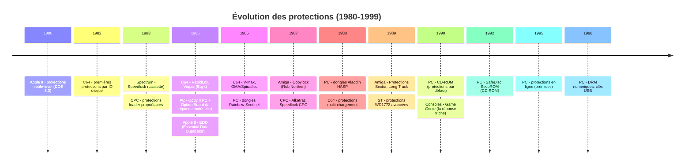
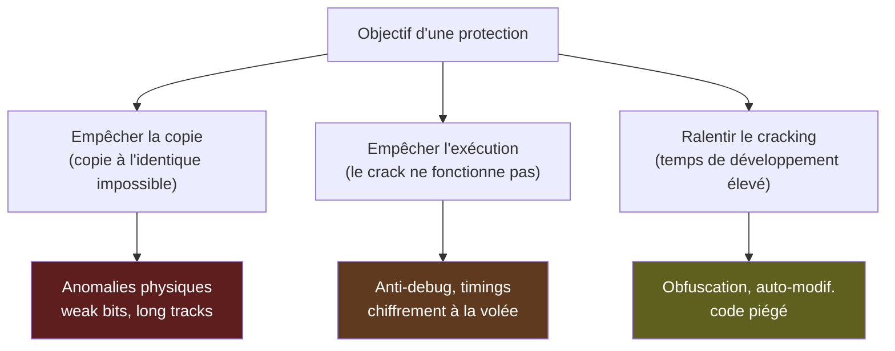
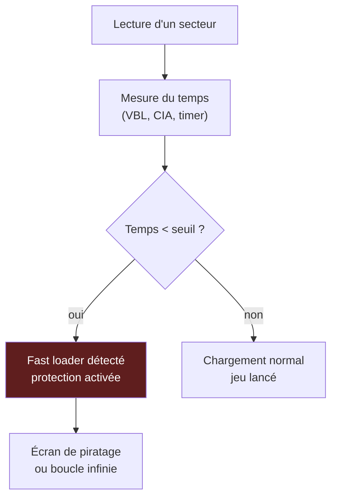
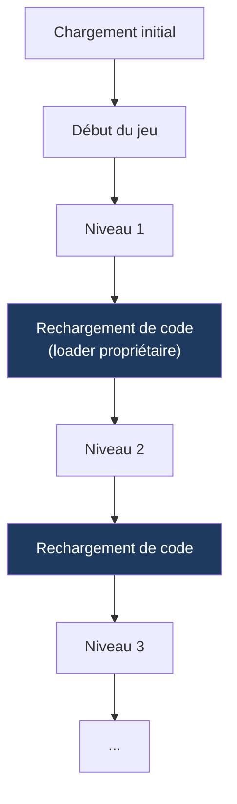
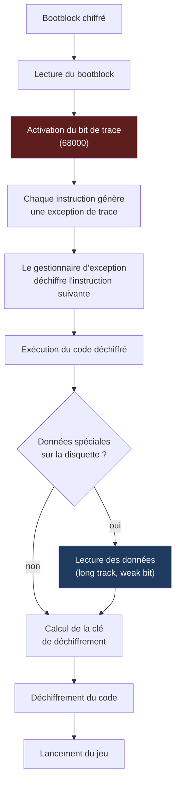
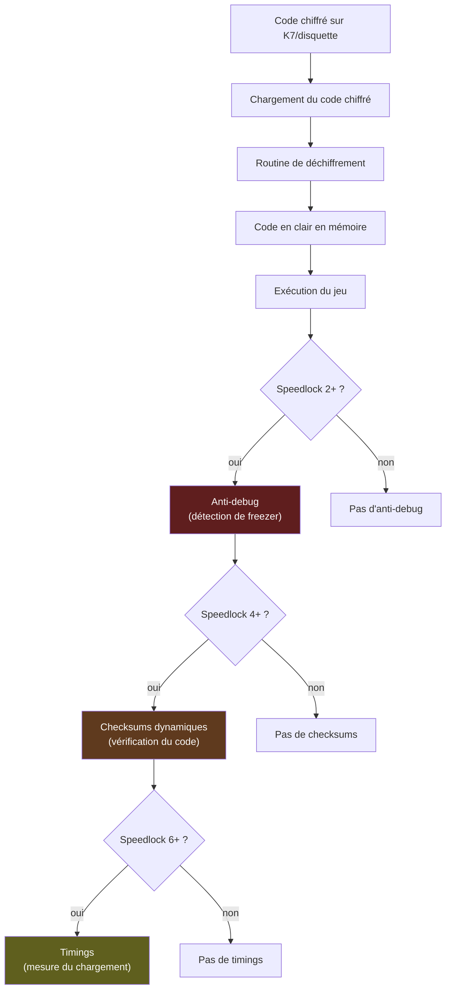
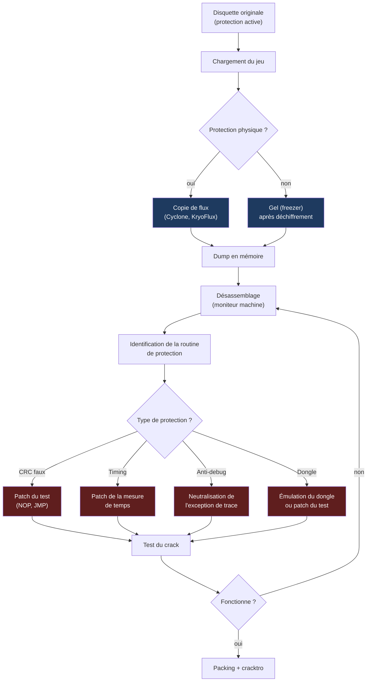
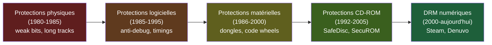

# 🛡️ L'Art de la Protection — Anatomie des Mécanismes Anti-Copie (1980-1999)
## Rapport technique approfondi — Édition illustrée

| | |
| --- | --- |
| Périmètre | Commodore 64/128, Amiga, Atari ST / 8 bits, ZX Spectrum, Amstrad CPC, Apple II, IBM PC, consoles (en périphérie) |
| Axe | Défense : protections physiques, logicielles, matérielles et hybrides — comment les éditeurs ont tenté de verrouiller leurs logiciels |
| Position dans la série | **Pendant « défense »** du document *Le Matériel de Cracking* et du document *Les Outils Logiciels* |
| Illustrations | Diagrammes [Mermaid](https://mermaid.js.org) et schémas ASCII |

### Légende des niveaux de confiance

| Marque | Signification |
| --- | --- |
| ✅ | Fait solidement établi (documentation officielle, datasheets, communauté de préservation) |
| ⚠️ | Information de seconde main ou contradictoire selon les sources : à vérifier avant citation |
| 🔧 | Correction ou précision apportée par rapport à la littérature courante |

---

## Sommaire

- [0. Vue d'ensemble : la course aux armements](#0-vue-densemble)
- [1. Introduction : pourquoi verrouiller une disquette ?](#1-introduction)
- [2. Fondamentaux : où nichent les protections](#2-fondamentaux)
- [3. Taxonomie générale des protections](#3-taxonomie)
- [4. Les protections physiques (niveau flux magnétique)](#4-protections-physiques)
- [5. Les protections logicielles (anti-debug, timings, chiffrement)](#5-protections-logicielles)
- [6. Les protections matérielles (dongles, clés physiques)](#6-protections-matérielles)
- [7. Études de cas par plateforme](#7-etudes-de-cas)
- [8. L'ingénierie inverse des protections](#8-ingenierie-inverse)
- [9. L'héritage : des protections aux DRM modernes](#9-heritage)
- [10. Conclusion](#10-conclusion)
- [Annexes](#annexes)

---

## 0. Vue d'ensemble : la course aux armements {#0-vue-densemble}

### 0.1 La boucle du duel

```mermaid
flowchart LR
    A["Éditeur :<br/>protection logicielle seule"] -->|"copieurs logiciels, DOS standard"| B["Copie triviale"]
    B --> C["Éditeur :<br/>anomalies physiques<br/>(secteurs, pistes, weak bits)"]
    C -->|"le FDC et l'OS ne savent plus lire"| D["Copieurs logiciels échouent"]
    D --> E["Scène : freezers et copieurs de flux"]
    E -->|"gel après déchiffrement<br/>ou copie au niveau flux"| F["Protection contournée"]
    F --> G["Éditeur :<br/>anti-debug, timings,<br/>chiffrement, dongles"]
    G --> E
    style E fill:#1e3a5f,color:#fff
    style C fill:#5f1e1e,color:#fff
    style G fill:#5f3a1e,color:#fff
```



### 0.2 Cartographie des familles de protections

```
                          ┌─────────────────────────────────────────┐
                          │   PROTECTIONS ANTI-COPIE (1980-1999)    │
                          └──────────────┬──────────────────────────┘
                                         │
         ┌───────────────┬───────────────┼───────────────┬───────────────┐
         ▼               ▼               ▼               ▼               ▼
   ┌──────────┐   ┌──────────┐   ┌──────────┐   ┌──────────┐   ┌──────────┐
   │ PHYSIQUE │   │ LOGIQUE  │   │ MATÉRIEL │   │ HYBRIDE  │   │ TEMPO-   │
   │ (flux)   │   │ (code)   │   │ (dongle) │   │ (mixte)  │   │ RIELLE   │
   └──────────┘   └──────────┘   └──────────┘   └──────────┘   └──────────┘
         │               │               │               │               │
         ▼               ▼               ▼               ▼               ▼
   Weak bits       Anti-debug      Rainbow         Copylock        Mesure du
   Long tracks     Timings         Sentinel        Rob Northen     temps de
   CRC faux        Chiffrement     HASP            Speedlock       chargement
   Secteurs        Auto-modif.     Code wheels     Alkatraz        Roues à
   fantômes        Obfuscation     Clés USB        V-Max           code
   Densités        Checksums       (plus tard)     RapidLok
   mixtes
```

### 0.3 Frise chronologique des grandes familles



---

## 1. Introduction : pourquoi verrouiller une disquette ? {#1-introduction}

En 1982, un jeu sur disquette coûte entre 150 et 350 francs français (l'équivalent de 50 à 120 € actuels). Une disquette vierge coûte 10 francs. Le ratio de copie est donc de **15:1 à 35:1** : une incitation économique massive. Les éditeurs, pour protéger leur chiffre d'affaires, ont déployé une ingéniosité considérable.

Mais la protection n'est pas qu'une affaire d'argent. C'est aussi une **course technologique** : chaque nouvelle protection est un défi lancé aux crackers, et chaque crack est une démonstration de compétence. Les meilleurs ingénieurs en basse couche de l'époque ont travaillé des deux côtés du front.

### 1.1 Les trois objectifs d'une protection



### 1.2 Le paradoxe de la protection

Toute protection doit être **transparente pour l'utilisateur légitime** et **détectable pour le cracker**. C'est un équilibre instable :

- Si la protection est trop agressive, elle rend le jeu instable ou incompatible avec certains lecteurs.
- Si elle est trop discrète, elle est triviallement contournable.
- Si elle repose sur du matériel (dongle), elle est coûteuse et impopulaire.

C'est pourquoi les protections ont évolué du **physique pur** (1980-1985) vers le **logiciel pur** (1990-1999), en passant par des **hybrides** (dongles, clés physiques).

---

## 2. Fondamentaux : où nichent les protections {#2-fondamentaux}

### 2.1 Les couches d'abstraction

Une protection vit dans les **couches basses** de la pile d'abstraction, là où le système d'exploitation ne regarde pas.

```
 ┌─────────────────────────────────────────────┐
 │ Application / Jeu                           │  ← voit des fichiers ou des secteurs
 ├─────────────────────────────────────────────┤
 │ Système de fichiers (DOS, AmigaDOS, GEMDOS) │  ← voit des blocs logiques
 ├─────────────────────────────────────────────┤
 │ Pilote disque (trackdisk.device, INT 13h…)  │  ← voit des secteurs (piste/tête/n°)
 ├─────────────────────────────────────────────┤
 │ Contrôleur FDC (WD1772, µPD765, Paula…)     │  ← voit des octets + marques de synchro
 ├─────────────────────────────────────────────┤
 │ Électronique de lecture du lecteur          │  ← voit des impulsions de flux
 ├─────────────────────────────────────────────┤
 │ Tête magnétique + oxyde de la disquette     │  ← réalité physique
 └─────────────────────────────────────────────┘
        ▲ plus on descend, plus la protection est forte
```

Une protection qui vit au niveau **physique** (faible bit, piste longue) est invisible pour un copieur logiciel standard. Une protection qui vit au niveau **logiciel** (anti-debug, timing) est invisible pour un copieur matériel.

### 2.2 Les trois familles de vulnérabilités exploitées

| Vulnérabilité | Principe | Exemple |
| --- | --- | --- |
| **Le FDC filtre l'information** | Le contrôleur de disquette ne renvoie que ce qu'il sait interpréter | Un secteur au CRC faux est « réparé » par un copieur logiciel |
| **L'OS ne voit pas le temps** | Le système d'exploitation ne mesure pas les durées de chargement | Une protection par timing est invisible pour un fast loader |
| **Le CPU ne voit pas le bus** | Le processeur ne voit pas les accès mémoire des autres puces | Une protection qui espionne le bus est invisible pour le programme |

---

## 3. Taxonomie générale des protections {#3-taxonomie}

### 3.1 Classification par niveau

| Niveau | Type | Exemples | Contre-mesure typique |
| --- | --- | --- | --- |
| **Physique** | Anomalies du flux magnétique | Weak bits, long tracks, CRC faux | Copieur de flux (Cyclone, KryoFlux) |
| **Logiciel bas niveau** | Code qui teste le support | Copylock, Speedlock | Patch du test, émulation |
| **Logiciel haut niveau** | Code qui teste l'environnement | Anti-debug, timing | Désactivation du fast loader |
| **Matériel** | Clé physique externe | Dongle, code wheel | Émulation du dongle |
| **Hybride** | Combinaison des précédents | Copylock + dongle | Analyse complète |

### 3.2 Classification par objectif

| Objectif | Mécanisme | Exemple |
| --- | --- | --- |
| **Empêcher la copie** | Anomalie physique non reproductible | Weak bit, trou laser |
| **Empêcher l'exécution** | Test de présence du support original | CRC faux, long track |
| **Ralentir le cracking** | Obfuscation, auto-modification | Code chiffré à la volée |
| **Détecter le débogage** | Anti-debug, exception de trace | Copylock, protections C64 avancées |

---

## 4. Les protections physiques (niveau flux magnétique) {#4-protections-physiques}

Ces protections exploitent les **limites du contrôleur de disquette** (FDC) et les **anomalies physiques** de la disquette.

### 4.1 Les weak bits (bits faibles)

**Principe** : une zone de la piste est écrite **sans transition de flux**. Le circuit de lecture (CAG / AGC) amplifie le bruit, et le résultat est **aléatoire à chaque lecture**.

```
 ┌──────────────────────────────────────────────────────────────┐
 │  PISTE AVEC WEAK BITS                                        │
 ├──────────────────────────────────────────────────────────────┤
 │  ...[données]...[ZONE SANS FLUX]...[données]...              │
 │                       ▲                                      │
 │                       │                                      │
 │                  Le CAG amplifie le bruit                    │
 │                  Résultat aléatoire à chaque lecture         │
 └──────────────────────────────────────────────────────────────┘
```

**Détection** : le jeu lit deux fois la même zone. Si les résultats diffèrent, la protection est satisfaite.

**Contre-mesure** : impossible à copier fidèlement. Les copieurs analogiques (Cyclone, Syncro Express) **figent** le weak bit en une transition nette, ce qui fait échouer la protection.

**Héritage moderne** : les lecteurs de flux modernes (KryoFlux, Greaseweazle) lisent la piste **plusieurs fois** et marquent les zones instables. L'émulateur (WinUAE, Hatari) simule alors l'aléa. C'est l'ironie de l'histoire : le matériel qui échouait à copier les weak bits est celui qui permet aujourd'hui de les **simuler** parfaitement. ✅

### 4.2 Les long tracks (pistes longues)

**Principe** : une piste est écrite avec **plus de données** qu'une révolution normale. La tête écrit « en trop » et « mord » sur le début de la piste.

```
 ┌──────────────────────────────────────────────────────────────┐
 │  PISTE LONGUE                                                │
 ├──────────────────────────────────────────────────────────────┤
 │  INDEX ─┐                                                    │
 │         ▼                                                    │
 │  ┌──────┬──────────────────────────────────────────────┬───┐ │
 │  │ GAP  │ DONNÉES (≈ 110 % d'une révolution)           │FIN│ │
 │  └──────┴──────────────────────────────────────────────┴───┘ │
 │         ▲                                                    │
 │         La tête continue d'écrire après l'INDEX              │
 └──────────────────────────────────────────────────────────────┘
```

**Détection** : le jeu mesure le temps d'une révolution, ou lit un secteur « après l'index ».

**Contre-mesure** : nécessite une écriture **synchronisée sur l'impulsion d'index** (Syncro Express, Blitz, Discovery Cartridge).

### 4.3 Les secteurs au CRC faux

**Principe** : un secteur est écrit avec un **CRC volontairement faux**. Le FDC signale une erreur de lecture.

```
 ┌──────────────────────────────────────────────────────────────┐
 │  SECTEUR AU CRC FAUX                                         │
 ├──────────────────────────────────────────────────────────────┤
 │  ID FIELD : 12×00 | 3×A1* | FE | C | H | R | N | CRC16 ✓   │
 │  DATA FIELD : 12×00 | 3×A1* | FB | données | CRC16 ✗        │
 │                                                    ▲         │
 │                                               CRC faux       │
 └──────────────────────────────────────────────────────────────┘
```

**Détection** : le jeu lit le secteur et vérifie que l'erreur est bien signalée (INT 13h : erreur 10h sur PC, code d'erreur spécifique sur C64).

**Contre-mesure** : un copieur logiciel standard « répare » le CRC. Il faut un copieur de flux (Option Board PC, Discovery Cartridge) pour reproduire le CRC faux.

### 4.4 Les secteurs hors-norme

**Principe** : des secteurs ont une **taille non standard** (N=6 → 8 Ko, N=7 → 16 Ko), ou des **numéros dupliqués** (deux secteurs avec le même numéro R), ou un **ID de piste mensonger** (C ≠ piste réelle).

**Détection** : le jeu lit directement un ID inattendu.

**Contre-mesure** : nécessite un copieur qui reproduit la structure exacte de la piste.

### 4.5 Les pistes supplémentaires et demi-pistes

**Principe** : des données sont écrites en **piste 40/41/82/83** (au-delà de la plage normale), ou entre deux pistes (demi-pistes).

**Détection** : le jeu positionne la tête au-delà de la plage normale.

**Contre-mesure** : nécessite un copieur indépendant de la plage « officielle ».

### 4.6 Les densités mixtes

**Principe** : une piste contient des zones en **FM** et des zones en **MFM**, ou des zones de **vitesse différente** (C64 : 4 zones).

**Détection** : le jeu lit avec un mauvais mode → erreur ; avec le bon → OK.

**Contre-mesure** : nécessite un contrôleur capable de changer de débit en cours de piste.

### 4.7 Les marques de synchro personnalisées

**Principe** : la piste utilise une **marque de synchronisation non standard** (autre que $4489 en MFM, autre que $FF en GCR).

**Détection** : le programme programme le FDC (DSKSYNC sur Amiga) sur un motif non standard.

**Contre-mesure** : nécessite un contrôleur à synchro programmable (Amiga natif, Catweasel, cartes PC).

### 4.8 Les trous d'index multiples

**Principe** : la disquette a **plusieurs trous d'index** (physiquement percés), ou un trou d'index décalé.

**Détection** : le jeu compte les impulsions d'index.

**Contre-mesure** : nécessite un copieur qui reproduit la géométrie physique.

### 4.9 Le trou laser

**Principe** : l'oxyde de la disquette est **percé au laser** à un endroit précis. Le secteur est **définitivement illisible**.

**Détection** : le jeu exige l'**erreur exacte** à cet endroit.

**Contre-mesure** : **aucune copie possible**. Seul le **patch du test** fonctionne. C'est la protection la plus forte physiquement.

### 4.10 Tableau récapitulatif

| Anomalie | Principe | Détectée par… | Réponse matérielle nécessaire |
| --- | --- | --- | --- |
| Weak bits | Zone sans flux, résultat aléatoire | Lecture multiple, résultats différents | Impossible à écrire fidèlement |
| Long track | Piste > 100 % d'une révolution | Mesure du temps, lecture après index | Écriture synchronisée sur index |
| CRC faux | CRC volontairement incorrect | Code d'erreur du FDC | Écriture de piste brute |
| Secteurs hors-norme | Taille, numéros, ID mensongers | Lecture d'ID inattendu | Reproduction exacte de la piste |
| Pistes supplémentaires | Données en piste 40/41/82/83 | Positionnement hors plage | Copieur indépendant de la plage |
| Densités mixtes | FM/MFM ou zones de vitesse différentes | Lecture avec mauvais mode | Contrôleur à débit variable |
| Synchro personnalisée | Motif de synchro non standard | Programmation du FDC | Contrôleur à synchro programmable |
| Trous d'index multiples | Plusieurs trous d'index | Comptage des impulsions | Reproduction de la géométrie |
| Trou laser | Oxyde percé, secteur illisible | Erreur exacte à un endroit | Aucune copie possible |

---

## 5. Les protections logicielles (anti-debug, timings, chiffrement) {#5-protections-logicielles}

Ces protections exploitent les **capacités du CPU** et les **comportements du système**.

### 5.1 L'anti-debug

**Principe** : le programme détecte la présence d'un débogueur (freezer, moniteur, pas-à-pas) et réagit (écran de piratage, boucle infinie, corruption du code).

#### 5.1.1 L'exception de trace (68000)

Le 68000 dispose d'un bit de trace dans le registre d'état (SR). Quand il est activé, **chaque instruction** génère une exception de trace.

```
 ┌──────────────────────────────────────────────────────────────┐
 │  PROTECTION PAR EXCEPTION DE TRACE (Copylock)                │
 ├──────────────────────────────────────────────────────────────┤
 │  1. Le programme active le bit de trace                      │
 │  2. Chaque instruction génère une exception                  │
 │  3. Le gestionnaire d'exception déchiffre l'instruction      │
 │     suivante et réactive la trace                            │
 │  4. Si un débogueur interrompt (freeze, pas-à-pas), la       │
 │     chaîne de déchiffrement est rompue                       │
 │  5. Le code devient inintelligible, le jeu échoue            │
 └──────────────────────────────────────────────────────────────┘
```

**Contre-mesure** : le cracker doit **émuler** la routine de déchiffrement, ou la **neutraliser** en patchant le gestionnaire d'exception.

#### 5.1.2 Les checksums de ROM

**Principe** : le programme calcule la somme de contrôle de sa propre ROM (ou de la ROM du système) et vérifie qu'elle n'a pas été modifiée.

```
 ┌──────────────────────────────────────────────────────────────┐
 │  PROTECTION PAR CHECKSUM DE ROM                              │
 ├──────────────────────────────────────────────────────────────┤
 │  1. Au démarrage, le programme calcule la somme de contrôle  │
 │     de la ROM du système (KERNAL, BIOS, etc.)                │
 │  2. Il compare avec une valeur attendue                      │
 │  3. Si la somme diffère (cartouche freezer, fast loader),    │
 │     le programme réagit (écran de piratage)                  │
 └──────────────────────────────────────────────────────────────┘
```

**Contre-mesure** : patcher le test, ou désactiver la cartouche (Final Kill).

#### 5.1.3 La détection de vecteurs modifiés

**Principe** : le programme vérifie que les vecteurs d'interruption (NMI, IRQ, VBL) n'ont pas été détournés par un freezer ou un moniteur.

```
 ┌──────────────────────────────────────────────────────────────┐
 │  PROTECTION PAR VÉRIFICATION DES VECTEURS                    │
 ├──────────────────────────────────────────────────────────────┤
 │  1. Le programme lit les vecteurs d'interruption             │
 │     ($FFFA-$FFFF sur C64, $7C sur Amiga, $0066 sur Z80)     │
 │  2. Il vérifie qu'ils pointent vers des adresses attendues   │
 │  3. Si un vecteur a été détourné (freezer actif), le         │
 │     programme réagit                                         │
 └──────────────────────────────────────────────────────────────┘
```

**Contre-mesure** : désactiver la cartouche (Final Kill, interrupteur matériel).

### 5.2 Les timings (mesure du temps)

**Principe** : le programme mesure le **temps de chargement** d'un secteur, ou le **temps entre deux événements**. Si le temps est trop court (fast loader actif), la protection échoue.



**Contre-mesure** : désactiver le fast loader (Final Kill), ou patcher la routine de mesure.

### 5.3 Le chiffrement à la volée

**Principe** : le code du jeu est **chiffré** sur la disquette, et **déchiffré en mémoire** au moment du chargement. Le déchiffrement utilise une **clé calculée** à partir de données lues sur le support.

```
 ┌──────────────────────────────────────────────────────────────┐
 │  CHIFFREMENT À LA VOLÉE                                      │
 ├──────────────────────────────────────────────────────────────┤
 │  1. Le code du jeu est chiffré sur la disquette              │
 │  2. Au chargement, le programme lit une donnée spéciale      │
 │     (secteur protégé, timing, ID disque)                     │
 │  3. Il calcule une clé de déchiffrement                      │
 │  4. Il déchiffre le code en mémoire                          │
 │  5. Il exécute le code déchiffré                             │
 └──────────────────────────────────────────────────────────────┘
```

**Contre-mesure** : geler le système **après** le déchiffrement (freezer), ou émuler la routine de déchiffrement.

### 5.4 L'auto-modification

**Principe** : le programme **modifie son propre code** en cours d'exécution. Cela rend le désassemblage statique inefficace.

```
 ┌──────────────────────────────────────────────────────────────┐
 │  AUTO-MODIFICATION                                           │
 ├──────────────────────────────────────────────────────────────┤
 │  1. Le programme contient du code « mort » (inintelligible)  │
 │  2. Au démarrage, il s'auto-modifie pour devenir exécutable  │
 │  3. En cours d'exécution, il se modifie à nouveau            │
 │  4. Un désassembleur statique ne voit que du code mort       │
 └──────────────────────────────────────────────────────────────┘
```

**Contre-mesure** : désassemblage dynamique (pas-à-pas), ou gel après auto-modification.

### 5.5 L'obfuscation

**Principe** : le code est rendu **difficile à lire** par des techniques d'obfuscation (instructions inutiles, sauts imbriqués, calculs redondants).

```
 ┌──────────────────────────────────────────────────────────────┐
 │  OBFUSCATION                                                 │
 ├──────────────────────────────────────────────────────────────┤
 │  Original :                                                  │
 │    LDA #$00                                                  │
 │    STA $D020                                                 │
 │                                                              │
 │  Obfusqué :                                                  │
 │    LDA #$00                                                  │
 │    JSR $1234      ; saut vers une routine qui ne fait rien  │
 │    NOP                                                       │
 │    NOP                                                       │
 │    LDA #$00       ; recalcul inutile                         │
 │    EOR #$FF                                                  │
 │    EOR #$FF       ; annulation                               │
 │    STA $D020                                                 │
 └──────────────────────────────────────────────────────────────┘
```

**Contre-mesure** : analyse statique avancée, ou exécution pas-à-pas.

### 5.6 Les protections multi-chargement

**Principe** : le jeu **recharge du code** en cours de partie (multi-load). Un freezer ne peut pas capturer l'ensemble du jeu en une seule fois.



**Contre-mesure** : extraction des modules, ou copie paramétrée (Maverick/Renegade).

---

## 6. Les protections matérielles (dongles, clés physiques) {#6-protections-matérielles}

Ces protections reposent sur la **présence physique** d'un objet externe.

### 6.1 Les dongles (clés matérielles)

**Principe** : un **boîtier** est branché sur le port parallèle ou série. Le programme l'interroge et attend une **réponse calculée**.

```
 ┌──────────────────────────────────────────────────────────────┐
 │  DONGLE (Rainbow Sentinel, Aladdin HASP)                     │
 ├──────────────────────────────────────────────────────────────┤
 │  1. Le programme envoie une requête au dongle                │
 │     (via le port parallèle ou série)                         │
 │  2. Le dongle effectue un calcul interne                     │
 │     (table de correspondance, algorithme propriétaire)       │
 │  3. Il renvoie une réponse                                   │
 │  4. Le programme vérifie la réponse                          │
 │  5. Si la réponse est incorrecte (dongle absent), le         │
 │     programme refuse de s'exécuter                           │
 └──────────────────────────────────────────────────────────────┘
```

**Exemples** :
- **Rainbow Sentinel** (Rainbow Technologies, 1980s-1990s) : dongle parallèle, très répandu sur PC.
- **Aladdin HASP** (Aladdin Knowledge Systems, 1980s-2000s) : dongle avec mémoire et calcul.
- **Key-Lok** : dongle avec EEPROM.

**Contre-mesure** : émulation du dongle (logiciel), ou patch du test.

### 6.2 Les code wheels (roues à code)

**Principe** : le manuel du jeu contient une **roue à code** (disque de papier avec des codes). Le programme demande un code à une position donnée, et l'utilisateur doit le lire sur la roue.

```
 ┌──────────────────────────────────────────────────────────────┐
 │  CODE WHEEL                                                  │
 ├──────────────────────────────────────────────────────────────┤
 │  ┌─────────────────────────────────────┐                     │
 │  │  ┌─────────────────────────────┐    │                     │
 │  │  │  ┌─────────────────────┐    │    │                     │
 │  │  │  │  ┌─────────────┐    │    │    │                     │
 │  │  │  │  │  POSITION   │    │    │    │                     │
 │  │  │  │  │  A-7 : 42   │    │    │    │                     │
 │  │  │  │  │  B-3 : 18   │    │    │    │                     │
 │  │  │  │  │  C-9 : 63   │    │    │    │                     │
 │  │  │  │  └─────────────┘    │    │    │                     │
 │  │  │  └─────────────────────┘    │    │                     │
 │  │  └─────────────────────────────┘    │                     │
 │  └─────────────────────────────────────┘                     │
 │                                                              │
 │  Le programme demande : "Code en B-3 ?"                      │
 │  L'utilisateur répond : "18"                                 │
 └──────────────────────────────────────────────────────────────┘
```

**Contre-mesure** : photocopier le manuel, ou patcher le test.

### 6.3 Les clés physiques (livres, cartes)

**Principe** : le jeu demande un mot de passe tiré d'un **livre** (ex : « page 42, ligne 7, mot 3 »), ou d'une **carte** (table de correspondance).

**Exemples** :
- **The Bard's Tale** : mot de passe tiré d'un livre.
- **Their Finest Hour** : carte de codes.

**Contre-mesure** : photocopier le livre, ou patcher le test.

### 6.4 Les protections par copie de manuel

**Principe** : le jeu demande à l'utilisateur de **recopier un texte** du manuel (preuve de possession).

**Contre-mesure** : photocopier le manuel, ou patcher le test.

---

## 7. Études de cas par plateforme {#7-etudes-de-cas}

### 7.1 Commodore 64

#### 7.1.1 RapidLok

**Éditeur** : divers (très répandu, ≈ 1986-1990)

**Principe** : protection par **ID disque** et **secteurs de synchronisation**.

```
 ┌──────────────────────────────────────────────────────────────┐
 │  RAPIDLOK                                                    │
 ├──────────────────────────────────────────────────────────────┤
 │  • Chaque disquette a un ID unique (ID1, ID2)                │
 │  • Le loader lit l'ID et vérifie qu'il correspond            │
 │  • Des secteurs de synchronisation sont écrits avec des      │
 │    motifs non standard                                       │
 │  • Le loader mesure le temps de lecture                      │
 │                                                              │
 │  Détection :                                                 │
 │  • Lecture de l'ID disque                                    │
 │  • Vérification des secteurs de synchronisation              │
 │  • Mesure du temps de chargement                             │
 │                                                              │
 │  Contre-mesure :                                             │
 │  • Copie paramétrée (Maverick/Renegade)                      │
 │  • Patch du test d'ID                                        │
 │  • Désactivation du fast loader                              │
 └──────────────────────────────────────────────────────────────┘
```

#### 7.1.2 Vorpal (Epyx)

**Éditeur** : Epyx (≈ 1985-1988)

**Principe** : **fast loader propriétaire** + protection par **format de piste non standard**.

```
 ┌──────────────────────────────────────────────────────────────┐
 │  VORPAL (Epyx)                                               │
 ├──────────────────────────────────────────────────────────────┤
 │  • Loader propriétaire très rapide                           │
 │  • Format de piste non standard (GCR modifié)                │
 │  • Secteurs de taille variable                               │
 │  • Protection par timing                                     │
 │                                                              │
 │  Détection :                                                 │
 │  • Lecture de secteurs au format Vorpal                      │
 │  • Vérification du timing de chargement                      │
 │                                                              │
 │  Contre-mesure :                                             │
 │  • Nibbling (copie brute de piste)                           │
 │  • Patch du test de timing                                   │
 └──────────────────────────────────────────────────────────────┘
```

#### 7.1.3 V-Max

**Éditeur** : V-Max (≈ 1986-1992)

**Principe** : protection **multi-chargement** avec **loader propriétaire** et **chiffrement à la volée**.

```
 ┌──────────────────────────────────────────────────────────────┐
 │  V-MAX                                                       │
 ├──────────────────────────────────────────────────────────────┤
 │  • Loader propriétaire multi-pistes                          │
 │  • Code chiffré sur la disquette                             │
 │  • Déchiffrement en mémoire au chargement                    │
 │  • Rechargement de code en cours de partie                   │
 │  • Protection par ID disque                                  │
 │                                                              │
 │  Détection :                                                 │
 │  • Lecture de l'ID disque                                    │
 │  • Vérification du format de piste                           │
 │                                                              │
 │  Contre-mesure :                                             │
 │  • Gel après déchiffrement (freezer)                         │
 │  • Extraction des modules                                    │
 │  • Copie paramétrée                                          │
 └──────────────────────────────────────────────────────────────┘
```

#### 7.1.4 GMA / Spiradisc

**Éditeur** : GMA (≈ 1987-1990)

**Principe** : protection par **secteurs décalés** et **pistes longues**.

```
 ┌──────────────────────────────────────────────────────────────┐
 │  GMA / SPIRADISC                                             │
 ├──────────────────────────────────────────────────────────────┤
 │  • Secteurs décalés (numéros non séquentiels)                │
 │  • Pistes longues (données après l'index)                    │
 │  • Protection par timing                                     │
 │                                                              │
 │  Détection :                                                 │
 │  • Lecture de secteurs décalés                               │
 │  • Mesure du temps de chargement                             │
 │                                                              │
 │  Contre-mesure :                                             │
 │  • Copie analogique (Cyclone)                                │
 │  • Nibbling                                                  │
 │  • Patch du test de timing                                   │
 └──────────────────────────────────────────────────────────────┘
```

### 7.2 Commodore Amiga

#### 7.2.1 Copylock (Rob Northen)

**Éditeur** : Rob Northen Computing (≈ 1987-1995)

**Principe** : protection **hybride** (physique + logiciel) avec **exception de trace** et **chiffrement à la volée**.



```
 ┌──────────────────────────────────────────────────────────────┐
 │  COPYLOCK (Rob Northen)                                      │
 ├──────────────────────────────────────────────────────────────┤
 │  • Bootblock chiffré                                         │
 │  • Exception de trace du 68000                               │
 │  • Chaque instruction est déchiffrée individuellement        │
 │  • Clé de déchiffrement calculée à partir de données         │
 │    lues sur le support (long track, weak bit)                │
 │  • Anti-debug : un point d'arrêt ou un pas-à-pas rompt       │
 │    la chaîne de déchiffrement                                │
 │                                                              │
 │  Détection :                                                 │
 │  • Vérification de la présence du débogueur                  │
 │  • Lecture des données spéciales                             │
 │  • Calcul de la clé                                          │
 │                                                              │
 │  Contre-mesure :                                             │
 │  • Émulation de la routine de déchiffrement                  │
 │  • Neutralisation de l'exception de trace                    │
 │  • Patch du test de données spéciales                        │
 └──────────────────────────────────────────────────────────────┘
```

#### 7.2.2 Protections Sector / Long Track

**Éditeur** : divers (≈ 1988-1995)

**Principe** : protection par **long track** (piste > 100 % d'une révolution) ou **weak bit**.

```
 ┌──────────────────────────────────────────────────────────────┐
 │  PROTECTIONS AMIGA (Sector, Long Track)                      │
 ├──────────────────────────────────────────────────────────────┤
 │  • Piste longue : données écrites après l'index              │
 │  • Weak bit : zone sans flux, résultat aléatoire             │
 │  • Le programme lit la piste et vérifie la présence des      │
 │    données spéciales                                         │
 │                                                              │
 │  Détection :                                                 │
 │  • Lecture de la piste longue                                │
 │  • Vérification de la longueur                               │
 │  • Lecture multiple du weak bit                              │
 │                                                              │
 │  Contre-mesure :                                             │
 │  • Copie analogique (Cyclone, Syncro Express)                │
 │  • Émulation du weak bit (préservation moderne)              │
 └──────────────────────────────────────────────────────────────┘
```

### 7.3 Atari ST

#### 7.3.1 Protections WD1772

**Éditeur** : divers (≈ 1986-1993)

**Principe** : protection par **secteurs fous** (taille variable, numéros dupliqués), **pistes mixtes** (FM/MFM), **index décalé**.

```
 ┌──────────────────────────────────────────────────────────────┐
 │  PROTECTIONS ATARI ST (WD1772)                               │
 ├──────────────────────────────────────────────────────────────┤
 │  • Secteurs de taille variable                               │
 │  • Numéros de secteurs dupliqués                             │
 │  • Pistes mixtes FM/MFM                                      │
 │  • Index décalé                                              │
 │  • CRC faux                                                  │
 │                                                              │
 │  Détection :                                                 │
 │  • Lecture de secteurs non standard                          │
 │  • Vérification du format de piste                           │
 │                                                              │
 │  Contre-mesure :                                             │
 │  • Discovery Cartridge                                       │
 │  • Copie analogique (Blitz, Syncro Express)                  │
 └──────────────────────────────────────────────────────────────┘
```

**Limite du WD1772** : la commande `Read Track` renvoie les octets **sans validation** et **sans les marques de synchro d'origine**. La commande `Write Track` ne permet d'écrire des marques de synchro (`$A1` à horloge manquante) qu'avec des **codes d'échappement spécifiques** (`$F5`/`$F6`/`$F7`). Les weak bits ne sont pas reproductibles à l'écriture. ✅

### 7.4 ZX Spectrum / Amstrad CPC

#### 7.4.1 Speedlock (générations 1 à 7+)

**Éditeur** : Speedlock (≈ 1985-1995)

**Principe** : protection de **chargeur** (cassette et disquette) avec **chiffrement du code** et **déchiffrement en mémoire**.



```
 ┌──────────────────────────────────────────────────────────────┐
 │  SPEEDLOCK (générations)                                     │
 ├──────────────────────────────────────────────────────────────┤
 │  Speedlock 1 (1985) :                                        │
 │  • Chiffrement simple du code                                │
 │  • Déchiffrement en mémoire                                  │
 │                                                              │
 │  Speedlock 2 (1986) :                                        │
 │  • + anti-debug (détection de freezer)                       │
 │                                                              │
 │  Speedlock 3 (1987) :                                        │
 │  • + protection par timing                                   │
 │                                                              │
 │  Speedlock 4 (1988) :                                        │
 │  • + checksums dynamiques                                    │
 │                                                              │
 │  Speedlock 5 (1989) :                                        │
 │  • + auto-modification                                       │
 │                                                              │
 │  Speedlock 6 (1990) :                                        │
 │  • + timings avancés                                         │
 │                                                              │
 │  Speedlock 7 (1991) :                                        │
 │  • + obfuscation                                             │
 │                                                              │
 │  Contre-mesure :                                             │
 │  • Gel après déchiffrement (Multiface)                       │
 │  • Patch des tests                                           │
 └──────────────────────────────────────────────────────────────┘
```

#### 7.4.2 Alkatraz (CPC)

**Éditeur** : Alkatraz (≈ 1987-1992)

**Principe** : **loader rapide propriétaire** + protection par **format de piste non standard**.

```
 ┌──────────────────────────────────────────────────────────────┐
 │  ALKATRAZ (CPC)                                              │
 ├──────────────────────────────────────────────────────────────┤
 │  • Loader rapide propriétaire                                │
 │  • Format de piste non standard                              │
 │  • Secteurs de taille variable                               │
 │  • Protection par timing                                     │
 │                                                              │
 │  Détection :                                                 │
 │  • Lecture de secteurs au format Alkatraz                    │
 │  • Vérification du timing de chargement                      │
 │                                                              │
 │  Contre-mesure :                                             │
 │  • Gel après chargement (Multiface Two/Three)                │
 │  • Patch du test de timing                                   │
 └──────────────────────────────────────────────────────────────┘
```

### 7.5 Apple II

#### 7.5.1 Protections nibble-level

**Éditeur** : divers (≈ 1980-1990)

**Principe** : protection par **octets de synchro** (self-sync bytes), **pistes longues**, **secteurs décalés**.

```
 ┌──────────────────────────────────────────────────────────────┐
 │  PROTECTIONS APPLE II (nibble-level)                         │
 ├──────────────────────────────────────────────────────────────┤
 │  • Octets de synchro à 10 bits                               │
 │  • Pistes longues                                            │
 │  • Secteurs décalés                                          │
 │  • Demi-pistes et quarts de piste                            │
 │  • Bits « fantômes »                                         │
 │                                                              │
 │  Détection :                                                 │
 │  • Lecture d'octets de synchro                               │
 │  • Mesure de la longueur de piste                            │
 │  • Positionnement sur demi-piste                             │
 │                                                              │
 │  Contre-mesure :                                             │
 │  • Copie nibble-level (Copy II Plus, Locksmith)              │
 │  • EDD (carte matérielle)                                    │
 └──────────────────────────────────────────────────────────────┘
```

### 7.6 Atari 8 bits

#### 7.6.1 Secteurs défectueux volontaires

**Éditeur** : divers (≈ 1982-1990)

**Principe** : des secteurs sont **volontairement défectueux** (CRC faux, données corrompues). Le programme vérifie la présence de ces secteurs.

```
 ┌──────────────────────────────────────────────────────────────┐
 │  PROTECTIONS ATARI 8-BITS (secteurs défectueux)              │
 ├──────────────────────────────────────────────────────────────┤
 │  • Secteurs au CRC faux                                      │
 │  • Secteurs avec données corrompues                          │
 │  • Le programme lit ces secteurs et vérifie l'erreur         │
 │                                                              │
 │  Détection :                                                 │
 │  • Lecture de secteurs défectueux                            │
 │  • Vérification du code d'erreur                             │
 │                                                              │
 │  Contre-mesure :                                             │
 │  • Happy 1050 (lecteur modifié)                              │
 │  • Discovery Cartridge                                       │
 │  • Patch du test                                             │
 └──────────────────────────────────────────────────────────────┘
```

### 7.7 IBM PC

#### 7.7.1 CRC faux et secteurs fantômes

**Éditeur** : divers (≈ 1985-1995)

**Principe** : protection par **secteurs au CRC faux**, **secteurs fantômes** (format inhabituel), **pistes longues**.

```
 ┌──────────────────────────────────────────────────────────────┐
 │  PROTECTIONS PC (CRC faux, secteurs fantômes)                │
 ├──────────────────────────────────────────────────────────────┤
 │  • Secteurs au CRC volontairement faux                       │
 │  • Secteurs de taille inhabituelle (8 Ko)                    │
 │  • Pistes 41/82 (au-delà de la plage normale)                │
 │  • Données en dehors des GAP                                 │
 │  • Weak bits                                                 │
 │                                                              │
 │  Détection :                                                 │
 │  • INT 13h, AH=02 (Read Sectors)                             │
 │  • Vérification du code d'erreur (Carry=1, AH=10h)           │
 │                                                              │
 │  Contre-mesure :                                             │
 │  • Option Board (Copy II PC)                                 │
 │  • Catweasel, KryoFlux                                       │
 └──────────────────────────────────────────────────────────────┘
```

```
 INT 13h, AH=02 (Read Sectors)  →  Carry=1, AH=10h (« CRC/ECC error »)   ← signature attendue
 Copie par DISKCOPY / XCOPY     →  le secteur est « réparé » : Carry=0       ← la protection échoue
 Copie par Option Board         →  le CRC faux est reproduit                  ← la protection est trompée
```

#### 7.7.2 Dongles (Rainbow Sentinel, Aladdin HASP)

**Éditeur** : Rainbow Technologies, Aladdin Knowledge Systems (≈ 1986-2000)

**Principe** : protection par **dongle matériel** sur port parallèle ou série.

```
 ┌──────────────────────────────────────────────────────────────┐
 │  DONGLES PC                                                  │
 ├──────────────────────────────────────────────────────────────┤
 │  Rainbow Sentinel (Rainbow Technologies) :                   │
 │  • Dongle sur port parallèle                                 │
 │  • Calcul interne (table de correspondance)                  │
 │  • Réponse à une requête du programme                        │
 │                                                              │
 │  Aladdin HASP (Aladdin Knowledge Systems) :                  │
 │  • Dongle sur port parallèle ou série                        │
 │  • Mémoire interne (EEPROM)                                  │
 │  • Calcul interne (algorithme propriétaire)                  │
 │  • Réponse à une requête du programme                        │
 │                                                              │
 │  Contre-mesure :                                             │
 │  • Émulation du dongle (logiciel)                            │
 │  • Patch du test                                             │
 └──────────────────────────────────────────────────────────────┘
```

---

## 8. L'ingénierie inverse des protections {#8-ingenierie-inverse}

### 8.1 La méthodologie du cracker



### 8.2 Les techniques d'analyse

| Technique | Principe | Outil |
| --- | --- | --- |
| **Désassemblage statique** | Analyse du code sans l'exécuter | Moniteur machine (Supermon, HRTMon) |
| **Désassemblage dynamique** | Analyse du code en cours d'exécution | Débuggeur (pas-à-pas) |
| **Bus snooping** | Observation des échanges entre CPU et FDC | Oscilloscope, analyseur logique |
| **Trace d'exécution** | Enregistrement de toutes les instructions exécutées | Débuggeur avec trace |
| **Analyse de flux** | Lecture de la piste avec un lecteur de flux | KryoFlux, Greaseweazle |

### 8.3 Les pièges à éviter

| Piège | Conséquence | Solution |
| --- | --- | --- |
| **Freezer pendant le déchiffrement** | Code incomplet, jeu inutilisable | Gel après déchiffrement |
| **Fast loader actif** | Détection par timing | Final Kill, désactivation |
| **Pas-à-pas pendant Copylock** | Chaîne de déchiffrement rompue | Émulation de la routine |
| **Copie analogique d'un weak bit** | Weak bit figé, protection échoue | Copie de flux moderne |
| **Patch d'un test de dongle** | Dongle émulé, mais calcul incorrect | Émulation complète du dongle |

---

## 9. L'héritage : des protections aux DRM modernes {#9-heritage}

### 9.1 L'évolution des protections



### 9.2 Les leçons de l'histoire

| Leçon | Exemple |
| --- | --- |
| **Toute protection peut être contournée** | Les weak bits, les dongles, les DRM ont tous été crackés |
| **La protection la plus forte est l'absence de protection** | Les jeux sans protection se vendent mieux (meilleure expérience utilisateur) |
| **La protection est une course aux armements** | Chaque nouvelle protection engendre une nouvelle contre-mesure |
| **La préservation est l'héritière du cracking** | Les techniques de copie de flux (KryoFlux) viennent des nibblers des années 80 |
| **La scène a formé une génération d'ingénieurs** | Beaucoup de développeurs modernes viennent de la scène du cracking |

### 9.3 L'ironie de la préservation

Les protections les plus sophistiquées des années 80 (weak bits, long tracks) sont aujourd'hui les **mieux préservées**, grâce aux outils modernes (KryoFlux, IPF) qui reprennent les techniques des copieurs de flux de l'époque.

```
 ┌──────────────────────────────────────────────────────────────┐
 │  L'IRONIE DE LA PRÉSERVATION                                 │
 ├──────────────────────────────────────────────────────────────┤
 │  Années 80 :                                                 │
 │  • Les copieurs analogiques (Cyclone) échouent sur les       │
 │    weak bits (ils les figent)                                │
 │  • Les éditeurs sont fiers de leurs protections « incopiables│
 │                                                              │
 │  Années 2020 :                                               │
 │  • Les lecteurs de flux (KryoFlux) lisent les weak bits      │
 │    plusieurs fois et marquent les zones instables            │
 │  • Les émulateurs (WinUAE) simulent l'aléa des weak bits     │
 │  • Les protections « incopiables » sont parfaitement         │
 │    préservées... mais pas copiées sur disquette              │
 │                                                              │
 │  Conclusion :                                                │
 │  • Le matériel qui échouait à copier les weak bits est       │
 │    celui qui permet aujourd'hui de les simuler               │
 └──────────────────────────────────────────────────────────────┘
```

---

## 10. Conclusion {#10-conclusion}

Les protections anti-copie des années 1980-1999 représentent un **chapitre fascinant** de l'histoire de l'informatique. Loin d'être de simples verrous, elles ont été le **laboratoire d'innovations techniques** majeures :

- **L'ingénierie inverse** : les crackers ont développé des techniques de débogage, de désassemblage et d'analyse de code qui préfiguraient les outils modernes (IDA Pro, Ghidra, x64dbg).
- **La cryptographie** : les protections par chiffrement à la volée (Copylock) ont posé les bases des algorithmes de chiffrement modernes.
- **La préservation** : les techniques de copie de flux brut (nibblers, copieurs analogiques) ont évolué vers les outils modernes de préservation (KryoFlux, Greaseweazle, format IPF).
- **La sécurité informatique** : les techniques d'anti-debug, d'obfuscation et de détection d'environnement sont aujourd'hui utilisées par les éditeurs de logiciels pour protéger leurs produits.

Ces protections ont également **formé une génération de développeurs** qui ont ensuite rejoint l'industrie du logiciel, de la sécurité informatique et du jeu vidéo. Beaucoup des techniques développées par les éditeurs pour protéger leurs produits sont aujourd'hui utilisées par les crackers... et vice-versa.

Aujourd'hui, ces protections sont pour la plupart **obsolètes** (les disquettes ont disparu, les dongles sont devenus des clés USB), mais elles restent un **témoignage précieux** d'une époque où la créativité technique et la maîtrise du matériel étaient poussées à leur paroxysme.

---

## Annexes

### Annexe A — Tableau comparatif des principales protections

| Protection | Plateforme | Type | Année | Principe signature |
| --- | --- | --- | --- | --- |
| RapidLok | C64 | Physique + timing | ≈ 1986 | ID disque, secteurs de synchronisation |
| Vorpal | C64 | Loader propriétaire | ≈ 1985 | Fast loader + format non standard |
| V-Max | C64 | Multi-chargement | ≈ 1986 | Loader + chiffrement + multi-load |
| GMA / Spiradisc | C64 | Physique | ≈ 1987 | Secteurs décalés, pistes longues |
| Copylock | Amiga, ST | Hybride | ≈ 1987 | Exception de trace + chiffrement + données spéciales |
| Protections Sector | Amiga | Physique | ≈ 1988 | Long tracks, weak bits |
| Protections WD1772 | ST | Physique | ≈ 1986 | Secteurs fous, pistes mixtes |
| Speedlock 1-7 | Spectrum, CPC | Logique | 1985-1991 | Chiffrement + anti-debug + timings |
| Alkatraz | CPC | Loader propriétaire | ≈ 1987 | Fast loader + format non standard |
| Protections nibble-level | Apple II | Physique | ≈ 1980 | Octets de synchro, demi-pistes |
| Secteurs défectueux | Atari 8-bit | Physique | ≈ 1982 | CRC faux, données corrompues |
| CRC faux | PC | Physique | ≈ 1985 | Secteurs au CRC faux |
| Rainbow Sentinel | PC | Matériel (dongle) | ≈ 1986 | Dongle parallèle, calcul interne |
| Aladdin HASP | PC | Matériel (dongle) | ≈ 1988 | Dongle parallèle/série, EEPROM |
| Code wheels | Multi | Matériel (manuel) | ≈ 1985 | Roue à code dans le manuel |
| SafeDisc | PC (CD-ROM) | Logique | ≈ 1998 | Secteurs intentionnellement erronés |
| SecuROM | PC (CD-ROM) | Logique | ≈ 1998 | Vérification de l'intégrité du CD |

### Annexe B — Glossaire étendu

| Terme | Définition |
| --- | --- |
| **AGC / CAG** | Contrôle automatique de gain du circuit de lecture ; à l'origine des weak bits sur zone sans flux |
| **Anti-debug** | Technique de détection de la présence d'un débogueur (freezer, moniteur, pas-à-pas) |
| **Bootblock** | Premier secteur d'une disquette Amiga, exécuté au démarrage |
| **Code wheel** | Roue à code (disque de papier) dans le manuel d'un jeu |
| **CRC** | Code de redondance cyclique, protégeant les en-têtes et données en MFM |
| **Dongle** | Clé matérielle (port parallèle/série) dont le programme exige la présence |
| **Exception de trace** | Mécanisme du 68000 permettant d'exécuter du code après chaque instruction |
| **Fast loader** | Routine ou matériel accélérant le chargement |
| **Final Kill** | Fonction de désactivation d'une cartouche freezer (Final Cartridge III) |
| **Freezer** | Cartouche ou carte permettant de figer l'état de la machine (via NMI) |
| **GAP** | Zone de remplissage entre champs d'une piste |
| **Index** | Signal émis une fois par tour (trou d'index) |
| **Long track** | Piste contenant plus de données qu'une révolution « normale » |
| **Nibbler** | Outil de copie octet-brut de piste |
| **NMI** | Interruption non masquable |
| **Obfuscation** | Technique de rendu du code difficile à lire |
| **Piste longue** | Piste écrite avec plus de 100 % de données |
| **Protection hybride** | Combinaison de protections physiques et logicielles |
| **Protection physique** | Protection exploitant les anomalies du flux magnétique |
| **Protection logique** | Protection exploitant les capacités du CPU |
| **Protection matérielle** | Protection reposant sur la présence d'un objet externe |
| **Self-sync byte** | Octet de synchronisation à 10 bits (Apple II) |
| **Timing** | Mesure du temps de chargement ou d'exécution |
| **Weak bit / fuzzy bit** | Zone sans transition donnant un résultat aléatoire à chaque lecture |

### Annexe C — Errata et points à vérifier

| # | Passage | Correction | Justification |
| --- | --- | --- | --- |
| 1 | Vorpal « (Electronic Arts) » | Vorpal est un système de chargement rapide d'**Epyx** | Attribution historique |
| 2 | Speedlock « classé parmi les protections de disquette » | Speedlock est une famille de protections de **chargeur** (cassette **et** disquette) | Nuance de support |
| 3 | Copylock « uniquement Amiga » | Copylock existe aussi sur **Atari ST** et **C64** (versions différentes) | Portages |
| 4 | Rainbow Sentinel « uniquement parallèle » | Rainbow Sentinel existe aussi en version **série** | Variantes matérielles |
| 5 | « Les weak bits sont impossibles à copier » | Les weak bits sont impossibles à copier **fidèlement** sur disquette, mais peuvent être **simulés** par un émulateur | Nuance de préservation |

### Annexe D — Pour aller plus loin

**Ouvrages et documentations d'époque** ✅

- *The Anatomy of the 1541 Disk Drive* (Abacus Software) — référence sur l'architecture et le DOS du 1541
- *Inside Commodore DOS* (Immers & Neufeld) — fonctionnement interne du DOS CBM
- *Mapping the Commodore 64* (Sheldon Leemon, COMPUTE!) — cartographie mémoire et E/S
- *Amiga Hardware Reference Manual* (Commodore) — chapitres Paula, Copper, Blitter, disques
- Fiches techniques du WD1772 (Western Digital), du µPD765 (NEC) / 8272A (Intel)

**Ressources contemporaines** ✅

- **Software Preservation Society** (SPS / KryoFlux / IPF) : https://www.softpres.org
- **Codebase64** (techniques C64) : https://codebase64.org
- **CSDb** (Commodore 64 Scene Database) : https://csdb.dk
- **Pouët** (démoscène) : https://pouet.net
- **Archive.org** (collections de logiciels et de magazines d'époque)

---

**Fin du document.** Les diagrammes Mermaid s'affichent nativement sur GitHub, GitLab, Obsidian, Typora et VS Code (extension Markdown Preview Mermaid). Sur un lecteur qui ne les rend pas, le code Mermaid reste lisible tel quel, et tous les schémas essentiels existent aussi en ASCII.

*Professeur Qwen, signant depuis les tranchées de la guerre des disquettes, octobre 2026.* 🛡️💾
