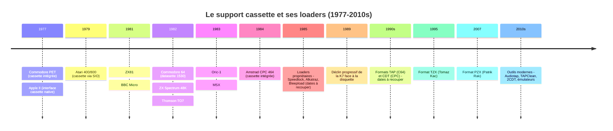
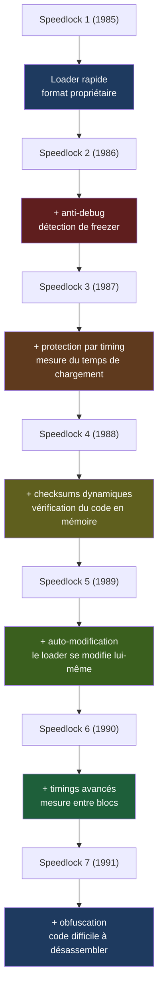
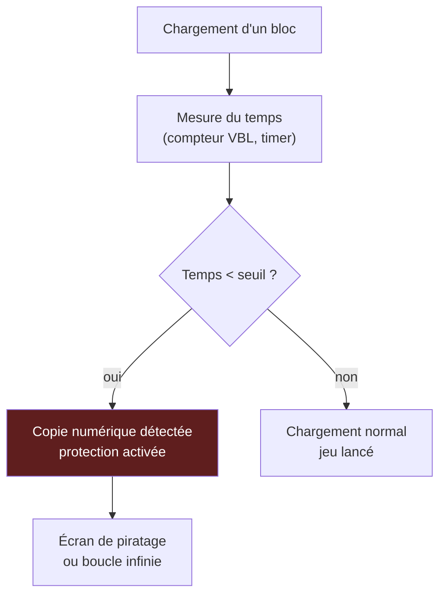
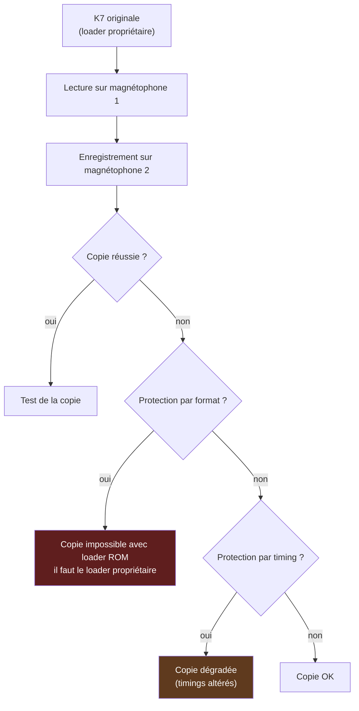
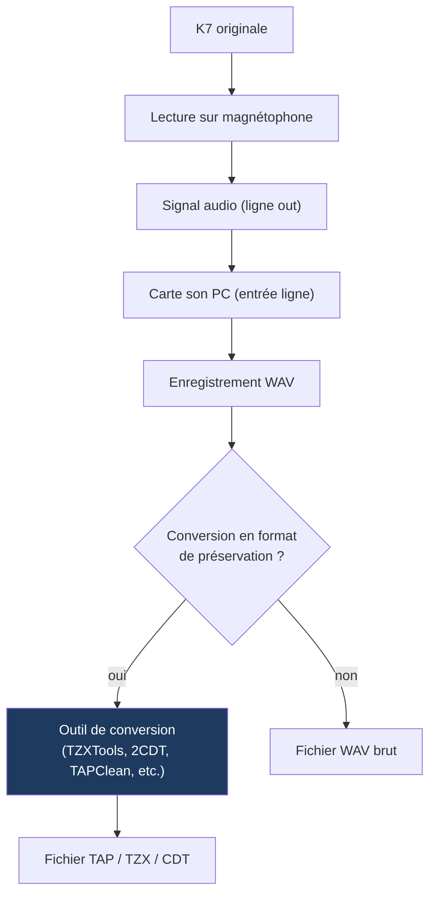
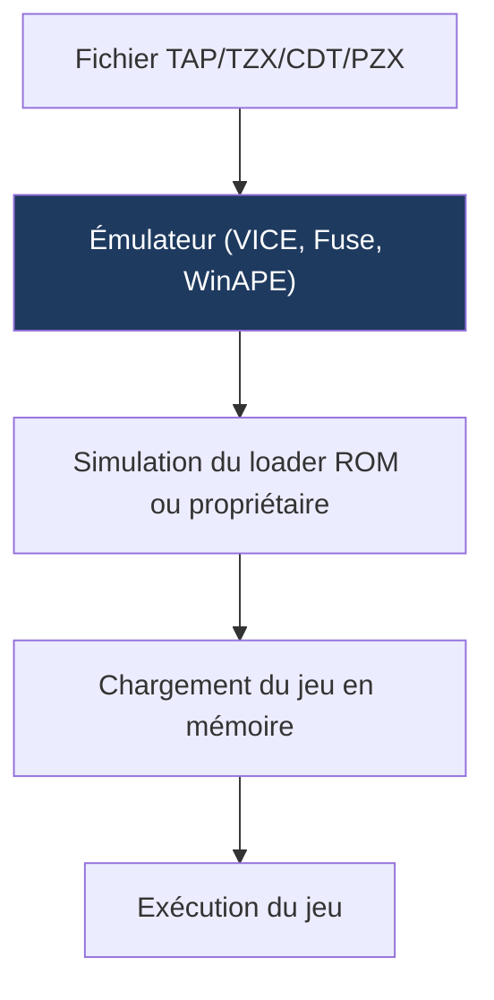

# 📼 Les Protections sur K7 et les Loaders — Du "PRESS PLAY ON TAPE" à la préservation numérique
## Rapport technique approfondi — Édition illustrée

| | |
| --- | --- |
| Périmètre | Commodore 64/128, ZX Spectrum, Amstrad CPC, ZX81, Oric, Thomson, MSX, Atari 8 bits, BBC Micro, et périphérie Amiga/ST (cassettes audio) |
| Axe | Le support cassette comme vecteur de logiciels : loaders éditeurs, protections spécifiques, outils de copie et de dump, culture du chargement, préservation moderne |
| Position dans la série | **Troisième volet** après *Le Matériel de Cracking* (disquettes) et *L'Art de la Protection* (disquettes) |
| Illustrations | Diagrammes [Mermaid](https://mermaid.js.org) et schémas ASCII |

### Légende des niveaux de confiance

| Marque | Signification |
| --- | --- |
| ✅ | Fait solidement établi (documentation officielle, formats de préservation) |
| ⚠️ | Information de seconde main ou contradictoire selon les sources |
| 🔧 | Correction ou précision apportée par rapport à la littérature courante |

> **Note** : les « fiches » ASCII (débits en ×N, années, versions) sont des synthèses illustratives, et les mécanismes de protection du §5 des **modèles génériques**. Se reporter à l'Annexe C pour les points corrigés ou à recouper.

---

## Sommaire

- [0. Vue d'ensemble : un support linéaire, une guerre de timings](#0-vue-densemble--un-support-linéaire-une-guerre-de-timings)
- [1. Introduction : pourquoi la cassette a régné](#1-introduction--pourquoi-la-cassette-a-régné)
- [2. Fondamentaux : la cassette audio comme support de données](#2-fondamentaux--la-cassette-audio-comme-support-de-données)
- [3. Les loaders « officiels » (ROM) : la base commune](#3-les-loaders--officiels--rom--la-base-commune)
- [4. Les loaders propriétaires des éditeurs](#4-les-loaders-propriétaires-des-éditeurs)
- [5. Les protections spécifiques K7](#5-les-protections-spécifiques-k7)
- [6. Les outils des crackers : copier, dumper, accélérer](#6-les-outils-des-crackers--copier-dumper-accélérer)
- [7. Études de cas par plateforme](#7-études-de-cas-par-plateforme)
- [8. La culture du chargement : bruits, écrans, temps](#8-la-culture-du-chargement--bruits-écrans-temps)
- [9. La préservation moderne : du TAP au TZX](#9-la-préservation-moderne--du-tap-au-tzx)
- [10. Conclusion](#10-conclusion)
- [Annexes](#annexes)

---

## 0. Vue d'ensemble : un support linéaire, une guerre de timings

### 0.1 Frise chronologique



### 0.2 Cartographie des familles de loaders

```text
                          ┌─────────────────────────────────────────┐
                          │   LOADERS ET PROTECTIONS K7 (1980-1995) │
                          └──────────────┬──────────────────────────┘
                                         │
         ┌───────────────┬───────────────┼───────────────┬───────────────┐
         ▼               ▼               ▼               ▼               ▼
   ┌──────────┐   ┌──────────┐   ┌──────────┐   ┌──────────┐   ┌──────────┐
   │ OFFICIEL │   │ ÉDITEUR  │   │ PROTEC-  │   │ CRACKER  │   │ PRÉSER-  │
   │ (ROM)    │   │ (PROPR.) │   │ TION     │   │ (COPIE)  │   │ VATION   │
   └──────────┘   └──────────┘   └──────────┘   └──────────┘   └──────────┘
         │               │               │               │               │
         ▼               ▼               ▼               ▼               ▼
   C64 datasette   TurboTape       Speedlock       Copie K7→K7     TAP, TZX
   Spectrum ROM    SeaSucker       Alkatraz        Dump numérique  CDT, PZX
   CPC ROM         Fireload        POPS            Fast loaders    MakeTZX
   Atari SIO       Bleepload       Timings         Tape trading    Émulateurs
```

### 0.3 La boucle du duel sur K7

```mermaid
flowchart LR
    A["Éditeur : loader ROM<br/>(lent, standard)"] -->|"copie K7→K7 triviale"| B["Copie facile"]
    B --> C["Éditeur : loader propriétaire<br/>(format maison, rapide)"]
    C -->|"le loader ROM ne sait plus lire"| D["Copie K7→K7 standard échoue"]
    D --> E["Scène : dump numérique<br/>ou copie avec le bon loader"]
    E -->|"conversion TAP/TZX<br/>ou copie avec loader éditeur"| F["Protection contournée"]
    F --> G["Éditeur : timings, checksums,<br/>silences, auto-modif"]
    G --> E
    style E fill:#1e3a5f,color:#fff
    style C fill:#5f1e1e,color:#fff
    style G fill:#5f3a1e,color:#fff
```



---

## 1. Introduction : pourquoi la cassette a régné

Avant la disquette (chère, ≈ 1500 F en 1985), avant le CD-ROM (années 1990), la **cassette audio compact** était le support universel de distribution des logiciels. Elle coûtait 20 à 50 F, tenait 30 à 90 minutes, et se lisait sur n'importe quel magnétophone du commerce — ou sur le datasette dédié de la machine.

### 1.1 Les avantages de la cassette

| Avantage | Détail |
| --- | --- |
| **Coût** | 10 à 50 fois moins chère qu'une disquette |
| **Universalité** | Tout magnétophone peut lire/écrire |
| **Capacité** | 30 à 90 minutes (≈ 50 à 150 Ko en loader rapide) |
| **Durabilité** | Support robuste (pas de tête de lecture fragile) |
| **Distribution** | Facile à dupliquer industriellement (pressage) |

### 1.2 Les inconvénients structurels

| Inconvénient | Conséquence |
| --- | --- |
| **Support linéaire** | Pas d'accès aléatoire : il faut dérouler la bande |
| **Vitesse variable** | La vitesse de défilement dépend du magnétophone (± 5 %) |
| **Qualité audio** | Bruit, distorsion, démagnétisation |
| **Temps de chargement** | De 30 secondes à 15 minutes pour un jeu complet |
| **Pas de protection physique** | Impossible de créer des « weak bits » ou des « long tracks » |

### 1.3 Le paradoxe de la cassette

La cassette est **le support le plus facile à copier** (il suffit d'un deuxième magnétophone) et **le plus difficile à protéger**. Les éditeurs ont donc dû innover non pas au niveau du support (comme sur disquette), mais au niveau du **format de données** et du **logiciel de chargement** (le « loader »).

C'est pourquoi l'histoire des protections K7 est avant tout une **histoire de loaders** : des programmes qui transforment un signal audio en données numériques, avec des formats propriétaires, des timings, des checksums, et parfois des pièges.

---

## 2. Fondamentaux : la cassette audio comme support de données

### 2.1 Du signal audio au bit

Une cassette audio enregistre des **variations de tension** (signal analogique). Pour y stocker des données numériques, on utilise une **modulation** ou un codage par durée d'impulsion. 🔧 Les loaders ROM du C64 et du Spectrum relèvent du second cas, pas du FSK au sens strict :

| Modulation | Principe | Utilisée par |
| --- | --- | --- |
| **FSK** (Frequency Shift Keying) | Deux fréquences distinctes pour 0 et 1 | Atari 8 bits, MSX, BBC Micro, Oric |
| **Durée d'impulsion** | La durée des impulsions (courte / longue) porte le bit | C64, ZX Spectrum, ZX81, CPC ⚠️ |
| **Manchester** | Transition au milieu de chaque bit | Certains loaders propriétaires |
| **PWM** (Pulse Width Modulation) | Largeur d'impulsion variable | Quelques loaders exotiques |

### 2.2 Le cas du Commodore 64 : la datasette

Le C64 utilise une **datasette** (Commodore 1530, pas un magnétophone standard) branchée sur un **port cassette dédié**, qui permet à la machine de commander le moteur. Le signal est une suite d'**impulsions** dont la **durée** encode les bits :

```text
 ┌──────────────────────────────────────────────────────────────┐
 │  SIGNAL DATASETTE C64 (loader ROM, KERNAL)                   │
 ├──────────────────────────────────────────────────────────────┤
 │  Un bit = deux impulsions successives :                      │
 │    • Bit 0 : courte puis moyenne                             │
 │    • Bit 1 : moyenne puis courte                             │
 │    • Marqueur d'octet : longue puis moyenne                  │
 │  Durées usuelles (valeurs du format TAP, PAL) :              │
 │    courte ≈ 390 µs (0x30), moyenne ≈ 540 µs (0x42),          │
 │    longue ≈ 700 µs (0x56)                                    │
 │  Chaque octet est suivi d'un bit de parité ; chaque bloc     │
 │  est enregistré DEUX fois (correction d'erreurs).            │
 └──────────────────────────────────────────────────────────────┘
```

**Débit** : ≈ 300 bauds nominaux ; comme chaque bloc est écrit deux fois, le débit utile est de l'ordre de **50 octets/s**. Un jeu de 40 Ko se charge en ≈ 15 minutes ⚠️.

### 2.3 Le cas du ZX Spectrum : le loader ROM

Le Spectrum utilise un **magnétophone standard** (pas de datasette dédiée). Le signal est codé par **durée d'impulsion** (et non en FSK strict), avec des durées différentes :

```text
 ┌──────────────────────────────────────────────────────────────┐
 │  SIGNAL SPECTRUM ROM                                         │
 ├──────────────────────────────────────────────────────────────┤
 │  Pilote : impulsions de ≈ 619 µs (≈ 810 Hz) :                │
 │    ≈ 5 s pour un en-tête, ≈ 2 s pour un bloc de données      │
 │  Synchro : deux courtes impulsions (≈ 190 µs, ≈ 210 µs)      │
 │  Bit 0 : 2 impulsions de ≈ 244 µs (≈ 2 kHz)                  │
 │  Bit 1 : 2 impulsions de ≈ 488 µs (≈ 1 kHz)                  │
 │                                                              │
 │  Débit moyen : ≈ 1 400-1 500 bauds (≈ 170 octets/s)          │
 │  Un jeu de 40 Ko se charge en ≈ 4 minutes                    │
 └──────────────────────────────────────────────────────────────┘
```

### 2.4 Le cas de l'Amstrad CPC

Le CPC 464 a un **magnétophone intégré** (pas de datasette externe). Le principe (impulsions modulées en durée) est comparable, avec des timings différents ⚠️ :

```text
 ┌──────────────────────────────────────────────────────────────┐
 │  SIGNAL CPC ROM                                              │
 ├──────────────────────────────────────────────────────────────┤
 │  Deux vitesses : 1000 bauds (défaut) et 2000 bauds           │
 │  Données en segments de 256 octets, chacun protégé par       │
 │  un CRC 16 bits ; blocs de 2 Ko au maximum                   │
 │                                                              │
 │  Débit : ≈ 1000 bauds (≈ 125 octets/s) par défaut            │
 └──────────────────────────────────────────────────────────────┘
```

### 2.5 Pourquoi les loaders propriétaires ?

Les loaders ROM sont **lents** et **standards**. Les éditeurs ont donc développé leurs propres loaders pour :

1. **Accélérer le chargement** (×2 à ×10)
2. **Protéger le logiciel** (format non standard, checksums, timings)
3. **Afficher des écrans de chargement animés** (loading screens)

C'est la naissance des **loaders propriétaires**, qui sont à la fois des outils de performance et des outils de protection.

---

## 3. Les loaders « officiels » (ROM) : la base commune

### 3.1 Tableau comparatif

| Plateforme | Loader ROM | Débit | Temps de chargement (40 Ko) | Particularités |
| --- | --- | --- | --- | --- |
| C64 (datasette) | Impulsions courte / moyenne / longue | ≈ 300 bauds nominaux (≈ 50 o/s utiles) | ≈ 15 min | Datasette dédiée ; blocs écrits deux fois |
| ZX Spectrum | Durée d'impulsion (≈ 2 kHz / 1 kHz) | ≈ 1 400-1 500 bauds | ≈ 4 min | Magnétophone standard |
| CPC 464 | Durée d'impulsion ⚠️ | 1000 bauds (2000 en option) | ≈ 5-6 min (à 1000 bauds) | Magnétophone intégré |
| ZX81 | Salves d'impulsions (≈ 3 kHz) | ≈ 300 bauds | ≈ 18 min (≈ 7-9 min pour 16 Ko) | Très lent |
| Oric | FSK 1200 / 2400 Hz | 300 bauds (lent) ou 2400 (rapide) | ≈ 18 min (300) / ≈ 3 min (2400) | Deux vitesses ✅ |
| Thomson TO7 | FSK ⚠️ | ≈ 1200 bauds ⚠️ | ≈ 5 min ⚠️ | Format maison |
| MSX | FSK 1200 / 2400 Hz | 1200 bauds (2400 en option) | ≈ 5 min | Standard MSX |
| BBC Micro | FSK 1200 / 2400 Hz (Kansas City Standard) | 300 bauds (ou 1200) | ≈ 18 min (300) / ≈ 5 min (1200) | Deux débits |
| Atari 8 bits | FSK 3995 / 5327 Hz | 600 bauds | ≈ 9 min | Magnétophone 1010 via le port SIO |

### 3.2 Le format standard : blocs et checksums

Tous les loaders ROM utilisent une structure similaire :

```text
 ┌──────────────────────────────────────────────────────────────┐
 │  STRUCTURE D'UN BLOC K7 (loader ROM)                         │
 ├──────────────────────────────────────────────────────────────┤
 │  1. Pilote (sync) : longue séquence de bits identiques       │
 │     (permet au loader de se synchroniser sur le signal)      │
 │  2. En-tête : nom du fichier, taille, type                   │
 │  3. Données : le contenu du fichier                          │
 │  4. Checksum : somme de contrôle (XOR ou somme modulo 256)   │
 │  5. Silence : pause entre blocs                              │
 └──────────────────────────────────────────────────────────────┘
```

**Exemple C64 (loader ROM)** :

```text
 Pilote : ≈ 10 s d'impulsions courtes (sync) ⚠️
 En-tête : type (1 o) + adresse début (2 o) + adresse fin (2 o) + nom (16 o)
 Données : N octets
 Checksum : XOR de tous les octets (1 o)
 Chaque bloc est enregistré une seconde fois (correction d'erreurs)
```

### 3.3 Les limites du loader ROM

| Limite | Conséquence |
| --- | --- |
| **Lent** | 300-1200 bauds, temps de chargement longs |
| **Standard** | Tout le monde peut copier avec un loader ROM |
| **Pas de protection** | Aucun mécanisme anti-copie |
| **Pas d'écran animé** | L'écran reste noir ou affiche un message statique |

C'est pourquoi les éditeurs ont développé leurs propres loaders.

---

## 4. Les loaders propriétaires des éditeurs

### 4.1 Pourquoi des loaders propriétaires ?

Les loaders propriétaires répondent à trois besoins :

1. **Accélérer le chargement** : ×2 à ×10 par rapport au loader ROM
2. **Protéger le logiciel** : format non standard, difficile à copier
3. **Personnaliser l'expérience** : écrans de chargement animés, musiques

### 4.2 Les grands loaders propriétaires par plateforme

#### 4.2.1 Commodore 64

| Loader | Éditeur | Année | Débit (indicatif ⚠️) | Particularités |
| --- | --- | --- | --- | --- |
| **Turbo Tape 64** | Utilitaire largement diffusé | ≈ 1984-1985 ⚠️ | ×3-5 | Turbo-chargeur généraliste |
| **Ocean Loader** | Ocean Software | milieu des années 1980 | ×3-4 | Écran de chargement musical (Martin Galway ✅) |
| **Novaload, Cyberload, Visiload, Pavloda** ⚠️ | Divers éditeurs | milieu des années 1980 | — | Turbo-loaders d'éditeurs souvent cités ; attributions à recouper |

#### 4.2.2 ZX Spectrum

| Loader | Éditeur | Année | Débit (indicatif ⚠️) | Particularités |
| --- | --- | --- | --- | --- |
| **Speedlock 1-7** | Speedlock Associates ✅ | ≈ 1984-1991 ⚠️ | ×3-8 | Loader + protection (voir §4.4 et §5) |
| **Alkatraz** | Alkatraz | ≈ 1986 ⚠️ | ×4 | Loader rapide, format propriétaire |
| **Paul Owens Protection System (POPS)** | — | ≈ 1987 ⚠️ | ×3 | Loader + protection |
| **Fireload** | Firebird ⚠️ | ≈ 1987 ⚠️ | ×4 | Loader rapide |
| **Bleepload** | — | ≈ 1988 ⚠️ | ×5 | Loader très rapide |

#### 4.2.3 Amstrad CPC

| Loader | Éditeur | Année | Débit (indicatif ⚠️) | Particularités |
| --- | --- | --- | --- | --- |
| **Speedlock CPC** | Speedlock Associates ✅ | ≈ 1986-1991 ⚠️ | ×3-6 | Loader + protection |
| **Alkatraz CPC** | Alkatraz | ≈ 1987 ⚠️ | ×4 | Loader rapide |

#### 4.2.4 Autres plateformes

| Plateforme | Loader | Particularités |
| --- | --- | --- |
| Oric | Mode rapide du ROM (2400 bauds) ✅ ; **Hyperload** ⚠️ | Hyperload : à recouper |
| Thomson | Loaders maison ⚠️ | Nom générique, pas de loader précis documenté ici |
| MSX | Modes 1200 / 2400 bauds du BIOS ✅ | Turbo-loaders tiers non détaillés |
| BBC Micro | Mode 1200 bauds de l'OS ✅ | Turbo-loaders tiers non détaillés |

> Les débits (×N) et années sont des ordres de grandeur. Seuls Speedlock, Alkatraz, Ocean Loader et POPS sont solidement attestés ; les autres noms sont à recouper.

### 4.3 Anatomie d'un loader propriétaire

Un loader propriétaire typique comprend :

```text
 ┌──────────────────────────────────────────────────────────────┐
 │  ANATOMIE D'UN LOADER PROPRIÉTAIRE                           │
 ├──────────────────────────────────────────────────────────────┤
 │  1. Routine de synchronisation                               │
 │     - Détection du pilote (sync)                             │
 │     - Calibration de la vitesse (optionnel)                  │
 │                                                              │
 │  2. Routine de décodage                                      │
 │     - Lecture du signal audio                                │
 │     - Conversion en bits (durées d'impulsion, FSK, etc.)     │
 │     - Gestion des erreurs (retry, skip)                      │
 │                                                              │
 │  3. Routine de vérification                                  │
 │     - Checksum (XOR, somme, CRC)                             │
 │     - Validation de l'en-tête                                │
 │                                                              │
 │  4. Routine de chargement                                    │
 │     - Écriture des données en mémoire                        │
 │     - Gestion des blocs multiples                            │
 │                                                              │
 │  5. Routine de protection (optionnel)                        │
 │     - Timings (mesure du temps de chargement)                │
 │     - Auto-modification (le loader se modifie lui-même)      │
 │     - Anti-debug (détection de freezer)                      │
 └──────────────────────────────────────────────────────────────┘
```

### 4.4 Zoom : Speedlock (Spectrum et CPC)

**Speedlock** est **le loader propriétaire le plus célèbre** des années 1980, développé par **Speedlock Associates** (Royaume-Uni, conçu par David Looker). Il a connu **7 générations** successives, chacune ajoutant des couches de protection.

> ⚠️ Le détail « génération par génération » (schéma et fiche ci-dessous) est une **reconstruction pédagogique** : l'apport exact de chaque version n'est pas documenté ici de façon vérifiable. Il illustre la montée en complexité, pas un historique daté.



```text
 ┌──────────────────────────────────────────────────────────────┐
 │  SPEEDLOCK (schéma illustratif)                              │
 ├──────────────────────────────────────────────────────────────┤
 │  Speedlock 1 (1985) :                                        │
 │  • Loader rapide (×3-5 par rapport au ROM)                   │
 │  • Format propriétaire (codage modifié)                      │
 │  • Écran de chargement animé                                 │
 │                                                              │
 │  Speedlock 2 (1986) :                                        │
 │  • + anti-debug : détection de la présence d'un freezer      │
 │    (Multiface, etc.) via vérification des vecteurs NMI       │
 │                                                              │
 │  Speedlock 3 (1987) :                                        │
 │  • + protection par timing : mesure du temps de chargement   │
 │    d'un bloc. Si trop rapide (copie numérique), échec        │
 │                                                              │
 │  Speedlock 4 (1988) :                                        │
 │  • + checksums dynamiques : vérification du code en mémoire  │
 │    après chargement. Si modifié (crack), échec               │
 │                                                              │
 │  Speedlock 5 (1989) :                                        │
 │  • + auto-modification : le loader se modifie lui-même       │
 │    pendant le chargement, rendant le désassemblage difficile │
 │                                                              │
 │  Speedlock 6 (1990) :                                        │
 │  • + timings avancés : mesure du temps entre plusieurs blocs │
 │    (pas seulement un bloc)                                   │
 │                                                              │
 │  Speedlock 7 (1991) :                                        │
 │  • + obfuscation : code rendu difficile à lire (junk code,   │
 │    sauts imbriqués, calculs redondants)                      │
 └──────────────────────────────────────────────────────────────┘
```

**Impact** : Speedlock a été utilisé par des centaines de jeux Spectrum et CPC (Ocean, US Gold, etc.). Il a été **systématiquement cracké** par la scène, mais chaque génération a nécessité de nouvelles techniques.

---

## 5. Les protections spécifiques K7

### 5.1 Pourquoi les protections K7 sont différentes des protections disquette

| Protection disquette | Protection K7 |
| --- | --- |
| **Weak bits** (zone sans flux) | ❌ Impossible (support linéaire, pas de flux magnétique aléatoire) |
| **Long tracks** (piste > 100 %) | ❌ Impossible (pas de pistes, juste une bande linéaire) |
| **CRC faux** | ✅ Possible (checksum volontairement faux) |
| **Secteurs hors-norme** | ❌ Impossible (pas de secteurs) |
| **Timings** | ✅ Possible (mesure du temps de chargement) |
| **Anti-debug** | ✅ Possible (détection de freezer) |
| **Auto-modification** | ✅ Possible (le loader se modifie) |
| **Silences** | ✅ Possible (zones de silence entre blocs) |

### 5.2 Les protections par timing

**Principe** : le loader mesure le **temps de chargement** d'un bloc. Si le temps est trop court (copie numérique, fast loader), la protection échoue.



**Contre-mesure** : le cracker doit **patcher la routine de mesure** pour qu'elle retourne toujours un temps « normal », ou **désactiver le fast loader** pendant le chargement.

### 5.3 Les protections par checksums dynamiques

**Principe** : après chargement, le programme vérifie que le code en mémoire n'a pas été modifié (par un crack).

```text
 ┌──────────────────────────────────────────────────────────────┐
 │  PROTECTION PAR CHECKSUM DYNAMIQUE                           │
 ├──────────────────────────────────────────────────────────────┤
 │  1. Le programme calcule la somme de contrôle du code chargé │
 │  2. Il compare avec une valeur attendue                      │
 │  3. Si la somme diffère (code modifié), le programme réagit  │
 │     (écran de piratage, boucle infinie)                      │
 └──────────────────────────────────────────────────────────────┘
```

**Contre-mesure** : le cracker doit **recalculer le checksum** après modification, ou **patcher le test**.

### 5.4 Les protections par auto-modification

**Principe** : le loader **se modifie lui-même** pendant le chargement. Cela rend le désassemblage statique inefficace.

```text
 ┌──────────────────────────────────────────────────────────────┐
 │  PROTECTION PAR AUTO-MODIFICATION                            │
 ├──────────────────────────────────────────────────────────────┤
 │  1. Le loader contient du code « mort » (inintelligible)     │
 │  2. Pendant le chargement, il s'auto-modifie pour devenir    │
 │     exécutable                                               │
 │  3. Un désassembleur statique ne voit que du code mort       │
 │  4. Il faut exécuter le loader pas-à-pas pour le comprendre  │
 └──────────────────────────────────────────────────────────────┘
```

**Contre-mesure** : désassemblage dynamique (pas-à-pas), ou gel après auto-modification.

### 5.5 Les protections par silences

**Principe** : des **zones de silence** sont insérées entre les blocs. Le loader mesure la durée du silence. Si trop court (copie numérique qui supprime les silences), la protection échoue.

```text
 ┌──────────────────────────────────────────────────────────────┐
 │  PROTECTION PAR SILENCES                                     │
 ├──────────────────────────────────────────────────────────────┤
 │  Bloc 1 ─── [SILENCE 2s] ─── Bloc 2 ─── [SILENCE 3s] ───     │
 │                                                              │
 │  Le loader mesure la durée du silence.                       │
 │  Si < 1,5s → copie détectée                                  │
 └──────────────────────────────────────────────────────────────┘
```

**Contre-mesure** : le cracker doit **préserver les silences** lors de la copie, ou **patcher la mesure**.

### 5.6 Les protections par anti-debug

**Principe** : le loader détecte la présence d'un **freezer** (Multiface, Action Replay) et réagit.

```text
 ┌──────────────────────────────────────────────────────────────┐
 │  PROTECTION PAR ANTI-DEBUG                                   │
 ├──────────────────────────────────────────────────────────────┤
 │  1. Le loader vérifie les vecteurs d'interruption (NMI, IRQ) │
 │  2. Si un vecteur a été détourné (freezer actif), le loader  │
 │     réagit (écran de piratage)                               │
 │  3. Ou : le loader mesure le temps entre deux instructions   │
 │     (un freezer ralentit l'exécution)                        │
 └──────────────────────────────────────────────────────────────┘
```

**Contre-mesure** : désactiver le freezer (fonction « kill » ou interrupteur), ou patcher le test.

### 5.7 Les protections par format propriétaire

**Principe** : le loader utilise un **format de données non standard** (codage modifié, vitesse non standard, etc.) que le loader ROM ne sait pas lire.

```text
 ┌──────────────────────────────────────────────────────────────┐
 │  PROTECTION PAR FORMAT PROPRIÉTAIRE                          │
 ├──────────────────────────────────────────────────────────────┤
 │  1. Le loader utilise un codage non standard                 │
 │     (ex : durées d'impulsion différentes du ROM)             │
 │  2. Une copie K7→K7 avec un loader ROM échoue                │
 │  3. Il faut utiliser le loader propriétaire pour copier      │
 └──────────────────────────────────────────────────────────────┘
```

**Contre-mesure** : le cracker doit **dumper le signal** (voir §6), ou **copier avec le bon loader**.

### 5.8 Tableau récapitulatif

| Protection | Principe | Détectée par… | Contre-mesure |
| --- | --- | --- | --- |
| **Timing** | Mesure du temps de chargement | Compteur VBL, timer | Patch de la mesure, désactivation fast loader |
| **Checksum dynamique** | Vérification du code en mémoire | Somme de contrôle | Recalcul du checksum, patch du test |
| **Auto-modification** | Le loader se modifie lui-même | Exécution pas-à-pas | Désassemblage dynamique |
| **Silences** | Zones de silence entre blocs | Mesure de durée | Préservation des silences, patch |
| **Anti-debug** | Détection de freezer | Vecteurs d'interruption | Désactivation du freezer (« kill ») |
| **Format propriétaire** | Modulation non standard | Loader ROM | Dump numérique, copie avec bon loader |

---

## 6. Les outils des crackers : copier, dumper, accélérer

### 6.1 La copie K7→K7

**Principe** : copier une K7 protégée sur une autre K7, en utilisant deux magnétophones.



**Limites** :

- La copie K7→K7 **dégrade le signal** (bruit, distorsion)
- Les protections par **timing** peuvent échouer (vitesse variable des magnétophones)
- Les protections par **format propriétaire** nécessitent le bon loader

### 6.2 Le dump numérique

**Principe** : convertir le signal audio de la K7 en **fichier numérique** (WAV, TAP, TZX, etc.) pour le préserver ou le copier sans dégradation.



**Outils de dump** :

| Plateforme | Outil | Format produit |
| --- | --- | --- |
| C64 | **Audiotap**, **Wav-PRG**, **TAPClean** ✅ | TAP |
| Spectrum | **TZXTools** (Tomaz Kac) ✅, **Tapir** ⚠️ | TZX, TAP, WAV |
| CPC | **2CDT**, **CDTDRV** ✅ | CDT |
| Multi | **Audacity** (capture WAV propre) ✅ | WAV |

### 6.3 Les fast loaders

**Principe** : des routines logicielles qui **accélèrent le chargement** depuis la K7, en contournant le loader ROM.

| Plateforme | Fast loader | Débit | Particularités |
| --- | --- | --- | --- |
| C64 | **Turbo Tape 64**, **Ocean Loader** | ×3-5 ⚠️ | Loader rapide, format propriétaire |
| Spectrum | **Speedlock**, **Alkatraz** | ×3-8 | Loader rapide, protection |
| CPC | **Speedlock CPC**, **Alkatraz CPC** | ×3-6 | Loader rapide, protection |

**Attention** : les fast loaders peuvent être **détectés par les protections par timing**.

### 6.4 Les cracktros sur K7

**Principe** : ajouter une **intro de groupe** (cracktro) avant le jeu, sur la même K7.

```text
 ┌──────────────────────────────────────────────────────────────┐
 │  STRUCTURE D'UNE K7 CRACKÉE                                  │
 ├──────────────────────────────────────────────────────────────┤
 │  1. Cracktro (loader + musique + scroll + logo)              │
 │  2. Jeu (loader propriétaire ou ROM)                         │
 │                                                              │
 │  La cracktro est chargée en premier, puis le jeu             │
 └──────────────────────────────────────────────────────────────┘
```

### 6.5 Le tape trading

**Principe** : échanger des K7 crackées entre membres de la scène, par courrier postal ou lors de rencontres.

```text
 ┌──────────────────────────────────────────────────────────────┐
 │  LE TAPE TRADING                                             │
 ├──────────────────────────────────────────────────────────────┤
 │  1. Un cracker crack un jeu et l'enregistre sur K7           │
 │  2. Il envoie la K7 à un « courier »                         │
 │  3. Le courier la copie et l'envoie à d'autres membres       │
 │  4. La K7 circule dans la scène (swapping postal)            │
 │                                                              │
 │  La qualité se dégrade à chaque copie (bruit, distorsion)    │
 └──────────────────────────────────────────────────────────────┘
```

---

## 7. Études de cas par plateforme

### 7.1 Commodore 64 : Turbo Tape 64 et l'Ocean Loader

**Turbo Tape 64** (≈ 1984-1985 ⚠️) est un turbo-chargeur généraliste très répandu sur C64. Il raccourcit les durées d'impulsion pour accélérer le chargement (×3-5 ⚠️).

```text
 ┌──────────────────────────────────────────────────────────────┐
 │  TURBO TAPE 64 (C64)                                         │
 ├──────────────────────────────────────────────────────────────┤
 │  • Loader rapide (×3-5 par rapport au ROM)                   │
 │  • Impulsions plus courtes que celles du ROM                 │
 │  • Écran de chargement : selon le jeu                        │
 │  • Pas de protection avancée                                 │
 │                                                              │
 │  Contre-mesure :                                             │
 │  • Copie avec le même turbo-chargeur                         │
 │  • Dump numérique (TAP)                                      │
 └──────────────────────────────────────────────────────────────┘
```

**Ocean Software** a utilisé l'**Ocean Loader** (milieu des années 1980), un turbo-chargeur célèbre pour ses écrans de chargement musicaux (musique de **Martin Galway** ✅).

```text
 ┌──────────────────────────────────────────────────────────────┐
 │  OCEAN LOADER (C64)                                          │
 ├──────────────────────────────────────────────────────────────┤
 │  • Loader très rapide (×4)                                   │
 │  • Écran de chargement animé (scroll, musique)               │
 │  • Musique de Martin Galway (célèbre)                        │
 │  • Format propriétaire                                       │
 │                                                              │
 │  Contre-mesure :                                             │
 │  • Copie avec l'Ocean Loader                                 │
 │  • Dump numérique (TAP)                                      │
 └──────────────────────────────────────────────────────────────┘
```

### 7.2 ZX Spectrum : Speedlock et POPS

**Speedlock** (voir §4.4) a été le loader propriétaire le plus utilisé sur Spectrum. Ses 7 générations ont représenté un défi constant pour les crackers.

**POPS (Paul Owens' Protection System)** est un autre système de chargement/protection connu sur Spectrum, utilisé par plusieurs éditeurs britanniques ⚠️ (dates et liste d'éditeurs à recouper).

```text
 ┌──────────────────────────────────────────────────────────────┐
 │  POPS (Paul Owens' Protection System)                        │
 ├──────────────────────────────────────────────────────────────┤
 │  • Loader rapide (×3)                                        │
 │  • Format propriétaire                                       │
 │  • Protection par checksum                                   │
 │  • Écran de chargement animé                                 │
 │                                                              │
 │  Contre-mesure :                                             │
 │  • Copie avec loader POPS                                    │
 │  • Dump numérique (TZX)                                      │
 │  • Patch du checksum                                         │
 └──────────────────────────────────────────────────────────────┘
```

### 7.3 Amstrad CPC : Speedlock CPC et Alkatraz

**Speedlock CPC** est l'adaptation du Speedlock Spectrum au CPC. Il applique les mêmes principes généraux ⚠️ (timings, checksums, anti-debug).

**Alkatraz CPC** (≈ 1987) est un loader rapide (×4) avec format propriétaire.

```text
 ┌──────────────────────────────────────────────────────────────┐
 │  ALKATRAZ CPC                                                │
 ├──────────────────────────────────────────────────────────────┤
 │  • Loader rapide (×4)                                        │
 │  • Format propriétaire                                       │
 │  • Écran de chargement : selon le jeu                        │
 │  • Niveau de protection : à recouper                         │
 │                                                              │
 │  Contre-mesure :                                             │
 │  • Copie avec loader Alkatraz                                │
 │  • Dump numérique (CDT)                                      │
 └──────────────────────────────────────────────────────────────┘
```

### 7.4 ZX81 : le loader ultra-lent

Le ZX81 utilise un loader ROM **très lent** (≈ 300 bauds), ce qui rend le chargement d'un jeu de 16 Ko long (≈ 7-9 minutes).

```text
 ┌──────────────────────────────────────────────────────────────┐
 │  ZX81 ROM LOADER                                             │
 ├──────────────────────────────────────────────────────────────┤
 │  • Loader lent (≈ 300 bauds)                                 │
 │  • Salves d'impulsions (≈ 3 kHz)                             │
 │  • Pas de protection                                         │
 │  • Temps de chargement : ≈ 7-9 min pour 16 Ko                │
 │                                                              │
 │  Contre-mesure :                                             │
 │  • Copie K7→K7 triviale                                      │
 │  • Dump numérique (.P ou WAV)                                │
 └──────────────────────────────────────────────────────────────┘
```

### 7.5 Oric : Hyperload

**Hyperload** ⚠️ est cité comme loader rapide pour Oric (×3-5), avec format propriétaire ; à recouper. Le ROM de l'Oric propose déjà un mode rapide à 2400 bauds ✅.

```text
 ┌──────────────────────────────────────────────────────────────┐
 │  HYPERLOAD (Oric)                                            │
 ├──────────────────────────────────────────────────────────────┤
 │  • Loader rapide (×3-5)                                      │
 │  • Format propriétaire                                       │
 │  • Écran de chargement animé                                 │
 │                                                              │
 │  Contre-mesure :                                             │
 │  • Copie avec loader Hyperload                               │
 │  • Dump numérique                                            │
 └──────────────────────────────────────────────────────────────┘
```

---

## 8. La culture du chargement : bruits, écrans, temps

### 8.1 Les bruits caractéristiques

Chaque loader a un **bruit caractéristique** (le son du signal audio). Ces bruits sont devenus iconiques :

| Loader | Bruit caractéristique |
| --- | --- |
| C64 ROM | Grésillement continu (impulsions courtes / moyennes) |
| Spectrum ROM | Pilote : sifflement grave continu (≈ 810 Hz), puis crépitement aigu des données |
| Speedlock | Sifflement modulé (codage modifié) |
| Ocean Loader | Grésillement + musique pendant le chargement |
| Alkatraz | Grésillement rapide |

Ces bruits sont **reproduits dans les émulateurs** pour l'authenticité.

### 8.2 Les écrans de chargement (loading screens)

Les loaders propriétaires affichent souvent des **écrans de chargement animés** pendant le chargement :

```text
 ┌──────────────────────────────────────────────────────────────┐
 │  LOADING SCREENS                                             │
 ├──────────────────────────────────────────────────────────────┤
 │  • Écrans fixes (logo de l'éditeur, nom du jeu)              │
 │  • Écrans animés (scroll, effets graphiques)                 │
 │  • Écrans avec musique (SID sur C64 ; AY sur 128K/CPC)       │
 │                                                              │
 │  Exemples célèbres :                                         │
 │  • Ocean Loader (C64) : scroll + musique de Martin Galway    │
 │  • Spectrum : bandes de couleur du border + écran fixe       │
 │  • Compositeurs C64 de l'époque : Martin Galway, Rob Hubbard │
 └──────────────────────────────────────────────────────────────┘
```

### 8.3 Les temps de chargement

Les temps de chargement variaient énormément selon le loader et la taille du jeu :

| Loader | Débit | Temps (40 Ko) |
| --- | --- | --- |
| C64 ROM | ≈ 300 bauds nominaux | ≈ 15 min |
| Spectrum ROM | ≈ 1 400-1 500 bauds | ≈ 4 min |
| CPC ROM | 1000 bauds | ≈ 5-6 min |
| Turbo Tape 64 (C64) | ×3-5 ⚠️ | ≈ 3-5 min |
| Speedlock (Spectrum) | ×3-8 ⚠️ | ≈ 1-2 min |
| Ocean Loader (C64) | ×3-4 ⚠️ | ≈ 4 min |

### 8.4 Le « PRESS PLAY ON TAPE »

Le message **« PRESS PLAY ON TAPE »** (ou **« PRESS PLAY »**) est l'invite affichée par le KERNAL du C64 pour demander à l'utilisateur de lancer la lecture de la K7 (sur Spectrum et CPC, l'équivalent est « Start tape, then press any key » / « Press PLAY then any key: »). Ce message est devenu **iconique** et est souvent reproduit dans les jeux modernes (hommages, rétros).

```text
 ┌──────────────────────────────────────────────────────────────┐
 │                                                              │
 │                    PRESS PLAY ON TAPE                        │
 │                                                              │
 │            (puis : OK, SEARCHING, FOUND, LOADING)            │
 │                                                              │
 └──────────────────────────────────────────────────────────────┘
```

### 8.5 Les multi-chargements

Beaucoup de jeux K7 sont **multi-chargements** : le jeu recharge du code en cours de partie (niveaux, écrans, etc.). Cela nécessite de **revenir à la K7** et de rebobiner pour trouver le bon bloc.

```text
 ┌──────────────────────────────────────────────────────────────┐
 │  MULTI-CHARGEMENT K7                                         │
 ├──────────────────────────────────────────────────────────────┤
 │  Bloc 1 : Niveau 1                                           │
 │  Bloc 2 : Niveau 2                                           │
 │  Bloc 3 : Niveau 3                                           │
 │  ...                                                         │
 │                                                              │
 │  Le jeu affiche : "PLAY SIDE 2" ou "REWIND TAPE"             │
 │  L'utilisateur doit retrouver le bon bloc sur la K7          │
 └──────────────────────────────────────────────────────────────┘
```

---

## 9. La préservation moderne : du TAP au TZX

### 9.1 Les formats de préservation

| Format | Plateforme | Niveau | Contenu | Préserve les protections ? |
| --- | --- | --- | --- | --- |
| **TAP** (C64) | C64 | Physique (impulsions) | Durée de chaque impulsion (1 octet par impulsion) | Oui (en grande partie) |
| **TAP** (Spectrum) | Spectrum | Logique | Blocs (longueur + flag + données + checksum) | Non (loader ROM seulement) |
| **TZX** | Spectrum, CPC, autres | Logique+ | Blocs de données + timings + silences + formats propriétaires | Oui (en grande partie) |
| **CDT** | CPC | Logique+ | Similaire à TZX, adapté au CPC | Oui |
| **PZX** | Spectrum | Physique | Flux de bits (plus précis que TZX) | Oui (intégralement) |
| **WAV** | Multi | Physique | Signal audio brut | Oui (intégralement, mais volumineux) |
| **CAS** | Atari 8 bits | Logique | Blocs de données | Partiellement |

### 9.2 Le format TAP (C64)

**TAP** est le format de préservation le plus répandu pour les cassettes C64 (apparu dans les années 1990 avec l'émulateur CCS64 ⚠️). 🔧 Il stocke la **durée de chaque impulsion** du signal (un octet par impulsion), ce qui permet de préserver les loaders propriétaires et la plupart des protections.

```text
 ┌──────────────────────────────────────────────────────────────┐
 │  FORMAT TAP (C64)                                            │
 ├──────────────────────────────────────────────────────────────┤
 │  En-tête fichier :                                           │
 │  • Signature : "C64-TAPE-RAW" (12 octets)                    │
 │  • Version : 0 ou 1, puis 3 octets réservés                  │
 │  • Longueur des données (4 octets)                           │
 │                                                              │
 │  Données :                                                   │
 │  • 1 octet par impulsion : durée = valeur × 8 cycles         │
 │  • Valeur 0 : impulsion longue (version 1 : 3 octets de      │
 │    durée en cycles)                                          │
 └──────────────────────────────────────────────────────────────┘
```

**Limites** : TAP décrit des impulsions, pas un signal analogique : les cassettes très dégradées demandent un enregistrement WAV. Ne pas confondre avec le **.TAP du Spectrum**, format *logique* (blocs : longueur, flag, données, checksum) qui ne préserve pas les loaders propriétaires — d'où l'existence du format TZX.

### 9.3 Le format TZX (Spectrum, multi-plateformes)

**TZX** (Tomaz Kac, ≈ 1995 ✅) est un format beaucoup plus riche, capable de stocker :

- Des **blocs de données standards** (ROM loader)
- Des **blocs de données turbo** (loaders propriétaires)
- Des **silences** (pauses entre blocs)
- Des **tones pilotes** (sync)
- Des **séquences de bits brutes** (pour les formats exotiques)
- Des **enregistrements directs** (échantillons bruts, bloc 0x15)

```text
 ┌──────────────────────────────────────────────────────────────┐
 │  FORMAT TZX                                                  │
 ├──────────────────────────────────────────────────────────────┤
 │  En-tête fichier :                                           │
 │  • Signature : "ZXTape!"                                     │
 │  • Version : 1.13                                            │
 │                                                              │
 │  Blocs (types multiples) :                                   │
 │  • 0x10 : Standard speed data block (ROM loader)             │
 │  • 0x11 : Turbo speed data block (loader propriétaire)       │
 │  • 0x12 : Pure tone (pilote)                                 │
 │  • 0x13 : Pulse sequence                                     │
 │  • 0x14 : Pure data block                                    │
 │  • 0x15 : Direct recording (flux brut)                       │
 │  • 0x20 : Pause (silence)                                    │
 │  • 0x21 : Group start (nom de groupe)                        │
 │  • 0x30 : Text description                                   │
 │  • 0x31 : Message block                                      │
 │  • 0x32 : Archive info (métadonnées)                         │
 │  • ...                                                       │
 └──────────────────────────────────────────────────────────────┘
```

**Avantages** : TZX préserve la **plupart des protections** (timings, silences, formats propriétaires).

### 9.4 Le format CDT (CPC)

**CDT** utilise la même structure que TZX (c'est essentiellement un fichier TZX avec une autre extension) ; les blocs employés sont ceux adaptés au codage du CPC ⚠️.

### 9.5 Le format PZX (Spectrum, moderne)

**PZX** (Patrik Rak, ≈ 2007 ⚠️) est un format de préservation plus récent, orienté impulsions. Il stocke les **impulsions** (pulses) avec une résolution temporelle très fine.

```text
 ┌──────────────────────────────────────────────────────────────┐
 │  FORMAT PZX                                                  │
 ├──────────────────────────────────────────────────────────────┤
 │  • Stocke les pulses (transitions) avec résolution 1/3,5 MHz │
 │  • Préserve intégralement le signal                          │
 │  • Plus précis que TZX pour les protections complexes        │
 └──────────────────────────────────────────────────────────────┘
```

### 9.6 Les outils de dump modernes

| Outil | Plateforme | Format produit | Particularités |
| --- | --- | --- | --- |
| **TZXTools** | Spectrum | TZX | Conversion WAV ↔ TZX, édition ✅ |
| **Audiotap**, **Wav-PRG**, **TAPClean** | C64 | TAP | Capture, conversion et nettoyage de signaux ✅ |
| **2CDT**, **CDTDRV** | CPC | CDT | Création de CDT à partir de fichiers / de cassettes ✅ |
| **Audacity** | Multi | WAV | Capture propre du signal avant conversion ✅ |

### 9.7 Les émulateurs et la lecture K7

Les émulateurs modernes (VICE, Fuse, WinAPE, Caprice32, etc.) peuvent lire les fichiers TAP, TZX, CDT, PZX et **simuler le chargement** comme si la K7 était insérée dans un vrai magnétophone.



---

## 10. Conclusion

Les protections sur K7 et les loaders associés représentent un **chapitre fascinant** de l'histoire de l'informatique. Loin d'être un support « pauvre » par rapport à la disquette, la cassette a été le **vecteur principal** de distribution des logiciels pendant plus de 10 ans (1980-1990), et a donné naissance à une **culture spécifique** :

- **Les bruits caractéristiques** des loaders (grésillements, sifflements)
- **Les écrans de chargement animés** (loading screens)
- **Les temps de chargement** (de 1 à 20 minutes)
- **Le « PRESS PLAY ON TAPE »** iconique
- **Les multi-chargements** (rewind tape, play side 2)

Les protections K7 sont **fondamentalement différentes** des protections disquette : pas de weak bits, pas de long tracks, mais des **timings**, des **checksums**, des **silences**, de l'**auto-modification**, et de l'**anti-debug**. Les loaders propriétaires (Speedlock, Alkatraz, Turbo Tape 64, Ocean Loader) ont été à la fois des **outils de performance** (chargement rapide) et des **outils de protection** (format propriétaire).

Les crackers ont répondu avec des **outils de copie** (K7→K7, dump numérique), des **fast loaders**, et des **cracktros** ajoutées aux jeux. Le **tape trading** a été un réseau de distribution mondial, avant l'ère d'Internet.

Aujourd'hui, les formats de préservation (TAP, TZX, CDT, PZX) permettent de **sauvegarder intégralement** ces logiciels, avec leurs protections, leurs timings, et leurs écrans de chargement. Les émulateurs modernes peuvent **simuler fidèlement** l'expérience de chargement, bruits inclus.

L'héritage de cette époque est double :

1. **Culturel** : les bruits, les écrans, les temps de chargement font partie de la mémoire collective des joueurs des années 1980.
2. **Technique** : les loaders propriétaires ont posé les bases des formats de compression et de protection modernes.

---

## Annexes

### Annexe A — Tableau comparatif des principaux loaders

| Loader | Plateforme | Type | Année | Débit | Particularités |
| --- | --- | --- | --- | --- | --- |
| C64 ROM | C64 | Officiel (ROM) | 1982 | ≈ 300 bauds nominaux | Impulsions courte / moyenne / longue, blocs doublés |
| Spectrum ROM | Spectrum | Officiel (ROM) | 1982 | ≈ 1 400-1 500 bauds | Pilote ≈ 810 Hz, bit 0 ≈ 2 kHz, bit 1 ≈ 1 kHz |
| CPC ROM | CPC | Officiel (ROM) | 1984 | 1000 bauds (2000 en option) | Segments de 256 octets + CRC |
| Mode rapide Oric | Oric | Officiel (ROM) | 1983 | 2400 bauds | FSK 1200/2400 Hz |
| Turbo Tape 64 | C64 | Propriétaire | ≈ 1984-1985 ⚠️ | ×3-5 ⚠️ | Turbo-chargeur généraliste |
| Ocean Loader | C64 | Propriétaire | milieu des années 1980 | ×3-4 ⚠️ | Écran de chargement musical (Martin Galway) |
| Speedlock 1-7 | Spectrum, CPC, C64 | Propriétaire + protection | ≈ 1984-1991 ⚠️ | ×3-8 ⚠️ | Loader + protections (détail par version à recouper) |
| Alkatraz | Spectrum, CPC | Propriétaire | ≈ 1986-1987 ⚠️ | ×4 ⚠️ | Format propriétaire |
| POPS | Spectrum | Propriétaire + protection | ≈ 1987 ⚠️ | ×3 ⚠️ | Loader + protection |
| Fireload | Spectrum ⚠️ | Propriétaire | ≈ 1987 ⚠️ | ×4 ⚠️ | À recouper |
| Bleepload | Spectrum | Propriétaire | ≈ 1988 ⚠️ | ×5 ⚠️ | Loader très rapide |
| Hyperload | Oric ⚠️ | Propriétaire | — | ×3-5 ⚠️ | À recouper |

### Annexe B — Glossaire étendu

| Terme | Définition |
| --- | --- |
| **Baud** | Symboles par seconde (équivalent à des bits/s dans les codages simples utilisés ici) |
| **CDT** | Format de préservation pour Amstrad CPC (même structure que TZX) |
| **Checksum** | Somme de contrôle pour vérifier l'intégrité des données |
| **Cracktro** | Intro de signature d'un groupe, ajoutée au jeu craqué |
| **Datasette** | Lecteur de cassette dédié (C64) |
| **Dump** | Conversion d'un support physique en fichier numérique |
| **Fast loader** | Routine logicielle accélérant le chargement |
| **FSK** | Frequency Shift Keying : modulation par changement de fréquence (Oric, MSX, BBC, Atari ; pas le C64 ni le Spectrum) |
| **Loading screen** | Écran affiché pendant le chargement |
| **Multi-chargement** | Jeu qui recharge du code en cours de partie |
| **PZX** | Format de préservation moderne pour Spectrum (impulsions) |
| **Silence** | Zone de bande sans signal audio |
| **TAP** | C64 : durées d'impulsions (physique) ; Spectrum : blocs de données (logique) |
| **Tape trading** | Échange de K7 crackées entre membres de la scène |
| **Timing** | Mesure du temps de chargement (protection) |
| **TZX** | Format de préservation pour Spectrum et autres machines (blocs + impulsions + silences) |
| **WAV** | Format audio numérique (signal brut) |

### Annexe C — Errata et points à vérifier

| # | Passage | Correction | Justification |
| --- | --- | --- | --- |
| 1 | Speedlock « uniquement Spectrum » | Speedlock existe aussi sur **CPC** et **C64** (versions différentes) | Portages |
| 2 | POPS « uniquement Spectrum » | ⚠️ Affirmation non vérifiée : POPS est surtout documenté sur Spectrum | Portages à recouper |
| 3 | TZX « uniquement Spectrum » | Conçu pour le Spectrum ; le CPC l'utilise (CDT) et d'autres machines passent par des blocs bruts | Format multi-plateformes |
| 4 | « Les weak bits sont impossibles sur K7 » | Pas de weak bits au sens disquette ; en revanche les variations de vitesse ou d'amplitude du signal peuvent être exploitées par certaines protections ⚠️ | Nuance technique |
| 5 | « La copie K7→K7 est toujours possible » | La copie K7→K7 peut échouer si la protection utilise un **format propriétaire** (il faut le bon loader) | Nuance de protection |
| 6 | Spectrum « FSK 2400/1200 Hz, 1200 bauds » | Codage par durée d'impulsion : pilote ≈ 810 Hz, bit 0 ≈ 2 kHz, bit 1 ≈ 1 kHz, ≈ 1 400-1 500 bauds | 🔧 Spécification du loader ROM |
| 7 | C64 « FSK 1480/833 Hz », « port série propriétaire », « 37 o/s » | Impulsions courte / moyenne / longue ; port cassette dédié ; blocs écrits deux fois, ≈ 50 o/s utiles | 🔧 Spécification KERNAL / format TAP |
| 8 | ZX81 « 300/1500 bauds, FSK » ; « 20 min pour 16 Ko » | ≈ 300 bauds, salves d'impulsions ; ≈ 7-9 min pour 16 Ko | 🔧 Débit |
| 9 | Oric « compatible Spectrum » | Non : FSK 1200/2400 Hz, 300 ou 2400 bauds | 🔧 Compatibilité |
| 10 | BBC, MSX, Atari : fréquences et « standard Yamaha » | BBC : Kansas City Standard ; Atari : 3995/5327 Hz à 600 bauds ; MSX : standard MSX (pas Yamaha) | 🔧 Spécifications |
| 11 | TAP C64 « blocs + checksum, ne préserve pas les timings » | TAP C64 = durées d'impulsions, qui préserve loaders et protections ; la description donnée correspond au .TAP du Spectrum | 🔧 Confusion entre deux formats |
| 12 | TAP « 1992 », PZX « 2010s » | TAP : années 1990 (à préciser) ; PZX ≈ 2007 (Patrik Rak) | ⚠️ Dates |
| 13 | « SeaSucker (Ocean) » | Nom non attesté ; le loader célèbre d'Ocean est l'Ocean Loader (musique de Martin Galway) | 🔧 Attribution |
| 14 | POPS listé pour C64 ; utilisé par « Codemasters » | POPS est un système Spectrum ; éditeurs à recouper | ⚠️ Attribution |
| 15 | Fireload / Bleepload / Datasoft listés pour C64 et CPC | Retirés de ces plateformes ; Datasoft supprimé (non attesté) | ⚠️ Doublons copiés entre tables |
| 16 | « PRESS PLAY ON TAPE / THEN PRESS ANY KEY » | C64 : PRESS PLAY ON TAPE puis OK ; Spectrum : « Start tape, then press any key » | 🔧 Messages par machine |
| 17 | Écrans « US Gold / Rob Hubbard », « Speedlock avec musique » | Non attestés ; retirés | ⚠️ Anecdotes non vérifiées |
| 18 | Détail par génération de Speedlock | Reconstruction illustrative ; Codemasters retiré de la liste des clients | ⚠️ Non documenté ici |
| 19 | KryoFlux « mode audio » | KryoFlux lit des disquettes, pas des cassettes | 🔧 Erreur matérielle |
| 20 | Frise : Apple II « sans K7 », ZX81 1980, BBC 1984, CPC 1983, TAP 1992 | Apple II : interface cassette native ; ZX81 et BBC : 1981 ; CPC 464 : 1984 | 🔧 Dates |
| 21 | Outils « TapEx », « C64 Tape DIY », « CPC Tape DIY », « MakeTZX », « TapOrac », CPCEmu | Remplacés par Audiotap, Wav-PRG, TAPClean, TZXTools, 2CDT, CDTDRV, WinAPE | ⚠️ Noms non retrouvés |

### Annexe D — Pour aller plus loin

**Ouvrages et documentations d'époque** ✅

- *Commodore 64 Programmer's Reference Guide* (Commodore) — chapitre sur la datasette
- *ZX Spectrum Manual* (Sinclair) — chapitre sur le chargement K7
- *Amstrad CPC Manual* (Amstrad) — chapitre sur le magnétophone intégré

**Ressources contemporaines** ✅

- **World of Spectrum** (archive Spectrum) : https://worldofspectrum.org
- **Lemon64** (archive C64) : https://www.lemon64.com
- **CPC-Power** (archive CPC) : https://www.cpc-power.com
- **Software Preservation Society** (SPS) : https://www.softpres.org
- **TZX format specification** : https://www.worldofspectrum.org/faq/reference/tzxformat.htm

**Outils modernes** ✅

- **VICE** (émulateur C64) : https://vice-emu.sourceforge.io
- **Fuse** (émulateur Spectrum) : https://fuse-emulator.sourceforge.net
- **WinAPE** / **Caprice32** (émulateurs CPC) : liens à retrouver via CPC-Power ⚠️
- **TZXTools** (conversion WAV ↔ TZX, Tomaz Kac) : à retrouver sur World of Spectrum ⚠️
- **Audacity** (capture audio) : https://www.audacityteam.org

### Annexe E — Compléments (ajouts de cette révision)

#### E.1 Niveaux d'abstraction des formats de cassette


Plus on avance vers la droite, plus le format est compact et portable, mais moins il préserve les loaders propriétaires.

#### E.2 Structure d'un bloc du loader ROM du Spectrum

| Élément | Contenu |
| --- | --- |
| Pilote | ≈ 8 063 impulsions (en-tête) ou ≈ 3 223 (données), ≈ 619 µs chacune |
| Synchro | Deux courtes impulsions (≈ 190 µs puis ≈ 210 µs) |
| Flag | 1 octet : 0x00 (en-tête) ou 0xFF (données) |
| Contenu | En-tête de 17 octets (type, nom sur 10 octets, longueur, 2 paramètres) ou données |
| Checksum | 1 octet : XOR de tous les octets précédents du bloc (flag inclus) |

#### E.3 Formats de cassette courants

| Format | Plateforme | Contenu |
| --- | --- | --- |
| TAP | C64 | Durées d'impulsions |
| TAP | Spectrum, Oric | Blocs logiques ou fichiers du loader ROM |
| TZX / CDT | Spectrum / CPC | Blocs standard, turbo, tons, pauses, impulsions brutes |
| PZX | Spectrum | Impulsions, haute résolution |
| CSW | Multi | Onde carrée compressée (impulsions) |
| UEF | BBC Micro, Electron | Format unifié Acorn |
| CAS | Atari 8 bits, MSX | Blocs de cassette (formats distincts selon la machine) |
| K7 | Thomson | Image de cassette |
| P / O | ZX81 / ZX80 | Programme brut |

---

**Fin du document.** Les diagrammes Mermaid s'affichent nativement sur GitHub, GitLab, Obsidian, Typora et VS Code (extension Markdown Preview Mermaid). Sur un lecteur qui ne les rend pas, le code Mermaid reste lisible tel quel, et tous les schémas essentiels existent aussi en ASCII.

*Professeur Qwen, signant depuis les tranchées du "PRESS PLAY ON TAPE", octobre 2026.* 📼🎵
