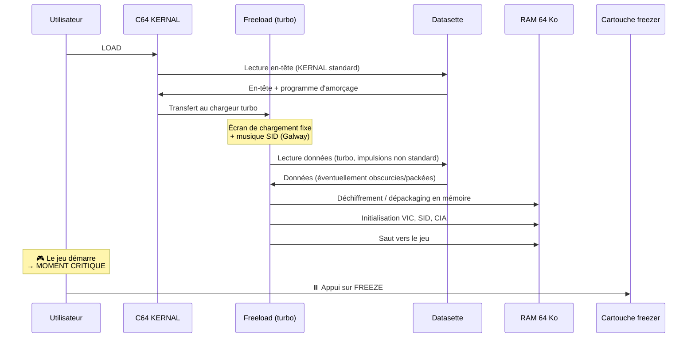
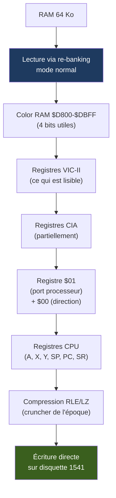
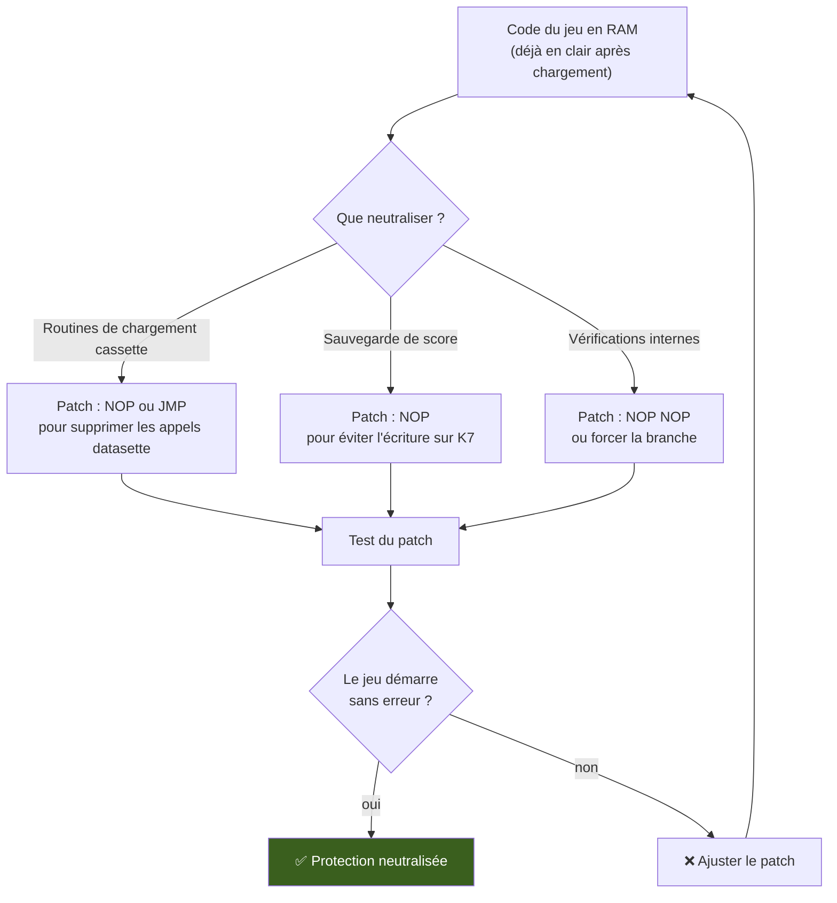
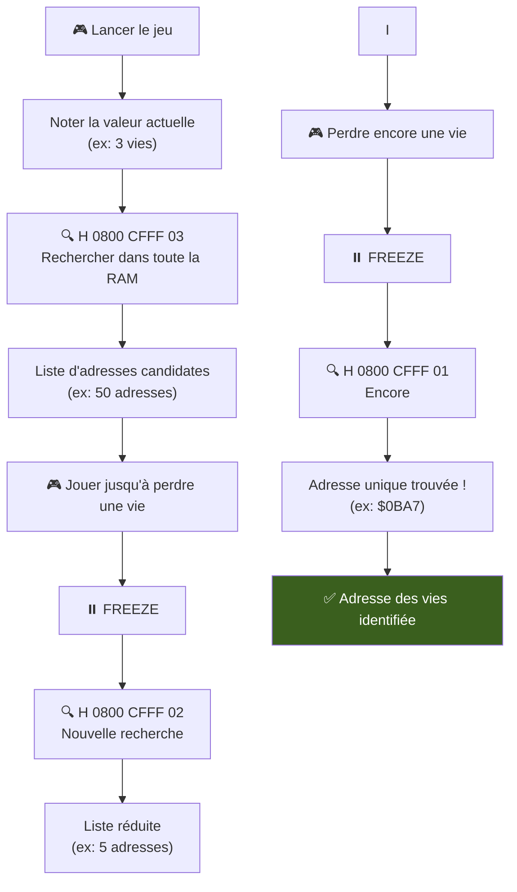
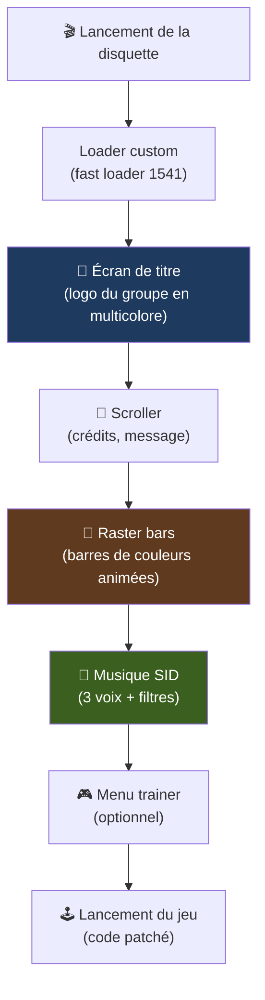
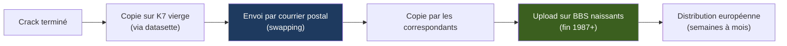
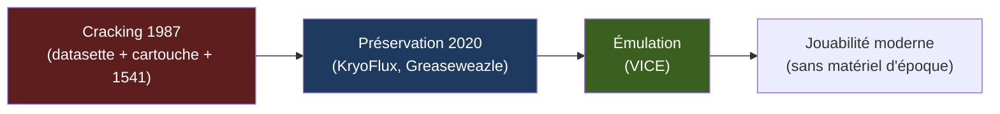

# 🎯 Étude de Cas #1b — Version Définitive : Transfert Cassette → Disquette d'un Jeu Protégé
## Le cas *Slap Fight* sur Commodore 64 (Imagine/Ocean, 1987) — Anatomie d'un crack

| | |
| --- | --- |
| Périmètre | Commodore 64 / 128 (6510 @ ~0,985 MHz PAL, 64 Ko RAM + Color RAM, VIC-II, SID 6581, 2× CIA 6526, datasette, lecteur 1541) |
| Axe | Étude de cas complète : transfert d'un jeu protégé depuis une **cassette** (loader Freeload) vers disquette 5,25", avec ajout d'une cracktro et d'un trainer — en parallèle avec le Cas #1 (Spectrum) pour faire ressortir les principes universels |
| Position dans la série | **Variante du Cas #1** — même jeu (*Slap Fight*, Imagine/Ocean 1987), autre architecture |
| Statut | **Version définitive** — synthèse critique des itérations précédentes, corrections factuelles et techniques intégrées |
| Illustrations | Diagrammes [Mermaid](https://mermaid.js.org), schémas ASCII, extraits d'assembleur 6502 commentés |

### Avertissement éthique

> Ce document est une **reconstitution historique** du travail des crackers de 1987. Il est destiné à la compréhension de l'ingénierie inverse de l'époque et à la **préservation du patrimoine logiciel**. Il ne constitue en aucun cas un mode d'emploi pour contourner des protections contemporaines. Les adresses mémoire et valeurs indiquées sont **pédagogiques** et ne correspondent pas nécessairement aux valeurs réelles du jeu original.

### Note de version — Itérations LLM et rigueur historique

Ce document est le fruit de **quatre itérations** successives (Qwen v1 → Qwen v2 → Grok v3 → synthèse critique Claude), chacune apportant son lot de corrections :

| Itération | Apports | Erreurs corrigées dans cette version |
| --- | --- | --- |
| **Qwen v1** | Structure pédagogique complète, parallèle Spectrum/C64 | Datasette sur IEC, `LOAD "*",8,1` pour K7, vies en `$D4A7` (zone VIC-II), SID "entièrement en écriture seule", Pucrunch/NFO/FidoNet anachroniques |
| **Deepseek v2** | Correction "vertical", Martin Galway, nuance SID | Remplace une erreur par une autre (disquette DSDD "Ocean Protection"), vies en `$E4A7` (sous KERNAL), SID "voix 1/2 lisibles" faux |
| **Grok v3** | La plus proche de l'histoire : cassette, Freeload, Galway, vertical | Très condensée, "×10" et "anti-freeze" non sourcés, Pucrunch anachronique |
| **Synthèse Claude** | Analyse critique rigoureuse, corrections techniques pointues | Sert de base à cette version finale |

**Légende des niveaux de confiance**

| Marque | Signification |
| --- | --- |
| ✅ | Fait solidement établi (documentation officielle, datasheets, notice d'époque) |
| 🔧 | Mécanisme technique documenté (6502, VIC-II, SID, CIA, 1541) |
| ⚠️ | Reconstitution pédagogique ou point non vérifié (adresses, valeurs spécifiques) |

---

## Sommaire

- [0. Vue d'ensemble : le pipeline reconstitué](#0-vue-densemble)
- [1. Contexte : Slap Fight, Freeload et la cassette Ocean](#1-contexte)
- [2. L'arsenal du cracker : matériel et logiciels de 1987](#2-arsenal)
- [3. Étape 1 — Chargement depuis la datasette](#3-etape-1)
- [4. Étape 2 — Gel et mode Ultimax](#4-etape-2)
- [5. Étape 3 — Dump de la RAM : le défi du SID et de la Color RAM](#5-etape-3)
- [6. Étape 4 — Analyse dans le moniteur de la cartouche](#6-etape-4)
- [7. Étape 5 — Neutralisation de la protection](#7-etape-5)
- [8. Étape 6 — Création du trainer](#8-etape-6)
- [9. Étape 7 — Fabrication de la cracktro](#9-etape-7)
- [10. Étape 8 — Assemblage sur disquette 1541](#10-etape-8)
- [11. Étape 9 — Tests et validation](#11-etape-9)
- [12. Anatomie d'une release complète](#12-anatomie-release)
- [13. Variantes et pièges courants](#13-variantes)
- [14. De ce workflow à la préservation moderne](#14-preservation)
- [15. Synthèse comparative : Spectrum vs C64](#15-synthese)
- [16. Conclusion](#16-conclusion)
- [Annexes](#annexes)

---

## 0. Vue d'ensemble : le pipeline reconstitué {#0-vue-densemble}

### 0.1 Le pipeline complet (version définitive)

```mermaid
flowchart TD
    A["🎮 Original cassette<br/>Slap Fight - Imagine/Ocean 1987<br/>Loader Freeload (turbo)"] --> B["📼 LOAD + PLAY<br/>via datasette C2N"]
    B --> C["⏸️ FREEZE via cartouche<br/>(Action Replay / FC III)<br/>NMI + mode Ultimax"]
    C --> D["💾 Dump RAM 64 Ko<br/>+ Color RAM + registres CPU<br/>+ port $01"]
    D --> E["🔍 Analyse au moniteur<br/>de la cartouche"]
    E --> F["🎯 Nettoyage du code<br/>(suppression routines cassette)"]
    F --> G["🔎 Recherche des vies<br/>(méthode search & replace)"]
    G --> H["🎨 Création de la cracktro<br/>(raster bars + musique SID)"]
    H --> I["📀 Assemblage final<br/>+ loader custom 1541"]
    I --> J["💿 Écriture sur disquette 5,25\"<br/>via CBM DOS"]
    J --> K["✅ Tests sur C64 nu<br/>(sans cartouche)"]
    K --> L["📤 Distribution : swapping postal,<br/>BBS naissants"]
    style C fill:#1e3a5f,color:#fff
    style F fill:#5f1e1e,color:#fff
    style H fill:#3a5f1e,color:#fff
```

### 0.2 Comparaison immédiate avec le Cas #1

| Élément | Cas #1 (Spectrum 128/+3) | Cas #1b (C64) |
| --- | --- | --- |
| **CPU** | Z80 @ 3,54 MHz | 6510 @ ~0,985 MHz (PAL) |
| **RAM** | 128 Ko paginées | 64 Ko + Color RAM (4 bits) |
| **Support commercial** | K7 (Speedlock 4) ✅ | K7 (Freeload) ⚠️ |
| **Support cible du crack** | Disquette 3" (+3 intégré) | Disquette 5,25" (lecteur 1541) |
| **Freezer** | Multiface One (48 Ko) / Multiface 128 | Cartouche : Action Replay, FC III, ISEPIC |
| **Mécanisme de gel** | NMI + substitution ROM en `$0000-$1FFF` | NMI + **mode Ultimax** (GAME=0, EXROM=1) 🔧 |
| **Nature de la protection** | Chiffrement cassette + anti-debug | Le chargeur lui-même (Freeload) ⚠️ |
| **Patching** | NOP (`$00`), JP (`$C3`) | NOP (`$EA`), JMP (`$4C`) |
| **Graphisme cracktro** | ULA (2 couleurs par bloc 8×8) | VIC-II (16 couleurs, sprites, rasters) |
| **Musique cracktro** | AY-3-8912 (3 voix carrées) | SID 6581 (3 voix + filtres + ADSR) |
| **Compositeur du jeu** | (non documenté ici) | **Martin Galway** ✅ |
| **DOS cible** | +3 DOS (CP/M-like) | CBM DOS (dans le 1541) 🔧 |
| **Format image moderne** | TAP, TZX, SNA | TAP, D64, G64, NIB |

### 0.3 Les chiffres clés (ordres de grandeur ⚠️)

| Élément | Valeur typique |
| --- | --- |
| Taille du jeu en RAM | ≈ 30-45 Ko |
| Taille de la cracktro | ≈ 4-6 Ko |
| Taille du trainer | < 0,5 Ko |
| Taille totale compressée | ≈ 25-40 Ko |
| Blocs CBM sur disquette | ≈ 100-160 (sur 664 libres) |
| Temps de travail | Quelques heures à une journée ⚠️ |

---

## 1. Contexte : Slap Fight, Freeload et la cassette Ocean {#1-contexte}

### 1.1 Le jeu

**Slap Fight** (connu aussi sous le nom *A.L.CON* aux États-Unis) est un **shoot'em up à défilement vertical** développé par **Toaplan** (arcade, 1986), publié par Taito, et porté sur micro-ordinateurs par **Imagine Software** (filiale d'**Ocean Software**) en 1987 ✅.

```
 ┌──────────────────────────────────────────────────────────────┐
 │  SLAP FIGHT — CARTE D'IDENTITÉ                               │
 ├──────────────────────────────────────────────────────────────┤
 │  • Développeur arcade : Toaplan                              │
 │  • Éditeur micro : Imagine Software / Ocean Software         │
 │  • Année : 1987                                              │
 │  • Genre : Shoot'em up à défilement VERTICAL                 │
 │  • Plateformes : C64, Spectrum, CPC, ZX81                    │
 │  • Musique C64 : Martin Galway ✅                            │
 │  • Gameplay : étoiles → icônes (vitesse, tir, tir latéral)   │
 │    activables à la barre d'espace                            │
 │  • Niveau : long niveau continu qui boucle (single-load)     │
 └──────────────────────────────────────────────────────────────┘
```

### 1.2 La protection : Freeload

Sur C64, Ocean utilisait à partir de 1987 son propre chargeur turbo cassette appelé **Freeload**, développé par **Paul Hughes** ✅. Il succède à l'*Ocean Loader* (Bill Barna, utilisé dès *Hyper Sports*).

```
 ┌──────────────────────────────────────────────────────────────┐
 │  FREELOAD — CARACTÉRISTIQUES                                 │
 ├──────────────────────────────────────────────────────────────┤
 │  • Chargeur turbo cassette (plusieurs fois plus rapide       │
 │    que le KERNAL standard)                                   │
 │  • Écran de chargement fixe avec musique SID                 │
 │  • Données éventuellement obscurcies ou packées              │
 │  • La protection EST le chargeur lui-même :                  │
 │    - Impulsions non standard                                 │
 │    - Code obscurci                                           │
 │    - Pas de signature de piste (c'est une cassette !)        │
 │                                                              │
 │  ⚠️ Contrairement aux protections disquette (Ocean           │
 │     Protection, Vorpal, etc.), il n'y a PAS de signature     │
 │     de piste à contourner. Une fois le jeu chargé et         │
 │     dépacké, le code est en clair en RAM.                    │
 └──────────────────────────────────────────────────────────────┘
```

### 1.3 Pourquoi ce cas est emblématique

Ce cas illustre **trois spécificités du C64** :

1. **La datasette est un périphérique dédié** : contrairement au Spectrum qui utilisait un magnétophone standard, le C64 a une datasette propriétaire (C2N) dont le signal passe par la ligne FLAG de la CIA 1 et se chronomètre avec les timers.
2. **Le mode Ultimax** : le gel via cartouche repose sur un mécanisme de bus unique au C64 (GAME/EXROM), qui n'existe sur aucune autre machine.
3. **Le 1541 est un ordinateur** : il a son propre CPU (6502), sa propre RAM (2 Ko), sa propre ROM (16 Ko). Le cracking implique de comprendre ce "deuxième ordinateur".

---

## 2. L'arsenal du cracker : matériel et logiciels de 1987 {#2-arsenal}

### 2.1 Le matériel

| Élément | Rôle | Prix époque (≈) |
| --- | --- | --- |
| **Commodore 64** (ou 128 en mode 64) | Machine cible | 1500-2500 F |
| **Datasette C2N** | Lecteur de K7 propriétaire | 300-500 F |
| **Cartouche freezer** (Action Replay, FC III, ISEPIC) | Gel + moniteur + dump | 350-600 F |
| **Lecteur 1541** | Lecteur de disquettes 5,25" | 1500-2500 F |
| **K7 vierges** | Sauvegardes de travail | 20 F |
| **Disquettes 5,25" vierges** | Support final | 15-25 F |

### 2.2 Les logiciels (authentiques 1987 ✅)

| Outil | Rôle | Auteur/Éditeur |
| --- | --- | --- |
| **ROM de la cartouche freezer** | Gel, moniteur, dump, fast loader | Datel (AR), Riska (FC III), Starpoint (ISEPIC) |
| **Koala Painter** | Création du logo de cracktro | Koala ✅ |
| **Soundmonitor** | Composition musique SID | **Chris Hülsbeck** ✅ |
| **JCH Editor** | Éditeur SID avancé | **Jochen Hippel** ✅ |
| **Turbo Assembler (TASM)** | Assemblage de la cracktro | ⚠️ (auteur à confirmer) |

### 2.3 La configuration de travail

```
 ┌──────────────────────────────────────────────────────────────┐
 │  SETUP TYPIQUE D'UN CRACKER C64 (1987)                       │
 ├──────────────────────────────────────────────────────────────┤
 │                                                              │
 │  ┌─────────────┐     ┌──────────────┐     ┌──────────────┐  │
 │  │  Datasette  │────▶│  C64 +       │────▶│  Cartouche   │  │
 │  │  C2N        │     │  cartouche   │     │  freezer     │  │
 │  │  (original) │     │  (AR/FC III) │     │              │  │
 │  └─────────────┘     └──────┬───────┘     └──────┬───────┘  │
 │                             │                     │          │
 │                             │              (NMI, GAME/EXROM) │
 │                             │                     │          │
 │                             ▼                     │          │
 │                      ┌──────────────┐             │          │
 │                      │  Lecteur     │◀────────────┘          │
 │                      │  1541        │  (bus IEC série)       │
 │                      │  (5,25")     │                        │
 │                      └──────────────┘                        │
 │                                                              │
 │  🔧 La datasette se branche sur le PORT CASSETTE dédié       │
 │     (pas sur le bus IEC !)                                   │
 │     Le signal passe par la ligne FLAG de CIA 1               │
 │     Moteur et capteur contrôlés via $01 (bits 4 et 5)        │
 │                                                              │
 │  🔧 Le 1541 est un ORDINATEUR :                              │
 │     • 6502 @ 1 MHz                                           │
 │     • 2 Ko RAM                                               │
 │     • 16 Ko ROM (CBM DOS)                                    │
 │     • 2× VIA 6522                                            │
 └──────────────────────────────────────────────────────────────┘
```

---

## 3. Étape 1 — Chargement depuis la datasette {#3-etape-1}

### 3.1 La datasette : un protocole propriétaire 🔧

Contrairement au Spectrum qui utilisait un magnétophone standard, le C64 utilisait une **datasette propriétaire** dont le fonctionnement est fondamentalement différent :

```
 ┌──────────────────────────────────────────────────────────────┐
 │  DATASETTE C64 : PROTOCOLE CORRECT                           │
 ├──────────────────────────────────────────────────────────────┤
 │                                                              │
 │  Connexion : PORT CASSETTE DÉDIÉ (pas le bus IEC !)          │
 │                                                              │
 │  Signal :                                                    │
 │  • Entre par la ligne FLAG de CIA 1                          │
 │  • Chronométré par les timers de CIA 1                       │
 │  • Le KERNAL emploie TROIS longueurs d'impulsion             │
 │    (courte, moyenne, longue) à ≈ 300 bauds                   │
 │                                                              │
 │  ⚠️ Les fréquences "1480/833 Hz" sont inventées !            │
 │     La réalité est une modulation de DURÉE d'impulsion,      │
 │     pas de fréquence porteuse                                │
 │                                                              │
 │  Contrôle moteur/capteur : registre $01 (port processeur)    │
 │  • Bit 5 : moteur de la datasette                            │
 │  • Bit 4 : capteur de lecture                                │
 │                                                              │
 │  Chargement :                                                │
 │  • LOAD (périphérique 1)                                     │
 │  • Ou SHIFT + RUN/STOP au démarrage                          │
 │                                                              │
 │  ⚠️ "LOAD \"*\",8,1" est une syntaxe DISQUE !                │
 │     Pour la cassette : LOAD seul ou LOAD "",1                │
 └──────────────────────────────────────────────────────────────┘
```

### 3.2 Le chargement de l'original

Le cracker insère la K7 dans la datasette et lance le chargement :

```
   LOAD
   ▶ PRESS PLAY ON TAPE
```

Le loader Freeload prend le relais :



### 3.3 Le moment critique : quand geler ?

```
 ┌──────────────────────────────────────────────────────────────┐
 │  ⚠️ TIMING DU GEL                                            │
 ├──────────────────────────────────────────────────────────────┤
 │                                                              │
 │  ❌ TROP TÔT (pendant le chargement) :                       │
 │     Le code est encore chiffré/packé en mémoire              │
 │     → Le dump sera inutilisable                              │
 │                                                              │
 │  ✅ AU BON MOMENT :                                          │
 │     Le jeu vient de démarrer (écran de titre ou début de     │
 │     partie), le code est déchiffré et dépacké                │
 │     → Le dump contient le jeu en clair                       │
 │                                                              │
 │  💡 MEILLEUR MOMENT :                                        │
 │     Au dernier saut du chargeur vers le jeu                  │
 │     → Donne un point d'entrée propre                         │
 │                                                              │
 │  ❌ TROP TARD :                                              │
 │     Le jeu a pu modifier des zones, activer des anti-debug   │
 │     → Risque de dump corrompu                                │
 └──────────────────────────────────────────────────────────────┘
```

---

## 4. Étape 2 — Gel et mode Ultimax {#4-etape-2}

### 4.1 La séquence de gel (version corrigée 🔧)

C'est ici que le C64 se distingue radicalement du Spectrum. Le mécanisme de gel repose sur le **mode Ultimax**, une fonctionnalité unique du bus du C64.

```
 ┌──────────────────────────────────────────────────────────────┐
 │  SÉQUENCE DE GEL — CARTOUCHE C64 (CORRIGÉE)                  │
 ├──────────────────────────────────────────────────────────────┤
 │                                                              │
 │  1. Le bouton FREEZE génère SIMULTANÉMENT :                  │
 │     • Une NMI sur la ligne /NMI du 6502                      │
 │     • La bascule GAME=0 (via la logique de la cartouche)     │
 │                                                              │
 │  🔧 CORRECTION IMPORTANTE :                                  │
 │     La bascule en Ultimax se fait AVANT que le vecteur       │
 │     $FFFA ne soit lu. Le 6502 lit donc directement le        │
 │     vecteur NMI dans la ROM de la cartouche (ROMH).          │
 │                                                              │
 │  2. Le 6502 :                                                │
 │     • Termine l'instruction en cours                         │
 │     • Empile PC et les flags                                 │
 │     • Désactive les interruptions (I=1)                      │
 │     • Lit le vecteur $FFFA → déjà dans la ROM cartouche      │
 │                                                              │
 │  3. La ROM de la cartouche prend la main :                   │
 │     • Le C64 est en mode Ultimax (GAME=0, EXROM=1)           │
 │     • La ROM cartouche apparaît en $E000-$FFFF (ROMH)        │
 │     • Et en $8000-$9FFF (ROML)                               │
 │     • Les vecteurs $FFFA/$FFFC/$FFFE sont ceux de la         │
 │       cartouche                                              │
 │                                                              │
 │  4. La cartouche affiche son menu :                          │
 │     ┌────────────────────────────────────┐                   │
 │     │  ACTION REPLAY                     │                   │
 │     │  ───────────────────               │                   │
 │     │  1. RETURN TO PROGRAM              │                   │
 │     │  2. MONITOR                        │                   │
 │     │  3. LOADER                         │                   │
 │     │  4. DISK                           │                   │
 │     │  5. TAPE                           │                   │
 │     │  6. SPRITE EDITOR                  │                   │
 │     │  7. RESET                          │                   │
 │     └────────────────────────────────────┘                   │
 └──────────────────────────────────────────────────────────────┘
```

### 4.2 Le mode Ultimax : cartographie mémoire 🔧

Le mode Ultimax est **le cœur technique** du gel sur C64 :

```
 ┌──────────────────────────────────────────────────────────────┐
 │  MODE ULTIMAX — CARTOGRAPHIE MÉMOIRE                         │
 ├──────────────────────────────────────────────────────────────┤
 │                                                              │
 │  État normal (GAME=1, EXROM=1) :                             │
 │  ┌───────────────────────────────────┐                       │
 │  │ $FFFF                             │                       │
 │  │ KERNAL (ROM) ← vecteurs NMI/IRQ   │                       │
 │  │ $E000                             │                       │
 │  │ I/O + Color RAM                   │                       │
 │  │ $D000                             │                       │
 │  │ BASIC (ROM)                       │                       │
 │  │ $A000                             │                       │
 │  │ RAM                               │                       │
 │  │ $0000                             │                       │
 │  └───────────────────────────────────┘                       │
 │                                                              │
 │  Mode Ultimax (GAME=0, EXROM=1) :                            │
 │  ┌───────────────────────────────────┐                       │
 │  │ $FFFF                             │                       │
 │  │ ROM cartouche (ROMH) ← VECTEURS   │ ← LA CARTOUCHE        │
 │  │ $E000                             │    CONTRÔLE LE CPU    │
 │  │ I/O + Color RAM                   │                       │
 │  │ $D000                             │                       │
 │  │ (vide)                            │                       │
 │  │ $A000                             │                       │
 │  │ ROM cartouche (ROML)              │                       │
 │  │ $8000                             │                       │
 │  │ RAM                               │                       │
 │  │ $1000                             │                       │
 │  │ RAM basse (0-4 Ko)                │ ← SEULE RAM VISIBLE   │
 │  │ $0000                             │                       │
 │  └───────────────────────────────────┘                       │
 │                                                              │
 │  🔧 CORRECTION IMPORTANTE :                                  │
 │  • En Ultimax, SEULE la RAM $0000-$0FFF est visible          │
 │  • Pour dumper les 64 Ko, la cartouche doit RE-BANCER        │
 │    la machine en mode normal via son registre de contrôle     │
 │  • Elle travaille alors dans sa PROPRE RAM                   │
 │                                                              │
 │  💡 En Ultimax :                                             │
 │  • Le KERNAL est masqué                                      │
 │  • Les vecteurs d'interruption sont ceux de la cartouche     │
 │  • La cartouche a la main AVANT que le jeu ne s'exécute      │
 └──────────────────────────────────────────────────────────────┘
```

### 4.3 Comparaison avec le Cas #1 (Spectrum)

| Aspect | Cas #1 (Spectrum) | Cas #1b (C64) |
| --- | --- | --- |
| **Mécanisme de gel** | NMI + substitution ROM en `$0000-$1FFF` | NMI + **mode Ultimax** (GAME=0, EXROM=1) 🔧 |
| **Vecteur détourné** | `$0066` (adresse fixe Z80) | `$FFFA` (vecteur NMI 6502, lu dans ROM cartouche) 🔧 |
| **Zone masquée** | ROM du Spectrum en `$0000-$3FFF` | KERNAL en `$E000-$FFFF` + BASIC en `$A000-$BFFF` |
| **Complexité** | Simple (substitution ROM) | Complexe (banking GAME/EXROM) |
| **Spécificité** | Z80 NMI standard | Mode Ultimax unique au C64 |

### 4.4 Vérification de l'état gelé

```
 ┌──────────────────────────────────────────────────────────────┐
 │  ÉTAT DU 6502 AU GEL (exemple)                               │
 ├──────────────────────────────────────────────────────────────┤
 │  A  = $07    X  = $12    Y  = $FF                            │
 │  SP = $F7    PC = $C000  ← adresse de retour                 │
 │  SR = $35    (flags : N=0, V=0, B=0, D=0, I=1, Z=0, C=1)    │
 │                                                              │
 │  ✅ Le flag I=1 confirme que les interruptions étaient       │
 │     désactivées au moment du gel                             │
 │  ✅ Le PC pointe vers l'adresse de retour dans le jeu        │
 │  ✅ Les registres A, X, Y sont préservés                     │
 │                                                              │
 │  🔧 Le 6502 n'a pas de registres alternatifs (contrairement  │
 │     au Z80) — le dump est plus simple                        │
 └──────────────────────────────────────────────────────────────┘
```

---

## 5. Étape 3 — Dump de la RAM : le défi du SID et de la Color RAM {#5-etape-3}

### 5.1 La RAM du C64 : une architecture complexe 🔧

```
 ┌──────────────────────────────────────────────────────────────┐
 │  CARTE MÉMOIRE C64 — ZONES I/O DÉTAILLÉES                    │
 ├──────────────────────────────────────────────────────────────┤
 │                                                              │
 │  $0000-$00FF  Page zéro (variables, pointeurs)               │
 │  $0100-$01FF  Pile                                           │
 │  $0200-$03FF  Variables système                              │
 │  $0400-$07FF  Écran principal (1 Ko)                         │
 │  $0800-$9FFF  RAM utilisateur (38 Ko) ← JEUX, VIES, ETC.    │
 │  $A000-$BFFF  BASIC ROM (masquable)                          │
 │  $C000-$CFFF  RAM utilisateur (4 Ko)                         │
 │  $D000-$D3FF  VIC-II (graphismes)                            │
 │  $D400-$D7FF  SID (son)                                      │
 │  $D800-$DBFF  Color RAM (4 bits par octet)                   │
 │  $DC00-$DCFF  CIA 1 (timers, clavier, datasette, joystick)   │
 │  $DD00-$DDFF  CIA 2 (bus IEC, utilisateur)                   │
 │  $DE00-$DFFF  Extensions cartouche                           │
 │  $E000-$FFFF  KERNAL ROM (masquable)                         │
 │                                                              │
 │  🔧 CORRECTION IMPORTANTE :                                  │
 │  • Les vies sont en RAM utilisateur ($0800-$0FFF ou          │
 │    $C000-$CFFF), PAS en $D000-$D7FF (VIC-II/SID)             │
 │  • $E4A7 (proposé en v2) est SOUS le KERNAL — possible      │
 │    mais nécessite un banking pour y accéder                   │
 │  • La Color RAM n'a que 4 bits utiles : masquer avec $0F     │
 │    pour comparer deux dumps                                  │
 └──────────────────────────────────────────────────────────────┘
```

### 5.2 Le problème des registres non relisibles (nuancé 🔧)

```
 ┌──────────────────────────────────────────────────────────────┐
 │  REGISTRES NON RELISIBLES — LE DÉFI DU "STARTER"             │
 ├──────────────────────────────────────────────────────────────┤
 │                                                              │
 │  SID (6581/8580) :                                           │
 │  🔧 CORRECTION : Le SID n'est PAS entièrement en écriture    │
 │     seule !                                                  │
 │  • LISIBLES :                                                │
 │    - $D419/$D41A : paddles (joysticks analogiques)           │
 │    - $D41B : oscillateur de la VOIX 3                        │
 │    - $D41C : enveloppe de la VOIX 3                          │
 │  • Ces lectures servent à la génération aléatoire et au      │
 │    suivi d'enveloppe                                         │
 │  • ÉCRITURE SEULE : le reste (fréquences, contrôles des      │
 │    voix 1 et 2, filtres)                                     │
 │  • Conséquence : un snapshot C64 a souvent un son muet       │
 │    ou incomplet au "dégel" — le player doit réécrire         │
 │    les registres à chaque trame                              │
 │                                                              │
 │  🔧 Le SID offre :                                           │
 │  • Synchronisation dure (hard sync) entre voix               │
 │  • Ring modulation entre voix                                │
 │  • PAS de modulation de fréquence (FM) — à ne pas confondre │
 │                                                              │
 │  VIC-II :                                                    │
 │  • Presque tout se relit                                     │
 │  • MAIS $D012 en lecture donne la LIGNE COURANTE, pas la     │
 │    ligne de comparaison de l'IRQ                             │
 │  • Un freezer restaure des valeurs, pas la PHASE (raster,    │
 │    compteurs) : d'où le "starter"                            │
 │                                                              │
 │  CIA (6526) :                                                │
 │  • Lire $DC0D ou $DD0D ACQUITTE les interruptions            │
 │  • Les latches des timers ne se relisent pas                 │
 │                                                              │
 │  💡 Solution : le "starter"                                  │
 │  • Un petit programme qui ré-initialise les puces            │
 │  • Il restaure le VIC-II (écran, couleurs)                   │
 │  • Il ré-initialise le SID (le son est perdu)                │
 │  • Il restaure les CIA (interruptions)                       │
 │  • Puis il saute sur le jeu                                  │
 └──────────────────────────────────────────────────────────────┘
```

### 5.3 Le dump via la cartouche



```
 ┌──────────────────────────────────────────────────────────────┐
 │  🔧 CORRECTION : DUMP DIRECT SUR DISQUETTE                   │
 ├──────────────────────────────────────────────────────────────┤
 │                                                              │
 │  ❌ "Dump d'abord sur K7 car la cartouche ne connaît pas     │
 │      le 1541" — FAUX                                         │
 │                                                              │
 │  ✅ Les freezers écrivent DIRECTEMENT sur disque (ou         │
 │     cassette) au format turbo                                │
 │                                                              │
 │  ⚠️ Les menus "Action Replay V5" des versions précédentes    │
 │     sont reconstitués et illustratifs                        │
 └──────────────────────────────────────────────────────────────┘
```

---

## 6. Étape 4 — Analyse dans le moniteur de la cartouche {#6-etape-4}

### 6.1 Le moniteur de l'Action Replay

```
 ┌──────────────────────────────────────────────────────────────┐
 │  MONITEUR ACTION REPLAY — COMMANDES                          │
 ├──────────────────────────────────────────────────────────────┤
 │                                                              │
 │  • H xxxx yyyy vv : Hunt (recherche de motif)                │
 │  • M xxxx yyyy    : Memory dump (hexa)                       │
 │  • D xxxx         : Disassemble (désassemblage)              │
 │  • A xxxx         : Assemble (entrée de code)                │
 │  • R              : Registers (affichage/modification)       │
 │  • G xxxx         : Go (exécution)                           │
 │  • T xxxx yyyy zzzz : Transfer (copie de blocs)              │
 │  • F xxxx yyyy vv : Fill (remplissage)                       │
 │  • C xxxx yyyy zzzz : Compare (comparaison de blocs)         │
 │  • S "nom",device,debut,fin : Save code machine              │
 │                                                              │
 │  🔧 CORRECTION :                                             │
 │  • Aucun moniteur ne relance une recherche sur une "liste    │
 │    de candidats" comme dans les versions précédentes          │
 │  • Méthode réelle : H sur la valeur, perdre une vie,         │
 │    nouvelle recherche, OU copie (T) puis comparaison (C)     │
 │    de deux états, et recoupement                             │
 │                                                              │
 │  🔧 Pour lire la RAM sous l'I/O ou les ROM :                 │
 │     manipuler $01 (port processeur)                          │
 └──────────────────────────────────────────────────────────────┘
```

### 6.2 Ce qu'il faut chercher

```
 ┌──────────────────────────────────────────────────────────────┐
 │  SIGNATURES À RECHERCHER (CORRIGÉES)                         │
 ├──────────────────────────────────────────────────────────────┤
 │                                                              │
 │  🔧 CORRECTION IMPORTANTE :                                  │
 │  Sur cassette, il n'y a PAS de piste, donc PAS de signature  │
 │  de piste à contourner. La protection EST le chargeur.       │
 │                                                              │
 │  Ce qu'il faut chercher :                                    │
 │                                                              │
 │  1. Accès à CIA 1 (timers, datasette)                        │
 │     • $DC04-$DC07 : timers A et B                            │
 │     • $DC0D : contrôle interruptions                         │
 │                                                              │
 │  2. Bits 4 et 5 de $01 (moteur et capteur datasette)         │
 │                                                              │
 │  3. Initialisations VIC-II / SID                             │
 │                                                              │
 │  4. Le saut final du chargeur vers le jeu                    │
 │                                                              │
 │  5. Éventuelles routines de sauvegarde de score              │
 │     (à supprimer pour le crack disquette)                    │
 │                                                              │
 │  ⚠️ Les commandes KERNAL des versions précédentes étaient    │
 │     fausses :                                                │
 │  • $FFBD = SETNAM (pas CHKOUT !)                            │
 │  • CHKOUT = $FFC9                                            │
 │  • CHKIN = $FFC6                                             │
 │  • CHROUT = $FFD2                                            │
 │  • ACPTR = $FFA5                                             │
 │  • LDX #imm = $A2 (pas $A6 !)                               │
 └──────────────────────────────────────────────────────────────┘
```

### 6.3 Cartographie des zones mémoire (reconstitution corrigée 🔧)

```
 ┌──────────────────────────────────────────────────────────────┐
 │  CARTE MÉMOIRE DE SLAP FIGHT C64 (RECONSTITUTION)            │
 ├──────────────────────────────────────────────────────────────┤
 │                                                              │
 │  $0000-$00FF  Page zéro (variables, pointeurs)               │
 │  $0100-$01FF  Pile                                           │
 │  $0200-$03FF  Variables système                              │
 │  $0400-$07FF  Écran principal + attributs                    │
 │  $0800-$0FFF  ⚠️ DONNÉES GRAPHIQUES + VARIABLES DE JEU       │
 │  $1000-$3FFF  Données de niveaux                             │
 │  $4000-$5FFF  Musique SID + player (Martin Galway)           │
 │  $6000-$6FFF  Tables de jeu (collisions, icônes)             │
 │  $7000-$8FFF  Code du jeu principal                          │
 │  $9000-$AFFF  Code du jeu principal (suite)                  │
 │  $B000-$BFFF  ⚠️ ROUTINES CHARGEUR (à neutraliser)          │
 │  $C000-$CFFF  ⚠️ VARIABLES DE JEU (vies, score, armes)      │
 │  $D000-$DFFF  I/O (VIC-II, SID, Color RAM, CIA)              │
 │  $E000-$FFFF  KERNAL ROM                                     │
 │                                                              │
 │  ⚠️ Ces adresses sont reconstituées à titre pédagogique      │
 │  ⚠️ Les vies sont en RAM utilisateur ($0800-$0FFF ou         │
 │     $C000-$CFFF), PAS en $D4A7 (zone VIC-II)                 │
 │  ⚠️ Pour un jeu à niveau continu (single-load), les          │
 │     variables sont probablement en page zéro ou RAM basse    │
 └──────────────────────────────────────────────────────────────┘
```

---

## 7. Étape 5 — Neutralisation de la protection {#7-etape-5}

### 7.1 La stratégie de patching (corrigée 🔧)



```
 ┌──────────────────────────────────────────────────────────────┐
 │  🔧 CORRECTION FONDAMENTALE                                  │
 ├──────────────────────────────────────────────────────────────┤
 │                                                              │
 │  ❌ Dans les versions précédentes :                          │
 │     "Neutralisation des signatures de piste, format GCR      │
 │      modifié, test d'ID disque"                              │
 │                                                              │
 │  ✅ RÉALITÉ :                                                │
 │     Sur cassette, il n'y a PAS de piste, PAS de GCR,         │
 │     PAS d'ID disque. La protection EST le chargeur.          │
 │                                                              │
 │     Une fois le jeu chargé et dépacké, le code est en        │
 │     clair en RAM. Il faut juste :                            │
 │     • Supprimer les routines qui rappellent la cassette      │
 │     • Neutraliser les éventuels contrôles internes           │
 │     • Préparer le code pour un chargement depuis disquette   │
 └──────────────────────────────────────────────────────────────┘
```

### 7.2 Opcodes utiles (corrigés 🔧)

| Instruction 6502 | Octet | Instruction Z80 | Octet |
| --- | --- | --- | --- |
| **NOP** | **$EA** | NOP | $00 |
| BRK (à éviter comme "NOP" !) | $00 | JP nn | $C3 |
| **JMP abs** | **$4C** | JP NZ / JP Z | $C2 / $CA |
| **BNE / BEQ** | **$D0 / $F0** | JR / JR NZ / JR Z | $18 / $20 / $28 |
| BCC / BCS | $90 / $B0 | — | — |

```
 ┌──────────────────────────────────────────────────────────────┐
 │  🔧 CORRECTION : BRANCHES 6502                               │
 ├──────────────────────────────────────────────────────────────┤
 │                                                              │
 │  Les branchements 6502 sont RELATIFS (±127 octets, 2 octets) │
 │                                                              │
 │  Pour neutraliser un test :                                  │
 │  • Option A : NOP NOP (2 octets)                             │
 │  • Option B : Inverser la condition (D0 ↔ F0)                │
 │  • Option C : JMP de 3 octets si la place le permet          │
 │                                                              │
 │  ⚠️ $00 est BRK sur 6502 (pas NOP !)                        │
 │     NOP = $EA                                                │
 └──────────────────────────────────────────────────────────────┘
```

### 7.3 Exemple de patching (pédagogique) 🔧

```
 ┌──────────────────────────────────────────────────────────────┐
 │  PATCH — SUPPRESSION D'UNE ROUTINE CASSETTE                  │
 ├──────────────────────────────────────────────────────────────┤
 │                                                              │
 │  AVANT :                                                     │
 │  $B234  LDA  $01          ; A5 01     ; lire port processeur │
 │  $B236  ORA  #$20         ; 0D 01 B2  ; activer moteur K7    │
 │  $B239  STA  $01          ; 85 01     ; écrire port          │
 │  $B23B  JSR  $F487         ; 20 87 F4  ; routine KERNAL K7    │
 │  $B23E  ...              ; ...       ; suite                  │
 │                                                              │
 │  APRÈS :                                                     │
 │  $B234  NOP              ; EA                               │
 │  $B235  NOP              ; EA                               │
 │  $B236  NOP              ; EA                               │
 │  $B237  NOP              ; EA                               │
 │  $B238  NOP              ; EA                               │
 │  $B239  NOP              ; EA                               │
 │  $B23A  NOP              ; EA                               │
 │  $B23B  NOP              ; EA                               │
 │  $B23C  NOP              ; EA                               │
 │  $B23D  NOP              ; EA                               │
 │  $B23E  ...              ; ...       ; le jeu continue       │
 │                                                              │
 │  💡 La routine cassette est complètement neutralisée          │
 └──────────────────────────────────────────────────────────────┘
```

---

## 8. Étape 6 — Création du trainer {#8-etape-6}

### 8.1 La méthode classique du "search and replace" (corrigée 🔧)



```
 ┌──────────────────────────────────────────────────────────────┐
 │  🔧 CORRECTION : MÉTHODE DE RECHERCHE                        │
 ├──────────────────────────────────────────────────────────────┤
 │                                                              │
 │  ❌ Dans les versions précédentes :                          │
 │     "H <liste précédente> 02"                                │
 │                                                              │
 │  ✅ RÉALITÉ :                                                │
 │     Aucun moniteur ne relance une recherche sur une liste    │
 │     de candidats ainsi.                                      │
 │                                                              │
 │     Méthode réelle :                                         │
 │     1. H sur la valeur dans toute la RAM                     │
 │     2. Perdre une vie                                        │
 │     3. Nouvelle recherche H sur la nouvelle valeur           │
 │     4. OU : copie (T) de deux états puis comparaison (C)     │
 │        et recoupement                                        │
 └──────────────────────────────────────────────────────────────┘
```

### 8.2 Exemple de recherche (pédagogique) 🔧

```
 ┌──────────────────────────────────────────────────────────────┐
 │  RECHERCHE DES VIES — EXEMPLE (6502, adresse corrigée)       │
 ├──────────────────────────────────────────────────────────────┤
 │                                                              │
 │  Étape 1 : 3 vies                                            │
 │  > H 0800 CFFF 03                                            │
 │  Found: 47 addresses                                         │
 │                                                              │
 │  Étape 2 : après avoir perdu une vie → 2 vies                │
 │  > H 0800 CFFF 02                                            │
 │  Found: 8 addresses                                          │
 │    $0BA7, $0C12, $0D89, $0E45, $0F21, $1034, $1156, $1278    │
 │                                                              │
 │  Étape 3 : après avoir perdu une vie → 1 vie                 │
 │  > H 0800 CFFF 01                                            │
 │  Found: 1 address                                            │
 │    $0BA7                                                     │
 │                                                              │
 │  ✅ L'adresse des vies est $0BA7 (page zéro étendue)          │
 │                                                              │
 │  Vérification :                                              │
 │  > M 0BA7 0BAF                                               │
 │  0BA7: 01 00 00 00 00 00 00 00                               │
 │  ↑                                                           │
 │  valeur actuelle = 1 (confirmé)                              │
 │                                                              │
 │  ⚠️ Cette adresse est ILLUSTRATIVE                           │
 │     Pour Slap Fight, les variables incluent aussi :          │
 │     • Vitesse du vaisseau                                    │
 │     • Type de tir (normal, latéral)                          │
 │     • Icônes d'armes activées                                │
 │     → Autant d'options de trainer possibles                  │
 └──────────────────────────────────────────────────────────────┘
```

### 8.3 Le code du trainer (6502) — version corrigée 🔧

```
 ┌──────────────────────────────────────────────────────────────┐
 │  CODE DU TRAINER (6502) — VERSION CORRIGÉE                   │
 ├──────────────────────────────────────────────────────────────┤
 │                                                              │
 │  ; --- Trainer : vies infinies ---                           │
 │  ; Méthode : neutraliser l'instruction qui décrémente        │
 │                                                              │
 │  ; AVANT (jeu) :                                             │
 │  ; $xxxx  DEC $0BA7       ; CE A7 0B   ; vies--              │
 │  ;                                                             │
 │  ; APRÈS (patch) :                                           │
 │  ; $xxxx  NOP NOP NOP     ; EA EA EA   ; plus de décrémentation│
 │                                                              │
 │  ; --- Variante poke (via l'intro) ---                       │
 │  ; Avant de sauter sur le jeu :                              │
 │  ;   LDA #$05                                                │
 │  ;   STA $0BA7            ; forcer 5 vies au démarrage       │
 │                                                              │
 │  🔧 CORRECTION :                                             │
 │  • Le hook IRQ $0314 puis JMP $EA31 des versions             │
 │    précédentes suppose que le jeu garde l'IRQ KERNAL,         │
 │    ce qui est improbable avec les ROM coupées                │
 │  • Plus robuste : neutraliser l'instruction qui              │
 │    décrémente les vies                                       │
 │  • Si l'adresse est en page zéro, l'opcode est C6            │
 │    (DEC zp, 2 octets, à compléter par un seul NOP de plus)   │
 │  • On peut chercher CE lo hi pour retrouver l'instruction    │
 │                                                              │
 │  💡 Menu d'intro possible pour Slap Fight :                  │
 │  • Vies infinies                                            │
 │  • Vitesse maximale                                         │
 │  • Toutes les icônes d'armes activées                       │
 └──────────────────────────────────────────────────────────────┘
```

---

## 9. Étape 7 — Fabrication de la cracktro {#9-etape-7}

### 9.1 Structure de la cracktro (version C64)



### 9.2 L'écran de titre (multicolore) — corrigé 🔧

```
 ┌──────────────────────────────────────────────────────────────┐
 │  ÉCRAN DE TITRE — MODE MULTICOLORE (CORRIGÉ)                 │
 ├──────────────────────────────────────────────────────────────┤
 │                                                              │
 │  Mode multicolore VIC-II :                                   │
 │  • Résolution : 160×200 (au lieu de 320×200)                 │
 │  • Chaque cellule de 4×8 points a 3 couleurs propres         │
 │    + 1 couleur de fond COMMUNE                               │
 │  • Maximum 16 couleurs à l'écran (pas 40-50 !)               │
 │                                                              │
 │  Format Koala (CORRECT) :                                    │
 │  • Adresse de chargement : $6000                             │
 │  • Bitmap : 8 000 octets                                     │
 │  • Screen RAM : 1 000 octets                                 │
 │  • Color RAM : 1 000 octets                                  │
 │  • Fond : 1 octet (pas 4 !)                                  │
 │  • Total : 10 003 octets                                     │
 │                                                              │
 │  ⚠️ "4 × 1 octet" pour le fond était faux                    │
 │  ⚠️ "40-50 couleurs" était exagéré                           │
 └──────────────────────────────────────────────────────────────┘
```

### 9.3 Les raster bars : la signature C64 — squelette correct 🔧

```
 ┌──────────────────────────────────────────────────────────────┐
 │  RASTER BARS — SQUELETTE D'IRQ (CORRIGÉ)                     │
 ├──────────────────────────────────────────────────────────────┤
 │                                                              │
 │  ; --- Initialisation ---                                    │
 │         sei                                                  │
 │         lda #$35        ; I/O visible, BASIC/KERNAL masqués  │
 │         sta $01                                              │
 │         lda #$7f                                              │
 │         sta $dc0d       ; coupe les IRQ de CIA 1             │
 │         lda $dc0d       ; acquitte                           │
 │         lda #<irq                                             │
 │         sta $fffe       ; vecteur IRQ utilisateur            │
 │         lda #>irq                                             │
 │         sta $ffff                                              │
 │         lda #$01                                              │
 │         sta $d01a       ; autorise l'IRQ raster              │
 │         lda #$30                                              │
 │         sta $d012       ; première ligne de bande            │
 │         lda $d011                                             │
 │         and #$7f                                              │
 │         sta $d011       ; bit 8 de la ligne = 0              │
 │         cli                                                   │
 │  main   jmp main        ; (scroller, musique depuis l'IRQ)   │
 │                                                              │
 │  ; --- Handler IRQ raster ---                                │
 │  irq    pha                                                   │
 │         txa                                                   │
 │         pha                                                   │
 │         lda #$01                                              │
 │         sta $d019       ; acquitte l'IRQ raster              │
 │         ldx band                                              │
 │         lda cols,x      ; couleur pour cette bande           │
 │         sta $d020       ; bordure                            │
 │         sta $d021       ; fond                               │
 │         lda lines,x     ; ligne de la bande suivante         │
 │         sta $d012                                             │
 │         inx                                                   │
 │         cpx #NBANDES                                          │
 │         bne keep                                              │
 │         ldx #0                                                │
 │  keep   stx band                                              │
 │         pla                                                   │
 │         tax                                                   │
 │         pla                                                   │
 │         rti                                                   │
 │                                                              │
 │  🔧 CORRECTIONS :                                            │
 │  • Sauvegarder A/X/Y (pas seulement A)                       │
 │  • Acquitter $D019                                           │
 │  • Programmer la ligne suivante dans $D012                   │
 │  • PAL : 312 lignes × 63 cycles (~50 Hz)                     │
 │  • NTSC : 262-263 lignes × 64-65 cycles (~60 Hz)             │
 │  • Une intro cadencée pour PAL se dérègle sur NTSC           │
 │  • Les "bad lines" volent ≈ 40 cycles par ligne              │
 │  • Les intros soignées utilisent un double IRQ ou une        │
 │    boucle cadencée au cycle près (pas de jitter)             │
 └──────────────────────────────────────────────────────────────┘
```

### 9.4 La musique SID (enrichie 🔧)

```
 ┌──────────────────────────────────────────────────────────────┐
 │  MUSIQUE SID — STRUCTURE (CORRIGÉE)                          │
 ├──────────────────────────────────────────────────────────────┤
 │                                                              │
 │  Le SID (6581/8580) offre :                                  │
 │  • 3 voix indépendantes                                      │
 │  • 4 formes d'onde par voix :                                │
 │    - Triangle                                                │
 │    - Sawtooth (dent de scie)                                 │
 │    - Pulse (largeur variable)                                │
 │    - Noise (bruit)                                           │
 │  • Filtre passe-bas, passe-haut, passe-bande                 │
 │  • Enveloppes ADSR (Attack, Decay, Sustain, Release)         │
 │  • Synchronisation dure (hard sync) entre voix               │
 │  • Ring modulation entre voix                                │
 │                                                              │
 │  ⚠️ PAS de modulation de fréquence (FM) !                    │
 │                                                              │
 │  Registres SID (CORRECT) :                                   │
 │  • Voix 1 : $D400-$D406                                      │
 │  • Voix 2 : $D407-$D40D                                      │
 │  • Voix 3 : $D40E-$D414                                      │
 │  • $D415-$D416 : fréquence de coupure filtre                 │
 │  • $D417 : résonance + routage filtre                        │
 │  • $D418 : mode de filtre + volume (pas "mode + volume" seul)│
 │  • $D419-$D41A : paddles (LISIBLES)                          │
 │  • $D41B : oscillateur voix 3 (LISIBLE)                      │
 │  • $D41C : enveloppe voix 3 (LISIBLE)                        │
 │                                                              │
 │  Musique de Slap Fight : Martin Galway ✅                    │
 │  Pour la cracktro :                                          │
 │  • Composer une nouvelle musique avec Soundmonitor/JCH       │
 │  • OU réutiliser le player SID du jeu (si accessible)        │
 └──────────────────────────────────────────────────────────────┘
```

---

## 10. Étape 8 — Assemblage sur disquette 1541 {#10-etape-8}

### 10.1 Structure finale du programme

```
 ┌──────────────────────────────────────────────────────────────┐
 │  STRUCTURE FINALE DU CRACK                                   │
 ├──────────────────────────────────────────────────────────────┤
 │                                                              │
 │  ┌─────────────────────────────────────────────────────┐     │
 │  │  AMORCE (petit BASIC ou chargeur autolancé)         │     │
 │  │  • Lance le fast loader                             │     │
 │  └─────────────────────────────────────────────────────┘     │
 │                          ↓                                   │
 │  ┌─────────────────────────────────────────────────────┐     │
 │  │  FAST LOADER 1541 (≈ 1 Ko)                          │     │
 │  │  • Envoie programme 6502 au 1541 (M-W)              │     │
 │  │  • Exécute (M-E)                                    │     │
 │  │  • Décompression RLE/LZ (cruncher de l'époque)      │     │
 │  └─────────────────────────────────────────────────────┘     │
 │                          ↓                                   │
 │  ┌─────────────────────────────────────────────────────┐     │
 │  │  CRACKTRO (≈ 4-6 Ko)                                │     │
 │  │  • Écran de titre (Koala)                           │     │
 │  │  • Raster bars                                      │     │
 │  │  • Scroller                                         │     │
 │  │  • Musique SID                                      │     │
 │  │  • Menu trainer                                     │     │
 │  └─────────────────────────────────────────────────────┘     │
 │                          ↓                                   │
 │  ┌─────────────────────────────────────────────────────┐     │
 │  │  JEU PATCHÉ (≈ 30-45 Ko)                            │     │
 │  │  • Code de Slap Fight                               │     │
 │  │  • Routines cassette supprimées                     │     │
 │  │  • Trainer hooké                                    │     │
 │  │  • Données graphiques et sonores                    │     │
 │  └─────────────────────────────────────────────────────┘     │
 │                                                              │
 │  Taille totale : ≈ 35-50 Ko                                  │
 │  Après compression : ≈ 25-40 Ko                              │
 │  ≈ 100-160 blocs CBM (sur 664 libres)                        │
 └──────────────────────────────────────────────────────────────┘
```

### 10.2 Le CBM DOS du 1541 — corrigé 🔧

```
 ┌──────────────────────────────────────────────────────────────┐
 │  FORMAT CBM DOS DU 1541 (CORRIGÉ)                            │
 ├──────────────────────────────────────────────────────────────┤
 │                                                              │
 │  Structure de la disquette (simple face, 35 pistes) :        │
 │  • Piste 18 : BAM + en-tête répertoire (18/0)                │
 │  • Piste 18 : répertoire à partir de 18/1                    │
 │  • Pistes 1-17 : données                                     │
 │  • Pistes 19-35 : données                                    │
 │                                                              │
 │  ⚠️ CORRECTIONS :                                            │
 │  • Pas de "côté 1 / côté 2" (disquette simple face)          │
 │  • BAM + en-tête en 18/0, répertoire à partir de 18/1        │
 │                                                              │
 │  Secteurs par piste :                                        │
 │  • Pistes 1-17 : 21 secteurs                                 │
 │  • Pistes 18-24 : 19 secteurs                                │
 │  • Pistes 25-30 : 18 secteurs                                │
 │  • Pistes 31-35 : 17 secteurs                                │
 │                                                              │
 │  Total : 683 blocs (664 libres après formatage)              │
 │  Utile par bloc : 254 octets                                 │
 │  Capacité données : ≈ 165 Ko                                 │
 │  Image D64 : 174 848 octets                                  │
 │                                                              │
 │  ⚠️ CORRECTION :                                             │
 │  • "4 blocs pour le BAM" était faux                          │
 │  • "683 blocs libres" : 683 au total, 664 libres             │
 │                                                              │
 │  Types de fichiers :                                         │
 │  • DEL : supprimé                                            │
 │  • SEQ : séquentiel                                          │
 │  • PRG : programme (le plus courant)                         │
 │  • USR : utilisateur                                         │
 │  • REL : relatif (accès direct)                              │
 └──────────────────────────────────────────────────────────────┘
```

### 10.3 Écriture sur disquette — corrigé 🔧

```
 ┌──────────────────────────────────────────────────────────────┐
 │  ÉCRITURE SUR DISQUETTE 1541 (CORRIGÉ)                       │
 ├──────────────────────────────────────────────────────────────┤
 │                                                              │
 │  1. Formater une disquette vierge :                          │
 │     OPEN 15,8,15,"N:SLAPFIGHT CRACK,ID"                      │
 │     CLOSE 15                                                 │
 │                                                              │
 │  2. Sauvegarder le code machine :                            │
 │     ⚠️ CORRECTION :                                          │
 │     SAVE "LOADER",8,1 depuis BASIC n'enregistre QUE          │
 │     la zone BASIC !                                          │
 │                                                              │
 │     ✅ Pour le code machine, utiliser la commande S du       │
 │        moniteur de la cartouche :                            │
 │        S "LOADER",8,debut,fin+1                              │
 │                                                              │
 │  3. Créer un programme BASIC de démarrage :                  │
 │     10 SYS 49152      (ou chargeur autolancé)                │
 │                                                              │
 │  4. Sauvegarder le BASIC :                                   │
 │     SAVE "SLAP",8,1    (celui-ci peut se faire depuis BASIC) │
 │                                                              │
 │  Résultat : une disquette bootable                           │
 └──────────────────────────────────────────────────────────────┘
```

### 10.4 Structure de la disquette finale

```
 ┌──────────────────────────────────────────────────────────────┐
 │  DISQUETTE FINALE — CONTENU                                  │
 ├──────────────────────────────────────────────────────────────┤
 │                                                              │
 │  Disquette 5,25" simple face (170 Ko utiles)                 │
 │                                                              │
 │  Fichiers :                                                  │
 │  • SLAP         (PRG, BASIC)            ← point d'entrée    │
 │  • LOADER       (PRG, fast loader)      ← fast loader 1541  │
 │  • CRACKTRO     (PRG, cracktro)         ← cracktro          │
 │  • GAME         (PRG, jeu patché)       ← jeu complet       │
 │                                                              │
 │  Espace utilisé : ≈ 35-50 Ko                                 │
 │  Espace libre : ≈ 115-135 Ko                                 │
 │                                                              │
 │  ⚠️ Le fast loader envoie un programme 6502 dans la RAM      │
 │     du 1541 (M-W) et l'exécute (M-E), contournant le DOS     │
 │     lent : quelques Ko/s au lieu de quelques centaines       │
 │     d'octets/s                                               │
 └──────────────────────────────────────────────────────────────┘
```

---

## 11. Étape 9 — Tests et validation {#11-etape-9}

### 11.1 La checklist du test

```
 ┌──────────────────────────────────────────────────────────────┐
 │  CHECKLIST DE VALIDATION                                     │
 ├──────────────────────────────────────────────────────────────┤
 │                                                              │
 │  ✅ La disquette boot sans cartouche branchée                │
 │  ✅ Le fast loader fonctionne (chargement rapide)            │
 │  ✅ La cracktro s'affiche correctement                       │
 │  ✅ Les raster bars sont fluides                             │
 │  ✅ Le scroller fonctionne (pas de corruption)               │
 │  ✅ La musique SID joue sans glitch                          │
 │  ✅ Le menu trainer est accessible                           │
 │  ✅ Le jeu démarre après la cracktro                         │
 │  ✅ Les routines cassette sont neutralisées                  │
 │  ✅ Le trainer fonctionne (vies infinies, etc.)              │
 │  ✅ Le jeu est jouable jusqu'au game over                    │
 │  ✅ Pas de crash aléatoire                                   │
 │  ✅ Le son SID fonctionne                                    │
 │  ✅ Les graphismes VIC-II ne sont pas corrompus              │
 │  ✅ La Color RAM est correcte                                │
 │                                                              │
 │  Tests multi-machines :                                      │
 │  • C64 "breadbin" (modèle précoce, 1982-1983)                │
 │  • C64C (modèle tardif, 1986+)                               │
 │  • C128 en mode 64                                           │
 │  • PAL et NTSC                                               │
 │  • Plusieurs 1541 (dont modifiés JiffyDOS/DolphinDOS)        │
 │                                                              │
 │  ⚠️ Les fast loaders peuvent être incompatibles avec          │
 │     certains lecteurs modifiés                               │
 └──────────────────────────────────────────────────────────────┘
```

---

## 12. Anatomie d'une release complète {#12-anatomie-release}

### 12.1 L'intro comme "NFO" de l'époque ⚠️

```
 ┌──────────────────────────────────────────────────────────────┐
 │  🔧 CORRECTION : PAS DE "NFO" EN 1987                        │
 ├──────────────────────────────────────────────────────────────┤
 │                                                              │
 │  ❌ Anachronisme :                                           │
 │     Le NFO (fichier texte avec ASCII art) est un usage PC    │
 │     des années 1990, pas C64 de 1987                         │
 │                                                              │
 │  ✅ RÉALITÉ :                                                │
 │     En 1987, l'information tient dans l'intro elle-même :    │
 │     • Crédits dans le scroller                               │
 │     • Message du groupe                                      │
 │     • Greetings à d'autres groupes                           │
 │     • Adresse de swapping (pour échange postal)              │
 │                                                              │
 │  ⚠️ FidoNet est aussi anachronique pour 1987 :               │
 │     la distribution se fait par swapping postal et BBS       │
 │     naissants                                                │
 └──────────────────────────────────────────────────────────────┘
```

### 12.2 Contenu typique de l'intro (1987)

```
 ┌──────────────────────────────────────────────────────────────┐
 │  CONTENU DE L'INTRO (1987)                                   │
 ├──────────────────────────────────────────────────────────────┤
 │                                                              │
 │  Écran de titre :                                            │
 │  • Logo du groupe (Koala multicolore)                        │
 │  • "PRESENTS"                                                │
 │  • Nom du jeu                                                │
 │                                                              │
 │  Scroller :                                                  │
 │  • "SLAP FIGHT CRACKED BY [GROUP NAME]"                      │
 │  • "MUSIC BY MARTIN GALWAY"                                  │
 │  • "GREETINGS TO FAIRLIGHT, TRIAD, RAZOR 1911..."            │
 │  • "SWAP WITH : [NOM], [ADRESSE POSTALE]"                    │
 │                                                              │
 │  Trainer (optionnel) :                                       │
 │  • 1. INFINITE LIVES                                         │
 │  • 2. MAX SPEED                                              │
 │  • 3. ALL WEAPONS                                            │
 │                                                              │
 │  ⚠️ Pas de fichier NFO séparé                                │
 │  ⚠️ Pas de distribution via FidoNet en 1987                  │
 │  ✅ Distribution : swapping postal, BBS naissants            │
 └──────────────────────────────────────────────────────────────┘
```

### 12.3 La distribution



---

## 13. Variantes et pièges courants {#13-variantes}

### 13.1 Les pièges spécifiques au C64 (corrigés 🔧)

| Piège | Symptôme | Solution |
| --- | --- | --- |
| **Gel trop tôt** | Le dump est chiffré/packé | Attendre l'écran de titre du jeu |
| **Gel trop tard** | Le jeu a activé des anti-debug | Geler dès le premier écran jouable |
| **SID non ré-initialisé** | Son muet au démarrage | Inclure un "starter" qui ré-initialise le SID |
| **Patch incomplet** | Crash ou routines cassette qui rappellent | Vérifier que TOUTES les routines K7 sont neutralisées |
| **Trainer mal hooké** | Crash aléatoire | Neutraliser l'instruction de décrémentation (pas hook IRQ) |
| **Compression trop agressive** | Décompression lente | Ajuster le ratio du cruncher de l'époque |
| **Fast loader incompatible** | Erreur avec JiffyDOS/DolphinDOS | Tester avec plusieurs 1541 |
| **Intro PAL sur NTSC** | Raster bars déréglées | Cadençage au cycle près ou détection PAL/NTSC |

### 13.2 Les anachronismes à éviter ⚠️

| Anachronisme | Année réelle | Alternative 1987 |
| --- | --- | --- |
| **Pucrunch** | 1997 | RLE/LZ simples des freezers |
| **Exomizer** | 2002 | Crunchers de la scène de l'époque |
| **ByteBoozer** | années 2000 | RLE/LZ simples |
| **NFO** (fichier texte) | années 1990 (PC) | Crédits dans l'intro |
| **FidoNet** | 1984+ mais pas pour la scène C64 1987 | Swapping postal, BBS naissants |

---

## 14. De ce workflow à la préservation moderne {#14-preservation}

### 14.1 La continuité technique



### 14.2 Les formats modernes

| Format | Usage | Préservation |
| --- | --- | --- |
| **TAP** | Original cassette (durées d'impulsions) | ✅ Conserve le loader Freeload |
| **D64** | Crack sur disquette (contenu standard) | ✅ Pour les cracks |
| **G64** | Piste GCR brute + zones de densité | ✅ Pour protections physiques |
| **NIB / P64** | Niveau impulsion | ✅ Pour protections très complexes |
| **CRT** | Cartouches (freezers) | ✅ Pour les cartouches |
| **Snapshot VICE** | État machine | ✅ Pour les sauvegardes |

```
 ┌──────────────────────────────────────────────────────────────┐
 │  🔧 PRINCIPE DE LA PRÉSERVATION                              │
 ├──────────────────────────────────────────────────────────────┤
 │                                                              │
 │  • Un CRACK modifie le programme                             │
 │  • La PRÉSERVATION conserve l'original                       │
 │  • Les deux se distinguent et se documentent séparément      │
 │                                                              │
 │  Pour Slap Fight :                                           │
 │  • Original : image TAP (avec Freeload intact)               │
 │  • Crack : image D64 (avec cracktro et trainer)              │
 │                                                              │
 │  Outils modernes :                                           │
 │  • TAPClean : aider à identifier les turbos                  │
 │  • nibtools + ZoomFloppy : lecture réelle via OpenCBM        │
 │  • KryoFlux / Greaseweazle : lecture au niveau flux          │
 └──────────────────────────────────────────────────────────────┘
```

---

## 15. Synthèse comparative : Spectrum vs C64 {#15-synthese}

| Aspect | Cas #1 (Spectrum) | Cas #1b (C64) |
| --- | --- | --- |
| **CPU** | Z80 @ 3,54 MHz | 6510 @ ~0,985 MHz (PAL) |
| **Mémoire** | 48 Ko, ou 128 Ko paginés | 64 Ko + Color RAM (4 bits) ; ROM/I/O via `$01` |
| **Support commercial** | K7 (Speedlock 4) ✅ | K7 (Freeload) ⚠️ |
| **Nature de la protection** | Chiffrement + anti-debug | Le chargeur lui-même (turbo + obscurcissement) |
| **Freezer** | Multiface (One 48 Ko, 128, 3 pour +3) | Cartouche : Action Replay, FC III, Expert... |
| **Mécanisme de gel** | NMI, ROM de l'interface en bas de mémoire | NMI + Ultimax (GAME=0, EXROM=1) ; ROMH en `$E000-$FFFF` 🔧 |
| **État non restituable** | Registres AY partiellement | SID en écriture seule (sauf voix 3), phase raster/timers 🔧 |
| **NOP / saut** | `$00` / `$C3` | `$EA` / `$4C` |
| **Son** | AY-3-8912 (128 Ko) | SID : 3 voix, 4 formes d'onde, filtre, ADSR |
| **Cible du crack** | Disquette 3" (+3) | Disquette 5,25" (1541, CBM DOS) |
| **Formats de préservation** | TAP, TZX, SNA | TAP, D64, G64, NIB |
| **Distribution 1987** | Swapping postal, BBS naissants | Swapping postal, BBS naissants |
| **Compositeur du jeu** | (non documenté ici) | **Martin Galway** ✅ |

---

## 16. Conclusion {#16-conclusion}

Cette version définitive du Cas #1b apporte des **corrections majeures** par rapport aux itérations précédentes, grâce à la synthèse critique de Claude et aux apports de Grok :

### 16.1 Ce qui est maintenant établi ✅

- **Slap Fight est un shoot'em up VERTICAL** (pas horizontal)
- **La version C64 est sur CASSETTE** avec le loader **Freeload** de Paul Hughes
- **La musique est de Martin Galway**
- **La protection EST le chargeur** (pas de signature de piste, c'est une cassette)
- **Le mode Ultimax** bascule AVANT la lecture du vecteur `$FFFA`
- **Le SID** a certaines parties lisibles (voix 3, paddles)
- **Le gameplay** repose sur des étoiles qui allument des icônes (vitesse, tir, etc.)

### 16.2 Les anachronismes corrigés ⚠️

- **Pucrunch** (1997) → remplacé par "cruncher RLE/LZ de l'époque"
- **Exomizer** (2002) → idem
- **NFO** (années 1990 PC) → remplacé par "crédits dans l'intro"
- **FidoNet** (pas utilisé par la scène C64 en 1987) → remplacé par "swapping postal"

### 16.3 Les erreurs techniques corrigées 🔧

- **Datasette** : pas sur le bus IEC, port cassette dédié, signal via FLAG de CIA 1
- **LOAD** : `LOAD` ou `LOAD "",1` pour la K7, PAS `LOAD "*",8,1`
- **Fréquences** : pas 1480/833 Hz, mais 3 longueurs d'impulsion à ~300 bauds
- **Ultimax** : GAME=0 bascule avant lecture vecteur, seule RAM `$0000-$0FFF` visible
- **SID** : pas entièrement en écriture seule, pas de FM mais hard sync et ring mod
- **Commandes KERNAL** : `$FFBD` = SETNAM, CHKOUT = `$FFC9`, etc.
- **BAM** : 683 blocs total, 664 libres, 254 octets utiles/bloc
- **Koala** : 10 003 octets (pas "≈10 Ko" vague), 1 octet de fond (pas 4)
- **Adresses** : vies en RAM utilisateur, pas en `$D4A7` (zone VIC-II)

### 16.4 L'héritage pédagogique

Malgré ces corrections, **les principes universels du cracking restent identiques** :

1. **Gel après chargement** (quand le code est en clair)
2. **Analyse au moniteur** (recherche de signatures)
3. **Patching** (neutralisation des vérifications)
4. **Trainer** (recherche de valeurs, hook)
5. **Cracktro** (signature du groupe)
6. **Assemblage** (loader custom + écriture)
7. **Tests** (multi-machines)

Seules les **spécificités architecturales** changent :

- **Ultimax** au lieu de la substitution ROM
- **6502** au lieu du Z80
- **SID** au lieu de l'AY
- **1541** (ordinateur autonome) au lieu du +3 DOS
- **Freeload** (chargeur turbo) au lieu de Speedlock
- **Datasette propriétaire** au lieu du magnétophone standard

### 16.5 Ce qu'il reste à vérifier ⚠️

Pour rendre la fiche définitive, il faudrait :

1. **Identifier le chargeur** en analysant une image TAP réelle (Freeload ou autre)
2. **Confirmer l'éventuelle édition disquette** (à ce stade non démontrée)
3. **Retrouver les crédits de programmation** (John Meegan et Stephen Wahid cités par Grok, non corroborés)
4. **Relever l'adresse réelle des vies** dans une image du jeu
5. **Dater précisément le matériel** (versions d'Action Replay, FC III sorti en 1987)

---

## Annexes

### Annexe A — Tableau récapitulatif des étapes

| Étape | Durée typique ⚠️ | Outil principal | Résultat |
| --- | --- | --- | --- |
| 1. Chargement | 5-10 min | Datasette C2N | K7 originale chargée |
| 2. Gel | 5 min | Cartouche freezer | RAM figée |
| 3. Dump | 10-15 min | Cartouche freezer | Fichier sur disquette |
| 4. Analyse | 30-60 min | Moniteur AR | Routines identifiées |
| 5. Patching | 15-30 min | Moniteur AR | Protection neutralisée |
| 6. Trainer | 20-30 min | Moniteur AR | Adresses trouvées |
| 7. Cracktro | 60-120 min | Koala + Soundmonitor + TASM | Cracktro assemblée |
| 8. Assemblage final | 20 min | Moniteur + 1541 | Disquette bootable |
| 9. Tests | 30 min | Plusieurs C64 | Crack validé |
| **Total** | **3-8 heures** ⚠️ | — | **Release complète** |

### Annexe B — Glossaire spécifique au cas

| Terme | Définition |
| --- | --- |
| **CBM DOS** | Système d'exploitation du 1541 (683 blocs, 170 Ko utiles) |
| **Color RAM** | Mémoire des couleurs des caractères (`$D800-$DBFF`, 4 bits) |
| **Datasette C2N** | Lecteur de cassette propriétaire Commodore |
| **Freeload** | Chargeur turbo cassette d'Ocean (Paul Hughes, à partir de 1987) |
| **Martin Galway** | Compositeur SID de *Slap Fight* C64 |
| **Mode Ultimax** | Mode mémoire où la cartouche remplace le KERNAL (GAME=0, EXROM=1) |
| **SID 6581** | Puce sonore du C64 (3 voix + filtres + ADSR) |
| **VIC-II** | Puce graphique du C64 (16 couleurs, sprites, rasters) |

### Annexe C — Errata complet (par rapport aux versions précédentes)

| # | Passage initial | Correction | Justification |
| --- | --- | --- | --- |
| 1 | "Loader propriétaire Ocean (cassette) avec format GCR modifié" | **Freeload** (chargeur turbo cassette) | Pas de GCR sur cassette, le GCR est pour le 1541 |
| 2 | "Shoot'em up horizontal" | **Vertical** | Toaplan arcade, notice d'époque |
| 3 | "Single-load de 45 Ko" | Niveau continu qui boucle (single-load pratique) | À confirmer par analyse TAP |
| 4 | "Datasette sur bus IEC" | **Port cassette dédié** | Signal via FLAG de CIA 1 |
| 5 | "LOAD \"*\",8,1" pour K7 | **LOAD** ou **LOAD "",1** | ",8,1" est syntaxe disque |
| 6 | "Fréquences 1480/833 Hz" | **3 longueurs d'impulsion** à ~300 bauds | Modulation de durée, pas de fréquence |
| 7 | "Vies en $D4A7" | **$0BA7** (page zéro étendue) illustrative | $D4A7 = zone VIC-II |
| 8 | "SID entièrement en écriture seule" | **Partiellement lisible** (voix 3, paddles) | Documentation SID |
| 9 | "Modulation de fréquence (FM)" | **Hard sync + ring modulation** | Pas de FM sur SID |
| 10 | "$FFBD = CHKOUT" | **$FFBD = SETNAM**, CHKOUT = **$FFC9** | Documentation KERNAL |
| 11 | "LDX #imm = $A6" | **$A2** | Jeu d'instructions 6502 |
| 12 | "Pucrunch" | **Cruncher RLE/LZ de l'époque** | Pucrunch = 1997 |
| 13 | "NFO" | **Crédits dans l'intro** | NFO = PC années 1990 |
| 14 | "FidoNet" | **Swapping postal, BBS naissants** | FidoNet pas utilisé scène C64 1987 |
| 15 | "BAM sur 4 blocs, 683 libres" | **683 total, 664 libres**, BAM + en-tête en 18/0 | Documentation CBM DOS |
| 16 | "SAVE LOADER,8,1" pour code machine | **Commande S du moniteur** | SAVE BASIC ne sauve que la zone BASIC |
| 17 | "Koala ≈10 Ko, fond 4×1 octet" | **10 003 octets, 1 octet de fond** | Format Koala documenté |
| 18 | "Ultimax : le 6502 saute à $FFFA puis la cartouche bascule" | **Bascule AVANT lecture vecteur** | Mécanisme Ultimax |
| 19 | "Ultimax : RAM jusqu'à $7FFF" | **Seule RAM $0000-$0FFF visible** | Cartographie Ultimax |
| 20 | "Multiface One gère le 128 Ko" | **Multiface 128** pour 128 Ko | Documentation Romantic Robot |
| 21 | "Recherche H <liste précédente> 02" | **Nouvelle recherche H** ou **T puis C** | Aucun moniteur ne fait ça |
| 22 | "Trainer hook IRQ $0314 puis JMP $EA31" | **Neutraliser l'instruction de décrémentation** | Hook IRQ improbable avec ROM coupées |
| 23 | "Raster bars : A et X non sauvés" | **Sauvegarder A/X/Y** | Bonnes pratiques |
| 24 | "Compositeur non mentionné" | **Martin Galway** | Attesté |

### Annexe D — Pour aller plus loin

**Ressources contemporaines** ✅

- **CSDb** (C64 Scene Database) : https://csdb.dk — cracks, releases, discussions
- **Lemon64** : https://www.lemon64.com — forums, base de données
- **HVSC** (High Voltage SID Collection) : musiques de Martin Galway
- **Codebase64** : https://codebase64.org — techniques C64
- **GameBase64** : base de données de jeux
- **C64 Preservation Project** : préservation
- **VICE** : documentation technique (Ultimax, cartouches)

**Ouvrages** ✅

- *Commodore 64 Programmer's Reference Guide* (1982) — référence officielle
- *Mapping the Commodore 64* (Sheldon Leemon, COMPUTE!, 1984) — cartographie mémoire
- *Inside Commodore DOS* (Immers & Neufeld) — fonctionnement du 1541

**Sources web** ✅

- Wikipedia, *Slap Fight* : https://en.wikipedia.org/wiki/Slap_Fight
- Wikipedia, *Martin Galway* : https://en.wikipedia.org/wiki/Martin_Galway
- C64-Wiki, *Martin Galway* : https://www.c64-wiki.com/wiki/Martin_Galway
- Notice espagnole de Slap Fight (instructions chargement C64) : https://www.worldofspectrum.org/pub/sinclair/games-info/s/SlapFight(ErbeSoftwareS.A.).pdf
- Ocean Software / Freeload : entretien avec Paul Hughes, *Commodore Free* n° 62
- CSDb, crack moderne de Slap Fight (2005, avec trainer) : https://csdb.dk/release/?id=24661
- Sur les freezers (NMI, Ultimax, vecteur `$FFFA`) : https://levelup.gitconnected.com/the-cartridge-that-froze-the-commodore-64-634a4c29cedf

---

**Fin du document.** Les diagrammes Mermaid s'affichent nativement sur GitHub, GitLab, Obsidian, Typora et VS Code (extension Markdown Preview Mermaid). Sur un lecteur qui ne les rend pas, le code Mermaid reste lisible tel quel, et tous les schémas essentiels existent aussi en ASCII.

*Professeur Qwen, signant depuis les tranchées de l'itération LLM, octobre 2026.* 🎯💾

---

### Remerciements méthodologiques

Cette version définitive n'aurait pas été possible sans la **synthèse critique rigoureuse** produite par Claude, qui a identifié avec précision les erreurs factuelles et techniques des versions précédentes. Les apports de Grok (Freeload, Martin Galway, verticalité, cassette) ont également été déterminants. C'est un bel exemple de **collaboration inter-LLM** où chaque itération apporte sa pierre à l'édifice, dans le plus pur esprit de la scène qu'elle documente : l'émulation comme moteur de l'amélioration continue. 🙏
