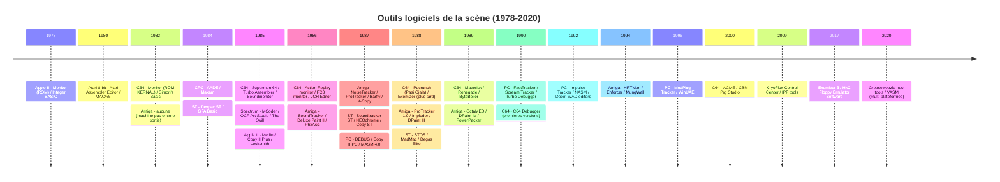

# 💾 Les Outils Logiciels du Cracking sur Ordinateurs 8/16 bits (1980-1999)
## Rapport technique approfondi — Édition enrichie et illustrée

| | |
| --- | --- |
| Périmètre | Commodore 64/128, Amiga, Atari ST, ZX Spectrum, Amstrad CPC, Apple II, Atari 8 bits, IBM PC, consoles (en périphérie) |
| Axe | Logiciels : assembleurs, moniteurs, débuggeurs, copieurs, packers, trackers, éditeurs graphiques, fast loaders, outils de préservation |
| Méthodologie | Outils classés par **fonction** puis par **plateforme**, avec dates, auteurs et héritage |
| Illustrations | Diagrammes [Mermaid](https://mermaid.js.org) et schémas ASCII |

### Légende des niveaux de confiance

| Marque | Signification |
| --- | --- |
| ✅ | Fait solidement établi (documentation officielle, dépôts de code, communauté de préservation) |
| ⚠️ | Information de seconde main ou contradictoire selon les sources : à vérifier avant citation |
| 🔧 | Correction / précision apportée par rapport à la littérature courante |

---

## Sommaire

- [0. Vue d'ensemble : frise chronologique et cartographie](#0-vue-densemble)
- [1. Introduction : pourquoi le logiciel était l'autre front de la guerre](#1-introduction)
- [2. Le workflow du cracker : de la disquette au .nfo](#2-le-workflow-du-cracker)
- [3. Les grandes familles d'outils logiciels](#3-les-grandes-familles-doutils-logiciels)
  - [3.1 Assembleurs et désassembleurs](#31-assembleurs-et-désassembleurs)
  - [3.2 Moniteurs machine](#32-moniteurs-machine)
  - [3.3 Débuggeurs et traceurs](#33-débuggeurs-et-traceurs)
  - [3.4 Copieurs de disquettes logiciels](#34-copieurs-de-disquettes-logiciels)
  - [3.5 Compresseurs / packers / crunchers](#35-compresseurs--packers--crunchers)
  - [3.6 Trackers musicaux et players](#36-trackers-musicaux-et-players)
  - [3.7 Éditeurs graphiques et de sprites](#37-éditeurs-graphiques-et-de-sprites)
  - [3.8 Fast loaders et accélérateurs](#38-fast-loaders-et-accélérateurs)
  - [3.9 Éditeurs de niveaux et d'aventures](#39-éditeurs-de-niveaux-et-daventures)
  - [3.10 Outils de préservation modernes](#310-outils-de-préservation-modernes)
- [4. Outils par plateforme](#4-outils-par-plateforme)
  - [4.1 Commodore 64 / 128](#41-commodore-64--128)
  - [4.2 Commodore Amiga](#42-commodore-amiga)
  - [4.3 Atari ST / STE / Falcon](#43-atari-st--ste--falcon)
  - [4.4 ZX Spectrum](#44-zx-spectrum)
  - [4.5 Amstrad CPC](#45-amstrad-cpc)
  - [4.6 Apple II](#46-apple-ii)
  - [4.7 Atari 8 bits (400/800/XL/XE)](#47-atari-8-bits)
  - [4.8 IBM PC / compatibles](#48-ibm-pc--compatibles)
  - [4.9 Consoles (NES, Mega Drive, SNES)](#49-consoles)
- [5. Études de cas : le cracking en action](#5-études-de-cas)
- [6. Culture, groupes et héritage](#6-culture-groupes-et-héritage)
- [7. Conclusion](#7-conclusion)
- [Annexes](#annexes)

---

## 0. Vue d'ensemble {#0-vue-densemble}

### 0.1 Frise chronologique des outils logiciels majeurs



### 0.2 Cartographie des familles d'outils

```
                          ┌─────────────────────────────────────┐
                          │   OUTILS LOGICIELS DE LA SCÈNE      │
                          └──────────────┬──────────────────────┘
                                         │
         ┌───────────────┬───────────────┼───────────────┬───────────────┐
         ▼               ▼               ▼               ▼               ▼
   ┌──────────┐   ┌──────────┐   ┌──────────┐   ┌──────────┐   ┌──────────┐
   │ ANALYSE  │   │ CRACKING │   │ PACKING  │   │ CRÉATION │   │ COPIE    │
   └──────────┘   └──────────┘   └──────────┘   └──────────┘   └──────────┘
         │               │               │               │               │
         ▼               ▼               ▼               ▼               ▼
   Assembleurs     Moniteurs       Packers         Trackers        Copieurs
   Désassembleurs  Débuggeurs      Crunchers       Éditeurs gfx    Fast loaders
   Traceurs        Patchers        Convertisseurs  Éditeurs 3D     Nibblers
                   Hex editors                     Éditions nfo
```

### 0.3 La boucle du cracking logiciel

```mermaid
flowchart LR
    A["Disquette originale<br/>(protections actives)"] --> B["Copie physique<br/>(Cyclone, KryoFlux)"]
    B --> C["Dump dans un émulateur<br/>(WinUAE, VICE, Hatari)"]
    C --> D["Moniteur / débuggeur<br/>(HRTMon, ICE, Barfly)"]
    D --> E["Analyse : localisation<br/>des routines de protection"]
    E --> F["Patching : NOP, JMP,<br/>modification de branchements"]
    F --> G["Test du crack<br/>(exécution pas-à-pas)"]
    G --> H["Packing : Pucrunch,<br/>PowerPacker, Exomizer"]
    H --> I["Ajout de la cracktro<br/>(musique + scroll + logo)"]
    I --> J["Création du .nfo<br/>(graphique ASCII / ANSI)"]
    J --> K["Distribution : BBS,<br/>FTP, swapping postal"]
    style E fill:#1e3a5f,color:#fff
    style F fill:#5f1e1e,color:#fff
    style I fill:#3a5f1e,color:#fff
```



---

## 1. Introduction : pourquoi le logiciel était l'autre front de la guerre {#1-introduction}

Le document compagnon traitait du **matériel** : freezers, copieurs de flux, câbles parallèles. Mais un cracker ne faisait pas que figer la mémoire ou copier des pistes : il devait **comprendre, modifier, reconditionner** le code. Cela exigeait une panoplie logicielle tout aussi sophistiquée, souvent développée par les crackers eux-mêmes et diffusée au sein des groupes.

Deux constats structurels :

1. **Les outils de développement professionnels étaient rares ou chers.** Sur C64, un assembleur comme *Turbo Assembler* coûtait cher et tenait sur disquette. Sur Amiga, *Bars & Pipes* ou *Deluxe Paint* étaient des investissements. Sur PC, *Turbo C* de Borland était un luxe. La scène a donc produit ses propres outils, souvent **gratuits, diffusés par BBS**, et d'une qualité technique stupéfiante.
2. **Le cracking était une école d'ingénierie inverse.** Un cracker de 1988 devait maîtriser simultanément l'assembleur du CPU, la cartographie mémoire, le format des disquettes, la compression, la musique et le graphisme. Les outils qu'il utilisait reflètent cette polyvalence.

Ce rapport passe en revue les logiciels qui ont permis à la scène de produire des dizaines de milliers de cracks, cracktros et démos entre 1982 et 1999, puis de léguer ce patrimoine aux archivistes d'aujourd'hui.

---

## 2. Le workflow du cracker : de la disquette au .nfo {#2-le-workflow-du-cracker}

Avant de détailler les outils, il faut comprendre **comment ils s'enchaînent**. Voici le flux typique d'un crack « single-load » sur C64 ou Amiga :

```
 ┌──────────────────────────────────────────────────────────────────────────┐
 │ 1. ACQUISITION                                                           │
 │    • Copie physique de l'original (Cyclone, KryoFlux, Catweasel)         │
 │    • Dump au format D64 / ADF / STX / IPF                                │
 │    • Ou chargement direct sur machine réelle via fast loader             │
 ├──────────────────────────────────────────────────────────────────────────┤
 │ 2. ANALYSE                                                               │
 │    • Chargement dans un moniteur (Supermon, HRTMon, Barfly)              │
 │    • Désassemblage de la routine de chargement                           │
 │    • Identification du « loader » propriétaire                           │
 │    • Repérage des tests de protection (CRC, timing, weak bits)           │
 ├──────────────────────────────────────────────────────────────────────────┤
 │ 3. CRACKING                                                              │
 │    • Patching des branchements conditionnels (BNE → NOP NOP)             │
 │    • Neutralisation des routines de vérification                         │
 │    • Éventuellement : réécriture du loader pour bypasser la protection   │
 │    • Tests pas-à-pas dans un débuggeur                                   │
 ├──────────────────────────────────────────────────────────────────────────┤
 │ 4. RECONDITIONNEMENT                                                     │
 │    • Extraction du code déchiffré en mémoire                             │
 │    • Compression (Pucrunch, PowerPacker, Exomizer)                       │
 │    • Ajout d'un décompresseur auto-extractible (decruncher)              │
 │    • Ajout de la cracktro (musique + scroll + logo du groupe)            │
 ├──────────────────────────────────────────────────────────────────────────┤
 │ 5. DISTRIBUTION                                                          │
 │    • Création du .nfo (fichier d'information du groupe)                  │
 │    • Packaging en .d64 / .adf / .zip                                     │
 │    • Upload sur BBS, FTP, ou envoi postal (swapping)                     │
 └──────────────────────────────────────────────────────────────────────────┘
```

Chaque étape mobilise des outils spécifiques, que nous allons passer en revue.

---

## 3. Les grandes familles d'outils logiciels {#3-les-grandes-familles-doutils-logiciels}

### 3.1 Assembleurs et désassembleurs

L'assembleur est **l'outil fondamental** du cracker. Il transforme du code source en langage machine (assembleur) ou, à l'inverse, désassemble du binaire en mnémoniques lisibles.

#### 3.1.1 Critères de choix

| Critère | Importance | Détail |
| --- | --- | --- |
| Vitesse d'assemblage | ⭐⭐⭐ | Sur C64, assembler un gros projet pouvait prendre plusieurs minutes |
| Qualité du listing | ⭐⭐⭐ | Labels, macros, indentation |
| Support des macros | ⭐⭐ | Essentiel pour factoriser le code |
| Taille du binaire produit | ⭐⭐ | Sur C64, chaque octet compte |
| Intégration d'un moniteur | ⭐⭐⭐ | Beaucoup d'assembleurs incluent un moniteur intégré |
| Support multi-plateforme | ⭐ (moderne) | VASM, ACME, 64TASS compilent pour plusieurs CPU |

#### 3.1.2 Les grands assembleurs par CPU

| CPU | Assembleurs historiques | Assembleurs modernes (encore utilisés) |
| --- | --- | --- |
| 6502/6510 (C64, Apple II) | Turbo Assembler (TASM), Macro Assembler (MAS), EDAS, Merlin (Apple II), EdAsm | ACME ✅, 64TASS ✅, XA (Cross Assembler) ✅, DASM ✅ |
| Z80 (Spectrum, CPC) | HiSoft-Dev, VASM (plus tard), Pasmo, ZX-Assembler | Pasmo ✅, VASM ✅, z80asm ✅ |
| 68000 (Amiga, ST) | PhxAss, Devpac, Barfly (intégré), A68k, MadMac | VASM ✅, EASy68k ✅, AS ✅ |
| x86 (PC) | MASM (Microsoft), TASM (Borland), A86 | NASM ✅, YASM ✅, FASM ✅ |

#### 3.1.3 Zoom : Turbo Assembler (C64)

Développé par **Tommi Rantanen** (alias *Slimey*) vers 1987, Turbo Assembler (TASM) était la référence absolue sur C64.

```
 ┌──────────────────────────────────────────────────────────────┐
 │  TURBO ASSEMBLER 3.0                                         │
 │  Copyright (c) 1987-1990 Tommi Rantanen                      │
 ├──────────────────────────────────────────────────────────────┤
 │  • Assembleur rapide (quelques secondes pour 10 Ko)          │
 │  • Macros puissantes, includes                               │
 │  • Moniteur intégré (commandes M, D, A, G, etc.)             │
 │  • Édition de sprites intégrée                               │
 │  • Support des formats .prg, .seq, .rel                      │
 │  • Labels locaux, globaux, sections                          │
 │  • Listing avec hexadécimal, binaire, décimal                │
 └──────────────────────────────────────────────────────────────┘
```

TASM a été **cloné, hacké, étendu** par la scène : des versions « Triad », « Fairlight », « Crest » circulaient avec des améliorations spécifiques. C'est un cas typique d'outil professionnel détourné par la scène.

#### 3.1.4 Zoom : VASM (multi-plateforme, moderne)

**VASM** (Volker Barthelmann's Assembler), développé à partir de 1999, est l'assembleur moderne de référence pour la scène rétro. Il supporte **tous les CPU de l'époque** (6502, Z80, 68000, x86, 6809, 8080, etc.) avec une syntaxe unifiée ou native. Il est utilisé aujourd'hui pour développer de nouveaux logiciels rétro et pour recompiler d'anciens projets.

### 3.2 Moniteurs machine

Le moniteur est **l'inspecteur de mémoire**. Il permet de visualiser et modifier la RAM, le ROM, les registres CPU et les E/S. C'est l'outil de base du cracker.

#### 3.2.1 Commandes typiques d'un moniteur

| Commande | Signification | Exemple |
| --- | --- | --- |
| `M` / `D` | Memory / Dump | `M 0400 04FF` (affiche 256 octets à partir de $0400) |
| `A` | Assemble | `A 0C00 LDA #$00` (assemble à l'adresse $0C00) |
| `G` | Go (exécuter) | `G 0C00` (exécute à partir de $0C00) |
| `R` | Registers | Affiche les registres CPU (A, X, Y, SP, PC, flags) |
| `T` | Transfer | `T 0400 0500 1000` (copie $0400-$0500 vers $1000) |
| `F` | Fill | `F 0400 04FF 00` (remplit avec des zéros) |
| `C` | Compare | `C 0400 0500 1000` (compare deux zones mémoire) |
| `H` | Hunt (recherche) | `H 0000 FFFF A9 00` (cherche `LDA #$00` dans toute la RAM) |
| `S` | Save | Sauvegarde une zone mémoire sur disque |
| `L` | Load | Charge un fichier en mémoire |

#### 3.2.2 Les grands moniteurs par plateforme

| Plateforme | Moniteurs historiques | Moniteurs modernes |
| --- | --- | --- |
| C64 | Monitor (KERNAL, très basique), Supermon 64 ✅, Supermon+, Monitor 4, Action Replay monitor, FC3 monitor | C64 Debugger ✅, VICE monitor ✅ |
| Amiga | Barfly ✅, HRTMon ✅, SID (System Information Display), Enforcer | WinUAE debugger ✅, FS-UAE debugger |
| ST | MonST ✅, GFA Debugger, K-Sek | Hatari debugger ✅, Steem debugger |
| Spectrum | ROM monitor (très basique), MCoder ✅, OCP Monitor | SpecEmu monitor, Fuse debugger |
| CPC | AA Monitor, CPC Monitor | CPCem debugger, WinAPE debugger |
| Apple II | Monitor (ROM, très complet pour l'époque) ✅, Bug Byter | AppleWin debugger |
| Atari 8-bit | Editor/Assembler monitor | Altirra debugger ✅ |
| PC | DEBUG (DOS) ✅, CodeView (Microsoft) | x64dbg ✅, IDA Pro ✅, Ghidra ✅ |

#### 3.2.3 Zoom : Supermon 64

**Supermon 64**, développé par **Jim Butterfield** et largement diffusé, était le moniteur de référence sur C64 avant l'arrivée des cartouches freezer. Il s'installait en mémoire haute (généralement à partir de $C000) et offrait toutes les commandes classiques. Sa version **Supermon+** ajoutait des fonctions de désassemblage symbolique.

#### 3.2.4 Zoom : HRTMon (Amiga)

**HRTMon** (High Resolution Tracker Monitor), développé par **Hans-Jörg Frieden** puis maintenu par la communauté, est le moniteur de référence sur Amiga. Il est **intégré dans WinUAE** et dans **WHDLoad** (le système de portage de jeux Amiga sur disques durs). Ses fonctions clés :

- Désassemblage 68000 complet avec symboles
- Inspection des **listes Copper** (structure de contrôle du coprocesseur graphique)
- Inspection des **registres custom** (Paula, Agnus, Denise)
- Breakpoints matériels et logiciels
- Dump de la Chip RAM et de la Fast RAM
- Sauvegarde d'état (snapshot)

### 3.3 Débuggeurs et traceurs

Au-delà du moniteur, le débuggeur ajoute des **breakpoints**, du **pas-à-pas**, de la **trace d'exécution** et de l'**observation mémoire**.

#### 3.3.1 Les débuggeurs historiques

| Plateforme | Débuggeurs | Particularités |
| --- | --- | --- |
| C64 | Action Replay monitor (déjà cité), ICE (In-Circuit Emulator, matériel+logiciel), C64 Debugger | Le C64 Debugger moderne permet le **replay** d'exécution |
| Amiga | Barfly ✅, TurboBoard debugger, SID | Barfly combinait assembleur, moniteur et débuggeur |
| ST | GFA Debugger, MonST, K-Sek | GFA Debugger était lié au langage GFA Basic |
| PC | DEBUG (DOS, très limité), CodeView (Microsoft), **Turbo Debugger** (Borland) ✅ | Turbo Debugger révolutionna le débogage PC avec son interface texte riche |
| Spectrum | Speculator, divers moniteurs | Peu de vrais débuggeurs, le Spectrum était limité en RAM |

#### 3.3.2 Zoom : Turbo Debugger (PC)

**Turbo Debugger**, livré avec Turbo Pascal et Turbo C de Borland à partir de 1989, était **l'outil de débogage de référence** sur PC. Ses innovations :

- Interface texte riche (fenêtres, menus, souris)
- Breakpoints conditionnels
- Watch windows (observation de variables)
- Pas-à-pas avec entrée/sortie des fonctions
- Désassemblage intégré
- Support du mode réel et du mode protégé

Turbo Debugger a formé **toute une génération de développeurs PC** et a été massivement utilisé par les crackers de jeux PC pour localiser les routines de protection.

#### 3.3.3 Zoom : Barfly (Amiga)

**Barfly**, développé par **Barfly** (le groupe, ou un développeur homonyme), était un environnement de développement complet pour Amiga :

- Assembleur 68000 intégré
- Moniteur machine
- Débuggeur avec breakpoints
- Éditeur de liens (linker)
- Gestion de projets multi-fichiers

Barfly était **l'outil de choix** des démomakers Amiga pour développer leurs productions.

### 3.4 Copieurs de disquettes logiciels

Avant les copieurs matériels (Cyclone, KryoFlux), les copieurs logiciels étaient la première ligne de défense contre les protections.

#### 3.4.1 Limites structurelles

Un copieur logiciel **dépend du système d'exploitation** et du **contrôleur de disquette** (FDC). Il ne peut copier que ce que le FDC consent à lire. Dès qu'une protection exploite une anomalie physique (weak bit, piste longue, CRC faux), le copieur logiciel échoue.

#### 3.4.2 Les grands copieurs logiciels par plateforme

| Plateforme | Copieurs logiciels | Particularités |
| --- | --- | --- |
| C64 | Fast Copy ✅, Disk2Disk, Star Copy, Big Six, **Maverick / Renegade** ✅ | Maverick utilisait des **paramètres** par titre (petites routines spécifiques) |
| Amiga | **X-Copy** ✅, X-Copy Pro, PowerCopy, SuperDiskCopy, Disk2Disk | X-Copy était le standard, souvent associé au dongle Cyclone |
| ST | Copy ST, ST-Copy, Disk2Disk ST | Moins de protections physiques sur ST, donc les copieurs logiciels suffisaient souvent |
| Spectrum | Lerm, Fast Copy, divers copieurs de cassettes | Le Spectrum utilisait surtout des cassettes, donc des copieurs de K7 |
| CPC | Discology, Copylock, divers | Copieurs de disquettes 3 pouces |
| Apple II | **Copy II Plus** ✅, **Locksmith** ✅, Essential Data Duplicator (EDD) | Copy II Plus et Locksmith étaient les références absolues |
| Atari 8-bit | Happy, divers | Le lecteur 810/1050 était modifiable, donc beaucoup de copieurs logiciels |
| PC | **Copy II PC** ✅, Disk2Disk, Teledisk, Dup-Rx | Copy II PC était le standard, souvent associé à l'Option Board (matériel) |

#### 3.4.3 Zoom : Maverick / Renegade (C64)

**Renegade**, renommé **Maverick** après un litige de marque avec Taito, n'était pas un simple copieur : c'était un **système paramétré**.

```
 ┌──────────────────────────────────────────────────────────────┐
 │  MAVERICK V5.04                                              │
 │  The Ultimate C64 Disk Copier                                │
 ├──────────────────────────────────────────────────────────────┤
 │  • Fast Data Copier : copie rapide des disques non protégés  │
 │  • Parameter Library : centaines de paramètres par titre     │
 │    - RapidLok, GEOS, protections par code wheel, etc.        │
 │  • Chaque paramètre est une petite routine 6502 qui :        │
 │    - Ignore ou fabrique un code d'erreur attendu             │
 │    - Reconstitue une séquence de synchronisation             │
 │    - Copie les pistes « 36 et plus »                         │
 │    - Réécrit les octets d'identification du disque           │
 │  • Bibliothèque mise à jour par abonnement ou échange        │
 └──────────────────────────────────────────────────────────────┘
```

Maverick est **l'ancêtre direct des scripts de préservation modernes** : au lieu de copier « bêtement » une disquette, on applique une routine spécifique au titre.

### 3.5 Compresseurs / packers / crunchers

Un cracker ne distribue pas une image mémoire brute de 64 Ko (C64) ou de 880 Ko (Amiga) : il la **compresse**. Le packing est une discipline à part entière.

#### 3.5.1 Les grandes familles de compression

| Génération | Technique | Exemples | Taux de compression typique |
| --- | --- | --- | --- |
| 1980s | **RLE** (Run-Length Encoding) | Sauvegardes natives des freezers C64 | 2:1 à 5:1 |
| Fin 1980s | **LZ77** et dérivés | PowerPacker (Amiga), ByteBoiler (C64) | 3:1 à 8:1 |
| 1990s | **LZ + Huffman / arithmétique** | Pucrunch (C64), Exomizer (C64) | 4:1 à 10:1 |
| 2000s+ | **LZMA, Zstandard** | Formats modernes de préservation | 5:1 à 15:1 |

#### 3.5.2 Les packers historiques par plateforme

| Plateforme | Packers historiques | Packers modernes |
| --- | --- | --- |
| C64 | RLE, ByteBoiler, Cruelcrunch, The AB cruncher, **Pucrunch** ✅ (1997), **Exomizer** ✅ (2002) | Exomizer 3 ✅, PuCrunch ✅, ByteBoiler ✅ |
| Amiga | **PowerPacker** ✅ (Nico François), Imploder, CrunchMania, Relokick | PowerPacker ✅, xPK ✅ |
| ST | PowerPacker, Imploder, CrunchMania | PowerPacker ✅ |
| Spectrum | RLE, divers | RLE ✅ |
| CPC | RLE, divers | RLE ✅ |
| PC | PKZIP ✅ (1989), ARJ, LHA, PKLITE | 7-Zip ✅, UPX ✅ |

#### 3.5.3 Zoom : PowerPacker (Amiga)

**PowerPacker**, développé par **Nico François** vers 1989, était le packer de référence sur Amiga. Son algorithme LZ était optimisé pour le 68000 et offrait un excellent taux de compression pour l'époque.

```
 ┌──────────────────────────────────────────────────────────────┐
 │  POWERPACKER 4.0                                             │
 │  Copyright (c) 1989-1992 Nico François                       │
 ├──────────────────────────────────────────────────────────────┤
 │  • Algorithme LZ optimisé pour 68000                         │
 │  • Taux de compression : 3:1 à 8:1 selon le type de données  │
 │  • Décompresseur auto-extractible intégré                    │
 │  • Support des fichiers exécutables Amiga                    │
 │  • Option « encryption » (faible, mais présente)             │
 │  • Utilisé pour packer la majorité des cracks Amiga          │
 └──────────────────────────────────────────────────────────────┘
```

PowerPacker a été **porté sur ST** et a été utilisé pour packer de nombreuses démos et intros.

#### 3.5.4 Zoom : Exomizer (C64, moderne)

**Exomizer**, développé par **Magnus Lind** à partir de 2002, est le packer moderne de référence pour C64. Il offre un **taux de compression inégalé** (souvent 10-15% meilleur que Pucrunch) et génère des décompresseurs très compacts (quelques centaines d'octets).

```
 ┌──────────────────────────────────────────────────────────────┐
 │  EXOMIZER 3.0                                                │
 │  Copyright (c) 2002-2020 Magnus Lind                         │
 ├──────────────────────────────────────────────────────────────┤
 │  • Algorithme LZ + Huffman                                   │
 │  • Taux de compression : 4:1 à 10:1                          │
 │  • Décompresseur très compact (≈ 200 octets)                 │
 │  • Support des formats raw, sfx (auto-extractible)           │
 │  • Utilisé pour packer la majorité des productions C64       │
 │    modernes (démos, intros, jeux homebrew)                   │
 └──────────────────────────────────────────────────────────────┘
```

### 3.6 Trackers musicaux et players

La musique est **l'âme de la scène**. Les cracktros et démos étaient jugées autant sur leur musique que sur leur graphisme. Les trackers sont les outils qui ont permis cette révolution sonore.

#### 3.6.1 Le principe du tracker

Un tracker est un éditeur de musique qui représente la partition sous forme de **grille verticale** (temps) et **horizontale** (voix/canaux). Chaque ligne contient des **notes**, des **instruments** et des **effets**.

```
 ┌──────────────────────────────────────────────────────────────┐
 │  EXEMPLE DE PATTERN (ProTracker, Amiga)                      │
 ├──────────────────────────────────────────────────────────────┤
 │  Ligne  | Voix 1    | Voix 2    | Voix 3    | Voix 4        │
 │  -------|-----------|-----------|-----------|-----------    │
 │  00     | C-4 01 A0 | ... 00 00 | E-3 02 00 | ... 00 00     │
 │  01     | ... 00 00 | G-3 03 00 | ... 00 00 | C-4 04 00     │
 │  02     | D-4 01 00 | ... 00 00 | F-3 02 00 | ... 00 00     │
 │  ...    | ...       | ...       | ...       | ...           │
 └──────────────────────────────────────────────────────────────┘
```

#### 3.6.2 Les grands trackers par plateforme

| Plateforme | Trackers historiques | Formats produits |
| --- | --- | --- |
| Amiga | **SoundTracker** ✅ (1987), **NoiseTracker** ✅, **ProTracker** ✅ (1990), OctaMED ✅, Startrekker | .MOD ✅ |
| ST | Soundtracker ST, DigiTracker, ProTracker ST | .MOD |
| C64 | **Soundmonitor** ✅, JCH Editor, Future Composer, **SIDMON** ✅, Music Assembler | .SID (player), .SNG |
| Spectrum | Wham! The Music Box, Vortex Tracker, Aztec Music | .AY, .PSG |
| CPC | Wham, Soundtrakker, Arkos Tracker (moderne) | .AY, .AKM |
| PC | **FastTracker 2** ✅ (1994), **Impulse Tracker** ✅ (1995), **Scream Tracker 3** ✅ (1994), ModPlug Tracker | .XM, .IT, .S3M, .MOD |
| Atari 8-bit | Music Macro Language, divers | .CM3, .RMT |

#### 3.6.3 Zoom : ProTracker (Amiga)

**ProTracker**, développé par **Lars Hamre**, **Anders Hamre**, **Olav Sørensen** et **Pål Gulbrandsen** (le groupe **Crusaders**) en 1990, est **le tracker de référence** sur Amiga. Il a défini le format **.MOD**, devenu un standard inter-plateformes.

```
 ┌──────────────────────────────────────────────────────────────┐
 │  PROTRACKER 3.62                                             │
 │  Copyright (c) 1990-1994 Crusaders                           │
 ├──────────────────────────────────────────────────────────────┤
 │  • 4 voix (extensibles à 8, 16, 32 avec des hacks)           │
 │  • 32 instruments (échantillons 8 bits)                      │
 │  • 128 patterns maximum                                      │
 │  • Effets : portamento, vibrato, volume slide, etc.          │
 │  • Format .MOD : standard de facto                           │
 │  • Utilisé pour 90% des musiques Amiga de l'époque           │
 └──────────────────────────────────────────────────────────────┘
```

ProTracker a été **cloné sur PC** (FastTracker, Scream Tracker) et a défini le format .MOD, encore utilisé aujourd'hui.

#### 3.6.4 Zoom : SID (C64)

Sur C64, la musique n'utilisait pas un format de tracker standard, mais le **format SID** (Sound Interface Device), qui encapsule un **player** (routine de lecture) et des **données musicales** spécifiques au SID, la puce sonore du C64.

Les outils de création étaient :

- **Soundmonitor** ✅ (1986) : le premier éditeur de musique C64, par **Johannes Bjerregaard**
- **JCH Editor** ✅ : amélioré par **Jochen Hippel** (alias **Mad Max**)
- **Future Composer** ✅ : par **Chris Hülsbeck** (musique de *Turrican*)
- **SIDMON** ✅ : par **Laxity**

Aujourd'hui, **GoatTracker 2** ✅ et **SID-Wizard** ✅ sont les outils modernes de composition SID.

### 3.7 Éditeurs graphiques et de sprites

Le graphisme était l'autre pilier de la scène. Les éditeurs graphiques permettaient de créer les **logos**, les **sprites**, les **écrans-titres** et les **cracktros**.

#### 3.7.1 Les grands éditeurs graphiques par plateforme

| Plateforme | Éditeurs historiques | Formats produits |
| --- | --- | --- |
| C64 | **Koala Painter** ✅, Face Painter, Doodle!, Advanced Art Studio, Graphic Assembler, **Charpad** ✅ (moderne) | .KOALA, .HI, .PRG |
| Amiga | **Deluxe Paint** ✅ (Electronic Arts), ProPaint, Graffiti2, Personal Paint, CyberPaint | .IFF, .LBM |
| ST | **DEGAS** ✅, DEGAS Elite, NEOchrome ✅, Cyber Paint, Canvas | .PI1, .NEO, .IMG |
| Spectrum | Melbourne Draw, OCP Art Studio ✅, Artist, Graphic Gadget | .SCR |
| CPC | Doodle CPC, Advanced Art Studio CPC, Pro Art Studio | .SCR |
| Apple II | Dazzle Draw, MegaGrafix, Koala (Apple II version) | .HRW |
| Atari 8-bit | MicroPainter, Doodle | .PIC |
| PC | **Deluxe Paint** ✅ (PC), CorelDRAW, Photoshop (plus tard) | .BMP, .PCX, .GIF |

#### 3.7.2 Zoom : Deluxe Paint (Amiga)

**Deluxe Paint** (DPaint), développé par **Dan Silva** pour **Electronic Arts** en 1985, est **l'éditeur graphique de référence** sur Amiga. Sa version II (1988) a introduit l'**animation**, faisant de DPaint un outil de création d'animations (animbrushes).

```
 ┌──────────────────────────────────────────────────────────────┐
 │  DELUXE PAINT II (Amiga)                                     │
 │  Copyright (c) 1988 Electronic Arts                          │
 ├──────────────────────────────────────────────────────────────┤
 │  • Édition bitmap (320×200, 640×200, 640×400)                │
 │  • 32 couleurs (EHB) ou 4096 (HAM)                           │
 │  • Animation (animbrushes)                                   │
 │  • Outils : pinceau, aérog
