# 💾 Les Outils Logiciels du Cracking sur Ordinateurs 8/16 bits (1980-1999)
## Rapport technique approfondi — Édition enrichie et illustrée

| | |
| --- | --- |
| Périmètre | Commodore 64/128, Amiga, Atari ST, ZX Spectrum, Amstrad CPC, Apple II, Atari 8 bits, IBM PC, consoles (en périphérie) |
| Axe | Logiciels : assembleurs, moniteurs, débuggeurs, copieurs, packers, trackers, éditeurs graphiques, fast loaders, outils de préservation |
| Méthodologie | Outils classés par **fonction** puis par **plateforme**, avec dates, auteurs et héritage |
| Illustrations | Diagrammes [Mermaid](https://mermaid.js.org) et schémas ASCII |

### Légende des niveaux de confiance

| Marque | Signification |
| --- | --- |
| ✅ | Fait solidement établi (documentation officielle, dépôts de code, communauté de préservation) |
| ⚠️ | Information de seconde main ou contradictoire selon les sources : à vérifier avant citation |
| 🔧 | Correction / précision apportée par rapport à la littérature courante |

> **Note sur les encadrés ASCII** : les « fiches » (numéros de version, copyrights, chiffres de performance) sont des synthèses illustratives. Elles n'ont pas valeur de citation : se reporter à l'Annexe C pour les points corrigés ou à recouper.

---

## Sommaire

- [0. Vue d'ensemble : frise chronologique et cartographie](#0-vue-densemble)
- [1. Introduction : pourquoi le logiciel était l'autre front de la guerre](#1-introduction--pourquoi-le-logiciel-était-lautre-front-de-la-guerre)
- [2. Le workflow du cracker : de la disquette au .nfo](#2-le-workflow-du-cracker--de-la-disquette-au-nfo)
- [3. Les grandes familles d'outils logiciels](#3-les-grandes-familles-doutils-logiciels)
  - [3.1 Assembleurs et désassembleurs](#31-assembleurs-et-désassembleurs)
  - [3.2 Moniteurs machine](#32-moniteurs-machine)
  - [3.3 Débuggeurs et traceurs](#33-débuggeurs-et-traceurs)
  - [3.4 Copieurs de disquettes logiciels](#34-copieurs-de-disquettes-logiciels)
  - [3.5 Compresseurs / packers / crunchers](#35-compresseurs--packers--crunchers)
  - [3.6 Trackers musicaux et players](#36-trackers-musicaux-et-players)
  - [3.7 Éditeurs graphiques et de sprites](#37-éditeurs-graphiques-et-de-sprites)
  - [3.8 Fast loaders et accélérateurs](#38-fast-loaders-et-accélérateurs)
  - [3.9 Éditeurs de niveaux et d'aventures](#39-éditeurs-de-niveaux-et-daventures)
  - [3.10 Outils de préservation modernes](#310-outils-de-préservation-modernes)
- [4. Outils par plateforme](#4-outils-par-plateforme)
  - [4.1 Commodore 64 / 128](#41-commodore-64--128)
  - [4.2 Commodore Amiga](#42-commodore-amiga)
  - [4.3 Atari ST / STE / Falcon](#43-atari-st--ste--falcon)
  - [4.4 ZX Spectrum](#44-zx-spectrum)
  - [4.5 Amstrad CPC](#45-amstrad-cpc)
  - [4.6 Apple II](#46-apple-ii)
  - [4.7 Atari 8 bits (400/800/XL/XE)](#47-atari-8-bits-400800xlxe)
  - [4.8 IBM PC / compatibles](#48-ibm-pc--compatibles)
  - [4.9 Consoles (NES, Mega Drive, SNES)](#49-consoles-nes-mega-drive-snes)
- [5. Études de cas : le cracking en action](#5-études-de-cas--le-cracking-en-action)
- [6. Culture, groupes et héritage](#6-culture-groupes-et-héritage)
- [7. Conclusion](#7-conclusion)
- [Annexes](#annexes)

---

## 0. Vue d'ensemble

### 0.1 Frise chronologique des outils logiciels majeurs

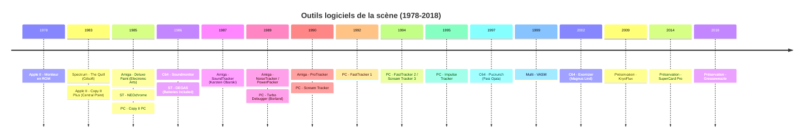

### 0.2 Cartographie des familles d'outils

```text
                          ┌─────────────────────────────────────┐
                          │   OUTILS LOGICIELS DE LA SCÈNE      │
                          └──────────────┬──────────────────────┘
                                         │
         ┌───────────────┬───────────────┼───────────────┬───────────────┐
         ▼               ▼               ▼               ▼               ▼
   ┌──────────┐   ┌──────────┐   ┌──────────┐   ┌──────────┐   ┌──────────┐
   │ ANALYSE  │   │ CRACKING │   │ PACKING  │   │ CRÉATION │   │ COPIE    │
   └──────────┘   └──────────┘   └──────────┘   └──────────┘   └──────────┘
         │               │               │               │               │
         ▼               ▼               ▼               ▼               ▼
   Assembleurs     Moniteurs       Packers         Trackers        Copieurs
   Désassembleurs  Débuggeurs      Crunchers       Éditeurs gfx    Fast loaders
   Traceurs        Patchers        Convertisseurs  Éditeurs 3D     Nibblers
                   Hex editors                     Éditions nfo
```

### 0.3 La boucle du cracking logiciel

```mermaid
flowchart LR
    A["Disquette originale<br/>(protections actives)"] --> B["Copie physique<br/>(Cyclone, KryoFlux)"]
    B --> C["Dump dans un émulateur<br/>(WinUAE, VICE, Hatari)"]
    C --> D["Moniteur / débuggeur<br/>(HRTMon, ICE, Barfly)"]
    D --> E["Analyse : localisation<br/>des routines de protection"]
    E --> F["Patching : NOP, JMP,<br/>modification de branchements"]
    F --> G["Test du crack<br/>(exécution pas-à-pas)"]
    G --> H["Packing : Pucrunch,<br/>PowerPacker, Exomizer"]
    H --> I["Ajout de la cracktro<br/>(musique + scroll + logo)"]
    I --> J["Création du .nfo<br/>(graphique ASCII / ANSI)"]
    J --> K["Distribution : BBS,<br/>FTP, swapping postal"]
    style E fill:#1e3a5f,color:#fff
    style F fill:#5f1e1e,color:#fff
    style I fill:#3a5f1e,color:#fff
```

---

## 1. Introduction : pourquoi le logiciel était l'autre front de la guerre

Le document compagnon traitait du **matériel** : freezers, copieurs de flux, câbles parallèles. Mais un cracker ne faisait pas que figer la mémoire ou copier des pistes : il devait **comprendre, modifier, reconditionner** le code. Cela exigeait une panoplie logicielle tout aussi sophistiquée, souvent développée par les crackers eux-mêmes et diffusée au sein des groupes.

Deux constats structurels :

1. **Les outils de développement professionnels étaient rares ou chers.** Sur C64, un assembleur comme *Turbo Assembler* coûtait cher et tenait sur disquette. Sur Amiga, *Bars & Pipes* ou *Deluxe Paint* étaient des investissements. Sur PC, *Turbo C* de Borland était un luxe. La scène a donc produit ses propres outils, souvent **gratuits, diffusés par BBS**, et d'une qualité technique stupéfiante.
2. **Le cracking était une école d'ingénierie inverse.** Un cracker de 1988 devait maîtriser simultanément l'assembleur du CPU, la cartographie mémoire, le format des disquettes, la compression, la musique et le graphisme. Les outils qu'il utilisait reflètent cette polyvalence.

Ce rapport passe en revue les logiciels qui ont permis à la scène de produire des dizaines de milliers de cracks, cracktros et démos entre 1982 et 1999, puis de léguer ce patrimoine aux archivistes d'aujourd'hui.

---

## 2. Le workflow du cracker : de la disquette au .nfo

Avant de détailler les outils, il faut comprendre **comment ils s'enchaînent**. Voici le flux typique d'un crack « single-load » sur C64 ou Amiga :

```text
 ┌──────────────────────────────────────────────────────────────────────────┐
 │ 1. ACQUISITION                                                           │
 │    • Copie physique de l'original (Cyclone, KryoFlux, Catweasel)         │
 │    • Dump au format D64 / ADF / STX / IPF                                │
 │    • Ou chargement direct sur machine réelle via fast loader             │
 ├──────────────────────────────────────────────────────────────────────────┤
 │ 2. ANALYSE                                                               │
 │    • Chargement dans un moniteur (Supermon, HRTMon, Barfly)              │
 │    • Désassemblage de la routine de chargement                           │
 │    • Identification du « loader » propriétaire                           │
 │    • Repérage des tests de protection (CRC, timing, weak bits)           │
 ├──────────────────────────────────────────────────────────────────────────┤
 │ 3. CRACKING                                                              │
 │    • Patching des branchements conditionnels (BNE → NOP NOP)             │
 │    • Neutralisation des routines de vérification                         │
 │    • Éventuellement : réécriture du loader pour bypasser la protection   │
 │    • Tests pas-à-pas dans un débuggeur                                   │
 ├──────────────────────────────────────────────────────────────────────────┤
 │ 4. RECONDITIONNEMENT                                                     │
 │    • Extraction du code déchiffré en mémoire                             │
 │    • Compression (Pucrunch, PowerPacker, Exomizer)                       │
 │    • Ajout d'un décompresseur auto-extractible (decruncher)              │
 │    • Ajout de la cracktro (musique + scroll + logo du groupe)            │
 ├──────────────────────────────────────────────────────────────────────────┤
 │ 5. DISTRIBUTION                                                          │
 │    • Création du .nfo (fichier d'information du groupe)                  │
 │    • Packaging en .d64 / .adf / .zip                                     │
 │    • Upload sur BBS, FTP, ou envoi postal (swapping)                     │
 └──────────────────────────────────────────────────────────────────────────┘
```

Chaque étape mobilise des outils spécifiques, que nous allons passer en revue.

---

## 3. Les grandes familles d'outils logiciels

### 3.1 Assembleurs et désassembleurs

L'assembleur est **l'outil fondamental** du cracker. Il transforme du code source écrit en mnémoniques en code machine binaire ou, à l'inverse, désassemble du binaire en mnémoniques lisibles.

#### 3.1.1 Critères de choix

| Critère | Importance | Détail |
| --- | --- | --- |
| Vitesse d'assemblage | ⭐⭐⭐ | Sur C64, assembler un gros projet pouvait prendre plusieurs minutes |
| Qualité du listing | ⭐⭐⭐ | Labels, macros, indentation |
| Support des macros | ⭐⭐ | Essentiel pour factoriser le code |
| Taille du binaire produit | ⭐⭐ | Sur C64, chaque octet compte |
| Intégration d'un moniteur | ⭐⭐⭐ | Beaucoup d'assembleurs incluent un moniteur intégré |
| Support multi-plateforme | ⭐ (moderne) | VASM, ACME, 64TASS compilent pour plusieurs CPU |

#### 3.1.2 Les grands assembleurs par CPU

| CPU | Assembleurs historiques | Assembleurs modernes (encore utilisés) |
| --- | --- | --- |
| 6502/6510 (C64, Apple II) | Turbo Assembler (TASM), Macro Assembler (MAS), EDAS, Merlin (Apple II), EdAsm | ACME ✅, 64TASS ✅, XA (Cross Assembler) ✅, DASM ✅ |
| Z80 (Spectrum, CPC) | HiSoft-Dev, VASM (plus tard), Pasmo, ZX-Assembler | Pasmo ✅, VASM ✅, z80asm ✅ |
| 68000 (Amiga, ST) | PhxAss, Devpac, Barfly (intégré), A68k, MadMac | VASM ✅, EASy68k ✅, AS ✅ |
| x86 (PC) | MASM (Microsoft), TASM (Borland), A86 | NASM ✅, YASM ✅, FASM ✅ |

#### 3.1.3 Zoom : Turbo Assembler (C64)

Apparu au milieu des années 1980, Turbo Assembler (TASM) était une référence sur C64 ⚠️ (l'attribution de l'auteur varie selon les sources ; on cite souvent Magnus Nyman).

```text
 ┌──────────────────────────────────────────────────────────────┐
 │  TURBO ASSEMBLER 3.0                                         │
 │  Copyright (c) 1987-1990 (auteur : voir texte)               │
 ├──────────────────────────────────────────────────────────────┤
 │  • Assembleur rapide (quelques secondes pour 10 Ko)          │
 │  • Macros puissantes, includes                               │
 │  • Moniteur intégré (commandes M, D, A, G, etc.)             │
 │  • Édition de sprites intégrée                               │
 │  • Support des formats .prg, .seq, .rel                      │
 │  • Labels locaux, globaux, sections                          │
 │  • Listing avec hexadécimal, binaire, décimal                │
 └──────────────────────────────────────────────────────────────┘
```

TASM a été **cloné, hacké, étendu** par la scène : des versions « Triad », « Fairlight », « Crest » circulaient avec des améliorations spécifiques. C'est un cas typique d'outil professionnel détourné par la scène.

#### 3.1.4 Zoom : VASM (multi-plateforme, moderne)

**VASM** (Volker Barthelmann's Assembler), développé à partir de 1999, est l'assembleur moderne de référence pour la scène rétro. Il supporte **de nombreux CPU de l'époque** (6502, Z80, 68000, 6809, 8080, etc.) avec une syntaxe unifiée ou native. Il est utilisé aujourd'hui pour développer de nouveaux logiciels rétro et pour recompiler d'anciens projets.

### 3.2 Moniteurs machine

Le moniteur est **l'inspecteur de mémoire**. Il permet de visualiser et modifier la RAM, le ROM, les registres CPU et les E/S. C'est l'outil de base du cracker.

#### 3.2.1 Commandes typiques d'un moniteur

| Commande | Signification | Exemple |
| --- | --- | --- |
| `M` / `D` | Memory / Dump | `M 0400 04FF` (affiche 256 octets à partir de $0400) |
| `A` | Assemble | `A 0C00 LDA #$00` (assemble à l'adresse $0C00) |
| `G` | Go (exécuter) | `G 0C00` (exécute à partir de $0C00) |
| `R` | Registers | Affiche les registres CPU (A, X, Y, SP, PC, flags) |
| `T` | Transfer | `T 0400 0500 1000` (copie $0400-$0500 vers $1000) |
| `F` | Fill | `F 0400 04FF 00` (remplit avec des zéros) |
| `C` | Compare | `C 0400 0500 1000` (compare deux zones mémoire) |
| `H` | Hunt (recherche) | `H 0000 FFFF A9 00` (cherche `LDA #$00` dans toute la RAM) |
| `S` | Save | Sauvegarde une zone mémoire sur disque |
| `L` | Load | Charge un fichier en mémoire |

#### 3.2.2 Les grands moniteurs par plateforme

| Plateforme | Moniteurs historiques | Moniteurs modernes |
| --- | --- | --- |
| C64 | Monitor (KERNAL, très basique), Supermon 64 ✅, Supermon+, Monitor 4, Action Replay monitor, FC3 monitor | C64 Debugger ✅, VICE monitor ✅ |
| Amiga | Barfly ✅, HRTMon ✅, SID (System Information Display), Enforcer | WinUAE debugger ✅, FS-UAE debugger |
| ST | MonST ✅, GFA Debugger, K-Sek | Hatari debugger ✅, Steem debugger |
| Spectrum | ROM monitor (très basique), MCoder ✅, OCP Monitor | SpecEmu monitor, Fuse debugger |
| CPC | AA Monitor, CPC Monitor | CPCem debugger, WinAPE debugger |
| Apple II | Monitor (ROM, très complet pour l'époque) ✅, Bug Byter | AppleWin debugger |
| Atari 8-bit | Editor/Assembler monitor | Altirra debugger ✅ |
| PC | DEBUG (DOS) ✅, CodeView (Microsoft) | x64dbg ✅, IDA Pro ✅, Ghidra ✅ |

#### 3.2.3 Zoom : Supermon 64

**Supermon 64**, développé par **Jim Butterfield** et largement diffusé, était le moniteur de référence sur C64 avant l'arrivée des cartouches freezer. Il s'installait en mémoire haute (généralement à partir de $C000) et offrait toutes les commandes classiques. Sa version **Supermon+** ajoutait des fonctions de désassemblage symbolique.

#### 3.2.4 Zoom : HRTMon (Amiga)

**HRTMon** est un moniteur/freezer logiciel de référence sur Amiga, à l'origine distribué sous forme de cartouche ou de ROM. Il est **pris en charge par WinUAE** (émulation de la cartouche) et peut être invoqué depuis **WHDLoad** (le système d'installation de jeux Amiga sur disque dur) ⚠️. L'auteur et la signification exacte du nom sont à recouper. Ses fonctions clés :

- Désassemblage 68000 complet avec symboles
- Inspection des **listes Copper** (structure de contrôle du coprocesseur graphique)
- Inspection des **registres custom** (Paula, Agnus, Denise)
- Breakpoints matériels et logiciels
- Dump de la Chip RAM et de la Fast RAM
- Sauvegarde d'état (snapshot)

### 3.3 Débuggeurs et traceurs

Au-delà du moniteur, le débuggeur ajoute des **breakpoints**, du **pas-à-pas**, de la **trace d'exécution** et de l'**observation mémoire**.

#### 3.3.1 Les débuggeurs historiques

| Plateforme | Débuggeurs | Particularités |
| --- | --- | --- |
| C64 | Action Replay monitor (déjà cité), ICE (In-Circuit Emulator, matériel+logiciel), C64 Debugger | Le C64 Debugger moderne permet le **replay** d'exécution |
| Amiga | Barfly ✅, TurboBoard debugger, SID | Barfly combinait assembleur, moniteur et débuggeur |
| ST | GFA Debugger, MonST, K-Sek | GFA Debugger était lié au langage GFA Basic |
| PC | DEBUG (DOS, très limité), CodeView (Microsoft), **Turbo Debugger** (Borland) ✅ | Turbo Debugger révolutionna le débogage PC avec son interface texte riche |
| Spectrum | Speculator, divers moniteurs | Peu de vrais débuggeurs, le Spectrum était limité en RAM |

#### 3.3.2 Zoom : Turbo Debugger (PC)

**Turbo Debugger**, livré avec Turbo Pascal et Turbo C de Borland à partir de 1989, était **l'outil de débogage de référence** sur PC. Ses innovations :

- Interface texte riche (fenêtres, menus, souris)
- Breakpoints conditionnels
- Watch windows (observation de variables)
- Pas-à-pas avec entrée/sortie des fonctions
- Désassemblage intégré
- Support du mode réel et du mode protégé

Turbo Debugger a formé **toute une génération de développeurs PC** et a été massivement utilisé par les crackers de jeux PC pour localiser les routines de protection.

#### 3.3.3 Zoom : Barfly (Amiga)

**Barfly** était un environnement de développement complet pour Amiga ⚠️ (auteur à recouper) :

- Assembleur 68000 intégré
- Moniteur machine
- Débuggeur avec breakpoints
- Éditeur de liens (linker)
- Gestion de projets multi-fichiers

Barfly était **l'outil de choix** des démomakers Amiga pour développer leurs productions.

### 3.4 Copieurs de disquettes logiciels

Avant les copieurs matériels (Cyclone, KryoFlux), les copieurs logiciels étaient la première ligne de défense contre les protections.

#### 3.4.1 Limites structurelles

Un copieur logiciel **dépend du système d'exploitation** et du **contrôleur de disquette** (FDC). Il ne peut copier que ce que le FDC consent à lire. Dès qu'une protection exploite une anomalie physique (weak bit, piste longue, CRC faux), le copieur logiciel échoue.

#### 3.4.2 Les grands copieurs logiciels par plateforme

| Plateforme | Copieurs logiciels | Particularités |
| --- | --- | --- |
| C64 | Fast Copy ✅, Disk2Disk, Star Copy, Big Six, **Maverick / Renegade** ✅ | Maverick utilisait des **paramètres** par titre (petites routines spécifiques) |
| Amiga | **X-Copy** ✅, X-Copy Pro, PowerCopy, SuperDiskCopy, Disk2Disk | X-Copy était le standard, souvent associé au dongle Cyclone |
| ST | Copy ST, ST-Copy, Disk2Disk ST | Moins de protections physiques sur ST, donc les copieurs logiciels suffisaient souvent |
| Spectrum | Lerm, Fast Copy, divers copieurs de cassettes | Le Spectrum utilisait surtout des cassettes, donc des copieurs de K7 |
| CPC | Discology, Copylock, divers | Copieurs de disquettes 3 pouces |
| Apple II | **Copy II Plus** ✅, **Locksmith** ✅, Essential Data Duplicator (EDD) | Copy II Plus et Locksmith étaient les références absolues |
| Atari 8-bit | Happy, divers | Le lecteur 810/1050 était modifiable, donc beaucoup de copieurs logiciels |
| PC | **Copy II PC** ✅, Disk2Disk, Teledisk, Dup-Rx | Copy II PC était le standard, souvent associé à l'Option Board (matériel) |

#### 3.4.3 Zoom : Maverick / Renegade (C64)

**Maverick** (parfois associé à une version antérieure nommée **Renegade** ⚠️) n'était pas un simple copieur : c'était un **système paramétré**.

```text
 ┌──────────────────────────────────────────────────────────────┐
 │  MAVERICK V5.04                                              │
 │  The Ultimate C64 Disk Copier                                │
 ├──────────────────────────────────────────────────────────────┤
 │  • Fast Data Copier : copie rapide des disques non protégés  │
 │  • Parameter Library : centaines de paramètres par titre     │
 │    - RapidLok, GEOS, protections par code wheel, etc.        │
 │  • Chaque paramètre est une petite routine 6502 qui :        │
 │    - Ignore ou fabrique un code d'erreur attendu             │
 │    - Reconstitue une séquence de synchronisation             │
 │    - Copie les pistes « 36 et plus »                         │
 │    - Réécrit les octets d'identification du disque           │
 │  • Bibliothèque mise à jour par abonnement ou échange        │
 └──────────────────────────────────────────────────────────────┘
```

Maverick est **l'ancêtre direct des scripts de préservation modernes** : au lieu de copier « bêtement » une disquette, on applique une routine spécifique au titre.

### 3.5 Compresseurs / packers / crunchers

Un cracker ne distribue pas une image mémoire brute de 64 Ko (C64) ou de 880 Ko (Amiga) : il la **compresse**. Le packing est une discipline à part entière.

#### 3.5.1 Les grandes familles de compression

| Génération | Technique | Exemples | Taux de compression typique |
| --- | --- | --- | --- |
| 1980s | **RLE** (Run-Length Encoding) | Sauvegardes natives des freezers C64 | 2:1 à 5:1 |
| Fin 1980s | **LZ77** et dérivés | PowerPacker (Amiga), ByteBoiler (C64) | 3:1 à 8:1 |
| 1990s | **LZ + Huffman / arithmétique** | Pucrunch (C64), Exomizer (C64) | 4:1 à 10:1 |
| 2000s+ | **LZMA, Zstandard** | Formats modernes de préservation | 5:1 à 15:1 |

#### 3.5.2 Les packers historiques par plateforme

| Plateforme | Packers historiques | Packers modernes |
| --- | --- | --- |
| C64 | RLE, ByteBoiler, Cruelcrunch, The AB cruncher, **Pucrunch** ✅ (1997), **Exomizer** ✅ (2002) | Exomizer 3 ✅, PuCrunch ✅, ByteBoiler ✅ |
| Amiga | **PowerPacker** ✅ (Nico François), Imploder, CrunchMania, Relokick | PowerPacker ✅, xPK ✅ |
| ST | PowerPacker, Imploder, CrunchMania | PowerPacker ✅ |
| Spectrum | RLE, divers | RLE ✅ |
| CPC | RLE, divers | RLE ✅ |
| PC | PKZIP ✅ (1989), ARJ, LHA, PKLITE | 7-Zip ✅, UPX ✅ |

#### 3.5.3 Zoom : PowerPacker (Amiga)

**PowerPacker**, développé par **Nico François** vers 1989, était le packer de référence sur Amiga. Son algorithme LZ était optimisé pour le 68000 et offrait un excellent taux de compression pour l'époque.

```text
 ┌──────────────────────────────────────────────────────────────┐
 │  POWERPACKER 4.0                                             │
 │  Copyright (c) 1989-1992 Nico François                       │
 ├──────────────────────────────────────────────────────────────┤
 │  • Algorithme LZ optimisé pour 68000                         │
 │  • Taux de compression : 3:1 à 8:1 selon le type de données  │
 │  • Décompresseur auto-extractible intégré                    │
 │  • Support des fichiers exécutables Amiga                    │
 │  • Option « encryption » (faible, mais présente)             │
 │  • Utilisé pour packer la majorité des cracks Amiga          │
 └──────────────────────────────────────────────────────────────┘
```

PowerPacker a été **porté sur ST** et a été utilisé pour packer de nombreuses démos et intros.

#### 3.5.4 Zoom : Exomizer (C64, moderne)

**Exomizer**, développé par **Magnus Lind** à partir de 2002, est le packer moderne de référence pour C64. Il offre un **taux de compression inégalé** (souvent 10-15% meilleur que Pucrunch) et génère des décompresseurs très compacts (quelques centaines d'octets).

```text
 ┌──────────────────────────────────────────────────────────────┐
 │  EXOMIZER 3.0                                                │
 │  Copyright (c) 2002-2020 Magnus Lind                         │
 ├──────────────────────────────────────────────────────────────┤
 │  • Algorithme LZ + Huffman                                   │
 │  • Taux de compression : 4:1 à 10:1                          │
 │  • Décompresseur très compact (≈ 200 octets)                 │
 │  • Support des formats raw, sfx (auto-extractible)           │
 │  • Utilisé pour packer la majorité des productions C64       │
 │    modernes (démos, intros, jeux homebrew)                   │
 └──────────────────────────────────────────────────────────────┘
```

### 3.6 Trackers musicaux et players

La musique est **l'âme de la scène**. Les cracktros et démos étaient jugées autant sur leur musique que sur leur graphisme. Les trackers sont les outils qui ont permis cette révolution sonore.

#### 3.6.1 Le principe du tracker

Un tracker est un éditeur de musique qui représente la partition sous forme de **grille verticale** (temps) et **horizontale** (voix/canaux). Chaque ligne contient des **notes**, des **instruments** et des **effets**.

```text
 ┌──────────────────────────────────────────────────────────────┐
 │  EXEMPLE DE PATTERN (ProTracker, Amiga)                      │
 ├──────────────────────────────────────────────────────────────┤
 │  Ligne  | Voix 1    | Voix 2    | Voix 3    | Voix 4         │
 │  -------|-----------|-----------|-----------|-----------     │
 │  00     | C-4 01 A0 | ... 00 00 | E-3 02 00 | ... 00 00      │
 │  01     | ... 00 00 | G-3 03 00 | ... 00 00 | C-4 04 00      │
 │  02     | D-4 01 00 | ... 00 00 | F-3 02 00 | ... 00 00      │
 │  ...    | ...       | ...       | ...       | ...            │
 └──────────────────────────────────────────────────────────────┘
```

#### 3.6.2 Les grands trackers par plateforme

| Plateforme | Trackers historiques | Formats produits |
| --- | --- | --- |
| Amiga | **SoundTracker** ✅ (1987), **NoiseTracker** ✅, **ProTracker** ✅ (1990), OctaMED ✅, Startrekker | .MOD ✅ |
| ST | Soundtracker ST, DigiTracker, ProTracker ST | .MOD |
| C64 | **Soundmonitor** ✅, JCH Editor, Future Composer, SidMon ⚠️, Music Assembler | .SID (player), .SNG |
| Spectrum | Wham! The Music Box, Vortex Tracker, Aztec Music | .AY, .PSG |
| CPC | Wham, Soundtrakker, Arkos Tracker (moderne) | .AY, .AKM |
| PC | **FastTracker 2** ✅ (1994), **Impulse Tracker** ✅ (1995), **Scream Tracker 3** ✅ (1994), ModPlug Tracker | .XM, .IT, .S3M, .MOD |
| Atari 8-bit | Music Macro Language, divers | .CM3, .RMT |

#### 3.6.3 Zoom : ProTracker (Amiga)

**ProTracker**, développé à partir de 1990 par **Amiga Freelancers** (notamment Lars Hamre, Anders Hamre, Olav Sørensen et Pål Gulbrandsen ⚠️), prolonge **SoundTracker** (Karsten Obarski, 1987) et **NoiseTracker** (Mahoney et Kaktus, 1989). C'est **le tracker de référence** sur Amiga. Il a défini le format **.MOD**, devenu un standard inter-plateformes.

```text
 ┌──────────────────────────────────────────────────────────────┐
 │  PROTRACKER 3.62                                             │
 │  Copyright (c) 1990-1994 Amiga Freelancers                   │
 ├──────────────────────────────────────────────────────────────┤
 │  • 4 voix (extensibles à 8, 16, 32 avec des hacks)           │
 │  • 32 instruments (échantillons 8 bits)                      │
 │  • 128 patterns maximum                                      │
 │  • Effets : portamento, vibrato, volume slide, etc.          │
 │  • Format .MOD : standard de facto                           │
 │  • Utilisé pour 90% des musiques Amiga de l'époque           │
 └──────────────────────────────────────────────────────────────┘
```

ProTracker a **inspiré les trackers PC** (Scream Tracker, FastTracker, puis OpenMPT et MilkyTracker) et a popularisé le format .MOD, encore utilisé aujourd'hui.

#### 3.6.4 Zoom : SID (C64)

Sur C64, la musique n'utilisait pas un format de tracker standard, mais le **format SID** (Sound Interface Device), qui encapsule un **player** (routine de lecture) et des **données musicales** spécifiques au SID, la puce sonore du C64.

Les outils de création étaient :

- **Soundmonitor** ✅ (1986) : éditeur de musique SID très répandu, par **Chris Hülsbeck**
- **JCH Editor** ✅ : créé par **Jens-Christian Huus** (JCH) ; à ne pas confondre avec les formats « Hippel/CoSo » de **Jochen Hippel** (alias *Mad Max*), qui concernent surtout l'ST et l'Amiga
- **Future Composer** ⚠️ : éditeur/player répandu sur Amiga et C64 ; auteur à recouper (à ne pas confondre avec les outils de Chris Hülsbeck, compositeur de *Turrican*)
- **SidMon** ⚠️ : éditeur surtout connu sur Amiga ; version C64 à recouper. **Laxity** est un musicien/codeur de la scène C64 (NewPlayer), à ne pas confondre

Aujourd'hui, **GoatTracker 2** ✅ et **SID-Wizard** ✅ sont les outils modernes de composition SID.

### 3.7 Éditeurs graphiques et de sprites

Le graphisme était l'autre pilier de la scène. Les éditeurs graphiques permettaient de créer les **logos**, les **sprites**, les **écrans-titres** et les **cracktros**.

#### 3.7.1 Les grands éditeurs graphiques par plateforme

| Plateforme | Éditeurs historiques | Formats produits |
| --- | --- | --- |
| C64 | **Koala Painter** ✅, Face Painter, Doodle!, Advanced Art Studio, Graphic Assembler, **Charpad** ✅ (moderne) | .KOALA, .HI, .PRG |
| Amiga | **Deluxe Paint** ✅ (Electronic Arts), ProPaint, Graffiti2, Personal Paint, CyberPaint | .IFF, .LBM |
| ST | **DEGAS** ✅, DEGAS Elite, NEOchrome ✅, Cyber Paint, Canvas | .PI1, .NEO, .IMG |
| Spectrum | Melbourne Draw, OCP Art Studio ✅, Artist, Graphic Gadget | .SCR |
| CPC | Doodle CPC, Advanced Art Studio CPC, Pro Art Studio | .SCR |
| Apple II | Dazzle Draw, MegaGrafix, Koala (Apple II version) | .HRW |
| Atari 8-bit | MicroPainter, Doodle | .PIC |
| PC | **Deluxe Paint** ✅ (PC), CorelDRAW, Photoshop (plus tard) | .BMP, .PCX, .GIF |

#### 3.7.2 Zoom : Deluxe Paint (Amiga)

**Deluxe Paint** (DPaint), développé par **Dan Silva** pour **Electronic Arts** en 1985, est **l'éditeur graphique de référence** sur Amiga. Les versions suivantes (DPaint III, 1989) ont introduit l'**animation** (animbrushes).

```text
 ┌──────────────────────────────────────────────────────────────┐
 │  DELUXE PAINT III (Amiga)                                    │
 │  Copyright (c) 1989 Electronic Arts                          │
 ├──────────────────────────────────────────────────────────────┤
 │  • Édition bitmap (320×200, 640×200, 640×400)                │
 │  • 32 couleurs (64 en EHB), 4096 en HAM                      │
 │  • Animation (animbrushes)                                   │
 │  • Outils : pinceau, aérog, remplissage, sélection           │
 │  • Gestion des bitplanes (4 à 6)                             │
 │  • Support IFF (Interchange File Format)                     │
 │  • Utilisé pour 80% des logos et cracktros Amiga             │
 └──────────────────────────────────────────────────────────────┘
```

DPaint a été **cloné et étendu** par la scène : des versions modifiées circulaient avec des brushes personnalisés, des palettes optimisées pour les écrans de défilement, et des macros pour accélérer la création de séquences animées.

#### 3.7.3 Zoom : Koala Painter (C64)

**Koala Painter**, édité par **Koala Technologies** (célèbre pour la tablette KoalaPad) au début des années 1980, était un éditeur graphique de référence sur C64. Il permettait de créer des images en **mode multicolore** (160×200, 4 couleurs par cellule de 4×8 pixels) et de les sauvegarder au format **.KOALA** (≈ 10 Ko : 8 000 octets de bitmap + 1 000 octets de matrice vidéo + 1 000 octets de color RAM + 1 octet de couleur de fond, plus l'adresse de chargement).

```text
 ┌──────────────────────────────────────────────────────────────┐
 │  KOALA PAINTER V1.0                                          │
 │  Copyright (c) Koala Technologies                            │
 ├──────────────────────────────────────────────────────────────┤
 │  • Mode multicolore : 160×200, 4 couleurs/cellule 4×8        │
 │  • Palette : 16 couleurs (VIC-II)                            │
 │  • Outils : pinceau, remplissage, ligne, cercle              │
 │  • Format .KOALA : ≈ 10 Ko (bitmap + 2 tables + fond)        │
 │  • Adresse de chargement usuelle : $6000                     │
 │  • Utilisé pour la majorité des écrans-titres C64            │
 └──────────────────────────────────────────────────────────────┘
```

Koala Painter a été **massivement utilisé** pour créer les écrans de présentation des cracktros, les logos de groupes et les illustrations de .nfo.

#### 3.7.4 Les éditeurs de sprites

Le sprite est **l'unité graphique de base** sur C64 (8 sprites matériels de 24×21 pixels, multicolores en 12×21). Les éditeurs de sprites permettaient de dessiner ces éléments graphiques avec une précision pixel par pixel.

| Plateforme | Éditeurs de sprites | Particularités |
| --- | --- | --- |
| C64 | **Sprite Editor** (intégré à TASM), **Sprite Master**, **Graphic Assembler** | Édition 24×21, multicolore, animation (sprites multiples) |
| Amiga | **DPaint** (déjà cité), **ProPaint** | 8 sprites matériels (16 pixels de large), bitplanes |
| ST | **DEGAS**, **NEOchrome** | Sprites logiciels (bitmap), animation |
| Spectrum | **Melbourne Draw**, **OCP Art Studio** | Sprites logiciels (32×24, 2 couleurs) |

#### 3.7.5 Les éditeurs de caractères (charset editors)

Sur C64 et Spectrum, le texte et les graphismes simples utilisaient des **jeux de caractères** (charset) de 256 caractères de 8×8 pixels. Les éditeurs de charset permettaient de créer des polices personnalisées, des tiles pour les jeux, et des effets de texte.

| Plateforme | Éditeurs de charset | Particularités |
| --- | --- | --- |
| C64 | **Charpad** ✅ (moderne), **Character Designer** (historique) | 256 caractères 8×8, multicolore, export .prg |
| Spectrum | **Font Editor**, **The Quill** (intégré) | 256 caractères 8×8, 2 couleurs |
| CPC | **Art Studio CPC** | 256 caractères 8×8, mode 0/1/2 |

### 3.8 Fast loaders et accélérateurs

Les fast loaders étaient des routines logicielles qui **accéléraient le chargement** depuis les disquettes ou cassettes, souvent en contournant les routines lentes du système d'exploitation.

#### 3.8.1 Le problème de la lenteur

Les systèmes d'exploitation d'origine étaient volontairement lents :

| Plateforme | Routine de chargement | Débit | Raison de la lenteur |
| --- | --- | --- | --- |
| C64 (KERNAL) | LOAD via IEC | ≈ 300-400 octets/s | Protocole série hérité du VIC-20, défaut de registre à décalage ✅ |
| Amiga (Workbench) | LoadFile via trackdisk.device | ≈ 10-20 Ko/s | Gestion des erreurs, vérifications multiples |
| ST (GEMDOS) | Fload via WD1772 | ≈ 15-25 Ko/s | Protocole standard, pas d'optimisation |
| Spectrum (ROM) | LOAD via ULA | ≈ 1 200 bauds (≈ 150 octets/s) | Format cassette standard |
| CPC (AMSOS) | LOAD via FDC | ≈ 5-10 Ko/s | Format disque standard |

#### 3.8.2 Les fast loaders historiques par plateforme

| Plateforme | Fast loaders historiques | Débit atteint | Particularités |
| --- | --- | --- | --- |
| C64 | **Warp Speed** ✅ (1987), **JiffyDOS** ✅ (1988), **DolphinDOS**, **SpeedDOS**, **Magic Formel**, **Professional DOS** | 3-10 Ko/s | Protocole série optimisé, souvent combiné avec câble parallèle |
| Amiga | Trackloaders propriétaires ; **WHDLoad** (installation sur disque dur) | 20-40 Ko/s | Lecture directe via Paula, bypass de trackdisk.device |
| ST | Loaders propriétaires | 25-50 Ko/s | Accès direct au WD1772 |
| Spectrum | **Fast Loader** (divers), **Turbo Load** | 2 400-4 800 bauds | Format cassette optimisé |
| CPC | Loaders propriétaires, formats disque non standard | Variable | ⚠️ Peu d'outils dédiés documentés |
| Apple II | **Super IOB**, **Copy II Plus** (fast copy) | Variable | Contrôle direct de la Disk II |
| PC | **Copy II PC** (fast copy), **Disk2Disk** | Variable | Accès direct au µPD765 |

#### 3.8.3 Zoom : JiffyDOS (C64)

**JiffyDOS**, développé et commercialisé par **Creative Micro Designs (CMD)** à partir de la fin des années 1980, est **le fast loader de référence** sur C64. Il remplace les ROM du KERNAL du C64 et du DOS du 1541 par des versions optimisées qui exploitent le temps mort de la ligne d'horloge du bus IEC pour envoyer **2 bits par cycle** au lieu d'un seul.

```text
 ┌──────────────────────────────────────────────────────────────┐
 │  JIFFYDOS V6.01                                              │
 │  Copyright (c) Creative Micro Designs                        │
 ├──────────────────────────────────────────────────────────────┤
 │  • Remplace les ROM KERNAL (C64) et DOS (1541)               │
 │  • Protocole série optimisé : 2 bits par cycle d'horloge     │
 │  • Débit : ≈ 3-6 Ko/s (×10 à ×15 par rapport au KERNAL)      │
 │  • Compatible avec la plupart des logiciels                  │
 │  • Commandes DOS étendues (@, $, etc.)                       │
 │  • Support des lecteurs 1541, 1571, 1581                     │
 │  • Devenu le standard de l'accélération C64                  │
 └──────────────────────────────────────────────────────────────┘
```

JiffyDOS a été **adopté par la majorité des utilisateurs C64** et est encore vendu aujourd'hui (sous forme de ROM modernes ou de kits de mise à jour).

#### 3.8.4 Zoom : Warp Speed (C64)

**Warp Speed** (vers 1987 ⚠️ ; éditeur à recouper) était un des fast loaders commerciaux pour C64. Il se présentait sous forme de cartouche ou de disquette et offrait une accélération significative du chargement.

```text
 ┌──────────────────────────────────────────────────────────────┐
 │  WARP SPEED V2.0                                             │
 │  Copyright (c) 1987 (éditeur à recouper)                     │
 ├──────────────────────────────────────────────────────────────┤
 │  • Fast loader pour disque et cassette                       │
 │  • Débit : ≈ 3-5 Ko/s (disque), ≈ 2 Ko/s (cassette)          │
 │  • Outils de copie intégrés                                  │
 │  • Moniteur machine intégré                                  │
 │  • Désactivation logicielle (pour compatibilité)             │
 │  • Utilisé par de nombreux crackers avant JiffyDOS           │
 └──────────────────────────────────────────────────────────────┘
```

#### 3.8.5 Le problème des protections minutées

Les fast loaders posaient un problème : **certaines protections détectaient l'accélération** en mesurant le temps de chargement. Si un secteur se chargeait trop vite, la protection échouait.

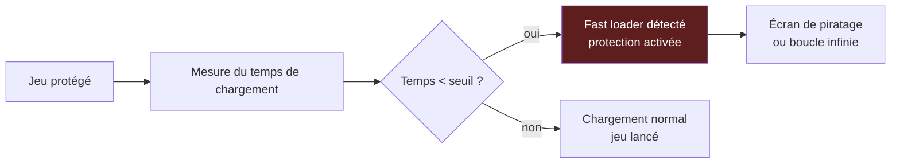

La contre-mesure des crackers était double :

1. **Désactiver le fast loader** pendant le chargement du jeu (via la fonction de désactivation (« kill ») des cartouches freezer, ou un interrupteur matériel).
2. **Patcher la routine de mesure** pour qu'elle retourne toujours un temps « normal ».

#### 3.8.6 Les trackloaders

Un **trackloader** est un chargeur qui lit des **pistes entières** (track-by-track) au lieu de secteurs individuels. Cela permet de contourner le système de fichiers et d'accélérer le chargement, mais aussi de masquer la structure des données.

| Plateforme | Trackloaders historiques | Particularités |
| --- | --- | --- |
| C64 | **Vorpal** (Epyx), **RapidLok**, **Speedlock C64**, loaders propriétaires de chaque éditeur | Lecture directe via le DOS du 1541, bypass du KERNAL |
| Amiga | **Copylock** (Rob Northen), **Protection System 1-5**, loaders propriétaires | Lecture via Paula, format maison |
| ST | **Protection ST**, loaders propriétaires | Lecture via WD1772 |

Les trackloaders étaient **l'arme de choix** des éditeurs pour protéger les jeux à chargement multiple (multi-load) : le jeu rechargeait du code en cours de partie, rendant le gel (freezer) inefficace.

### 3.9 Éditeurs de niveaux et d'aventures

La scène ne se contentait pas de cracker : elle **créait** aussi ses propres jeux et aventures textuelles.

#### 3.9.1 Les éditeurs d'aventures textuelles

| Plateforme | Éditeurs | Formats produits |
| --- | --- | --- |
| Spectrum | **The Quill** ✅ (1983), **The Graphic Adventure Creator** (1986) | .QUILL, .GAC |
| CPC | **The Quill**, **Adventure Writer** | .QUILL |
| C64 | **The Quill** (portage), **Adventure Creator** | .QUILL |
| Atari 8-bit | **The Quill**, **Adventure Master** | .QUILL |

**The Quill**, développé par **Graeme Yeandle** et publié par **Gilsoft** en 1983, était **l'éditeur d'aventures textuelles de référence** sur Spectrum et CPC. Il permettait de créer des aventures sans programmation, en définissant des lieux, des objets, des messages et des conditions.

```text
 ┌──────────────────────────────────────────────────────────────┐
 │  THE QUILL                                                   │
 │  Copyright (c) 1983-1987 Gilsoft                             │
 ├──────────────────────────────────────────────────────────────┤
 │  • Éditeur d'aventures textuelles sans programmation         │
 │  • Définition de lieux (limité par la RAM)                   │
 │  • Définition d'objets (limité par la RAM)                   │
 │  • Définition de messages (limité par la RAM)                │
 │  • Conditions et événements (limité par la RAM)              │
 │  • Compilation en fichier exécutable autonome                │
 │  • Utilisé pour des centaines d'aventures amateurs           │
 └──────────────────────────────────────────────────────────────┘
```

#### 3.9.2 Les éditeurs de niveaux de jeux

Certains jeux populaires (comme **Jet Set Willy**, **Manic Miner**, **Dizzy**) ont vu leurs niveaux édités par des outils créés par la scène.

| Jeu | Éditeur de niveaux | Plateforme |
| --- | --- | --- |
| Jet Set Willy | **Jet Set Willy Editor** | Spectrum |
| Manic Miner | **Manic Miner Editor** | Spectrum |
| Dizzy | **Dizzy Level Editor** | Spectrum, CPC |
| Boulder Dash | **Boulder Dash Construction Kit** (officiel) | C64, Atari 8-bit |
| ZZT | **ZZT Editor** (intégré) | PC |

### 3.10 Outils de préservation modernes

La scène des années 80-90 a légué un patrimoine logiciel immense, aujourd'hui préservé par des outils modernes qui reprennent les techniques de l'époque.

#### 3.10.1 Les lecteurs de flux

| Outil | Année | Plateforme | Résolution | Format d'image |
| --- | --- | --- | --- | --- |
| **KryoFlux** ✅ | 2009 | PC (USB) | ≈ 41,6 ns | Streams KryoFlux, IPF |
| **SuperCard Pro** ✅ | 2014 | PC (USB) | 25 ns | SCP |
| **Greaseweazle** ✅ | 2018 | PC (USB) | ≈ 13,9 ns | Flux brut (SCP, KryoFlux) |
| **Catweasel** | 1996 | Amiga, PC (ISA/PCI) | Variable | ADF, flux brut |
| **DiscFerret** | 2010 | PC (USB) | Variable | Flux brut |
| **FluxEngine** | 2019 | PC (USB) | Variable | Flux brut |

Ces outils lisent les disquettes au niveau du **flux magnétique brut**, capturant non seulement les données, mais aussi les timings, les weak bits, les pistes longues, etc. C'est l'héritage direct des copieurs analogiques (Cyclone, Syncro Express) et des nibblers (Renegade/Maverick).

#### 3.10.2 Les formats de préservation

| Format | Année | Plateforme | Niveau | Préservation des protections |
| --- | --- | --- | --- | --- |
| **IPF** ✅ (CAPS/SPS) | 1997 | Amiga, ST, CPC, C64, Spectrum | Physique (simulé) | Oui (via reconstitution du flux) |
| **WOZ** ✅ (Applesauce) | 2015 | Apple II | Physique (flux) | Oui (quart de piste) |
| **SCP** ✅ (SuperCard Pro) | 2014 | Multi | Flux brut | Oui (intégral) |
| **G64** ✅ | 2000s | C64 | Physique (GCR brut) | Oui (partiel) |
| **STX** ✅ (Pasti) | 2000s | Atari ST | Physique (secteurs + timings) | Oui (fuzzy bits) |
| **HFE** ✅ (HxC) | 2010s | Multi | Physique (flux) | Oui (partiel) |
| **Flux brut** (KryoFlux, Greaseweazle) | 2009+ | Multi | Flux intégral | Oui (intégral) |

#### 3.10.3 Les émulateurs modernes

Les émulateurs modernes intègrent les techniques de la scène (freezers, moniteurs, fast loaders) et les poussent plus loin :

| Émulateur | Plateforme émulée | Fonctions de cracking |
| --- | --- | --- |
| **VICE** ✅ | C64, C128, VIC-20, PET | Moniteur intégré, freeze, injection de code |
| **WinUAE** ✅ | Amiga | Débuggeur 68000, HRTMon intégré, inspection Copper |
| **Hatari** ✅ | Atari ST | Débuggeur 68000, inspection mémoire |
| **Fuse** ✅ | ZX Spectrum | Moniteur, debuggeur |
| **CPCEmu** / **WinAPE** ✅ | CPC | Moniteur, debuggeur |
| **AppleWin** ✅ | Apple II | Moniteur, debuggeur |
| **Altirra** ✅ | Atari 8-bit | Debuggeur avancé |

#### 3.10.4 Les outils de développement modernes

La scène rétro utilise aujourd'hui des outils modernes pour développer de nouveaux logiciels (homebrew) :

| Outil | Année | Plateforme | Fonction |
| --- | --- | --- | --- |
| **ACME** ✅ | 1990s | Famille 6502 | Assembleur cross-platform |
| **64TASS** ✅ | 1990s | 6502 | Assembleur C64 avancé |
| **VASM** ✅ | 1999 | Multi | Assembleur multi-CPU |
| **Exomizer 3** ⚠️ | fin 2010s | 6502 | Packer moderne |
| **GoatTracker 2** ✅ | 2000s | C64 (SID) | Tracker SID moderne |
| **SID-Wizard** ✅ | 2000s | C64 (SID) | Tracker SID moderne |
| **Charpad** ✅ | 2010s | C64 | Éditeur de charset moderne |
| **CBM Prg Studio** ✅ | 2010s | C64 | IDE complet (assembleur, éditeur graphique, etc.) |

---

## 4. Outils par plateforme

Cette section détaille les outils les plus utilisés sur chaque plateforme, en montrant comment ils s'articulaient dans le workflow du cracker.

### 4.1 Commodore 64 / 128

Le C64 est **la plateforme reine** du cracking des années 80. La scène y a développé une culture et des outils d'une richesse exceptionnelle.

#### 4.1.1 Les outils fondamentaux

| Catégorie | Outils historiques | Outils modernes |
| --- | --- | --- |
| Assembleur | **Turbo Assembler** ✅ (TASM), Macro Assembler (MAS), EDAS | **ACME** ✅, **64TASS** ✅, **XA** ✅ |
| Moniteur | **Supermon 64** ✅, Monitor 4, Action Replay monitor | **VICE monitor** ✅, **C64 Debugger** ✅ |
| Débuggeur | Action Replay monitor, ICE (matériel+logiciel) | **C64 Debugger** ✅ (replay d'exécution) |
| Copieur | **Maverick / Renegade** ✅, Fast Copy, Star Copy | **Nibtools** ✅ (préservation) |
| Packer | ByteBoiler, Cruelcrunch, **Pucrunch** ✅ (1997) | **Exomizer** ✅ (2002+) |
| Tracker | **Soundmonitor** ✅, JCH Editor, Future Composer | **GoatTracker 2** ✅, **SID-Wizard** ✅ |
| Éditeur graphique | **Koala Painter** ✅, Face Painter, Doodle! | **Charpad** ✅, **Paint 64** |
| Fast loader | **Warp Speed** ✅, **JiffyDOS** ✅, SpeedDOS | JiffyDOS (toujours utilisé) |

#### 4.1.2 Le workflow typique d'un cracker C64

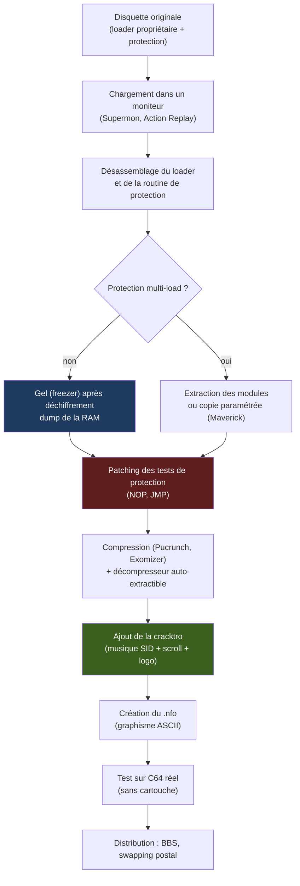

#### 4.1.3 Zoom : Maverick / Renegade

**Maverick** (parfois associé à une version antérieure nommée **Renegade** ⚠️) n'était pas un simple copieur : c'était un **système paramétré**.

```text
 ┌──────────────────────────────────────────────────────────────┐
 │  MAVERICK V5.04                                              │
 │  The Ultimate C64 Disk Copier                                │
 ├──────────────────────────────────────────────────────────────┤
 │  • Fast Data Copier : copie rapide des disques non protégés  │
 │  • Parameter Library : centaines de paramètres par titre     │
 │    - RapidLok, GEOS, protections par code wheel, etc.        │
 │  • Chaque paramètre est une petite routine 6502 qui :        │
 │    - Ignore ou fabrique un code d'erreur attendu             │
 │    - Reconstitue une séquence de synchronisation             │
 │    - Copie les pistes « 36 et plus »                         │
 │    - Réécrit les octets d'identification du disque           │
 │  • Bibliothèque mise à jour par abonnement ou échange        │
 └──────────────────────────────────────────────────────────────┘
```

Maverick est **l'ancêtre direct des scripts de préservation modernes** : au lieu de copier « bêtement » une disquette, on applique une routine spécifique au titre.

#### 4.1.4 Zoom : Pucrunch et Exomizer

**Pucrunch**, développé par **Pasi Ojala** en 1997, et **Exomizer**, développé par **Magnus Lind** à partir de 2002, sont les packers modernes de référence pour C64.

| Packer | Année | Algorithme | Taux de compression | Taille du décompresseur |
| --- | --- | --- | --- | --- |
| Pucrunch | 1997 | LZ + Huffman | 4:1 à 8:1 | ≈ 200 octets |
| Exomizer | 2002+ | LZ + Huffman (optimisé) | 4:1 à 10:1 | ≈ 200 octets |
| Exomizer 3 | 2020+ | LZ + Huffman (amélioré) | 5:1 à 12:1 | ≈ 200 octets |

Exomizer est **le packer le plus utilisé** aujourd'hui pour les productions C64 modernes (démos, intros, jeux homebrew).

### 4.2 Commodore Amiga

L'Amiga a vu naître une scène de cracking et de démos particulièrement riche, grâce à ses capacités graphiques et sonores exceptionnelles.

#### 4.2.1 Les outils fondamentaux

| Catégorie | Outils historiques | Outils modernes |
| --- | --- | --- |
| Assembleur | **PhxAss** ✅, **Barfly** ✅, Devpac, A68k | **VASM** ✅, **EASy68k** ✅ |
| Moniteur | **Barfly** ✅, **HRTMon** ✅, SID | **WinUAE debugger** ✅ |
| Débuggeur | Barfly, TurboBoard debugger | **WinUAE debugger** ✅, **FS-UAE debugger** |
| Copieur | **X-Copy** ✅, X-Copy Pro, PowerCopy | **KryoFlux** ✅, **Greaseweazle** ✅ |
| Packer | **PowerPacker** ✅, Imploder, CrunchMania | **PowerPacker** ✅, **xPK** ✅ |
| Tracker | **SoundTracker** ✅, **NoiseTracker** ✅, **ProTracker** ✅, OctaMED | **ProTracker** ✅ (moderne), **OctaMED** ✅ |
| Éditeur graphique | **Deluxe Paint** ✅, ProPaint, Graffiti2 | **Deluxe Paint** ✅ (moderne), **GrafX2** ✅ |
| Fast loader | Trackloaders propriétaires | **WHDLoad** ✅ |

#### 4.2.2 Le workflow typique d'un cracker Amiga

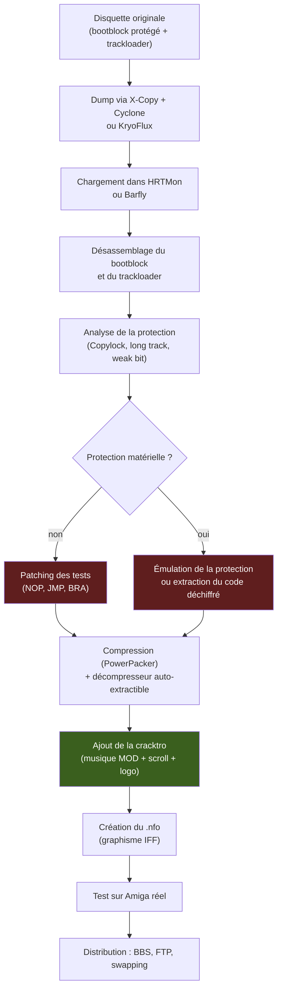

#### 4.2.3 Zoom : ProTracker

**ProTracker**, développé à partir de 1990 par **Amiga Freelancers** (voir §3.6.3), est **le tracker de référence** sur Amiga. Il a défini le format **.MOD**, devenu un standard inter-plateformes.

```text
 ┌──────────────────────────────────────────────────────────────┐
 │  PROTRACKER 3.62                                             │
 │  Copyright (c) 1990-1994 Amiga Freelancers                   │
 ├──────────────────────────────────────────────────────────────┤
 │  • 4 voix (extensibles à 8, 16, 32 avec des hacks)           │
 │  • 32 instruments (échantillons 8 bits)                      │
 │  • 128 patterns maximum                                      │
 │  • Effets : portamento, vibrato, volume slide, etc.          │
 │  • Format .MOD : standard de facto                           │
 │  • Utilisé pour 90% des musiques Amiga de l'époque           │
 └──────────────────────────────────────────────────────────────┘
```

ProTracker a **inspiré les trackers PC** (Scream Tracker, FastTracker, puis OpenMPT et MilkyTracker) et a popularisé le format .MOD, encore utilisé aujourd'hui.

#### 4.2.4 Zoom : PowerPacker

**PowerPacker**, développé par **Nico François** vers 1989, était le packer de référence sur Amiga. Son algorithme LZ était optimisé pour le 68000 et offrait un excellent taux de compression pour l'époque.

```text
 ┌──────────────────────────────────────────────────────────────┐
 │  POWERPACKER 4.0                                             │
 │  Copyright (c) 1989-1992 Nico François                       │
 ├──────────────────────────────────────────────────────────────┤
 │  • Algorithme LZ optimisé pour 68000                         │
 │  • Taux de compression : 3:1 à 8:1 selon le type de données  │
 │  • Décompresseur auto-extractible intégré                    │
 │  • Support des fichiers exécutables Amiga                    │
 │  • Option « encryption » (faible, mais présente)             │
 │  • Utilisé pour packer la majorité des cracks Amiga          │
 └──────────────────────────────────────────────────────────────┘
```

PowerPacker a été **porté sur ST** et a été utilisé pour packer de nombreuses démos et intros.

### 4.3 Atari ST / STE / Falcon

L'Atari ST a connu une scène de cracking active, bien que moins documentée que celle du C64 ou de l'Amiga.

#### 4.3.1 Les outils fondamentaux

| Catégorie | Outils historiques | Outils modernes |
| --- | --- | --- |
| Assembleur | **Devpac ST** ✅, **MadMac** ✅, GFA Assembler | **VASM** ✅, **EASy68k** ✅ |
| Moniteur | **MonST** ✅, GFA Debugger, K-Sek | **Hatari debugger** ✅ |
| Débuggeur | GFA Debugger, MonST | **Hatari debugger** ✅, **Steem debugger** |
| Copieur | Copy ST, ST-Copy, **Discovery Cartridge** ✅ (matériel) | **KryoFlux** ✅, **Greaseweazle** ✅ |
| Packer | PowerPacker, Imploder, CrunchMania | **PowerPacker** ✅ |
| Tracker | Soundtracker ST, DigiTracker | **ProTracker ST** ✅ |
| Éditeur graphique | **DEGAS** ✅, **NEOchrome** ✅, Cyber Paint | **GrafX2** ✅ |
| Fast loader | Loaders propriétaires | — |

#### 4.3.2 Le workflow typique d'un cracker ST

Le workflow ST était similaire à celui de l'Amiga, avec quelques spécificités :

- **Moins de protections matérielles** : le WD1772 était moins flexible que le Paula, donc les protections reposaient surtout sur des formats de disque non standards (secteurs de taille variable, pistes longues).
- **Discovery Cartridge** : cette cartouche matérielle (voir document compagnon) était l'outil de prédilection pour copier les disquettes protégées.
- **GFA Basic** : beaucoup de crackers ST utilisaient GFA Basic pour développer leurs outils, grâce à sa facilité d'utilisation et ses performances correctes.

#### 4.3.3 Zoom : DEGAS / DEGAS Elite

**DEGAS** (Design and Entertainment Graphic Access System ⚠️), conçu par **Tom Hudson** et publié par **Batteries Included** en 1985-1986, était un éditeur graphique de référence sur Atari ST. Sa version **DEGAS Elite** (1987) ajoutait des fonctions avancées dont le cyclage de palette.

```text
 ┌──────────────────────────────────────────────────────────────┐
 │  DEGAS ELITE                                                 │
 │  Copyright (c) Batteries Included                            │
 ├──────────────────────────────────────────────────────────────┤
 │  • Édition bitmap (320×200, 640×200, 640×400)                │
 │  • 16 couleurs (mode basse résolution)                       │
 │  • Cyclage de palette                                        │
 │  • Outils : pinceau, remplissage, ligne, cercle              │
 │  • Formats .PI1 / .PI2 / .PI3 (basse / moyenne / haute)      │
 │  • Utilisé pour la majorité des graphismes ST                │
 └──────────────────────────────────────────────────────────────┘
```

DEGAS a été **massivement utilisé** pour créer les écrans-titres, les logos et les cracktros ST.

#### 4.3.4 Zoom : Discovery Cartridge

La **Discovery Cartridge** (voir document compagnon, §4.B) était **le copieur matériel de référence** sur Atari ST. Elle permettait de copier les disquettes protégées en accédant directement au WD1772, contournant les limitations du GEMDOS.

```text
 ┌──────────────────────────────────────────────────────────────┐
 │  DISCOVERY CARTRIDGE                                         │
 │  Éditeur : à recouper                                        │
 ├──────────────────────────────────────────────────────────────┤
 │  • Copieur matériel (cartouche)                              │
 │  • Accès direct au WD1772                                    │
 │  • Copie des protections : secteurs de taille variable,      │
 │   pistes longues, densités mixtes                            │
 │  • Bibliothèque de paramètres par titre                      │
 │  • Considérée comme le meilleur copieur ST de l'époque       │
 └──────────────────────────────────────────────────────────────┘
```

### 4.4 ZX Spectrum

Le ZX Spectrum a connu une scène de cracking très active, malgré ses limitations techniques (48 Ko de RAM, pas de lecteur de disquette en standard).

#### 4.4.1 Les outils fondamentaux

| Catégorie | Outils historiques | Outils modernes |
| --- | --- | --- |
| Assembleur | **HiSoft-Dev** ✅, VASM (plus tard), Pasmo, ZX-Assembler | **Pasmo** ✅, **VASM** ✅, **z80asm** ✅ |
| Moniteur | ROM monitor (basique), **MCoder** ✅, OCP Monitor | **Fuse debugger** ✅, **SpecEmu monitor** |
| Débuggeur | Speculator, divers moniteurs | **Fuse debugger** ✅ |
| Copieur | Lerm, Fast Copy, copieurs de K7 | **KryoFlux** ✅, **Greaseweazle** ✅ |
| Packer | RLE, divers | RLE ✅ |
| Tracker | **Wham! The Music Box**, Vortex Tracker, Aztec Music | **Vortex Tracker 2** ✅, **Arkos Tracker 2** ✅ |
| Éditeur graphique | Melbourne Draw, **OCP Art Studio** ✅, Artist | **GrafX2** ✅ |
| Éditeur d'aventures | **The Quill** ✅, **The Graphic Adventure Creator** | — |

#### 4.4.2 Le workflow typique d'un cracker Spectrum

Le workflow Spectrum était dominé par le **chargement depuis cassette** :

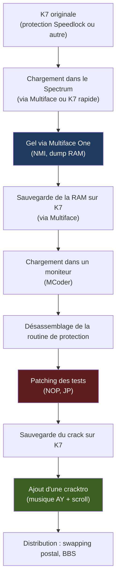

#### 4.4.3 Zoom : The Quill

**The Quill**, développé par **Graeme Yeandle** et publié par **Gilsoft** en 1983, était **l'éditeur d'aventures textuelles de référence** sur Spectrum. Il a permis la création de centaines d'aventures amateurs.

```text
 ┌──────────────────────────────────────────────────────────────┐
 │  THE QUILL                                                   │
 │  Copyright (c) 1983-1987 Gilsoft                             │
 ├──────────────────────────────────────────────────────────────┤
 │  • Éditeur d'aventures textuelles sans programmation         │
 │  • Définition de lieux (limité par la RAM)                   │
 │  • Définition d'objets (limité par la RAM)                   │
 │  • Définition de messages (limité par la RAM)                │
 │  • Conditions et événements (limité par la RAM)              │
 │  • Compilation en fichier exécutable autonome                │
 │  • Utilisé pour des centaines d'aventures amateurs           │
 └──────────────────────────────────────────────────────────────┘
```

The Quill a été **porté sur CPC et C64**, devenant un standard inter-plateformes pour la création d'aventures textuelles.

#### 4.4.4 Zoom : OCP Art Studio

**OCP Art Studio**, développé par **OCP** (Oxford Computer Publishing) en 1985, était l'éditeur graphique de référence sur Spectrum.

```text
 ┌──────────────────────────────────────────────────────────────┐
 │  OCP ART STUDIO                                              │
 │  Copyright (c) 1985 OCP                                      │
 ├──────────────────────────────────────────────────────────────┤
 │  • Bitmap 256×192, 2 couleurs/bloc d'attribut 8×8            │
 │  • Outils : pinceau, remplissage, ligne, cercle              │
 │  • Gestion des attributs de couleur (8×8 pixels)             │
 │  • Format .SCR (6 912 octets)                                │
 │  • Utilisé pour la majorité des écrans Spectrum              │
 └──────────────────────────────────────────────────────────────┘
```

### 4.5 Amstrad CPC

L'Amstrad CPC a connu une scène de cracking active, notamment en France et en Espagne.

#### 4.5.1 Les outils fondamentaux

| Catégorie | Outils historiques | Outils modernes |
| --- | --- | --- |
| Assembleur | **AADE** ⚠️, **Maxam** ✅ | **VASM** ✅, **Pasmo** ✅ |
| Moniteur | AA Monitor, CPC Monitor | **WinAPE debugger** ✅, **CPCEmu debugger** |
| Débuggeur | AA Monitor, CPC Monitor | **WinAPE debugger** ✅ |
| Copieur | Discology, Copylock, divers | **KryoFlux** ✅, **Greaseweazle** ✅ |
| Packer | RLE, divers | RLE ✅ |
| Tracker | Wham, **Soundtrakker**, **Arkos Tracker** (moderne) | **Arkos Tracker 2** ✅ |
| Éditeur graphique | Doodle CPC, **Advanced Art Studio CPC**, Pro Art Studio | **GrafX2** ✅ |

#### 4.5.2 Le workflow typique d'un cracker CPC

Le workflow CPC était similaire à celui du Spectrum, avec le **Multiface Two** comme outil central :

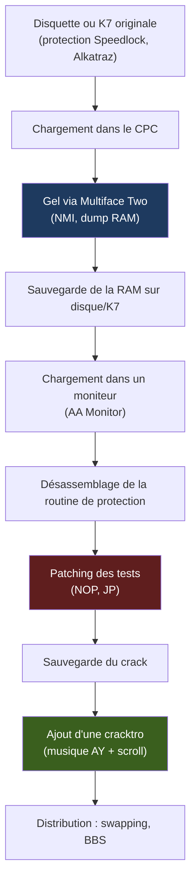

#### 4.5.3 Zoom : Maxam

**Maxam**, assembleur de référence sur CPC, a été commercialisé au milieu des années 1980 (éditeur : Arnor ⚠️, à recouper).

```text
 ┌──────────────────────────────────────────────────────────────┐
 │  MAXAM                                                       │
 │  Copyright (c) Arnor (à recouper)                            │
 ├──────────────────────────────────────────────────────────────┤
 │  • Assembleur Z80 complet                                    │
 │  • Macros, includes, labels                                  │
 │  • Moniteur intégré                                          │
 │  • Support des formats .BIN, .SNA                            │
 │  • Utilisé par la majorité des crackers CPC                  │
 └──────────────────────────────────────────────────────────────┘
```

### 4.6 Apple II

L'Apple II a connu une scène de cracking très active aux États-Unis, avec des outils d'une sophistication remarquable.

#### 4.6.1 Les outils fondamentaux

| Catégorie | Outils historiques | Outils modernes |
| --- | --- | --- |
| Assembleur | **Merlin** ✅, EdAsm, MAC/65 (Apple II version) | **ACME** ✅, **Merlin 32** ✅ |
| Moniteur | **Monitor** (ROM, très complet pour l'époque) ✅, Bug Byter | **AppleWin debugger** ✅ |
| Débuggeur | Monitor (ROM) | **AppleWin debugger** ✅ |
| Copieur | **Copy II Plus** ✅, **Locksmith** ✅, **EDD** (Essential Data Duplicator, logiciel+carte) | **Applesauce** ✅ (WOZ) |
| Packer | RLE, divers | RLE ✅ |
| Tracker | Music Macro Language, divers | — |
| Éditeur graphique | **Dazzle Draw**, **MegaGrafix**, Koala (Apple II version) | **GrafX2** ✅ |

#### 4.6.2 Le workflow typique d'un cracker Apple II

Le workflow Apple II était dominé par la **copie de disquettes 5,25"** :

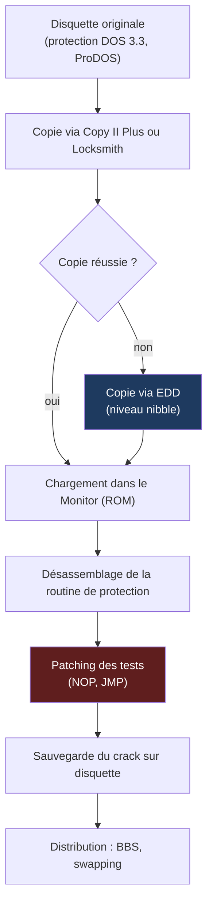

#### 4.6.3 Zoom : Copy II Plus

**Copy II Plus**, développé par **Central Point Software** en 1983, était **le copieur de référence** sur Apple II.

```text
 ┌──────────────────────────────────────────────────────────────┐
 │  COPY II PLUS V8.3                                           │
 │  Copyright (c) 1983-1990 Central Point Software              │
 ├──────────────────────────────────────────────────────────────┤
 │  • Copieur de disquettes 5,25"                               │
 │  • Support de la plupart des protections :                   │
 │   - Format DOS 3.3, ProDOS                                   │
 │   - Secteurs décalés, pistes longues                         │
 │   - Octets de synchro, nibbles                               │
 │  • Bibliothèque de paramètres par titre                      │
 │  • Utilisé pour la majorité des copies Apple II              │
 └──────────────────────────────────────────────────────────────┘
```

Copy II Plus était souvent **complété par EDD** (Essential Data Duplicator ⚠️, essentiellement un logiciel de copie au niveau nibble), pour contourner les protections les plus retorses.

#### 4.6.4 Zoom : Locksmith

**Locksmith**, apparu au début des années 1980 (éditeur : Omega Microware / Alpha Logic ⚠️), était un autre copieur de référence sur Apple II, concurrent de Copy II Plus.

```text
 ┌──────────────────────────────────────────────────────────────┐
 │  LOCKSMITH V6.0                                              │
 │  Copyright (c) 1982-1989 (voir texte)                        │
 ├──────────────────────────────────────────────────────────────┤
 │  • Copieur de disquettes 5,25"                               │
 │  • Support de nombreuses protections                         │
 │  • Mode « fast copy »                                        │
 │  • Bibliothèque de paramètres                                │
 │  • Concurrent direct de Copy II Plus                         │
 └──────────────────────────────────────────────────────────────┘
```

### 4.7 Atari 8 bits (400/800/XL/XE)

L'Atari 8-bit a connu une scène de cracking active, notamment aux États-Unis et en Allemagne.

#### 4.7.1 Les outils fondamentaux

| Catégorie | Outils historiques | Outils modernes |
| --- | --- | --- |
| Assembleur | **Atari Assembler Editor** ✅, **MAC/65** ✅, EdAsm | **DASM** ✅, **MADS** ✅ |
| Moniteur | Editor/Assembler monitor | **Altirra debugger** ✅ |
| Débuggeur | Editor/Assembler monitor | **Altirra debugger** ✅ |
| Copieur | Happy, divers | **KryoFlux** ✅, **Greaseweazle** ✅ |
| Packer | RLE, divers | RLE ✅ |
| Tracker | Music Macro Language, divers | **RMT** ✅ (Raster Music Tracker) |
| Éditeur graphique | MicroPainter, Doodle | **GrafX2** ✅ |

#### 4.7.2 Le workflow typique d'un cracker Atari 8-bit

Le workflow Atari 8-bit était similaire à celui de l'Apple II, avec des protections basées sur des **secteurs défectueux volontaires** :

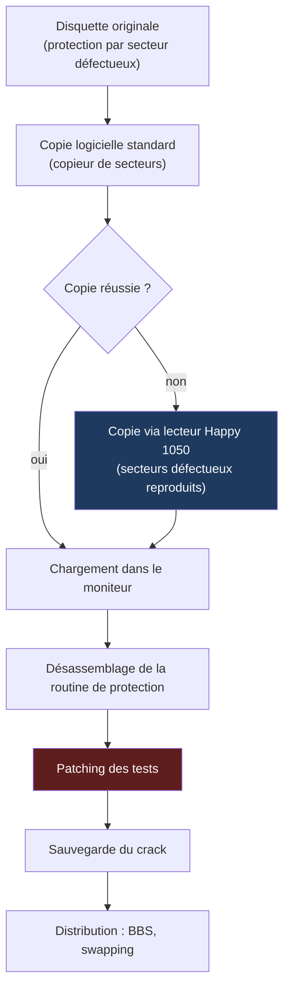

#### 4.7.3 Zoom : MAC/65

**MAC/65**, développé par **Optimized Systems Software** (OSS) en 1983, était l'assembleur de référence sur Atari 8-bit.

```text
 ┌──────────────────────────────────────────────────────────────┐
 │  MAC/65 V1.1                                                 │
 │  Copyright (c) 1983-1988 Optimized Systems Software          │
 ├──────────────────────────────────────────────────────────────┤
 │  • Assembleur 6502 complet                                   │
 │  • Macros, includes, labels                                  │
 │  • Éditeur de texte intégré                                  │
 │  • Support des formats .OBJ, .COM                            │
 │  • Utilisé par la majorité des développeurs Atari 8-bit      │
 └──────────────────────────────────────────────────────────────┘
```

### 4.8 IBM PC / compatibles

Le PC a connu une scène de cracking plus tardive (fin des années 80, début des années 90), mais très active.

#### 4.8.1 Les outils fondamentaux

| Catégorie | Outils historiques | Outils modernes |
| --- | --- | --- |
| Assembleur | **MASM** ✅ (Microsoft), **TASM** ✅ (Borland), A86 | **NASM** ✅, **YASM** ✅, **FASM** ✅ |
| Moniteur | **DEBUG** (DOS) ✅, CodeView (Microsoft) | **x64dbg** ✅, **IDA Pro** ✅, **Ghidra** ✅ |
| Débuggeur | DEBUG (DOS, limité), CodeView, **Turbo Debugger** ✅ (Borland) | **x64dbg** ✅, **IDA Pro** ✅ |
| Copieur | **Copy II PC** ✅, Disk2Disk, Teledisk | **KryoFlux** ✅, **Greaseweazle** ✅ |
| Packer | **PKZIP** ✅ (1989), ARJ, LHA, PKLITE | **7-Zip** ✅, **UPX** ✅ |
| Tracker | **FastTracker 2** ✅, **Impulse Tracker** ✅, **Scream Tracker 3** ✅, ModPlug Tracker | **OpenMPT** ✅, **MilkyTracker** ✅ |
| Éditeur graphique | **Deluxe Paint** ✅ (PC), CorelDRAW, Photoshop (plus tard) | **GrafX2** ✅, **Aseprite** ✅ |

#### 4.8.2 Le workflow typique d'un cracker PC

Le workflow PC était dominé par la **copie de disquettes 3,5" et 5,25"** :

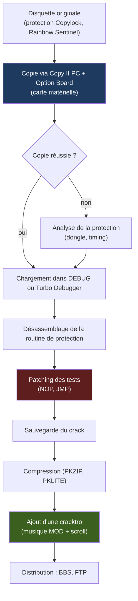

#### 4.8.3 Zoom : Turbo Debugger

**Turbo Debugger**, livré avec Turbo Pascal et Turbo C de Borland à partir de 1989, était **l'outil de débogage de référence** sur PC.

```text
 ┌──────────────────────────────────────────────────────────────┐
 │  TURBO DEBUGGER V5.0                                         │
 │  Copyright (c) 1989-1994 Borland International               │
 ├──────────────────────────────────────────────────────────────┤
 │  • Interface texte riche (fenêtres, menus, souris)           │
 │  • Breakpoints conditionnels                                 │
 │  • Watch windows (observation de variables)                  │
 │  • Pas-à-pas avec entrée/sortie des fonctions                │
 │  • Désassemblage intégré                                     │
 │  • Support du mode réel et du mode protégé                   │
 │  • Utilisé par la majorité des crackers PC                   │
 └──────────────────────────────────────────────────────────────┘
```

Turbo Debugger a **formé toute une génération de développeurs PC** et a été massivement utilisé par les crackers pour localiser les routines de protection.

#### 4.8.4 Zoom : FastTracker 2

**FastTracker 2**, développé par **Fredrik Huss** (Mr. H) et **Magnus Högdahl** (Vogue), du groupe **Triton** en 1994, était **le tracker de référence** sur PC.

```text
 ┌──────────────────────────────────────────────────────────────┐
 │  FASTTRACKER 2.08                                            │
 │  Copyright (c) 1994-1998 Triton                              │
 ├──────────────────────────────────────────────────────────────┤
 │  • Jusqu'à 32 voix                                           │
 │  • Instruments (échantillons 8 ou 16 bits)                   │
 │  • Format .XM (eXtended Module)                              │
 │  • Effets avancés : enveloppes, auto-vibrato, etc.           │
 │  • Interface graphique (mode texte riche)                    │
 │  • Utilisé pour la majorité des musiques PC de l'époque      │
 └──────────────────────────────────────────────────────────────┘
```

FastTracker 2 a été **le standard de la scène PC** jusqu'à l'arrivée d'Impulse Tracker et de ModPlug Tracker.

#### 4.8.5 Zoom : Copy II PC + Option Board

**Copy II PC**, développé par **Central Point Software** en 1985, était **le copieur de référence** sur PC. Il était souvent associé à l'**Option Board**, une carte ISA qui permettait de lire les disquettes protégées au niveau du flux brut.

```text
 ┌──────────────────────────────────────────────────────────────┐
 │  COPY II PC V8.0 + OPTION BOARD                              │
 │  Copyright (c) 1985-1993 Central Point Software              │
 ├──────────────────────────────────────────────────────────────┤
 │  • Copieur de disquettes 5,25" et 3,5"                       │
 │  • Option Board : contrôleur de flux matériel (ISA)          │
 │  • Support des protections :                                 │
 │   - Secteurs de taille variable, pistes longues              │
 │   - Densités mixtes, weak bits                               │
 │   - CRC faux, secteurs fantômes                              │
 │  • Format d'image propriétaire : Transcopy                   │
 │  • Utilisé pour la majorité des copies PC                    │
 └──────────────────────────────────────────────────────────────┘
```

Copy II PC + Option Board est **l'ancêtre direct des lecteurs de flux modernes** (KryoFlux, SuperCard Pro, Greaseweazle).

### 4.9 Consoles (NES, Mega Drive, SNES)

Bien que hors périmètre strict des ordinateurs, les consoles ont connu une scène de cracking active, avec des outils spécifiques.

#### 4.9.1 Les outils fondamentaux

| Console | Outils historiques | Particularités |
| --- | --- | --- |
| NES | **Game Genie** ✅ (1990), Pro Action Replay | Interposition de bus, patch ROM |
| Mega Drive | **Game Genie**, **Pro Action Replay** ✅ | Interposition de bus, trainer |
| SNES | **Pro Action Replay**, **GameShark** ✅ | Patch RAM, trainer |
| PlayStation | **Pro Action Replay**, **GameShark** | Patch RAM, trainer |

#### 4.9.2 Zoom : Game Genie vs Pro Action Replay

Le **Game Genie** (Codemasters/Galoob, 1990) et le **Pro Action Replay** (Datel) sont souvent confondus, mais leurs principes sont opposés :

| | Game Genie (NES/Mega Drive) | Pro Action Replay / GameShark |
| --- | --- | --- |
| **Où agit-il ?** | Entre la console et la cartouche : intercepte les **lectures de la ROM** | Dans la console : agit sur la **RAM** (via hook d'interruption vidéo) |
| **Principe** | Quand le CPU lit l'adresse X de la ROM, le Game Genie renvoie **une autre valeur** | À chaque trame, une routine **écrit** (« poke ») des valeurs aux adresses choisies |
| **Effet** | Modifie la ROM **vue par le CPU**, pas la RAM | Fige ou force **une valeur en RAM** |
| **Recherche de valeurs** | Non | Oui (trainer : recherche de « 3 », puis « 2 », etc.) |

L'ancêtre direct de la seconde famille est le moniteur du Multiface/Action Replay ; celui de la première, la modification de ROM pratiquée par les crackers avec leurs EPROM.

---

## 5. Études de cas : le cracking en action

Ces cas décrivent des mécanismes et des raisonnements d'époque, sans prétendre constituer des procédures détaillées : l'objectif est de comprendre l'architecture du « duel », pas de reproduire un crack précis.

### 5.1 Un jeu C64 « single-load » : la logique du gel

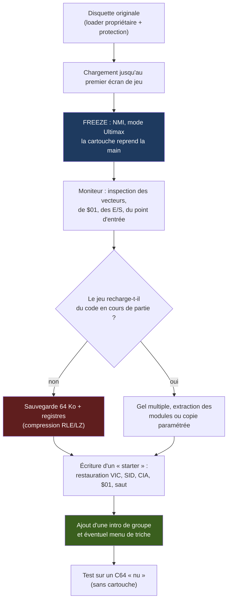

**Points de vigilance** que l'on retrouve dans toutes les histoires de l'époque :

- Le **starter** doit ré-initialiser les puces sans l'aide de la ROM : sans lui, l'écran reste noir ou le son muet (voir document compagnon, §2.6.3).
- Le programme gelé peut avoir laissé des **interruptions CIA actives** : il faut les couper ou les rediriger vers un gestionnaire sain.
- Le jeu peut tester la présence d'un lecteur 1541 d'origine (identification par ID ou par commande), ce qui oblige à neutraliser ce test.

### 5.2 L'Amiga et la famille « Copylock » : une protection contre le débogage

Les protections de type **Copylock** (Rob Northen) ne reposent pas seulement sur une anomalie du disque. Elles combinent :

- Un **code chiffré** dont la clé est calculée au fil de l'exécution ;
- Un **mode trace** (exception de trace du 68000) qui fait de chaque instruction un maillon de la chaîne de déchiffrement : un point d'arrêt ou un pas-à-pas altère le résultat ;
- Une **dépendance à des données lues sur le support** (selon les versions).

Un freezer « classique » est donc mal adapté : geler le système pendant l'exécution du Copylock perturbe sa chaîne de calcul. La contre-mesure de la scène consistait à **émuler ou neutraliser la routine** plutôt qu'à la « regarder » — un déplacement du jeu de cache-cache du matériel vers la cryptanalyse logicielle.

C'est le même mouvement que celui qui, plus tard, mènera aux protections entièrement logicielles des années 1990.

### 5.3 L'Atari ST et le WD1772 : le problème de la lecture de piste

Le **WD1772** sait lire un secteur identifié, lire un champ d'adresse, lire une piste entière (`Read Track`) et formater une piste (`Write Track`). Mais :

- `Read Track` renvoie les octets **sans validation** et **sans les marques de synchro d'origine** : c'est une lecture interprétée, pas du flux ;
- `Write Track` ne permet d'écrire des marques de synchro (`$A1` à horloge manquante) qu'avec des **codes d'échappement spécifiques** (`$F5`/`$F6`/`$F7` pour la synchro, l'index et le CRC) ;
- Les **weak bits** ne sont pas reproductibles à l'écriture.

Cette double limite — lecture imprécise, écriture limitée — explique que la copie analogique (Blitz, Syncro Express) et les cartouches à logique propre (Discovery Cartridge) aient été si recherchées. Et pourquoi la préservation moderne a dû inventer un format physique (STX/Pasti) pour l'ST.

### 5.4 Le PC : quand une erreur est une signature

Sur PC, une protection par disquette typique consiste à écrire un secteur au **CRC volontairement faux** (ou un secteur « fantôme » d'un format inhabituel) et à vérifier que la lecture retourne bien une erreur précise :

```text
 INT 13h, AH=02 (Read Sectors)  →  Carry=1, AH=10h (« CRC/ECC error »)   ← signature attendue
 Copie par DISKCOPY / XCOPY     →  le secteur est « réparé » : Carry=0       ← la protection échoue
 Copie par Option Board         →  le CRC faux est reproduit                  ← la protection est trompée
```

La contre-attaque des éditeurs fut de multiplier ces signatures (plusieurs secteurs, plusieurs pistes, des comparaisons de timing entre secteurs), puis de glisser vers les **dongles** : la guerre se déplace du support vers le port parallèle.

### 5.5 Le Spectrum et Speedlock : la course au déchiffrement

**Speedlock** était une famille de protections de chargeur (cassette et disquette) massive sur Spectrum et CPC. Le principe était de **chiffrer le code du jeu** et de le déchiffrer en mémoire au moment du chargement.

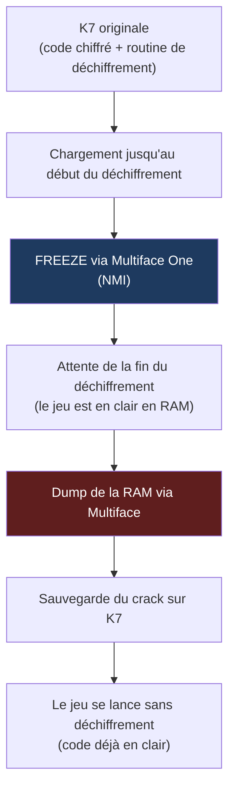

Speedlock a connu **de nombreuses versions** (Speedlock 1 à 7, Speedlock Plus), chacune ajoutant des couches de complexité (anti-debug, timings, checksums). La scène a répondu en développant des routines de déchiffrement de plus en plus sophistiquées, dans une course sans fin.

---

## 6. Culture, groupes et héritage

Le logiciel n'était qu'une moitié du phénomène. L'autre moitié était **sociale et culturelle** :

### 6.1 Les groupes

Les **groupes** étaient des collectifs organisés qui « sortaient » leurs versions (releases) en concurrence, avec leurs propres conventions de nommage, de classement et d'étiquetage. Parmi les noms qui marquent l'histoire de la scène :

- **Razor 1911** (fondé en 1985 en Norvège) : l'un des plus anciens groupes encore actifs
- **Fairlight** (1987, Suède) : légendaire sur C64 et Amiga
- **Triad** (Suède) : C64, Amiga
- **Hotline** : multi-plateformes
- **The Humble Guys** (THG) : PC
- **Skid Row** : PC
- **Paradox** : Amiga puis PC ⚠️
- **Quartex** : Amiga

Chaque groupe avait ses **spécialistes** :

- **Cracker** : celui qui contourne les protections
- **Graphiste** : celui qui crée les logos, les écrans-titres, les .nfo
- **Musicien** : celui qui compose les musiques de cracktro
- **Codeur** : celui qui développe les outils (packers, fast loaders, moniteurs)
- **Swapper** : celui qui gère les échanges avec les autres groupes
- **Courier** : celui qui transporte les disquettes entre les membres

### 6.2 Le crack-intro (cracktro)

La **cracktro** était la signature visuelle et sonore ajoutée devant le jeu craqué. Elle comprenait généralement :

- Un **écran de défilement** (scroll) avec le nom du groupe, les crédits, et parfois un message
- Une **musique** (SID sur C64, MOD sur Amiga, MOD/XM sur PC)
- Un **logo** animé ou statique
- Parfois un **menu de triche** (trainer)

Beaucoup de futurs **demomakers** y ont fait leurs premières armes : la démoscène naît de cette émulation entre groupes, qui a fini par s'émanciper du piratage.

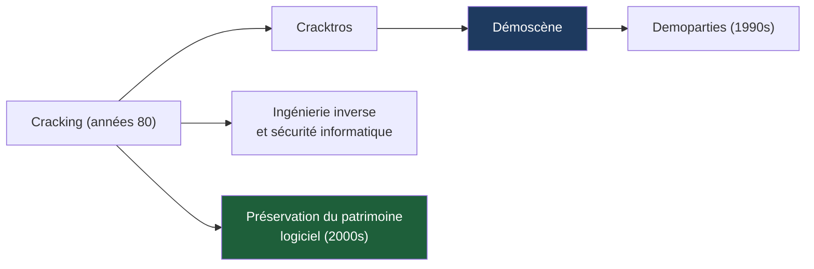

### 6.3 Les réseaux

La scène s'est dotée de réseaux de distribution de plus en plus sophistiqués :

- **BBS** (Bulletin Board Systems) : des serveurs téléphoniques où les utilisateurs uploadaient et downloadaient des cracks, des démos, des outils
- **Swapping postal** : échange de disquettes par la poste, avec des courriers manuscrits, des stickers, des badges
- **FTP / IRC** (début des années 1990) : le réseau numérique a remplacé progressivement le swapping postal

La scène a développé son propre **jargon** :

- **Release** : version crackée d'un jeu
- **Nuke** : disqualification d'une release (parce qu'elle est défectueuse, ou parce qu'un autre groupe l'a déjà sortie)
- **Dupe** : sortie simultanée de la même release par deux groupes
- **Courier** : membre qui transporte les disquettes entre les sites
- **Site** : BBS ou FTP affilié à un groupe
- **Pre-time** : moment de la première diffusion d'une release

### 6.4 Les compétences

Le cracker de 1988 est un **ingénieur système**. Il lit le désassemblage 6502/Z80/68000, connaît les cartes mémoire par cœur, comprend les contrôleurs de disquette, programme en assembleur pour packer et décompresser. Cette culture de l'ingénierie inverse a formé une génération de développeurs — et une partie de l'industrie de la sécurité.

### 6.5 Les rencontres

Les **demoparties** (The Gathering, Assembly, apparues au début des années 1990) deviennent des lieux d'échange où la scène « légale » prend le relais. Les crackers y présentent leurs dernières productions, échangent des techniques, et rencontrent leurs homologues qu'ils ne connaissaient que par pseudonymes interposés.

### 6.6 L'héritage

L'héritage des outils logiciels de la scène est immense :

- **Les save states** des émulateurs modernes sont les descendants directs des cartouches « freezer » (Multiface, Action Replay, Final Cartridge III).
- **Les packers** (Exomizer, PowerPacker) sont encore utilisés aujourd'hui pour compresser les productions rétro.
- **Les trackers** (ProTracker, FastTracker) ont défini des formats (MOD, XM, IT) encore utilisés par les musiciens de la scène rétro.
- **Les formats de préservation** (IPF, WOZ, SCP) reprennent les techniques de lecture de flux brut développées par les nibblers (Renegade/Maverick) et les copieurs analogiques (Cyclone, Syncro Express).
- **Les outils de développement modernes** (ACME, VASM, Exomizer, GoatTracker) sont les héritiers directs des assembleurs, packers et trackers de l'époque.

---

## 7. Conclusion

Les outils logiciels du cracking sur ordinateurs 8/16 bits constituent un **chapitre fascinant** de l'histoire de l'informatique. Loin d'être de simples instruments de piratage, ils ont été le laboratoire d'innovations techniques majeures :

- **L'ingénierie inverse** : les crackers ont développé des techniques de débogage, de désassemblage et d'analyse de code qui préfiguraient les outils modernes (IDA Pro, Ghidra, x64dbg).
- **La compression** : les packers (Pucrunch, Exomizer, PowerPacker) ont repoussé les limites de la compression sur des machines aux ressources limitées, posant les bases des algorithmes modernes (LZ, Huffman).
- **La musique** : les trackers (ProTracker, FastTracker) ont inventé un nouveau mode de composition musicale, encore utilisé aujourd'hui par les musiciens de la scène rétro et les jeux vidéo indépendants.
- **La préservation** : les techniques de copie de flux brut (nibblers, copieurs analogiques) ont évolué vers les outils modernes de préservation (KryoFlux, Greaseweazle, format IPF), qui archivent le patrimoine logiciel au niveau magnétique.

Ces outils ont également **formé une génération de développeurs** qui ont ensuite rejoint l'industrie du logiciel, de la sécurité informatique et du jeu vidéo. Beaucoup des techniques développées par les crackers (anti-debug, chiffrement, obfuscation) sont aujourd'hui utilisées par les éditeurs de logiciels pour protéger leurs produits.

Aujourd'hui, ces outils sont pour la plupart **préservés et documentés** par des communautés de passionnés (Codebase64, Pouët, CSDb, Amiga Preservation Project), qui maintiennent vivante la mémoire de cette époque révolue mais ô combien fertile.

---

## Annexes

### Annexe A — Tableau comparatif des principaux outils logiciels

| Outil | Plateforme | Type | Année | Fonction signature |
| --- | --- | --- | --- | --- |
| Turbo Assembler (TASM) | C64 | Assembleur | 1987 | Assembleur rapide, macros, moniteur intégré |
| Supermon 64 | C64 | Moniteur | 1985 | Moniteur machine de référence |
| Maverick / Renegade | C64 | Copieur paramétré | 1988 | Bibliothèque de paramètres par titre |
| JiffyDOS | C64 | Fast loader | 1988 | Protocole série rapide (2 bits/cycle) |
| Pucrunch | C64 | Packer | 1997 | LZ + Huffman, décompresseur compact |
| Exomizer | C64 | Packer | 2002+ | LZ + Huffman optimisé, taux élevé |
| Soundmonitor | C64 | Tracker | 1986 | Premier éditeur de musique SID |
| GoatTracker 2 | C64 | Tracker | 2000s | Tracker SID moderne |
| PhxAss | Amiga | Assembleur | 1980s | Assembleur 68000 de référence |
| Barfly | Amiga | Assembleur + moniteur | 1990s | Environnement de développement complet |
| HRTMon | Amiga | Moniteur | 1990s | Moniteur intégré aux émulateurs et WHDLoad |
| ProTracker | Amiga | Tracker | 1990 | Tracker de référence, format .MOD |
| PowerPacker | Amiga, ST | Packer | 1989 | LZ optimisé pour 68000, format .PP |
| Deluxe Paint | Amiga, PC | Éditeur graphique | 1985 | Éditeur de référence, animation |
| Devpac ST | ST | Assembleur | 1980s | Assembleur 68000 de référence |
| DEGAS / DEGAS Elite | ST | Éditeur graphique | 1986-1987 | Éditeur de référence |
| Discovery Cartridge | ST | Copieur (logiciel+matériel) | 1980s | Accès direct au WD1772, paramètres |
| HiSoft-Dev | Spectrum | Assembleur | 1980s | Assembleur Z80 de référence |
| MCoder | Spectrum | Moniteur | 1980s | Moniteur machine de référence |
| The Quill | Spectrum, CPC, C64 | Éditeur d'aventures | 1983 | Éditeur d'aventures textuelles sans programmation |
| OCP Art Studio | Spectrum | Éditeur graphique | 1985 | Éditeur de référence |
| Maxam | CPC | Assembleur | années 1980 ⚠️ | Assembleur Z80 de référence |
| Soundtrakker | CPC | Tracker | 1990s | Tracker AY de référence |
| Copy II Plus | Apple II | Copieur | 1983 | Copieur de référence, paramètres |
| Locksmith | Apple II | Copieur | 1982 | Copieur de référence, fast copy |
| Merlin | Apple II | Assembleur | 1980s | Assembleur 6502 de référence |
| MAC/65 | Atari 8-bit | Assembleur | 1983 | Assembleur 6502 de référence |
| MASM | PC | Assembleur | 1981 | Assembleur x86 de référence (Microsoft) |
| TASM | PC | Assembleur | 1980s | Assembleur x86 de référence (Borland) |
| Turbo Debugger | PC | Débuggeur | 1989 | Débuggeur de référence, interface riche |
| Copy II PC + Option Board | PC | Copieur | 1985 | Copieur de référence, flux brut (ISA) |
| FastTracker 2 | PC | Tracker | 1994 | Tracker de référence, format .XM |
| Impulse Tracker | PC | Tracker | 1995 | Tracker avancé, format .IT |
| PKZIP | PC | Packer | 1989 | Compresseur de référence, format .ZIP |
| Game Genie | NES, Mega Drive | Interposition | 1990 | Patch ROM à la volée |
| Pro Action Replay | Mega Drive, SNES, PS1 | Interposition | 1990s | Patch RAM, trainer |
| GameShark | SNES, PS1 | Interposition | 1990s | Patch RAM, trainer |

### Annexe B — Glossaire étendu

| Terme | Définition |
| --- | --- |
| Assembleur | Programme qui transforme du code source en mnémoniques en code machine binaire exécutable |
| BBS (Bulletin Board System) | Serveur téléphonique permettant aux utilisateurs de partager des fichiers, des messages, etc. |
| Crack | Version modifiée d'un logiciel pour contourner ses protections |
| Cracktro | Intro de signature d'un groupe, ajoutée au jeu craqué |
| Cracker | Personne qui contourne les protections logicielles |
| Cruncher / Packer | Compresseur de programmes (RLE, LZ…) livré avec un décompresseur auto-extractible |
| Demoparty | Rencontre de la scène démo, avec compétitions et échanges |
| Démoscène | Communauté de programmeurs créant des démonstrations audiovisuelles en temps réel |
| Dongle | Clé matérielle (port parallèle/série) dont le programme exige la présence |
| Fast loader | Routine ou matériel accélérant le chargement depuis disquette ou cassette |
| Freezer | Cartouche ou carte permettant de figer l'état de la machine (via NMI) |
| NFO | Fichier d'information accompagnant une release, avec crédits, message, graphisme ASCII |
| Nibble / nibbler | Demi-octet (4 bits) / outil de copie lisant les pistes au niveau « nibble » (données brutes codées) |
| NMI (Non-Maskable Interrupt) | Interruption non masquable, utilisée par les freezers pour prendre la main |
| Release | Version crackée d'un jeu, distribuée par un groupe |
| Swapping | Échange de disquettes entre membres de la scène, par courrier postal |
| Trainer | Menu de triche (vies infinies, etc.) ajouté à un jeu |
| Tracker | Éditeur de musique basé sur une grille de notes, instruments et effets |
| Weak bit / fuzzy bit | Zone sans transition magnétique donnant un résultat aléatoire à chaque lecture |

### Annexe C — Errata et points à vérifier

| # | Passage d'origine | Correction | Justification |
| --- | --- | --- | --- |
| 1 | « Vorpal (Electronic Arts) » | Vorpal est un système de chargement rapide d'**Epyx** | Attribution historique |
| 2 | « BRA sur C64 » | Sur 6502/6510, il n'existe pas de BRA ; on utilise NOP/NOP ($EA $EA) ou un JMP. BRA existe sur 68000 (Amiga/ST) et sur 65C02 | Jeu d'instructions du NMOS 6502 |
| 3 | « Speedlock classé parmi les protections de disquette » | Speedlock est une famille de protections de chargeur (cassette **et** disquette), massive sur Spectrum et CPC, également présente sur C64 | Nuance de support |
| 4 | « EDD (carte) » pour Apple II | Essential Data Duplicator est surtout un **logiciel** ; les freezers matériels Apple II les mieux documentés sont Wildcard et cartes de même famille | Attribution à vérifier |
| 5 | « Discovery Cartridge (Happy Computers) » | L'attribution exacte de la Discovery Cartridge (Happy Computers ou autre société) varie selon les sources | À recouper |
| 6 | Auteur de Turbo Assembler (C64) | Attribution incertaine ; on cite souvent Magnus Nyman | 🔧 Source unique non vérifiable |
| 7 | JiffyDOS « développé par Jim Brain » | Produit de Creative Micro Designs (CMD) | 🔧 Attribution historique |
| 8 | Soundmonitor, JCH Editor, Future Composer, SIDMON | Soundmonitor : Chris Hülsbeck ; JCH Editor : Jens-Christian Huus ; Future Composer et SidMon à recouper | 🔧 Attributions mélangées dans la source |
| 9 | ProTracker par « Crusaders » | Amiga Freelancers (d'après les sources courantes) ; filiation SoundTracker → NoiseTracker → ProTracker | 🔧 Attribution et filiation |
| 10 | FastTracker 2 par « Mikael Malmqvist » | Fredrik Huss (Mr. H) et Magnus Högdahl (Vogue), Triton | 🔧 Attribution |
| 11 | DEGAS par « Bastion Software » ; nom développé en « DEluxe… » | Tom Hudson / Batteries Included ; Elite en 1987 | 🔧 Attribution et dates |
| 12 | Koala Painter « groupe Koala », fichier de 6 Ko | Koala Technologies ; fichier ≈ 10 Ko (8 000 + 1 000 + 1 000 + 1 octets) | 🔧 Taille et attribution |
| 13 | DPaint II (1988) introduit l'animation ; EHB = 32 couleurs | Animbrushes : DPaint III (1989) ; EHB = 64 couleurs (palette de 32) | 🔧 Chronologie / hardware |
| 14 | C64 « 64 sprites », Amiga « sprites 64×64 » | 8 sprites matériels sur C64 et sur Amiga (16 px de large) | 🔧 Hardware |
| 15 | OCP = « Output Creative Programs » | Oxford Computer Publishing | 🔧 Attribution |
| 16 | Maxam « Rebelmoon, 1991 » ; Maxam/AADE « fast loaders » | Assembleur, éditeur et date à recouper (Arnor, années 1980) ; ce ne sont pas des fast loaders | 🔧 Catégorie et attribution |
| 17 | Multiface « Two/Three » sur CPC | Le Multiface Three vise le Spectrum +3 ; CPC : Multiface Two | 🔧 Compatibilité |
| 18 | X-Copy, PowerCopy, Copy ST listés comme fast loaders | Ce sont des copieurs ; les loaders sont propriétaires (ou WHDLoad aujourd'hui) | 🔧 Catégorie |
| 19 | Atari 8-bit : repli sur la Discovery Cartridge | La Discovery Cartridge est un produit Atari ST ; remplacé par le lecteur Happy 1050 | 🔧 Incohérence de plateforme |
| 20 | Frise : Amiga 1982, « Doom WAD editors » 1992, ProTracker 1987, Pucrunch 1988, Impulse Tracker 1992, Greaseweazle 2020 | Frise réécrite avec dates cohérentes avec le corps du texte | 🔧 Dates |
| 21 | ACME « 6502, Z80, 68000 » | Famille 6502 | 🔧 Périmètre CPU |
| 22 | « Renegade renommé Maverick après litige Taito » ; Warp Speed « Skyles » ; HRTMon « Frieden » | Non vérifiés : marqués ⚠️ | ⚠️ À recouper |

### Annexe D — Pour aller plus loin

**Ouvrages et documentations d'époque** ✅

- *The Anatomy of the 1541 Disk Drive* (Abacus Software) — référence sur l'architecture et le DOS du 1541
- *Inside Commodore DOS* (Immers & Neufeld) — fonctionnement interne du DOS CBM
- *Mapping the Commodore 64* (Sheldon Leemon, COMPUTE!) — cartographie mémoire et E/S
- *Beneath Apple DOS* (Worth & Lechner) — la disquette Apple II décortiquée
- *Amiga Hardware Reference Manual* (Commodore) — chapitres Paula, Copper, Blitter, disques
- Fiches techniques du WD1772 (Western Digital), du µPD765 (NEC) / 8272A (Intel), du MOS 6510/6526/6522

**Revues de l'époque**

- *Zzap!64*, *Commodore User*, *Amiga Format*, *ST Format*, *Tilt*, *Joystick*, *Crash*, *Your Sinclair*

**Ressources contemporaines** ✅

- **Codebase64** (techniques C64) : https://codebase64.org
- **CSDb** (Commodore 64 Scene Database) : https://csdb.dk
- **Pouët** (démoscène) : https://pouet.net
- **Software Preservation Society** (SPS / KryoFlux / IPF) : https://www.softpres.org
- **Applesauce** (WOZ) : https://applesaucefdc.com
- **Greaseweazle** (wiki) : https://github.com/keirf/Greaseweazle/wiki
- **HxC Floppy Emulator** (HFE) : https://hxc2001.com
- **Archive.org** et **Internet Archive** (collections de logiciels et de magazines d'époque)

### Annexe E — Compléments (ajouts de cette révision)

#### E.1 Généalogie des trackers

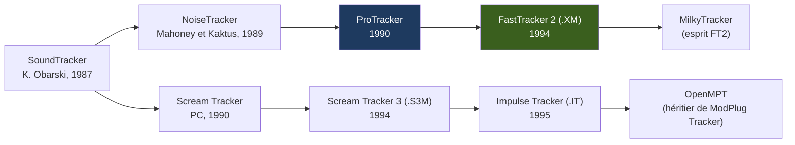

#### E.2 Outils complémentaires non traités dans le corps du rapport

| Outil | Plateforme | Fonction | Confiance |
| --- | --- | --- | --- |
| Pack-Ice, Atomik Cruncher | Atari ST | Packers très répandus dans les cracks et démos ST (auteurs à recouper) | ✅ |
| Bytekiller, Titanics Cruncher | Amiga | Crunchers courants avant/à côté de PowerPacker | ✅ |
| ReSource | Amiga | Désassembleur interactif (étiquetage, rechargement de sessions) | ✅ |
| Sourcer | PC | Désassembleur commenté (V Communications) | ✅ |
| SoftICE | PC (386+/Windows) | Débuggeur noyau (NuMega), outil phare du cracking PC des années 1990 | ✅ |
| W32Dasm, HIEW | PC | Désassembleur Windows / éditeur hexadécimal-désassembleur | ✅ |
| Norton Disk Editor | PC | Édition directe de secteurs de disquette | ✅ |
| IDA | PC | Désassembleur interactif (première version en 1991) | ✅ |

#### E.3 Formats d'image et de snapshot courants

| Format | Plateforme | Contenu |
| --- | --- | --- |
| D64, G64, T64, TAP | C64 | Disquette 1541 (secteurs / GCR brut), archive de fichiers, cassette |
| ADF, DMS | Amiga | Image disquette brute / archive compressée |
| MSA, ST, STX | Atari ST | Image disquette (MSA compressée), image brute, image physique (Pasti) |
| TAP, TZX, SNA, Z80 | ZX Spectrum | Cassette (brute / avec protections) et snapshots mémoire |
| DSK / EDSK | Amstrad CPC | Image disquette (standard / étendue, avec pistes non standard) |
| DO, PO, NIB, WOZ | Apple II | Image par ordre DOS / ProDOS, nibbles bruts, flux (Applesauce) |
| ATR, XEX | Atari 8 bits | Image disquette, exécutable |
| IMG, IMD | PC | Image brute, image avec métadonnées de format (ImageDisk) |

---

**Fin du document.** Les diagrammes Mermaid s'affichent nativement sur GitHub, GitLab, Obsidian, Typora et VS Code (extension Markdown Preview Mermaid). Sur un lecteur qui ne les rend pas, le code Mermaid reste lisible tel quel, et tous les schémas essentiels existent aussi en ASCII.
